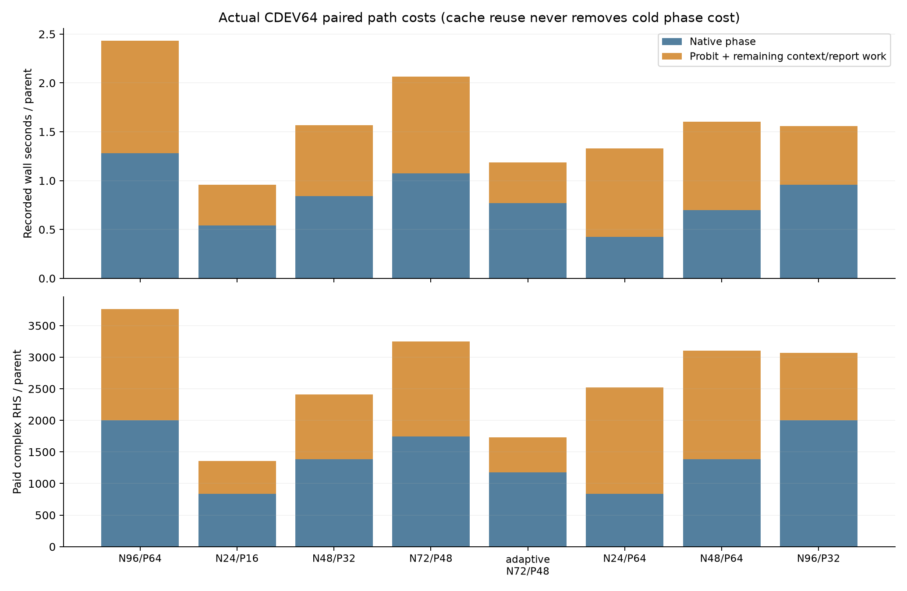
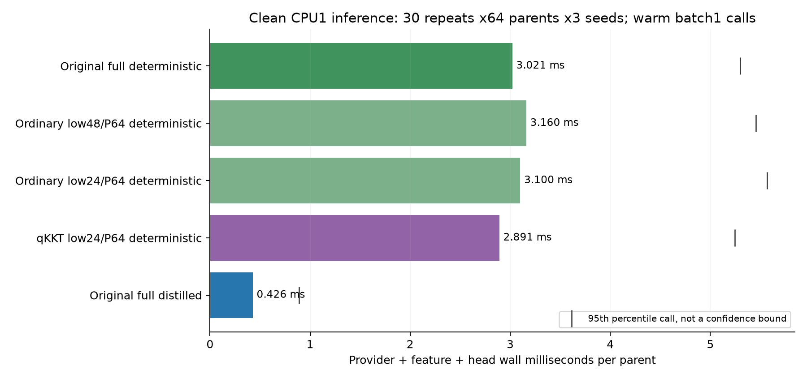

# Stage C：物理锚点与真实成本

Maxwell 锚点先回答一个具体问题：哪一幅可行材料图能够解释当前的复数观测？每次改变材料，系统都要重新建立并求解散射方程；随后求导还需要接收端线性系统。神经网络头虽然很快，仍然依赖这个物理锚点。因而几毫秒的头推理改善不能替代秒级物理路径的计量，复用历史缓存也不能把部署时的物理求解说成免费。

本文只整理已经结束的 CDEV 开发与历史 TRAIN512 配对训练。**锁定 D 当前为 `RUNNING`；本文不读取 D 真值、不报告 D 通过，也不作最终 GO/TAP 判断。**

## 原始物理问题与计费边界

基线仍是 Original Native96 + Probit64。Native 阶段从 `z64=0, u2=(0.5,0.5)` 开始，使用原始完整 TRF 目标、均匀属性盒约束、噪声白化及容差；Probit 阶段从 Native 端点作原始初始化，继续执行其原始坐标 MAP。两个阶段的 MAP 坐标与先验项不同，不能把“删除 Probit”描述成同一锚点的等价实现。

Native 和 Probit 的数字是新前向状态尝试上限，并非保证实际用满的迭代数。每个新状态支付 8 个复数前向 RHS 和一次 LU；第一次接收端 Jacobian 支付 32 RHS。实际尝试、失败和真正发生的缓存未命中全部由根线程的独立账本计费。优化器保留最佳有限端点，并不因此获得精确驻点或后验资格。Instrumentation 只记录已经获得的状态和 Jacobian，不为梯度诊断另解系统；Point 弱引用不保留历史 LU，原始有界缓存保持不变。

## C 的真实新增物理账

| 已完成工作 | 父样本 × 配置 | 新增复数 RHS | 新状态/LU | 物理操作 wall | 锚点端到端 wall 合计 |
|---|---:|---:|---:|---:|---:|
| CDEV 首轮五配置 | 64 × 5 | 800,112 | 22,798 | 327.493 s | 525.674 s |
| CDEV Revision1 三种阶段分配 | 64 × 3 | 556,256 | 15,804 | 176.742 s | 287.666 s |
| 历史 TRAIN512 的低成本 N48/P32 锚点 | 512 × 1 | 1,249,048 | 35,775 | 489.540 s | 777.008 s |
| CDEV64 独立真值观测生成 | 64 | 512 | 单独由生成 job 记录 | 不并入上面锚点 wall | 不并入上面锚点 wall |
| **Stage C 合计** | | **2,605,928** | | | |

这些是根线程真实执行的物理工作；本文所属 worker 没有执行物理求解。端到端锚点 wall 来自各 `REPORT.json` 的 `end_to_end_anchor_wall_seconds`，包含相应上下文与报告输出，不能仅用 RHS 或 LU 数替代。不同开发轮次存在当时系统负载差异，因此本表保留实际测量；最终整条路径性能仍须由根线程在锁定 D 上作独立、同日志开销的 full/low 实测。

本表是追加 direct-prior Probit 强基线执行前的已完成账。新 baseline 的 64/128 两档代码与开发协议已冻结，尚待根线程排队；其全 64 最坏预算共 496,640 RHS，**不计作已经发生的成本**。执行后必须另加实际账，不能把本表误当作未来最终 C 合计。它直接从 `x0=zeros66` 开始而没有 Native 优化，仍使用原始 Probit 目标；这是检查 warm-start 分配主张所缺少的简单强控制。

来源：[统一 C closeout](TRACK_C_CLOSEOUT.json)、[首轮结果](evaluation_CDEV/CDEV_RESULTS.json)、[Revision1 结果](evaluation_CDEV_revision1/CDEV_RESULTS.json)。

待执行强控制：[开发协议](probit_prior_baseline/DEVELOPMENT_PROTOCOL.json)、[查询前源码冻结](probit_prior_baseline/DEVELOPMENT_SOURCE_FREEZE.json)。

## 缓存复用与 Native-only 的冷成本

历史 TRAIN512 原始 Native 端点的 `q/current/field/prediction/receiver_T` 全部存在。新 Native-only 上下文由原始链式法则构造 Jacobian，并验证材料解码、Maxwell current/field、观测与接收传递矩阵算术。576 个 TRAIN/CDEV 缓存的最大相对检查误差为 `1.6905e-15`；没有读取 LU，没有新 LU 或 RHS。构造耗时 11.584 s wall、9.493 s CPU。

这只是新增数据准备成本为零物理。历史 TRAIN 的 Native 冷计算平均仍为 2,091.969 RHS/parent；CDEV Native 阶段平均为 2,000.375 RHS、1.27991 s，而完整 N96/P64 平均为 3,765.25 RHS、2.43427 s。删除 Probit 在开发成本上有吸引力，但 Native-only 是新任务锚点，必须接受独立风险检验。其匹配头后来没有通过风险门，不能凭这张成本表晋级。

来源：[Native 资产/冷成本审计](NATIVE96_ASSET_COST_AUDIT.json)、[零求解缓存构造收据](native96_only_contexts/BUILD_RECEIPT.json)。

## 配对头训练、历史成本与资源缺口

新 Full512、Native512、Low512 各训练 3 个种子，共 9 个头；每头 6,418 参数、4,000 次更新、batch64，同一 TRAIN512 父样本、种子和批抽样规则，AdamW `lr=5e-4, weight_decay=1e-3, clip=5`。214,272 参数的 compact128 provider、原始 TRAIN 特征/矩归一化均冻结，没有 provider 更新。CDEV64 只用于显式允许的 checkpoint 选择；D 与历史测试标签未用于训练。

九个 fit 的保守整段 MPS job 预约 wall 为 **499.373 s**，CPU 为 **185.994 s**，低于分配的 1,800 s；新增物理 RHS 为 0。TRAIN512 观测、full 上下文、标签分离与 teacher 导出另有 5.279 s wall、4.529 s CPU 收据。fit 计时器外 CPU provider loading/特征准备没有单独完整计量，逐 fit RSS 峰值也没有记录；因此这些数不能冒充全项目总成本。Original R5 的 N1024 训练、provider 训练和旧物理数据成本另列，不能摊为零。

来源：[九个 fit 的源码/数据/资源清单](MATCHED_9_FIT_MANIFEST.json)、[训练逐 job 账本](MATCHED_TRAINING_LEDGER.jsonl)、[TRAIN512 导出收据](matched_inputs_TRAIN512/EXPORT_RECEIPT.json)。

## 干净的头微成本测量

CPU1、固定 CDEV64、3 种子、30 次重复，每种方法 5,760 次单 parent 调用；使用 warm loaded checkpoints。各重复开始时中央物理与训练 job 均空闲。完整测量耗时 **72.942 s wall / 71.412 s CPU**，不读取真值、新物理为 0。

| provider + feature + head 链 | 平均 wall/parent | 中位 wall/parent |
|---|---:|---:|
| Original full deterministic | 3.021 ms | 2.603 ms |
| 普通 N48/P64 deterministic | 3.160 ms | 2.639 ms |
| 普通 N24/P64 deterministic | 3.100 ms | 2.656 ms |
| qKKT N24/P64 deterministic | 2.891 ms | 2.482 ms |
| Original full distilled | 0.426 ms | 0.343 ms |

这是头链的微成本，不含物理锚点、冷模型加载或训练摊销；它没有证明整条系统只需这些毫秒。qKKT 的 Jacobian 求解也没有在既有物理账中获得虚构退款。

来源：[干净 30-repeat 计时收据](clean_inference_benchmark30/BENCHMARK.json)、[逐调用原始时间](clean_inference_benchmark30/TIMINGS.csv)。

## 审计保留

第一次 Python 环境导入失败，以及 float64 观测特征进入原始 float32 distilled provider 的未封存启动失败，均在真值评分前结束，未产生物理调用，失败收据保留。第一次 phase 分区错误地使用了 GTq，原始评分与源码完整归档；修正后共同分区来自完整 N96/P64 锚点 q0，原始预测封存未变，20 个主风险/成本/门控行与每 parent 主指标数组逐值相同。

来源：[phase 修正收据](PHASE_CORRECTION_RECEIPT.json)、[首次错误结果归档](BUG_GT_PHASE_DEFINITION/FAILURE_RECEIPT.json)、[启动失败收据](evaluation_CDEV_failed_feature_dtype/FAILURE_RECEIPT.json)。
