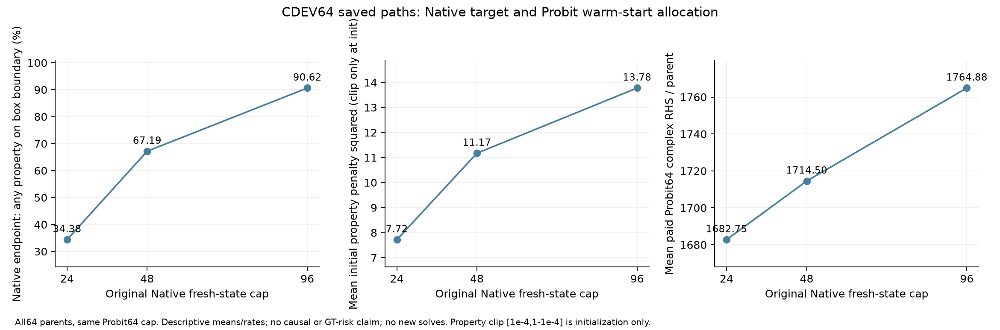
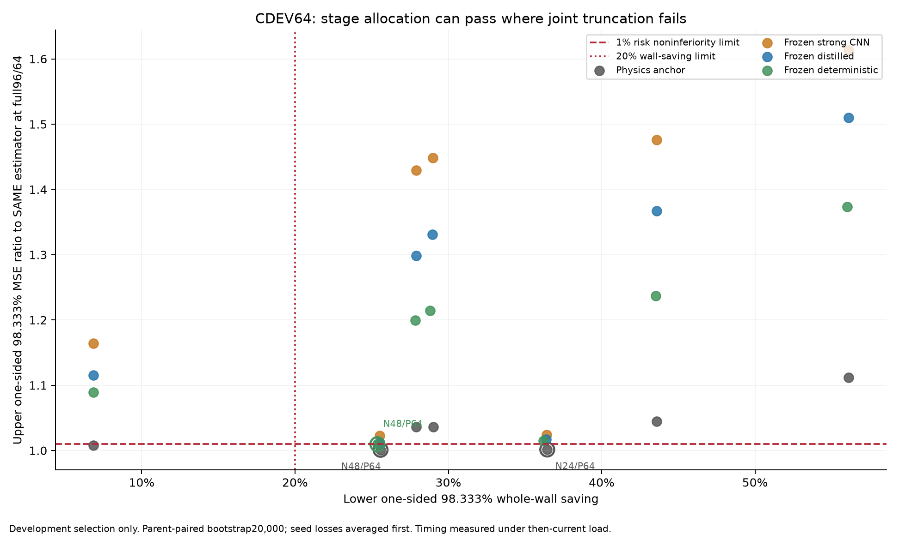
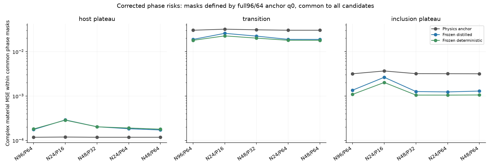

# Stage C：由材料任务风险检查何时停止

观测残差很小，只说明材料图已经能解释测量；材料内部仍可能有多个相近解释。反过来，继续降低优化目标，也不保证交给下游材料估计头的特征更有用。Stage C 因而把“少解一些 Maxwell 状态”和“保持材料任务风险”放在同一个配对检查里，而没有把优化收敛、后验精度与材料误差视为一件事。

本文是已暴露 CDEV64 的开发记录。**锁定 D 当前为 `RUNNING`，最终 GO/TAP 由根线程负责；本文没有 D 通过结论。**

## 冻结的风险门与开发边界

所有首轮五配置和 Revision1 三配置均在相同 64 个新 CDEV parent 上执行。预测只接收观测和当前锚点允许数组；各轮完整预测先 BLAKE2b 封存，再读取该轮离线材料真值。主指标是全 576-cell 复数材料 MSE：先在每个 parent 内平均 3 种子的损失，再以独立 parent 配对 bootstrap 20,000 次。种子平均损失与平均三幅图后的 ensemble 损失分开保存。

开发门保持不变：同估计器低成本/full 的 MSE 比率**单侧 98.333% 上界 ≤1.01**，且整条系统 wall 节省**单侧下界 ≥20%**。开发配置与 checkpoint 选择使用了 CDEV；这些区间不能重新解释成未见数据上的确认性证据。后来锁定 D 的全局比较族由根线程另行冻结，本文不把 C 的开发门搬成 D 的通过记录。

## 首轮：同时截短两个阶段没有通过

比较 N24/P16、N48/P32、N72/P48 与 adaptive N72/P48，原始 full N96/P64 保持不变。首轮没有一个 arm 同时通过风险与成本门。例如 N48/P32 physics 的 wall 下界节省 27.90%，但 MSE 比率上界为 1.0360；N72/P48 physics 风险上界 1.00755 通过，wall 下界仅 6.85%。冻结学习头对短锚点更敏感：N48/P32 distilled 上界 1.29832，deterministic 上界 1.19935。

Adaptive 规则只看已经接受的迭代：至少 Native24/Probit16 个状态，连续 3 次残差平方相对变化 ≤1e-3、当前材料输出相对变化 ≤5e-3 时停止，最大 72/48。它没有读取真值、未来 full 端点或为决策额外求导。这个规则明确是**残差/材料更新稳定性代理，未作风险校准**。其 physics 上界 1.04483、deterministic 上界 1.23682，均未通过；不能把它称为已成立的 risk-aware optimal stopping。

完整路径保留了 12,711 个首轮 Native、10,139 个 Probit 已评价端点，以及 18,766 个接受步输出；离线解码后的风险曲线是解释材料，不反向修改当时停止决定。

来源：[首轮结果](evaluation_CDEV/CDEV_RESULTS.json)、[端点风险曲线](evaluation_CDEV/ALL_EVALUATED_PATH_RISKS.jsonl)、[首轮规则实现](anchors.py)。

## Revision1：分别分配阶段预算

首轮失败后，先写入 [Revision1 冻结](REVISION1.json)，再执行 N24/P64、N48/P64、N96/P32。原始优化数学未改，完整基线物理与预测均复用已封存结果，没有重跑 full。

| 开发比较：相对同估计器 full | MSE 比率上界 | wall 节省下界 | 开发门 |
|---|---:|---:|---|
| N24/P64 physics | 1.001492 | 36.45% | PASS |
| N48/P64 physics | 1.001073 | 25.58% | PASS |
| N48/P64 frozen deterministic | 1.009755 | 25.37% | PASS |
| N24/P64 frozen distilled | 1.017148 | 36.39% | FAIL 风险 |
| N48/P64 frozen distilled | 1.012124 | 25.53% | FAIL 风险 |
| N96/P32 frozen distilled | 1.331260 | 28.96% | FAIL 风险 |

这些结果支持在当前开发集继续检查阶段分配，尤其保留完整 Probit64 的路径。它不证明任何阶段对所有任务普遍必要，也不是新优化理论。physics 的通过相对它自己的完整 physics 基线，不能偷换成与更强学习估计器同等的绝对误差。

来源：[Revision1 全结果](evaluation_CDEV_revision1/CDEV_RESULTS.json)。

## 保存路径揭示的目标差别与 warm-start 分配

Native 的均匀物性坐标没有高斯边界惩罚；Probit 的物性高斯坐标有该惩罚。因此把 Native 自己的目标优化得更充分，未必把起点放到后续 Probit 所偏好的区域。以下只读取已经保存的 64×3 个路径，不读取任何真值，不增加优化或物理求解。

| Native 上限，后续均 Probit64 | Native Φ 均值 | Native 场范数均值 | 任一物性靠盒边界的 parent 比例 | Probit 初始化物性惩罚平方均值 | 后续 Probit 实付 RHS 均值 | 后续新前向/接受步均值 |
|---|---:|---:|---:|---:|---:|---:|
| 24 | 249.733 | 2.443 | 34.375% | 7.719 | 1,682.750 | 48.34 / 39.86 |
| 48 | 240.980 | 2.319 | 67.188% | 11.173 | 1,714.500 | 49.50 / 40.39 |
| 96 | 240.095 | 2.223 | 90.625% | 13.775 | 1,764.875 | 50.86 / 41.53 |

边界按 `u≤1e-6` 或 `u≥1−1e-6` 定义。惩罚平方只指 Original 初始化中 `||ndtri(clip(u,1e-4,1−1e-4))||²`；这个 clip 不是修改先验或后续 MAP 目标。初始 Probit Φ 从第一次实际付费评价记录读取，不能用 clip 前的 Native Φ 代替。实际首次 Probit 总能量均值依次为 256.917、249.554、249.641；Native48 的该值与 Native96 已很接近，而额外 Native 工作没有在这批路径上减少后续 Probit 平均付费量。

N24/P64 最终图相对 full 最终图的复数材料 RMS 差，均值 `4.766e-4`、中位 `9.079e-6`、最大 `4.669e-3`；场 latent 差范数均值 0.05207、中位 0.0006653、最大 0.6168。多数路径接近，但尾部差异没有被平均值抹去。这些是候选端点之间的差，**不是与真值的误差**。它们支持“两个坐标目标与 warm-start 分配值得区分”的描述，不证明 Native 过度优化造成某种材料风险，也不改变任何一个 MAP 法则。

来源：[紧凑统计](stage_target_mismatch/SUMMARY.json)、[全 64×3 parent 数表](stage_target_mismatch/PARENT_STAGE_TARGETS.csv)。

## 匹配训练排除“只是不适配冻结头”的简单解释

使用同一历史 TRAIN512，重新训练 Full512、Low N48/P32、Native96-only 三套头，各 3 种子、4,000 更新、6,418 参数，provider 与 TRAIN 归一化冻结。CDEV64 checkpoint 选择明确披露。三者必须同时面对两类参照：同样训练 N512 的新 Full512，以及不降格的 Original R5 Full1024。

| 系统 | CDEV MSE，种子平均损失 | 相对新 Full512 上界 | 相对 Original distilled Full1024 上界 |
|---|---:|---:|---:|
| Original distilled Full1024 | 0.006666692 | 非该比较 | 1（外部参照） |
| 新 Full512 | 0.006908786 | 1 | 1.051693，FAIL |
| 新 Low512，N48/P32 | 0.006984981 | 1.036769，FAIL | 1.077751，FAIL |
| 新 Native512，Native96-only | 0.007485933 | 1.121563，FAIL | 1.164361，FAIL |

Low512 和 Native512 的成本下降没有补偿风险门失败。新 Full512 自己也没有通过 Original Full1024 的 1% 门，不能通过更换为较弱参照来制造成功。Original frozen deterministic 的 full MSE 则为 0.006353832；它与 compact-provider 新头所对照的 Original distilled 不是同一估计器。

来源：[新 Full/Low512 配对结果](evaluation_matched512_full_low/MATCHED_CDEV_RESULTS.json)、[新 Full/Native512 配对结果](evaluation_matched512_full_native/MATCHED_CDEV_RESULTS.json)、[9 个 fit 清单](MATCHED_9_FIT_MANIFEST.json)。

## qKKT：方向特征闭合的开发证据与尚未成立的机制结论

对于残差 `y−F`，原始 Native 的高斯场先验驻点条件给出白化反投影 `g=Jwᵀ white(y−F)` 的场分量应接近 `z`。qKKT 只把这个关系用作下游反投影**方向特征**的近似闭合；它没有构造假 Jacobian、修改物理 J、退款既有 RHS，或给材料风险提供证书。离开驻点时 `g=z` 不是恒等式，Probit 物性坐标也不能不加区分地套入该 Native 场关系。

已暴露 CDEV 上，N24/P64 的 q-closure deterministic 相对 Original full true-gradient deterministic，MSE 0.006363738、比率上界 **1.008195**，wall 节省下界 **36.28%**，开发联合门通过。零方向和负 q 控制未通过，短 Probit 配置的 q-closure 仍未通过风险门。

但这还没有建立“KKT 特征本身改善材料风险”。在**同一 N24/P64 锚点**上，q 与普通 actual-gradient 的 MSE 差为 `−7.476e-6`，配对 98.333% 区间为 **[−1.0471e-4, +8.9982e-5]**，跨零。普通该锚点头的 MSE 0.006371214，与 q 的 0.006363738 相近；相对 full 参考的上界从 1.015101 移到 1.008195 形成开发门差异，并不等价于同锚点配对改进已成立。

因此 qKKT24/P64 是带清楚机制限制的开发候选。根线程已经决定在 D 冻结中保留 ordinary-low 与 full-q 等控制；本文只记录这个状态，不能预先宣布独立收益。

来源：[qKKT 开发全结果](kkt_closure/RESULTS.json)、[同锚点 actual-gradient 配对比较](kkt_closure/SAME_CONFIG_COMPARISON.json)、[机制声明边界](kkt_closure/PLAIN_CLAIMS.json)。

## 分区与失败没有被抹去

图中的 host/transition/inclusion 分区全部由 Original full N96/P64 锚点 q0 定义，对所有 arm 共用。第一次错误使用 GTq 的 phase 输出和源码仍在归档；修正没有改变主风险、成本或选择。C 全部新增物理为 2,605,928 RHS；缓存与特征代理、匹配训练及干净头微计时的新 RHS 为零，其实际计算时间另外保留。

最终可否 GO/TAP、是否支持独立风险主张以及完整性能主张，均等待根线程完成目前 `RUNNING` 的锁定 D 并进行最终科学审查。

## 仍须检查的简单强基线

只把新分配与 N96/P64 相比，还不能证明 Native warm-start 的价值。根线程因此在任何新 direct-prior 查询之前，另行冻结了直接从 prior `x0=zeros66` 开始的 Original Probit64 **与 Probit128** 两档；128 档避免把纯 Probit 人为限制得比 N24+P64 总路径更短。它们是已暴露 CDEV64 上的新增开发强控制，保持 actual-gradient 与 q-closure frozen deterministic 三种子，并要求 12 个预测文件先全局封存再评分。

本文生成时这些查询尚待根线程排队，没有结果。若纯 Probit 竞争或支配所提分配，最终 TAP/新意主张必须明确受限。它不会被悄悄加入已冻结 D 比较族；任何前瞻性补充都由根线程在其自身真值解锁前决定。

来源：[额外开发协议](probit_prior_baseline/DEVELOPMENT_PROTOCOL.json)、[查询前源码冻结](probit_prior_baseline/DEVELOPMENT_SOURCE_FREEZE.json)。
