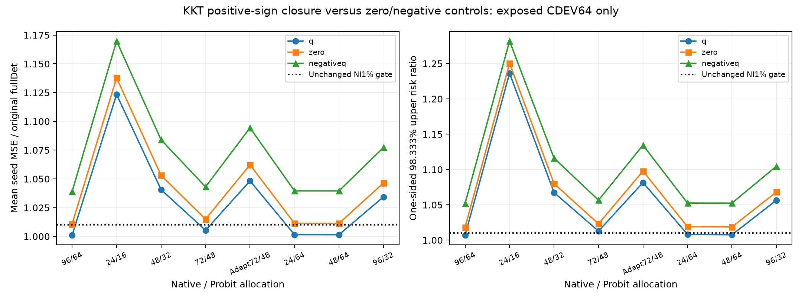
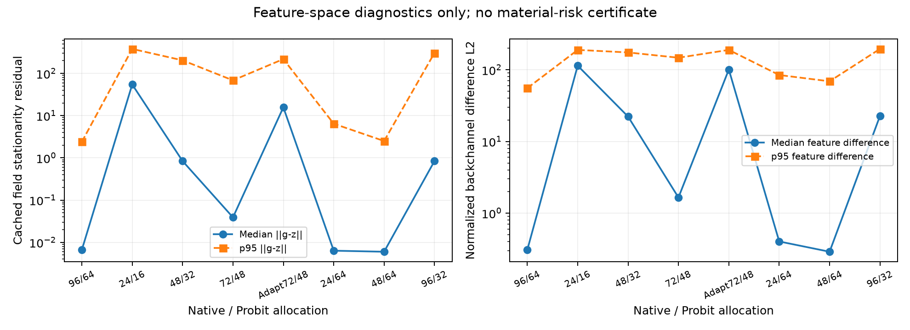

# KKT closure：冻结功能模型的零新增物理特征算法

**开发结果：正号q closure在24/64与48/64配置通过原NI1%/wall20%数值门；zero-back和negativeq均未通过。** 这是已经暴露的CDEV64上的新近似算法选择，不是独立确认；单凭跨门前后不能称为KKT专属风险改善。

只替换六通道image中的复残差反投影方向。残差约定为y−F，因此无约束场Gaussian stationarity给出Jwhiteᵀrwhite=z，正号为+q0[:64]。新方向使用g/max(||g||,1)，保留原anchor、df/δ/A/weak/strong灵敏度、u2标准化、冻结Gaussian provider和三份匹配head。推断直接构造解析image，没有制造proxy J，没有修改物理J，也没有训练。

## 已冻结API与噪声约定

`closure_action.py: Action(method="deterministic_matched", seed=2026102601, closure_mode="q", noise_ratio=r).predict(yfloat32, online, parents, batch_size=64)`。online只需要原生q0和chi0；额外J/residual/observation被忽略。class实现也支持原蒸馏provider，但本次实际sealed pilot只执行deterministic_matched。

未来噪声比r=σnew/σfeaturecfg已在预测前声明：保存的Jwhite按新σ白化，而历史feature residual仍按旧σ白化，故raw closure用r*z，再按原式归一化。σfeaturecfg=.00119211798514519。只把它称为stationarity近似；早停、非收敛或其他偏离stationarity的对象仍可能不满足g=z。

CONFIG_FROZEN.json先于任何预测保存；原5+revision3共8个context来源见SOURCE_CONTEXT_REGISTRY.json。72份预测（8配置×3模式×3seeds）全部BLAKE2b封存、重新验证后才打开本次CDEV truth。原fullDet预测直接使用原有seal，没有重算。无旧TEST/D truth访问。

## 固定门与实际结果

|配置/模式|MSE|ratio upper98.333%|wall saving lower98.333%|联合门|
|---|---:|---:|---:|---|
|native96_probit64 / q|0.006360427|1.006961|-0.0025|FAIL|
|native96_probit64 / zero|0.006422697|1.018121|-0.0011|FAIL|
|native96_probit64 / negativeq|0.006602236|1.052034|-0.0012|FAIL|
|native24_probit64 / q|0.006363738|1.008195|0.3628|PASS|
|native24_probit64 / zero|0.006425878|1.019018|0.3627|FAIL|
|native24_probit64 / negativeq|0.006605186|1.052580|0.3627|FAIL|
|native48_probit64 / q|0.006363466|1.007617|0.2542|PASS|
|native48_probit64 / zero|0.006425686|1.018692|0.2541|FAIL|
|native48_probit64 / negativeq|0.006605109|1.052447|0.2543|FAIL|

基准原始fullDet MSE=.006353832110。固定20,000次独立parent重采样，先平均3seed loss，不是ensemble图像loss；one-sided98.333% upper≤1.01、wall saving lower≥.20未调整。whole wall使用真实anchor receipt加实测单parent推断；没有因closure不使用J而虚构扣除已经付费的J费用。计时仍受当前机器负载影响，需要后续独立/重复成本确认。

## 不把跨门当成KKT风险增益

24/64的原true-gradient Det上界1.015101，新q上界1.008195；但48/64原true-gradient本已通过，且q的MSE点估计比它略差。相同配置的配对差与98.333%双侧探索区间：
- native96_probit64: q−actual = 6.59517877e-06; [-3.05912129e-05, 4.98262587e-05]。
- native24_probit64: q−actual = -7.4756932e-06; [-0.000104712772, 8.99823791e-05]。
- native48_probit64: q−actual = 6.65507839e-06; [-6.91158596e-05, 7.71099788e-05]。

以上仅用于开发诊断；在新低成本q与普通低成本actual之间取得独立配对风险差证据前，不声称KKT专属风险改善。短probit配置的q仍未通过NI，不能说closure修复所有早停误差。

## 解析公式与特征界诊断

24个稀疏CPU重构检查将真实缓存gradient代回解析image，均满足预声明allclose(rtol=2e-5,atol=2e-6)，最大normalized image差2.8610e-6。这只是当前CPU公式实现资格；它与历史CPU/MPS预测比较的3e-6门是不同检查，没有覆盖或改变历史FAIL。

512个context的||g−z||、cosine、raw/normalized back差和decoder operator norm均保存。实际raw back差不超过测得的||δdiag(df)A||·||g−z||，但这些有限点数值界只在feature空间，不是风险证书。full配置的median ||g−z||仍为.006626，说明原全预算输出也不是每个parent都精确stationary。

实际成功job CPU 30.856s、wall 32.633s，CPU1，peakRSS 0.306GB；新增RHS=0、训练=0。一次启动import路径错误在任何预测前失败，startup_import_failure.log保留，随后修复依赖路径。

SELECTED_WEIGHTS_IDENTITY.json记录原head/provider文件身份、selected update、feature噪声与未修改状态；CONTEXT_SOURCE.json可供独立QA/D scaffold加载。所有新文件仅在本kkt_closure目录。

