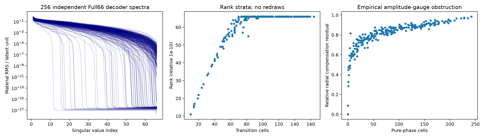
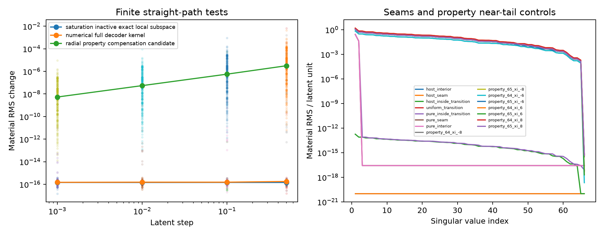

# E1：Full66材料商与参数退化

使用原P1 decoder、Gaussianized66、完整576格复材料实Hilbert度量。256个独立prior点在计算前固定，另15个确定性边界/平台控制不计独立样本。新增Maxwell RHS、LU、forward和训练均为0。

|相对截断|1e−6|1e−8|1e−10|1e−12|
|---|---:|---:|---:|---:|
|数值rank66的对象数|88|163|186|191|

191个点的transition场矩阵在machine尺度满64列秩；65个点有数值构造的饱和不活跃方向。transition格数10–164，pure格数0–242。不能从一个cutoff把这些数字升格为精确代数秩或统一商维数。

每列三档中心差分的最大相对误差1.53e−8；独立SciPy gesvd重算全部秩一致，最大奇异值差1.14e−15。rank公式在1e−10处有一个数值判定不一致，保留为conditioning警告。完整逐点结果在E1_RANK_STRATA.json，初版英文记录与原始收据保留在audit。

四个无pure、transition行数分别19/40/10/14的对象092/201/233/251，可用inverse-quintic修正场与共同属性尺度，四档参数步长.001/.01/.1/.5全部合法、材料RMS差≤2.42e−16。它们是数值同材料见证；直线沿一阶null方向通常会弯离材料等值集。另一个无pure对象136在较紧阈值满66，不能作相同推广。

数学上，严格stratum且A_T满行秩、无pure、属性在内点时，可在局部构造等材料曲线；有pure时径向属性变化不能由该pure格的一阶场导数补偿。详见[条件证明](THEORY_AND_PROOFS.md)。因此**局部gauge存在，不等于Full66普遍可以降去一个尺度；单点DGv≈0，也不等于有限exact gauge**。

