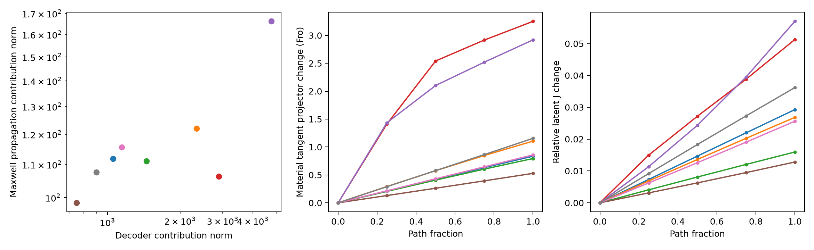

# Jacobian、材料切向与rank变化

E1的数值rank66数量随cutoff由88变为191，说明不能把冻结latent Jacobian的rank当物理解集维数。真实plateau-null、近null与seam临界必须分开。E2八个重建中心在主cutoff下材料有效rank均66，最小材料响应奇异值约.0308–.0956；选择的prior-aware单位材料方向c1 norm约8.33–16.53，显然并非exact-null。

五节点B路径上，最大latent J相对变化约5.70%，材料切向投影Fro变化可达3.252。单个弱SVD向量可能旋转/换序，因此用完整投影和主角度比较；不直接凭向量符号对齐下结论。实际数据在analysis/MATERIAL_PHYSICS.json和每个NODE文件。

固定frame的谱簇若有正gap且扰动小于gap一半，可使用条件sin-angle界。动态材料像还需控制frame运输和seam，R7没有获得廉价全区间稳定证书。有限node检查不排除node间变化，也不证明非对合控制的新可达性。

材料二阶项的切向能量比例在八个点约45.3%–65.0%，剩余为当前有效frame的法向部分；这不是数据响应归因。decoder与Maxwell二阶数据向量cosine可到−.910，实际相消须保留向量，不能按norm百分比相加。

