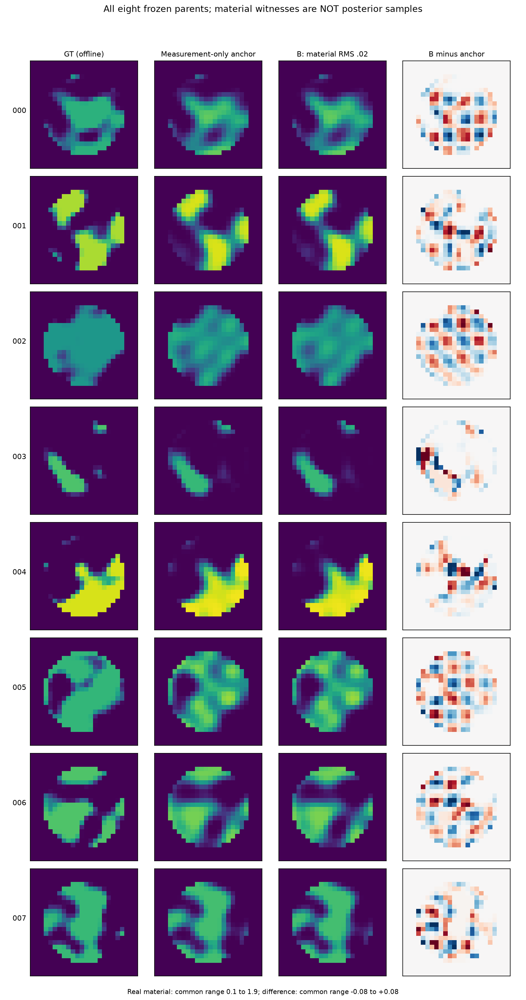
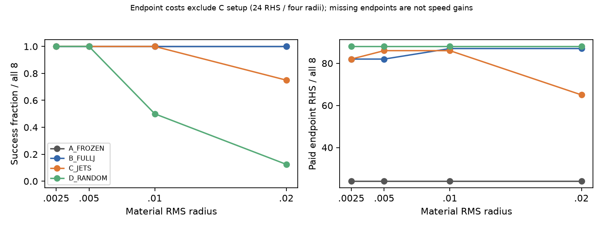
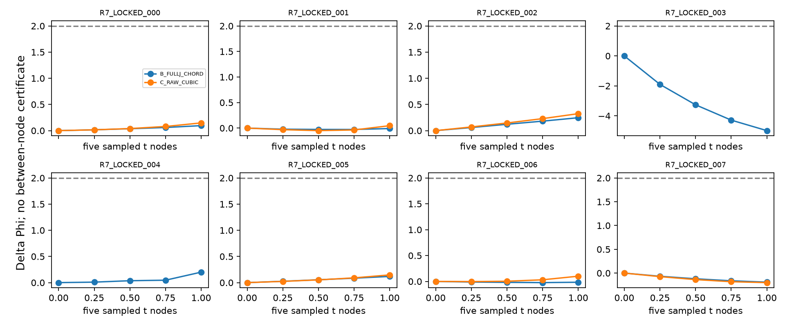

# P3L-R7：真正材料弱响应存在，高阶方法尚未胜过普通正确器

本轮完成了256个新prior点的零物理材料秩审计、四个已暴露开发上下文、八个全新测量驱动上下文，以及有限路径和独立数值审查。总新增 **37,456 complex RHS、1,325次state/LU**，50,000硬上限内封账。没有训练网络，也没有把有限候选当成posterior。

最重要的答案是：**去掉decoder参数重复后，原P1中仍能得到实际0.02材料RMS的有限噪声竞争材料；但普通冻结/动态Full-J已经做到，高阶二/三阶方法没有独立增量。** 精确材料solution fiber、Full66后验和强TAP新机制仍未建立。

## 1. 为什么必须先分清四个对象？

不同x表示同一材料，是decoder gauge；材料确实改变但一阶散射弱，是材料可观测性；不同材料在完整非线性forward下有限噪声相近，是候选几何；给这些材料分配质量并计算任务，是另一项概率问题。R6的均匀V=QD补偿只涉及第一项，不能直接证明第三项。本轮按E0→E1→E2执行，没有用第一个问题的正面结果替后面背书。

## 2. 固定物理、资产与独立性

保持原Gaussian64×Uniform2、精确probit Gaussian66、quintic平台、host、被动材料、TM24/VIE、256 ROI、8源×32复接收、sigma=.00119211798514519及source-major sqrt2/sigma白化。原R4 prior/target和A30 frozen solver只读复用。输入理论包CRC与BLAKE2b身份、47页PDF及TeX逐节核查；不把精简包当全部原始数据。

E1用固定2026102807；locked八对象用独立SeedSequence([2026102809,i,1])与noise子流2，未按秩或效果重抽。历史59项元数据、38,507个parent ID和初始化流去重审计有明确覆盖限制。DEV只复用R6 CDEV0000–0003；新数据生成与在线程序分进程，全部八对象620份预测/结果先封存，再读GT评分。代码在生成前冻结，后续未因GT改变方法。

## 3. E1：Full66不是统一尺度商，也不是处处无gauge

在相对阈值1e−6/1e−8/1e−10/1e−12下，rank66分别88/163/186/191个。191个transition场矩阵machine尺度满64列，65个存在饱和不活跃方向；这些数值不能当精确代数秩。

四个无pure且transition行可独立调整的点有弯曲同材料数值路径，四档参数步都合法，最大材料RMS残差2.42e−16。另一个无pure点并不满足这种降维。严格局部IFT解释了何种stratum允许尺度补偿；有pure格或材料Jacobian满66时不能普遍删除一个尺度。独立gesvd与三档全列差分完成，数值阈值敏感和一个rank公式不一致例保留。

## 4. E2方法：强普通对照与真实高阶向量

主方向由材料正交frame上的KᵀK+prior代价选择，材料速度归一为1；不简单取最小latent奇异向量。四臂共用decoder距离匹配、signed progress、原Gaussian prior目标及真实Full-Maxwell评价。

- A：冻结J的合法有限步正确器。
- B：动态Full-J、有效材料坐标GN和原decoder回缩，是主要普通强基线。
- C：同一首速度、共同top8实strong坐标中的二/三阶current递推，加同一动态正确器。
- D：native随机位移投影、材料速度归一与有限材料RMS匹配的物理提案，加同一正确器。

每档最多三个新trial，明确叫budgeted corrector；另两例DEV给最多20态普通参考。每次新state8 RHS、首次receiver-J32 RHS、每阶八源jet8 RHS，所有拒绝和恢复均付费。首次实际探针200 RHS，伴随误差1.95e−15，chain/递推误差约1e−13，小有限材料响应预测误差2.2e−9/1.4e−8。完整decoder与Maxwell二阶向量均保存。

C固定首速度而只补偿高阶系数；其c1并不为零，也不自动满足严格response-aligned profile。这是本实现的明确范围，不能以它的NO-GO否定所有高阶方法。quintic只有C²，跨seam以后依靠实际有限验证，不能调用全局C³定理。

## 5. 八个新对象：真实不同材料成立，高阶优势不成立

|0.02 RMS路线|竞争成功/8|pair≤1且成功/8|
|---|---:|---:|
|A Frozen|8|6|
|B Full-J|8|7|
|C Jets|6|6|
|D Matched Random|1|0|

竞争门同时要求距离±2%、进度≥一半、合法、原noise-ball与DeltaPhi≤2。它不是credible region。B的003端点虽然更能拟合含噪数据，pair距离1.1206，不能叫两个均值的≤1近等价。C的003/004在局部latent半径4内不能完成.02，照记失败，不用较小距离填数。

在两方法都有端点的六对象上，C−B Phi均值−.01154，描述95%配对区间[−.06022,.02133]；C还要24 RHS setup，四档摊销每档另6 RHS。缺少端点导致费用较少不是加速。8 parent只支持机制小样本，不是总体算法冠军。

## 6. 有限路径与物理阶数

B八条弦在五个固定t节点均竞争，C六条可用原始cubic路径也通过。它们只取得sampled-path资格，不证明所有节点之间相容，不证明连续exact fiber。C端点预测相对误差约.86%–4.73%，仍跨1–6个decoder接缝。

八个中心的材料有效rank都是66，最小材料响应奇异值约.0308–.0956；所选方向c1 norm约8.33–16.53。材料首速度为1，响应一阶非零，因此没有把decoder三次平坦冒称为Maxwell三阶null。条件渐近仅由明确toy验证，不写成Full66物理率。

## 7. 多照明：五个有限揭示见证，主要已是一阶效应

原八源分为A0–3、B4–7；没有新layout。A专属弱方向的B/A线性敏感度比约1.78–2.83。在A-only正确器得到的.02材料中，5/8对A的pair≤1、对B>1，说明单组弱材料变化可被另一组揭示。

共同strong基下的补偿冲突分解数值正确，最大相对defect约1e−15；但一阶已有约7.24%–16.21%冲突，二阶仅约.46%–3.35%。因此未证明高阶冲突优于普通一阶谱/Fisher。联合也增加了数据量，不能作为等预算最优采集定理。

## 8. 材料任务：图像变化不代表每个任务同样不确定

固定任务包括ROI复均值、right-half材料二阶函数及真实材料阈值事件。B的.02材料变化中，平均实/虚材料变化最大约.000632/.000211，区域二阶任务最大.005014，阈值占比最多变3/256，八个硬事件都不变。它们只是这些有限弱弧上的经验可辨识性；没有覆盖所有相容材料，更没有算posterior质量。

局部task dual、Gaussian两点KL/TV下界及其条件保存于analysis。不能把它们称作已获得Bayesian risk或credible interval。GT评分只作封存后几何诊断，默认成像动作仍是基础点，没有GT选候选或用Best-of-K冒充在线重建。

## 9. R6 copula现象能推广到哪里？

四个非均匀Full66同材料构造中，分别交叉四个场与四个属性，全部64个点合法；独立组合制造材料均值偏差/方差，EαE1/α公式误差<3.5e−17。额外128 RHS核验显示同材料端点响应差约1e−14，交叉端点可达约1.035白化L2。

这是原decoder的真实非均匀映射反例，却是受控等权离散纤维，不是原prior条件抽样或Full66 posterior。它说明在有gauge的stratum必须保留依赖；不说明所有66维点都能用S3商降维。

## 10. 科学与工程资格

共37,456 RHS，10,600 forward、26,856 derivative，1,325 state/LU；19个物理job，物理动作失败0。物理job总wall72.21秒、动作wall14.77秒、CPU67.47秒，进程峰值约190 MB。E1另7.18秒、490 MB；编辑、检索及交付时间不伪称被这个物理账本完整profile。没有GPU/网络训练。

三个前置代码问题和一次随机控制问题都在新locked生成前修复；DEV原结果与付费重放保留。新对象003/007触及anchor状态cap的记录不删除；科学负结果与数值失败分开。实际成本不能与R6不同优化配置的1.73秒直接换成加速比。

## 11. 七个最终问题

1. **Full66 gauge？** 在饱和/特定无pure低transition stratum有局部自由度；不存在普遍一维rescaling，数值近零不等于exact。
2. **真正材料弱响应？** 有。.02 RMS的B八例竞争，其中七例另满足pair≤1，非同材料重复。
3. **高阶比Full-J好？** 当前实现没有，GO_HIGHER_ORDER=NO_GO；不扩大其神经Explorer。
4. **另一组照明能恢复？** 五个有限见证；主要由一阶效应解释，不是新layout泛化。
5. **什么任务更稳定？** 这些弧上的均值/区域函数较稳定，阈值有限变化；仅局部/经验，未认证概率任务。
6. **R6能推广什么？** 非均匀特定gauge上的依赖破坏反例成立；通用尺度商、原prior条件权重和Full66 posterior未建立。
7. **强TAP证据够吗？** 尚不足。标准高阶散射、LIS、coarea和LS已有先例；本轮复杂C未胜普通方法，采集收益也未超过一阶解释。

## 12. 下一轮的最小可证伪问题

先控制一阶材料谱和同等测量费用，找补偿冲突不同而普通Full-J仍无法解释的有限材料区间，再讨论高阶采集指标；若找不到，停止独立高阶算法主张。另一条数学路线是求非均匀局部gauge上的**真实原prior条件核**及其材料任务积分，而不是继续等权候选加softmax。未来若使用更少通道创造exact kernel，必须作为新观测合同，不冒称本轮原采集合格。

本轮最终为：有限噪声材料歧义限定GO；exact physical fiber未建立；Full66 posterior未合格；高阶算法NO-GO；强TAP贡献REDIRECT。完整代码、向量、失败、统计及长期背景均可复核。
