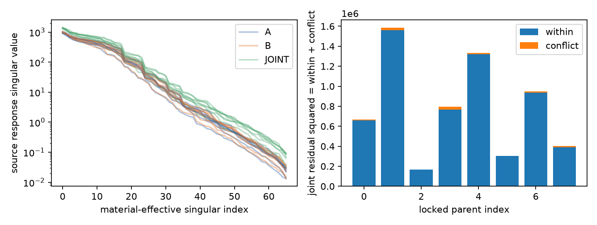
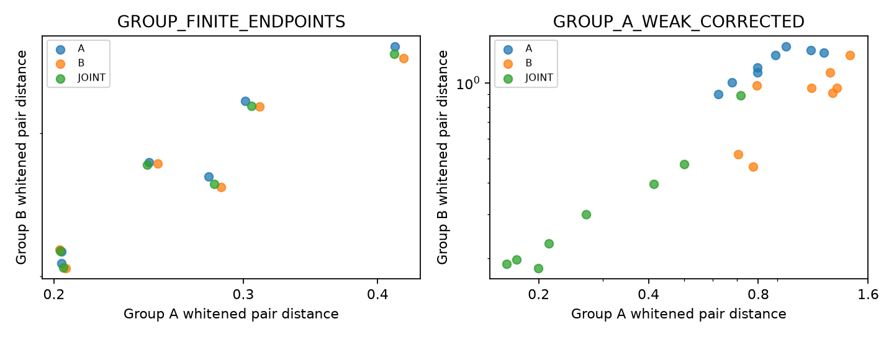

# 材料任务与照明条件可辨识性

任务在计算前固定：T1=ROI平均复材料，T2=right-half ROI的mean|chi−host|²，T3=ROI Re(chi)≥.75的格占比及其≥.25事件。T2是材料二阶函数，不是用GT定义的在线risk；T3依赖真实材料而非latent phase标签。

在B的八个.02 RMS端点上，平均实材料变化绝对值最大约.000632，平均虚材料最大约.000211；区域二阶任务变化最大.005014，阈值占比变化最大3/256。八个硬事件均未改变。它们说明这些具体弱材料弧对低阶任务影响小；不证明所有相容材料的任务都唯一，也不等于posterior方差或credible interval。

局部线性任务反演敏感性通过L K_g⁺计算，并分别保存A/B/联合三组。只有所声明的有效材料frame、rank和局部线性条件下可解释；不是Bayesian covariance。标准两点Gaussian KL/TV任务界也保留，明确用于固定候选对的未来两点子实验。

## 第二照明组是否揭示第一组的弱变化？

使用原8源中固定互斥A={0,1,2,3}、B={4,5,6,7}。A专属弱方向的线性B/A响应norm比为1.78–2.83。A-only预算正确器的.02端点，5/8满足pair_A≤1但pair_B>1，给出有限材料见证。所有源仍共享同一材料，保存的是完整八源预测。

但是这些增量主要已经出现在一阶谱：共同strong基的一阶补偿冲突占联合剩余能量约7.24%–16.21%，二阶约.46%–3.35%。二阶冲突恒等式误差约1e−15，不证明高阶指标有额外采集选择价值。没有得到“线性指标相当而高阶冲突独立预测更好”的确认。

加入B也增加数据量；本轮没有新旋转layout、没有等测量数的最优采集设计、没有新增观测降低Bayes风险的posterior计算。kernel交集关系是标准线性代数。

机器结果：analysis/SOURCE_RECOVERY_AND_EARLIEST_CONFLICT.json、analysis/MATERIAL_PHYSICS.json及audit/results/SOURCE_GROUP_ENDPOINTS.csv。任务资格为LOCAL_OR_EMPIRICAL_ONLY。
