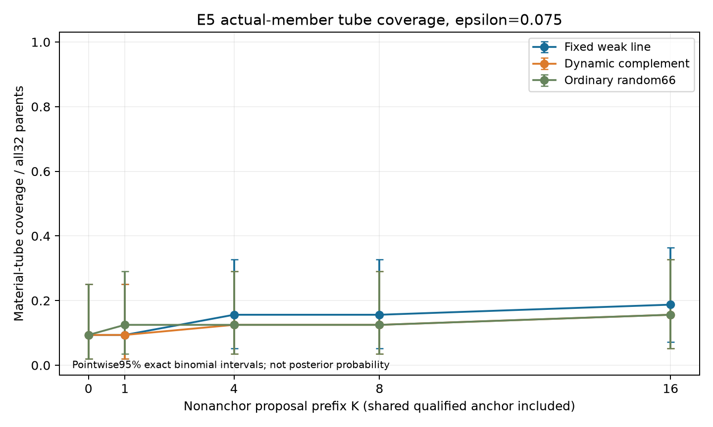
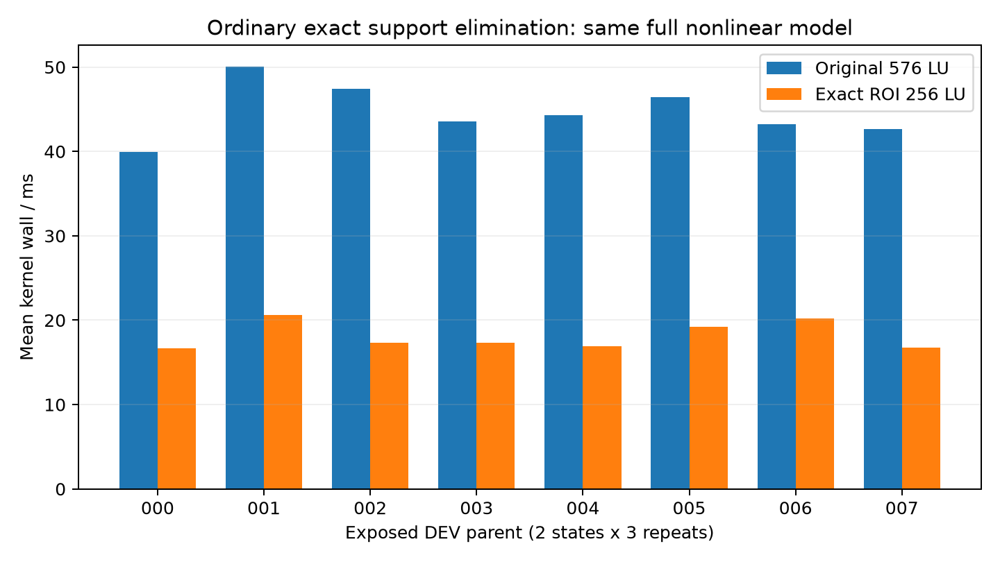
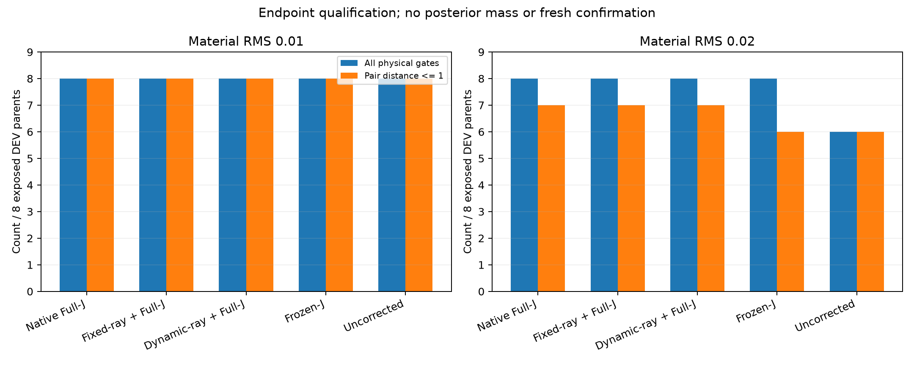
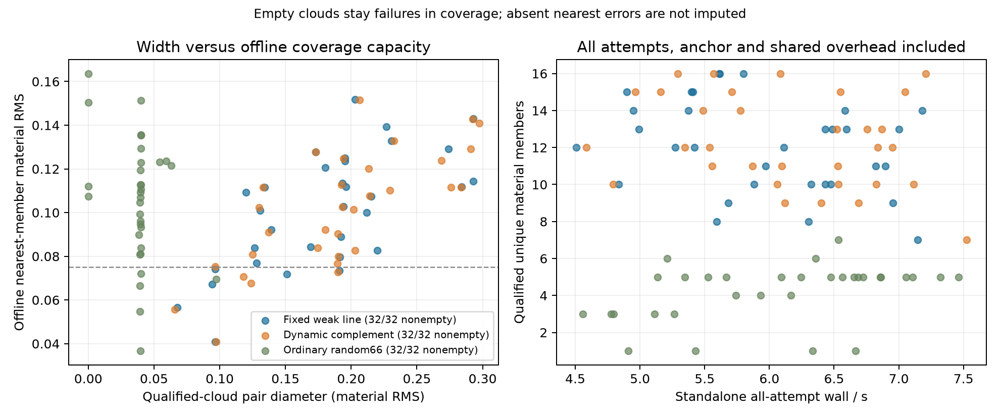
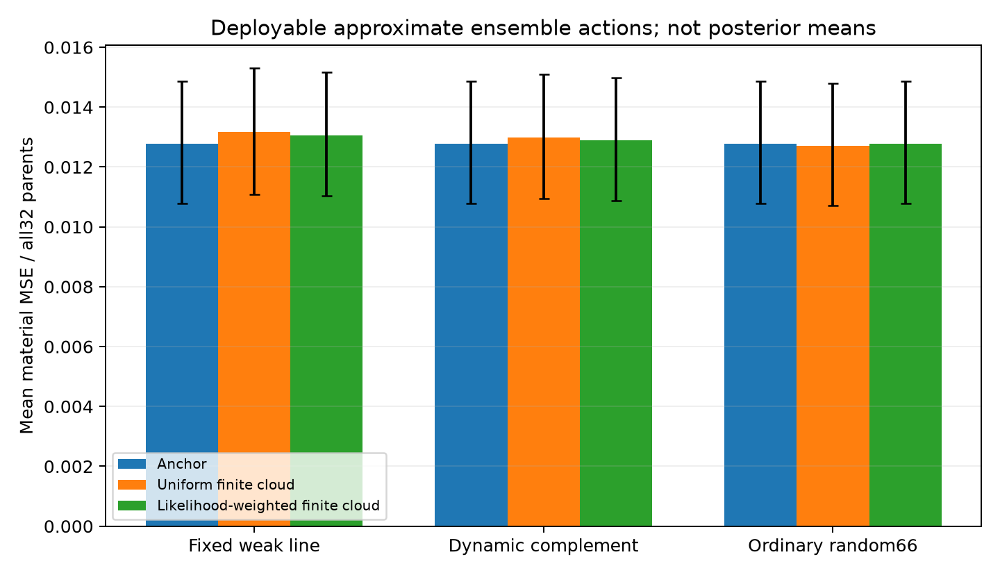
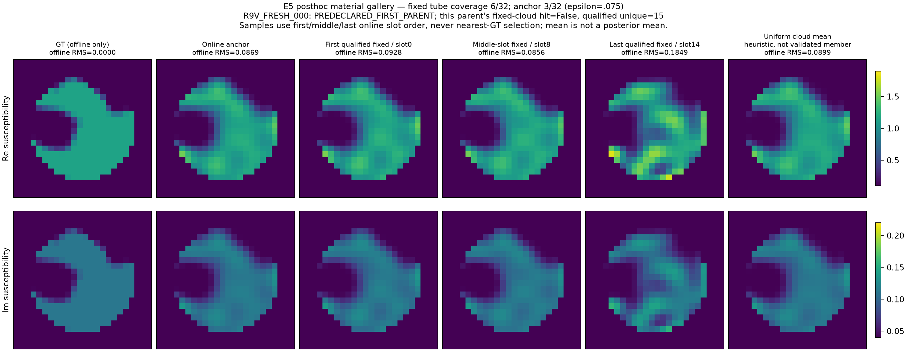
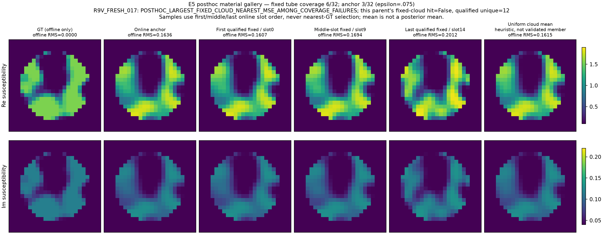

# P3L-R9-S：从稳定物理算子到材料可能性体积

本轮完成了公式推导、开发对照、困难低维概率积分，以及**32个全新材料对象的候选云实验**。核心目标重新落到：从同一观测生成许多真实、合法、数据相容的材料，检验它们能否以合理的范围与费用覆盖GT。准确posterior属于独立增强目标，没有被用来阻止这项成像研究。

结果是有范围的正面与明确的负面并存。固定弱空间加普通完整Maxwell校正，能生成明显多于随机方向的材料候选；固定宿主的精确ROI消元显著降低物理核费用。但是，**“能产生很多相容材料”尚未转化为精细尺度下的高GT覆盖或更好的单幅成像**。动态更新weak frame没有解决这个问题，固定方法也未获得20%的整链费用优势。

[持续维护的公式总集](../maxwell_formula_atlas/index.html) · [原始结果JSON](RESULTS_SUMMARY.json) · [32对象主比较CSV](POSSIBILITY_VOLUME_COMPARISON.csv) · [完整证据与复现](EVIDENCE_PACKAGE.md) · [下一轮研究交接](GPT_PRO_HANDOFF/START_HERE.md)

## 1. 先回答用户最关心的问题

在原P1模型的32个新parent中，每种方法预留16个非anchor方向候选预算，另共享一个物理anchor。候选必须属于原decoder支持、达到冻结材料半径与前进门，并满足原噪声的95%绝对数据门。全部方法的预测先封存，随后才读取GT。

| 方法 | 合格不同材料/512方向预算 | 平均云直径 | GT覆盖 RMS≤0.075 | 离线最近候选MSE | 不看GT的均匀均值MSE | 整链平均秒/parent |
|---|---:|---:|---:|---:|---:|---:|
| 共同物理anchor | 单点/parent | 0 | 3/32 | 0.01277981 | 0.01277981 | 见原始成本分项 |
| 固定Q8 + 动态Full-J校正 | 354/512 | 0.18150 | 6/32 | 0.01099138 | 0.01316807 | 5.96763 |
| 动态Q8 + 动态Full-J校正 | 362/512 | 0.19075 | 5/32 | 0.01084891 | 0.01298733 | 6.13639 |
| 随机66方向 + 普通全切向校正 | 103/512 | 0.03834 | 5/32 | 0.01187843 | 0.01271029 | 6.04904 |

“离线最近”使用GT，仅衡量候选集合容量，不能部署。整链费用含共同anchor、frame/setup分摊、全部失败尝试与证据保存；不是只比较成功对象。随机控制的corrector自由度更多，三臂比较是整体策略比较，不能宣称只改变提案方向的一因素因果实验。

固定方案的离线最近候选MSE比anchor降低约14.0%，但均匀均值反而增加约3.0%；按likelihood启发式加权的MSE为0.01305884，也未胜过anchor。**这说明候选集合确有额外材料容量，但缺少正确的方向覆盖与可部署决策。** 失败原因不能简化为“posterior没认证”。本轮根本没有把精确posterior作为主门。

在更宽的预定容差RMS≤0.15下，固定与动态均为31/32、anchor为29/32；这项宽尺度结果保留，但不能拿它替换主容差0.075，更不能把容差宽度藏起来。

## 2. 论文主线与已有工作的关系

概率体积成像可以首先是一个**材料集合行动**：观测给出有限候选及其邻域，输出的意义由GT覆盖、集合范围、任务表现和费用共同界定。候选权重可以近似，只要明确它们是排序或决策权重。后续需要事件概率或Bayesian credible interval时，再增加严格概率层。

这个目标有成熟前身。SOM/TSOM已有固定电流子空间，LIS已有可辨识子空间，RTO、RML/rMAP已有随机优化产生多个非线性反演候选。因此“固定SVD”“多样本”“resolvent恒等式”都不是本轮原创性结论。完整梳理见[论文核心与原创性](PAPER_CORE_AND_ORIGINALITY.md)和[先例与主张账本](PRIOR_ART_AND_CLAIMS.md)。

更值得争取的独立主张是：**固定且可复用的精确Maxwell计算载体，结合材料有效的集合行动与任务导向覆盖，能在同等物理信息下更便宜地给出有用的不确定成像。** 本轮已实现精确计算载体—合法候选—覆盖与任务评估链；任务导向生成尚未实现，关键的精细GT覆盖与强普通候选算法优势也尚未成立；不能提前写成强TAP突破。

## 3. 公式先行带来了什么实际变化

[公式总集](../maxwell_formula_atlas/FORMULA_ATLAS.html)按稳定编号组织九章，包含物理空间、Born双边结构、远场幅相条件、SOM/TSOM投影、材料几何、概率条件体积、任务误差、精确消元和候选覆盖。每项给出条件、推导、固定/变化量、计算含义与来源。源码函数对应保存在[SOURCE_FORMULA_INDEX.csv](formula_collection/SOURCE_FORMULA_INDEX.csv)。

首先，Born的双边形式

$$F_B(m)=G_{receiver}\operatorname{diag}(m)G_{source}A_s$$

确实把两侧传播固定下来。但完整Maxwell多次散射还含材料相关resolvent。固定Green不意味着局部材料Jacobian固定。二维TM的远场振幅为$R^{-1/2}$，三维标量Green才是$R^{-1}$；振幅可近似常量的$a/R$条件与相位可线性化的$ka^2/R$条件分开。本轮保留原近场物理，不以远场近似替换它。

其次，投影式twofold可写为$Z=P_wV_D$，其像一般不等于两个空间的交集。若列不正交，真实投影是$Z(Z^*Z)^\dagger Z^*$，不能简单把两次投影相乘当正交投影。receiver-dark current还必须满足所有source共享的材料构成关系。

第三，原固定host与256格ROI允许**精确消元**。设$D$是ROI相对host的对角材料增量：

$$h=(I-DC)^{-1}DE_R,\qquad F=F_h+Oh.$$

$C,E_R,O,F_h$一次设置，之后每个非均匀材料只解256阶系统。它保留全部原ROI、原Full66支持和完整多次散射，不是Born，也不是把256格材料改成rank-one。所有新候选臂共用这个强后端。

在八个开发对象、两个状态、三次旋转重复的同forward+Full-J核比较中，原576系统总计2.145907秒；ROI在线0.870254秒，加setup0.016972秒，**核层setup-inclusive节时58.65%**。这是标准块消元的实际收益，不是新算子恒等式，也不等于完整反演系统节时58.65%。本轮没有同时重跑32个对象的direct576整系统，不能补造该比较。

最后，公式直接定位了旧E2的约束障碍：固定weak系数再固定材料半径，可能使strong correction没有可行余量。修订版保留固定weak方向、允许系数幅度改变并做decoder径向retraction。这个修正先由代数判定，不再靠一轮轮机器精度小测试猜测。

## 4. 开发阶段：固定空间能做什么

八个R7对象已经暴露，本轮仅用作开发。R7历史门保留：材料半径0.01/0.02、DeltaPhi≤2、原noise-ball与prior规则。普通Full-J基线在16个parent-radius对上复现历史端点Phi。Frozen-J、固定方向+动态Full-J、动态方向+动态Full-J明确分开。

初始E2的过约束版本在RMS0.02处固定/动态均为7/8合格，14/16个B/C端点完全相同；该失败保留。E3_REV1解除幅度约束后，两个半径的B/C均8/8合格，pair distance≤1分别8/8和7/8。固定/动态端点16/16不同，但固定法在0.01慢12.97%、在0.02快7.39%，没有稳定20%优势。

轨迹的最大弱空间角度从约5.8度到52.8度不等；即使角度大，普通corrector仍可能成功。选择的SOM current扰动全部未通过共享材料lift（相对残差约0.52—0.75），不是合法候选，不计为成功，也不据此否定所有SOM。Fourier/Wavelet映回原支持的投影损失约0.22—0.70，说明表达选择有实际代价。

## 5. 32个新对象：实际算法与独立性

正式E5协议在新数据生成前冻结，科学源码提交为`75184170`。新parent为R9V_FRESH_000—031，SeedSequence命名空间[20261030,900901]，prior/noise/weak/random按角色分开。原P1 Gaussianized66、sigma=0.00119211798514519、8×32 source-major复观测不变。

每parent先从零latent得到R7同配置direct Probit64 anchor。注意：这不是R5-B的Native96+Probit64，不能把历史两者费用当同配置。每臂四个材料半径0.02/0.05/0.10/0.15，各两组正负配对，共16个方向预算。最多6次forward与4次Full-J；decoder半径搜索不调用Maxwell。

固定与动态方法均用材料有效广义谱中8个低data+prior方向。其corrector保持strong complement加一条weak **line**，幅度和符号可变，再施加signed progress切向条件。代码中的`*_RAY`只是冻结ID，不应误读为始终保正射线。动态方法在当前状态刷新frame，固定方法保留初始frame。随机控制使用普通全66切向corrector。

主数据门是$\Phi\le\chi^2_{512}(0.95)/2=282.8737921622988$，另保留旧相对竞争指标。此门固定原噪声、没有增大噪声；更改的是新的科学输出合同，不回写旧门。原真实GT可由于噪声随机性不通过此95%门：本批为28/32通过。它不是候选云包含GT的95%保证。

2026-10-29 16:27:08 UTC左右全部预测封存；随后验证32parent/96组完整，才由独立批准记录启动评分。预测、visited states、每次J和费用均保留。所有方法消费同一观测和同一anchor，GT没有参与提案、停止、排序、权重或模型选择。

## 6. 覆盖、任务与统计资格

主集合为合格实际材料周围RMS半径epsilon的并集。它不是逐像素min/max盒子的笛卡尔积，也不是576维Lebesgue体积估计。去重门RMS>1e-6，anchor也须通过数据门。全部32parent保留，没有空云；失败方向仍计入预算。

主family为四个比较，20,000次共同parent重采样，98.75%区间：

| 固定减动态/随机 | 点差 | 调整区间 | 解释 |
|---|---:|---:|---|
| epsilon=.075覆盖：固定−动态 | +0.03125 | [0, 0.125] | 区间触零，不证明严格优势 |
| epsilon=.075覆盖：固定−随机 | +0.03125 | [−0.09375, 0.1875] | 不确定 |
| 离线最近MSE：固定−动态 | +0.00014247 | [−0.00004402, 0.00049402] | 动态点估计较好，差异未确立 |
| 整链wall秒：固定−动态 | −0.16876 | [−0.25440, −0.09281] | 当前窗口固定较快，约2.75%，未到20% |

32parent percentile bootstrap只是小样本近似；离散覆盖单个不一致parent会产生触零区间，不能据此包装为强显著性。固定法主覆盖6/32的Clopper–Pearson95%区间约[7.21%,36.44%]，单侧下界8.50%，明确不支持90%高覆盖门。

材料任务可以比整幅材料更容易，但仍要看任务本身是否有辨别力。冻结ROI平均实材料范围覆盖固定/动态22/32、随机25/32；硬事件“实材料≥.75的ROI格数≥64”固定/动态31/32、随机32/32。二值事件容易被某个候选表示，不等于精细图像恢复，也不是事件posterior准确。软占据任务的范围覆盖固定/动态11/32、随机3/32。完整任务定义、宽度与结果见原始JSON，不挑最好一个任务作为主结论。

## 7. 为什么更大的合法材料云仍然漏掉GT

封存后的解释性分析不修改主算法和统计门，单独标为posthoc。它指出了具体瓶颈：

- 初始8维weak材料切向平均解释约47.9%的GT−anchor材料误差；完整66维材料切向约85.0%。这不是可部署GT选择，只揭示初始weak空间并不覆盖全部材料误差。
- 实际固定候选增量的仿射张成空间平均解释约41.4%，动态44.4%，随机21.8%。固定云有19/32对象即使允许不合法的GT最优仿射组合，误差仍超过主epsilon；另外7个对象的仿射误差可以低于epsilon，有限候选本身却未命中。方向遗漏与有限点放置都存在。
- 固定云新增的三个主epsilon命中都来自0.05半径；0.10/0.15没有增加该主覆盖。保留所有visited噪声合格状态后，固定云约46个不同状态/parent，仍为6/32。简单增加同一路径存点不是当前主要解法。
- 26个固定云未命中parent中，4个GT不在预定噪声集合，22个GT在集合中却未被候选邻域覆盖。主要缺口是算法漏覆盖，不能推给noise门。
- 原GT latent到anchor距离全部超过4，但同材料可能存在其他preimage；不能据此证明材料GT一定被latent cap排除。

独立审查还发现：若把旧DeltaPhi≤2作为GT材料资格门，本批32个GT材料都会被排除；DeltaPrior≤10也排除全部32个原始生成latent，但不证明其他同材料原像均被排除（中位DeltaPhi约13.73、DeltaPrior约31.42）。这不否定历史有限竞争实验，但说明它们本来就不适合直接承诺GT覆盖；新绝对噪声门是目标定义修正，而不是放大噪声救结果。

这些投影只是几何容量上界：仿射组合可能不合法、数据不相容，并且使用GT。不能把其低误差当成新成像算法。数据与公式见[后验封存几何诊断](results/possibility_volume/posthoc_geometry/SUMMARY.json)、[独立理论裁决](POST_E5_THEORY_DECISION.md)。

## 8. 独立概率支线：正确积分仍有价值，但不主导本轮

原R6 REGULAR、PURE_OVERLAP低维均匀复材料合同使用正确的联合prior、host/pure质量与Q⁻²条件体积。精确共享传递与ordinary adaptive/GH积分获得合格数值任务参考；独立路径材料均值差约5.88e-7/2.12e-7，事件差≤2.55e-5。移除正确prior会让REGULAR均值偏移约0.112个posterior SD；PURE source-layer条件质量约0.56890/0.43110。

同节点、同积分法下，精确物理复用组件约快3.1—5.7倍。但R8-P任务中心化包络在冻结32²网格下材料均值半宽仍约0.00808/0.01149，未通过1e-5门；原P1一维条件任务的普通adaptive quad约0.4秒，512-cell包络约1.57秒，后者没有费用优势。

因此保留`NUMERICAL_TASK_PASS`，严格全支持外包证书未建立；Full66 posterior仍`UNQUALIFIED`。这没有阻止材料候选云实验，也不否定正确先验积分在需要可靠事件概率时的独立用途。详见[E4完整报告](E4_PROBABILITY_REPORT_ZH.md)。

## 9. 费用、失败与未执行部分

- 旧开发探索及幅度修订：16,968个576维RHS。
- 条件概率支线：3,624个576维RHS、1,452,408个256维RHS。
- exact ROI匹配核：2,184个576维RHS、1,920个256维RHS。
- 新32parent候选云：293,088个256维RHS，8,380个256维LU，全部job关闭；新增576维RHS为0，因为使用已支付的精确setup。
- 本轮合计22,776个576维RHS与1,747,416个256维RHS，分别列账，不把不同阶系统换算为同一个“RHS节省率”。
- 新候选云受控job wall449.96秒、CPU396.34秒；其中物理核177.18秒、证据写盘154.73秒。保存27,062份完整精度数组。全科学受控job wall约571.12秒；文献阅读、推导、网页、评分与压缩不冒称为物理执行时间。

完整原始账本见Release。独立隔离目录已从归档布局恢复依赖与合成GT，验证32parent/96组封存并重新评分一次，47013个数值与原结果一致；原文件未修改、新增物理为0。初始重复role日志bug与一次venv入口错误在生成前失败、0RHS，记录保留；随后没有solver action异常。候选不合格与bracket失败不是solver错误，分别报告。历史E2过约束、E4事件underflow及修复也保留。

未执行：新noise/acquisition泛化、Research W变化Green迁移、新训练NN、RTO/RML物理主对照、严格Full66 posterior、连续exact material fiber认证。没有因本轮32对象结果而追加半径或再选checkpoint。

## 10. 最终问题与下一步

**Q1 三个空间差别多大？** receiver/current空间固定；材料坐标可固定；局部J随内部场和decoder变化。实际角度变化5.8—52.8度不等，current lift还受共享材料约束。不能合并为一个“弱空间”。

**Q2 固定空间是否足够完成R7有限探索？** 开发半径0.01/0.02上，允许幅度变化后的普通Full-J已足够取得8/8合格；这只支持限定范围。

**Q3 动态更新有没有独立收益？** 新32对象动态合格候选略多、离线最近MSE略低，主差异不确定；多付约2.75%平均整链wall。没有显示它不可替代，也不能证明固定普遍等价。

**Q4 最简单修复是什么？** 首先解除错误固定系数约束。扩大动态几何之前，下一项关键工作应针对遗漏的材料任务方向与候选点放置，而非增加同一路径密度。扩大固定空间/少量chart是候选，不是本轮已验证收益。

**Q5 R8-P通过困难概率门了吗？** 精确物理复用与正确prior数值积分通过限定任务门；严格区间包络的均值门及成本门没有通过。

**Q6 稳定坐标能否降低正确积分成本？** 共享物理计算确有组件收益；任务包络未胜强普通求积。不能把两者收益混在一起。

**Q7 真正新增什么？** 本轮给出共享精确物理载体上的完整合法候选云实现、独立GT覆盖/范围/成本证据、过约束反例和覆盖缺口分解。尚未证明超越成熟随机优化/ensemble方法的独立算法优势。

**Q8 是否足够论文级确认？** 可作为方法审查和负结果证据；精细高覆盖和20%固定空间优势不成立，不扩大当前weak8路线做更大同质实验。

**Q9 可迁移到W吗？** 固定背景消元只在背景/采集固定时复用。W的Green随墙假设变化，需另有稳定性/任务误差合同；本轮W迁移NOT_RUN。

**Q10 下一轮做什么？** 保留公式集和exact ROI后端，继续以“材料集合行动”为主线。先从任务误差覆盖与有限K量化推导一个最小新机制，再用历史TRAIN学习或设计方向分配，与RTO/RML等强普通方法做一个真正有辨别力的实验。不再把概率认证当入口，也不把普通weak8重复加大当创新。

本轮尚不能声称已实现“大概率包含GT的精细材料体积”。但已经知道下一步需要解决的不是笼统的流形不稳定，而是**合法相容集合中，材料任务相关方向的覆盖与有限候选预算的分配**。
