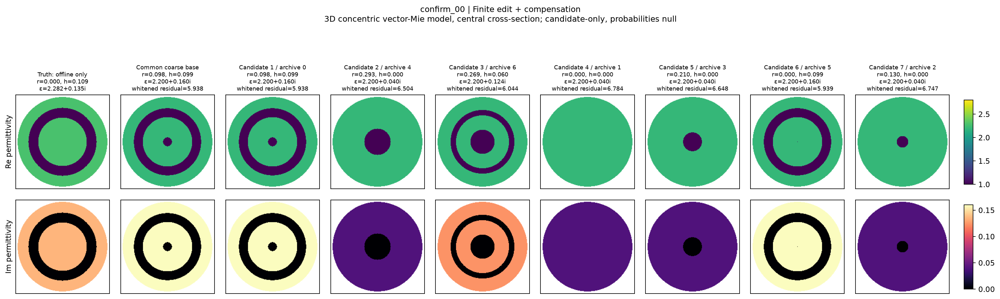
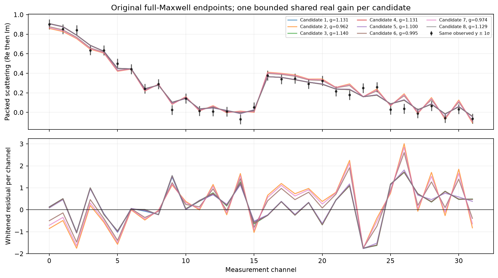
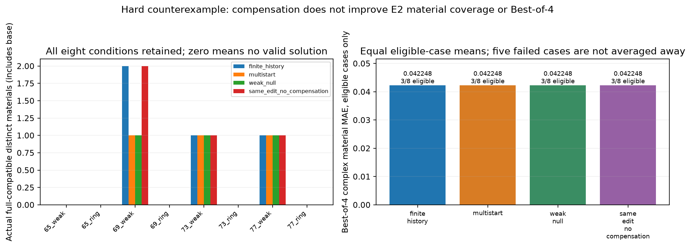

# Research A：从单张重建转向顺序发现相容材料世界

研究日期：2026-10-15。物理范围为三维球对称vector-Mie校准台和历史暴露的二维TM/VIE困难条件。主目标是发现并保留不同材料解释；本轮不计算候选posterior mass。

## 先给结论

**多解输出已经真正实现，但“利用已发现解和失败历史，优于强独立重启地生成下一个解”的核心机制尚未成立。** 32份新测量各保留3–10个full-Mie相容材料，静态有限编辑平均6.031个、multi-start平均2.563个。离线Best-of-4材料误差改善17.1558%，但在线按最低残差选图没有改善；困难二维实验没有新增结构。进一步归因表明，目前正面结果主要来自预先覆盖结构区间，而不是新的反馈或学习机制。

这不是“完全没有结果”：真实不同材料、准确full prediction、合法性和成本都已导出，可供下游新增测量继续判别。也不能把它包装成已经解决一般三维逆散射、建立了校准后验、或支持强IEEE TAP算法论文。

## 1. 为什么应保留多张材料图

测量只观察外部散射场。物体内部改变后，介电常数、损耗和有限校准误差可能吸收一部分散射差异。因此，最低数据残差不必对应最低材料误差。把所有相容解释压缩为一张图，会隐藏真实的材料歧义；反过来，生成很多低残差图也不能自动证明它们具有显著后验质量。

本轮将在线目标限定为：给定同一观测，产生合法材料，恢复测量相容性，按材料场而非观测距离去重，再保存下一位系统能够验证和重新求值的候选。`posterior_weight`、represented mass和模型外质量均为null/unquantified。这里的“世界”是一个已经验证的材料场，不是连续场单点的概率质量，也不是已证明不连通的posterior mode。

## 2. 继承什么，不能继承什么

A17的双侧反馈、材料注入和finite-gain工作可以支撑局部代数理解；冻结GN步改善不能直接验证最终非线性成像或多解覆盖。A23各失败Gate、A24 ROM成像NO-GO、A30局部材料补偿失败均保留。不能用新的小球正结果撤销它们。

B1×C1 P2提供了本轮真正复用的solver、同一径向材料decoder、已支付response bank、噪声约定和冻结MDN。旧P2 bank的1,250次材料–频率评估是历史setup，不重计为本轮调用，也不能称免费。C1-P1/P2的事件质量成绩不等于完整材料分布正确；本轮仅复用其proposal，不重训大型或小型新网络，也不把生成频率解释为full-Maxwell posterior。

实际基础重建是同target的常规有界材料优化：96个prior起点粗筛、最好的4个优化，再做新full-Mie endpoint。TSOM/SOM、DBIM、ROM、反馈专用corrector没有形成本轮公平端到端对照，状态为NOT_RUN。详细上游事实见 `delegated/history/SUMMARY.md`，原A17/A23/A24/A30结论不修改。

## 3. 冻结的材料、噪声和验证

径向材料由原P2四维连续latent生成：两个相离的径向bump系数、共同复介电常数。系数各在[-3,1]均匀，ε实部[2.2,2.8]、虚部[0.04,0.16]。`u(r)<0`形成严格真空；其它区域共享ε。实心、中心空腔、环形空腔和组合是生成后派生事件，不是generator输入的topology标签。

为了便于优化，在线可用中心空腔半径r、环形半宽h及ε实虚部作为坐标，但没有把原coefficient prior偷偷换成radius-uniform prior。候选发现使用支持而不估计posterior；概率目标仍保持原P2声明。相同材料的inactive latent不重复计数。

外半径R=1，主频kR=1.6，8个角度20°–160°、两种偏振响应，Re16后接Im16。每个实通道SD固定为原参考实心RMS的0.12倍，不随候选变化。候选gain为同一实标量，限制[0.7,1.3]；共享材料、ε和gain不能逐照明任意调整。在线gain为bounded profile，不是nuisance边缘化evidence。

每个正式成员都使用原vector-Mie matching、nmax14验证：白化残差≤sqrt(χ²_32,.95)、被动性和边界匹配残差满足冻结要求。阈值是声明的数值相容规则，不能单独称统计覆盖或连续物理认证。analytic-Mie角度接口没有内部current/field，本构相对缺陷为null并标`NOT_EXPOSED_BY_ANALYTIC_MIE_INTERFACE`；边界backward residual单独报告，绝不伪填本构误差0。

新后端审计覆盖实心、中心空腔和环形空腔：独立递推/匹配响应相对差≤3.33e-16，n14/n18白化差为数值0。包内8-dipole algebra另列为合成代数核验，不能冒充这些真实物理或成像结果。

## 4. 实际运行的生成算法

所有方法共享基础解、材料支持、proxy corrector、full verifier和每对象12次新endpoint：

- **静态有限编辑**：预定覆盖8个径向结构区间，保留受保护的结构范围，优化其余材料变量；20%步骤为global-prior proposal。
- **独立multi-start**：直接从原prior重启，不依赖亲本解。
- **population**：残差与材料排斥共同选起点，再用同一corrector。
- **冻结MDN**：旧C1-P2模型提出latent，仍需相同优化与新full verification。
- **adaptive**：利用成功/重复/失败次数和proxy可行性/材料新颖性forecast选编辑类别，保留global探索。

修正使用已有response proxy和有界least_squares；它不等于每一步full-Maxwell LM。full solver负责所有正式端点以及付费消融，proxy误差不被隐藏成full validation。材料去重以球体精确体积分复ε L2距离0.03为阈值；结构尺度另外固定为δr≥0.05R或δh≥0.025R。

确认集在规则冻结后产生32个fresh parent，每个一次噪声。来源仍是同一受限prior，不能叫跨模型独立验证。Top-K先保留base，再按材料最远点选择；Selected用最小full residual。只有离线评分器读取真值，在线提案、修正、归档和排序不使用真值。

## 5. 多候选改善成立，强整体结论不成立

|方法|Best4归一化MAE|Coverage@4|平均材料数|平均结构代表数|平均wall秒|
|---|---:|---:|---:|---:|---:|
|静态有限编辑|0.112949|0.28125|6.03125|5.00000|0.51184|
|multi-start|0.136339|0.21875|2.56250|1.75000|0.57420|
|population|0.135669|0.25000|2.28125|1.62500|0.92334|
|冻结MDN|0.137451|0.25000|2.43750|1.59375|0.56658|
|adaptive|0.113789|0.21875|5.81250|4.81250|0.74470|

静态相对multi-start的Best4改善17.1558%，paired parent bootstrap差为-0.0233900、95%区间[-0.0357844,-0.0124545]。然而coverage仅增加6.25个百分点，平均wall仅下降约10.86%，没有减少full endpoint数；未达到冻结强联合条件。每方法384次确认endpoint的比较不包括重复摊入共享base、历史teacher或bank。

静态方法Selected MAE=0.152732，base=0.151770。最小残差选图没有变成更好的单张重建。Best4的收益是“候选集中更可能有一个材料上更接近真值的解释”，不是在线知道哪个是真的。平均材料数净增3.469，32个archive计数净增111；没有证明这些条目是其它方法在更充分预算下永远无法发现的独立分支。

adaptive比静态Best4反而高0.7436%，配对区间跨0，平均wall约高45.49%。MDN也未胜过multi-start。本轮没有证据支持继续增加memory、flow或更大网络。

## 6. 对机制做了什么反证

同一protected geometry区间内，改用独立材料/补偿初始化，在两个development对象的8个端点做新full验证，全部合法；与亲本有限编辑端点的最大材料L2差只有2.84e-5，远低于0.03去重阈值。这个小型归因对照说明，至少在这些端点上，结构分层及普通有界优化足以复现结果，不能把收益归给A17/A23式新反馈或亲本历史。

8个付费no-comp对照中，3个原不相容proposal经修正进入相容阈值。但这3例都来自step4的global-prior步骤，未使用protected geometry box。它们证明有界非线性材料修正可以恢复某些global proposal的拟合，不单独证明受保护有限结构编辑获得了新增可行分支。4个step1 protected小编辑本来已经相容。不能把减少残差自动写成新结构发现。

32个静态archive共有497个满足声明结构差异的候选对，其中210对白化预测距离≤1。这是有限已发现候选的描述统计，不是所有解的coverage或mode概率。

第一个固定顺序witness为confirm_00的候选0和5：r≈0.098324R与r≈0，h约0.099R，材料L2距离0.0408833，gain后白化预测距离0.0406709，各自观测残差5.93847和5.93860，均相容。ε均接近2.2+0.16i支持边界，gain分别1.27590/1.27687，存在明确边界压力。它是物理可行witness，不是高posterior mass或全局观测等价定理。

固定前8个parent，新增kR=2.4并跨频共享gain，原base与最远材料候选各一张。共24次材料–频率调用含8个新测量生成和16个候选预测；没有重新调噪声。联合阈值下7/8 base和2/8最远候选仍相容。新增频率能排除一些旧候选，支持将多候选交给后续测量，而非证明某种主动选择策略最优。

## 7. A30困难二维反证

复用原24×24 TM/VIE、8源32接收器及原复观测。每复通道实虚方差σ²/2，因此白化为sqrt(2)/σ；这与Mie每实通道σ的约定不同，不能混用。gain固定1，没有靠自由校准放宽难题。

4个历史暴露parent各weak/ring两条件，共8条件。有限编辑、普通multi-start、material weak/null、同编辑不补偿在同材料box中比较；corrector先用16实DCT、后用32实Haar坐标，每轨迹两次非线性修正。

**5/8条件没有合法候选，全部保留NO_VALID_SOLUTION。** 余3个条件的Best4复材料MAE分别0.0435144、0.0347768、0.0484529，四方法相同。finite-history多出的一个field-RMS去重材料在no-comp原编辑中已经存在，只改变1个结构mask格，未达到6格结构阈值，材料MAE还比base差3.36%。不存在新增结构收益。

有限编辑32条轨迹没有一次invalid→valid；初末残差中位数58.8559→36.6712，配对下降中位数11.03%。200个材料QP中191个收敛，说明修正器确实工作；残差降低没有完成多解发现。5个条件base本身不相容，有限表示、初始化和修正预算仍是混杂原因，不能因此宣称完整材料空间不存在其它解。

累计328个新full state、9214个复LU RHS，包括首次失败audit的1state/91RHS。只余2RHS，无法再执行一个8源状态；剩56个state名额不是可继续计算的授权。原A30结果不修改，也没有将这8个暴露条件包装成fresh确认。详见 `results/E2/E2_FAILURE_ANALYSIS.md`。

## 8. 实际交接和费用

静态方法32份正式包共193个真实材料世界。每包用所有候选分层边界的精确union径向网格存复ε；它唯一决定球对称三维材料，不是把中心切面当完整一般三维场。包内有旧观测预测、验证、结构、pair距离、补偿、生成/失败历史和唯一账本回执。global total_cost是重复的全局snapshot，禁止跨包累加。

保留A原生schema及格式；单列执行overlay允许用户no-hash政策下的asset摘要null、analytic-Mie未暴露本构缺陷的null/status。独立common exchange v1不声称兼容未读取的B原生schema。序列化/验证不执行新测量；明确的callback接口需要另行授权预算和实际记账solver。没有用合成fixture充当正式发现结果。

截至文档汇总，E1使用2301/2304次独立新材料–频率attempt；E2为328/384 state和9214/9216 RHS。两阶段费用单位不同、不可互转；旧P2剩余541次未使用。GPU训练、旧locked truth、新大型bank、非同心三维campaign均为0/NOT_RUN。最终累计wall及全部失败由主线程资源汇总和原append-only账本给出。

缓存计时另作了前4parent×5轮方法顺序回放：重跑搜索，复用完全相同full endpoint缓存，新物理0。warm wall没有更低，不建立full-solver或ROM加速。不得将这类接口/代数通过、能公开访问网页，混成科学成功。

## 9. 已保存的材料图与数据拟合

这张图对应固定顺序的第一个确认对象。不同候选按同一ε色标显示；真值仅用于离线说明，不进入搜索或候选排序。完整radial材料和观测预测可从同一对象的正式包重放。

外部拟合相近不意味着内部材料相同，也不意味着内部总场不变。图中预测来自实际full endpoint，不是神经网络输出直接代替物理。

无合法解的条件保持无解，不能用不相容图填充K。二维与球对称三维图只在各自平台内比较。

## 10. 下一步科研判断

值得保留的是受限材料支持上的结构分层候选benchmark、诚实失败和可供下游继续判别的交接接口。应停止当前history adaptive、冻结MDN、反馈/ROM和进一步网络复杂化的优越性主张；不启动E3。

如果以后另获授权，优先研究新增测量能否可靠减少候选分歧，以及如何在A30先取得真正相容的强粗解，再分离表示/优化瓶颈。只有新的物理机制或匹配成本收益被验证后，才讨论一般三维扩展。现在没有足够证据把普通分层重启、Schur恒等式或“多生成几张图”写成强IEEE TAP原创算法。

原始证据入口：`results/SUMMARY_E1.json`、`results/STRATIFICATION_ATTRIBUTION.json`、`results/PAIRWISE_AMBIGUITY.json`、`results/E2/RESULT_SUMMARY.json`、`MaterialHypothesisPackage/`。图库见 [index.html](index.html)。固定公开入口见文末。

公开入口：[可浏览材料图库](https://migodam.github.io/b1-probabilistic-maxwell-imaging/research/research_a_20261015/) · [本次证据Release](https://github.com/migodam/b1-probabilistic-maxwell-imaging/releases/tag/research-a-20261015)。所有历史阶段在同一B1仓库保留。
