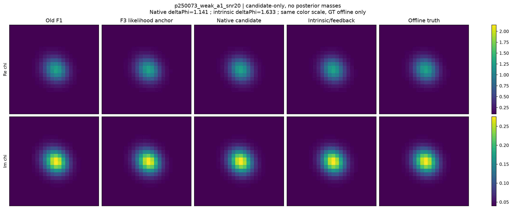
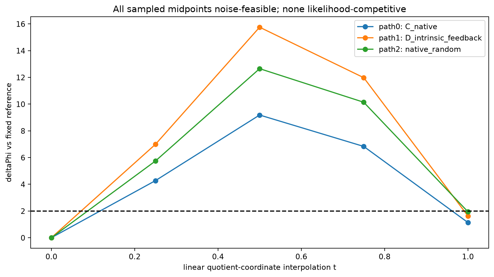
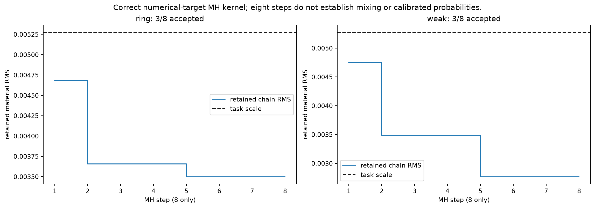

# Research F3：商坐标解决了驻点障碍，但没有支持高阶Explorer

2026-10-17。独立有界CPU实验，原P0、原观测、noise/gain、背景与真值均不变。已完成并封账；未训练任何NN。

**最终选择：原P0局部Explorer研究在这里收束。** 本轮解决了独立physics-only anchor问题，也真正运行了四臂有限探索与Maxwell MH。weak背景存在任务尺度、likelihood-competitive的合法端点；它们仍是同一小材料区域的代表，没有新的拓扑。当前intrinsic/finite-feedback方案未优于普通material-native retraction，不值得据此训练高阶网络。

## 1. 第一屏：五个决定及真正新增证据

| 决定 | 结论 |
|---|---|
| P0的校准价值是否基本完成？ | 是：保留低维数值基准，停止继续宣称exact-local-fiber Explorer |
| 任务尺度竞争端点是否存在？ | weak存在；ring没有。3个数值不同端点相互很近，不能称3个posterior modes |
| intrinsic transport有优势吗？ | 普通材料retraction优于冻结切向；高阶D没有同成本增量 |
| 已有可摊销teacher吗？ | 有candidate-only端点数组，缺可复现competitive路径与多parent增益，不训练 |
| 下一步选什么？ | 独立物理P1及ambiguity benchmark；本轮不执行P1，不扩大原P0/noise |

新增**55/64个二维full states、712/2048 complex RHS、17.6407078秒受控wall**，55个端点全部立即保存。包括首轮数值失败的8states/224RHS和其后9个中点诊断，旧Research F与45-state诊断未重跑、未改账。

## 2. 我们纠正的是材料坐标与测度，不是换掉物理问题

原两Gaussian权重独立U[.4,.9]，材料生成先求加权和，再除以图像最大值。共同正尺度不改变材料。定义rho=log(w0/w1)，L=log(9/4)，规范代表

\[
w_0=.6e^{\rho/2},\qquad w_1=.6e^{-\rho/2},\qquad |\rho|\le L.
\]

因为.6=sqrt(.4*.9)，这个代表完整覆盖原权重材料image且保持原支持。其余六shape参数仍是原生成均匀坐标，未改变先验。

但材料image等价不等于概率均匀。将共同尺度积分掉后，原prior诱导

\[
p_\rho(\rho)=\frac{.81e^{-|\rho|}-.16e^{|\rho|}}{2(.9-.4)^2}.
\]

在q=(六uniform shape,t)、t=(rho+L)/(2L)中，密度为2L*p_rho。独立积分为1.0000000000000002；40万次原权重pushforward KS=.00177860，小于99% DKW界.00257350。随机材料image最大等价误差2.92e−16；缓存链式Jacobian误差≤4.12e−16。

rho端点的密度线性归零，尾质量为.72*delta²+O(delta⁴)。所以likelihood最优材料可以位于合法闭支持边界，却拥有零posterior点密度。其邻域仍有非零质量。**不能把边界材料宣布非法，也不能把正密度候选直接称为重要概率世界。**

去连续gauge后，两个Gaussian的标签交换仍存在；两Gaussian碰合还会失去ratio可辨识性。因此这不是全局一一商atlas。局部rank/conditioning结果只对实测点成立。完整推导见[商先验](QUOTIENT_PRIOR_DERIVATION.md)。

## 3. F1.5：4个状态补上独立合格物理anchor

沿用原F1已经保存的两个端点，只做有界quotient GN与真实Maxwell回溯。不是N3 warm start，也不是GT初始化；在线代码不读取GT。两条件是**同一个已暴露development parent250073在ring/weak背景下的观测**，已知family/global geometry，不是两独立物体或一般未知形状反演。

新停止准则在执行前冻结：7坐标符号正确的projected gradient≤.001，加材料GN步≤5.27555e−6、预测Φ改善≤1e−6，以及物理/先验合法与rank检查。最终两点都到达精确比例边界，独立重算支持其KKT符号。

| 条件 | 新state数 | projected gradient | 可行线性GN材料RMS | 预测Φ改善 |
|---|---:|---:|---:|---:|
| ring | 3 | .0005792604 | 5.29818e−8 | 9.30783e−10 |
| weak | 1 | .0005356274 | 6.76656e−8 | 4.56623e−10 |

原noise残差分别22.239554758/21.512112256，均小于tau23.785449。新资格PASS，原八维Gate2失败仍完整保留。材料质量几乎不变，说明旧端点已很接近受约束似然最优，坐标/边界使旧驻点解释困难，而不是还缺很大的合法物理下降。

这两点是**likelihood anchor，非posterior MAP**：边界prior密度为0。有限噪声MH并不要求从MAP或驻点开始。

## 4. F2真的运行了：两个判据不能混用

固定任务尺度s=.00527555；目标s、2s加一个1e−6相对裕度防止浮点舍入。Data-feasible仍使用原noise-ball。Likelihood-competitive为相对**执行前固定的原F1材料**，ΔΦ≤2；这是发现指标，不是95%credible region。

A冻结商坐标切向；B更新切向/Jacobian；C在材料RMS下合法retraction；D加入prior法向曲率、真实Maxwell方向二阶项，并在第二目标使用已测full响应误差和刷新J。corrector始终保留非零进度，所有选中端点full-forward验证。

### 相同任务材料距离的结果

| 背景 | 冻结A ΔΦ | 更新B ΔΦ | native C ΔΦ | intrinsic/feedback D ΔΦ |
|---|---:|---:|---:|---:|
| ring，s | 20.6337 | 20.6337 | 5.1964 | 4.5023 |
| weak，s | 10.6440 | 10.6440 | **1.1406** | **1.6327** |
| weak，2s | 51.1057 | 距离未匹配 | 3.0980 | 4.2301 |

ring的A第二目标与两个背景B第二目标未达到所申请距离，不能当作同2s成功。C/D两个目标都匹配。普通native显著改善冻结切向的有限步数据漂移；高阶D的改善不稳定，在weak还更差。完整端点及距离表见[四臂比较](LOCAL_TRANSPORT_COMPARISON.md)。

D没有重新证明resolvent恒等式，只支付真实8RHS方向current，计算所需Maxwell二阶响应。新CM、II、方向、normal correction和预测误差均保存；它不是A17 Schur加速实验。

## 5. 发现了几个真正不同的材料世界？

C2普通native pool每背景8个端点，其中2个来自C臂复用、6个固定随机方向，不能称8个iid样本。weak有2个满足任务尺度、原noise、ΔΦ≤2、正先验密度和结构检查；ring没有。D另有1个weak合格端点。

| weak端点 | 材料RMS | ΔΦ | log p_q | t | 相对anchor最大切空间角 |
|---|---:|---:|---:|---:|---:|
| 普通C | .0052755553 | 1.140604 | .0893825 | .720938 | 79.80° |
| 另一native | .0052755553 | 1.948266 | −.0378736 | .752508 | 84.35° |
| D | .0052755553 | 1.632730 | −1.538063 | .943372 | 73.33° |

按材料数组数值去重确有3个端点，但两两RMS只有.000639–.001100，均小于s；多尺度连通和孔洞计数差异均0，threshold occupancy平均变化只有约.0007–.0009。**这是有限材料不确定性的一个正例，不能包装成3个分离结构worlds或posterior modes。** 点密度也不能重新归一化成图像概率。

这些候选在材料中近、参数中远，切空间旋转很大，说明局部材料范围与参数chart半径不能混为一谈。去共同尺度并没有消除近碰合Gaussian或全局参数表示的全部几何困难。

图像各方法使用相同实部/损耗色标。GT只用于离线评分，不选方向或候选；native代表由最小Φ而非GT误差选择。

## 6. 中间路径给出决定性的限制

为避免把“端点合格”冒称“已经有有限传输路径”，对全部3个合格独特端点追加q直线t=.25/.5/.75，共9次full-forward。在读到端点结果后、计算中点前冻结方案，无GT选择、无新候选优化，属于后续诊断，不称独立盲测。

9个中点全部prior合法、noise-ball相容，但**全部ΔΦ>2**，范围4.2755–15.7556。沿q直线的材料RMS可先增大再减小，也可大于终点。这显示参数插值不是稳定的材料传输。

它没有证明其他competitive路径不存在，更没有证明多个分离mode；只说明当前三条自然参数线段没有保住所需likelihood。需要真正material-native path算法时，还要动态重定中心/可行几何，而不是只学习端点之间的参数直线。

## 7. MH核正确，但没有后验准确度结论

共同数值目标为原Gaussian likelihood乘正确p_q。采用冻结对角Gaussian逐坐标反射，其proposal对称，接受比保留full likelihood与proper prior。没有state-dependent covariance、额外Gram因子、noise-ball截断或many-to-one物理投影。

两例各8步、各接受3步；拒绝后重复状态全部保留。起点处prior0按明确的测度零初始化扩展处理，第一有限密度proposal接受1，其后标准MH。起点不叫posterior样本。

保留链最大RMS分别.00468347/.00475189，未达任务尺度；达到任务尺度但被拒绝的proposal不能算发现。**8步无法判断混合、credible interval、事件mass或概率校准。** prior可能合理支持likelihood略差的材料，因此MH没有满足ΔΦ≤2不能被解释为其后验错误。

独立重放16次proposal、接受随机数、log prior及全部重复链状态，均一致。正确kernel只保证声明的数值目标的不变性，不提供有限链分布、连续Maxwell或现实模型认证。

## 8. 同成本结论是什么？

每条件D两端点：16forward RHS+8方向Hessian RHS+32刷新J RHS=56。普通native前7端点独立冷启动等价为7×8=56；两个已在C臂付费的缓存端点仍计入其cold费用。weak前7 native有2个合格端点，D有1个；ring两者0。

所以当前高阶方法没有同预算发现收益，**停止高阶D优越性及其NN摊销主张**。普通native相对短MH的优势只针对有限端点发现指标；candidate-only没有正确后验分布，不能据此宣称概率更准确。

原pilot46states/640RHS；追加路径9/72；合计55/712。新55LU全部记账，440forward、256adjoint、16Hessian RHS。17.641秒是本机整个受控作业（含decoder、SLSQP、缓存审查及持久化）的时间，不是方法独立cold/warm吞吐基准。未测速度排名不补造。

首attempt出现规范权重1ulp越界，在调用fullstate前被validator拒绝。失败、8states/224RHS及原closure保留；修复舍入并从已保存state/J继续，不重置账本或重跑F1.5。实际复现见FLOATING_BOUNDARY_FAILURE_AUDIT。

## 9. 离线成像质量与概率主张边界

weak基础材料复RMS到GT约.004913，按Φ选择的native候选约.003884，D约.003950；ring候选反而比很好的基础解差。这里GT始终离线，两个条件还使用已知家族/global geometry；不据一例改善宣布通用成像收益，也不改写N3强Top-1地位。

没有独立完整7Dposterior reference、evidence、event probabilities、credible interval或模型外质量估计；图库只展示candidate-only。未探索/未展示概率质量不清楚，不将Top-K归一化为1。P0并非一般二维或三维开放材料支持。

## 10. 现在结束什么，下一步做什么

**结束原P0的exact-fiber神经Explorer路线，停止当前intrinsic/feedback增量主张。** 保留商先验、边界优化和有限噪声基准作为可复用底座。原P0并非被证明全局唯一，只是当前实验已经清楚区分：有小的finite-noise自由度，尚无新拓扑、多独立worlds或昂贵高阶teacher收益。

有3个可复查端点，但没有跨独立parent、保持competitive的可复现有限路径，也没有teacher+训练费用后收益；现在训练NN不合理。

下一阶段选择**独立物理P1**：先冻结有实际空间结构自由度的被动材料生成测度和任务尺度，再建立可信ambiguity/reference。不是扩大原P0或noise救结果。本轮P1、NN、Mie、3D、独立A17 Schur消融均NOT_RUN。

目前不足以支持强IEEE TAP生成算法论文。关键缺失是复杂材料、多独立anchor、同完整成本的新结构探索正例及可验证概率/覆盖意义；不是再多几张相似图。

[五项裁决](GO_NO_GO_DECISION.md) · [后验目标审计](POSTERIOR_TARGET_AUDIT.md) · [完整成本](MATCHED_COST_RESULTS.md) · [失败记录](FAILURE_ANALYSIS.md) · [独立审查](evidence/PROBABILITY_AND_STATIONARITY_REVIEW.md) · [复现](REPRODUCE.md)
