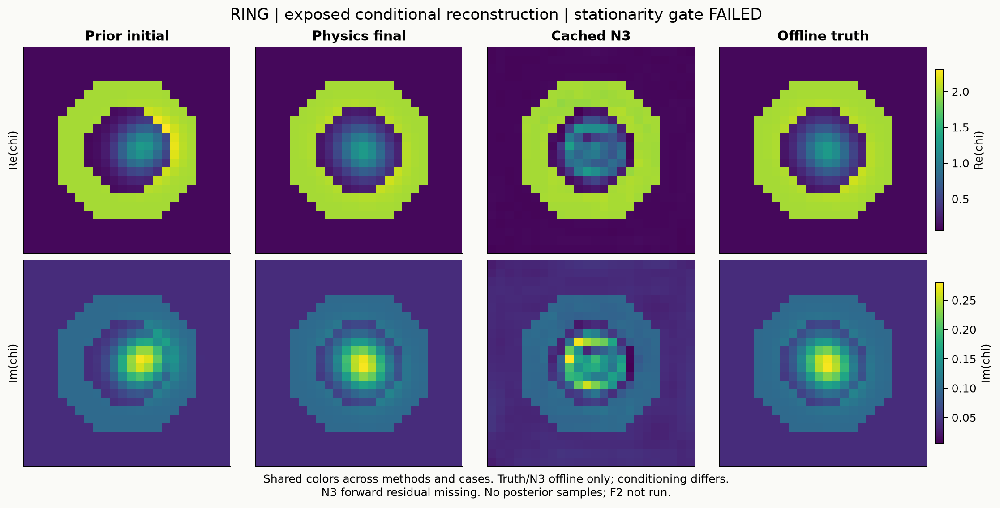
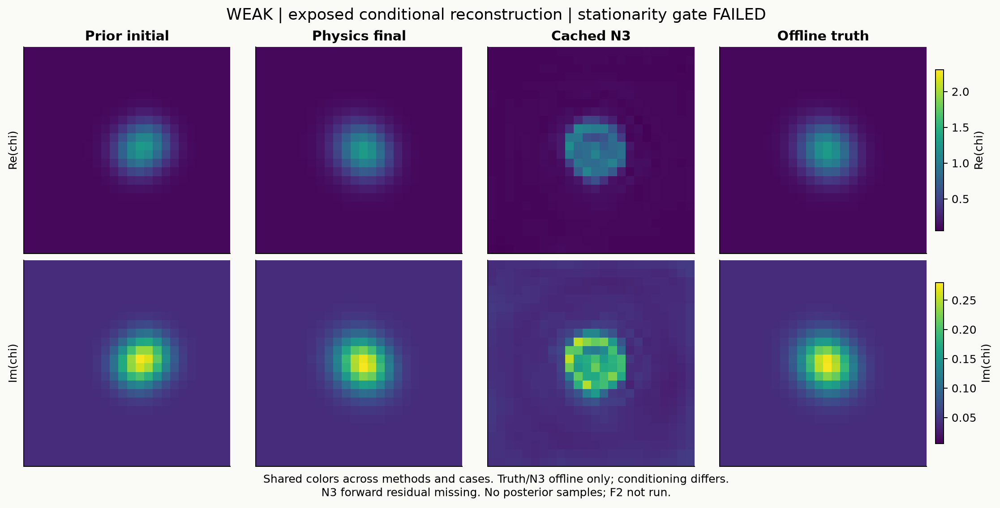

# Research F：巨大参数曲率不等于巨大物理曲率，但有限材料探索仍未建立

2026-10-17。独立CPU研究阶段，原P0、原Maxwell求解器与原noise不变；已执行、已封账。

**裁决：F0几何审计通过限定范围检查；独立反演已获得两份合法且数据相容的材料，但未达到事前冻结的驻点资格，F2四臂实验未启动。learned Explorer当前NO-GO；材料原生坐标和边界处理研究CONDITIONAL GO。** 不把本轮停止解释为不存在局部不确定性。

## 1. 这轮实际回答了什么

上轮在合法TRAIN材料附近看到：原Gaussian参数走一步，实际散射变化会比初始切向预测大很多。可能有三种原因：参数坐标走弯了；合法材料集合本身弯了；Maxwell高阶反馈很强。这三者需要不同算法，不能都交给一个“高阶物理网络”去学。

本轮首先用保存的Jacobian和decoder区分前两者，再使用新的独立物理反演补上anchor实验。没有重跑上轮45个state，没有训练NN，也没有为了凑多解改变prior/noise/gain。

| 实际执行 | 新states | 新complex RHS | 主要结果 |
|---|---:|---:|---|
| F0缓存几何、解析/三步差分/重参数化 | 0 | 0 | 大坐标项与非零真实先验曲率得以区分 |
| F1两个development条件的独立物理反演 | 24 | 960 | 两例合法、噪声相容；冻结驻点标准未过 |
| F2同材料距离四臂传输 | 0 | 0 | NOT_RUN，遵守前置依赖 |

F1受控执行wall为**5.5342895秒**，24份材料、电流、内部场、prediction、LU和24份Jacobian均落盘。预算上限64states/2048RHS/1200s，未用额度保持未用；没有借用任何旧账。

## 2. 原材料集合、数据与度量

复用A30原24×24 scalar-TM/VIE、8sources、32receivers和原背景数组。二维本构为 (X=operatorname{diag}chi)，状态 (L=I-XG)，观测 (S j)。源共享同一个合法材料。固定gain=1，原复高斯噪声每实部方差为 (sigma^2/2)，按每源Re32后Im32打包，再乘 (sqrt2/sigma)，总512实通道。

材料质量坐标 (m(chi)=[Rechi;Imchi]/24)，其欧氏范数就是复材料RMS。合法增量相位、amplitude1.2、Gaussian栅格化及peak normalization均沿用原P0。背景ring不被解释为空洞，增量零不等于绝对空气。

F0沿用旧公开TRAIN数学点250033_weak/250034_ring；它们的已知材料不称未知成像成功。F1按元数据顺序选前两个暴露development smooth/ID条件：p250073_ring_a1_snr20和p250073_weak_a1_snr20，原rows67/71，**同一parent、两个背景，不是两个独立物体**。

F1只估计两Gaussian的中心、宽度、权重，共8原uniform参数；家族与global中心/rotation/scale/axis-ratio是显式已知条件。因此它是受限的条件材料反演，不能冒称一般未知结构恢复。

## 3. F0：坐标加速度与真实材料曲率

对原decoder微分 (D_m) 做SVD，去掉Gaussian权重共同缩放的同材料gauge，得到材料正交frame (Q)。令

[
d_2=D^2m[v,v],quad d_{2,parallel}=QQ^T d_2,quad d_{2,perp}=(I-QQ^T)d_2.
]

其中切向项是可以通过参数加速度抵消的坐标效应；法向项是prior image在材料空间的第二基本形式。再映射到白化数据得到 (C_{
m coordinate}=Jd_{2,parallel})、(C_{
m prior}=Jd_{2,perp})。这里“intrinsic audit”不意味着在计算Riemann内蕴曲率张量。

| 旧TRAIN条件 | 坐标响应范数 | 真实prior响应范数 | raw decoder响应 | 二者cosine | 材料二阶能量中法向比例 |
|---|---:|---:|---:|---:|---:|
| weak | 3.64871074 | .008391183 | 3.65231450 | .428532 | .0032863% |
| ring | 9.25251040 | 3.50531456 | 7.52726016 | −.635720 | 14.77154% |

表中响应对应原保存的参数单位速度，各例材料速度不同；CSV另外给出单位材料速度平方归一化值。**不能把两个范数加起来当作总响应，也不能把材料能量占比当作数据响应占比。** ring存在明显向量抵消，weak几乎全部材料二阶能量来自坐标加速度，但其较小真实prior曲率仍非零。

这改变了对旧“decoder/Maxwell=38361或42.4”的解释：那些比值混合了坐标和真实先验几何，不能用于证明强Maxwell非线性或学习困难。

## 4. F0缺什么，哪些结论仍可靠

**旧Maxwell方向Hessian向量MISSING。** 原执行代码只保留了其norm，q/bmax未落盘。本轮检查了相关NPZ headers及旧源码，不调用保存LU、不新增RHS、不从粗端点拟合一个“exact Hessian”。因此Maxwell与另外两项的cosine、完整三向量总和、实际intrinsic向量范数都未独立恢复。

利用同方向、同白化的历史Maxwell norm可以给出保守区间。令 (Q_{
m out}) 为 (JQ) 的数据余核投影：

| 条件 | (||Q_{
m out}C_{
m prior}||) | 历史Maxwell norm | 总intrinsic余核范数条件区间 |
|---|---:|---:|---:|
| weak | .000648559834 | .000095209015 | [.000553350820,.000743768849] |
| ring | 1.435993714 | .177677343 | [1.258316372,1.613671057] |

这是三角不等式，**依赖历史norm计算正确**，并非新求解或完整向量重现。它说明不能由已知大小的Maxwell项完全消掉该固定速度下的prior余核项；它不证明所有有限步都不可补偿。

三个固定差分步长1e−3/5e−4/2.5e−4与固定active-max解析D²g交叉核对。raw D²相对误差最多3.90e−7；weak余核小量受到舍入影响，误差最多1.23e−4。相同material velocity的非线性重参数化可以大幅改变raw项，但解析prior法向及其数据余核投影保持约1e−12/1e−14量级一致。三步结果全部保存，没有选最漂亮一步。

两例去gauge的材料rank和响应rank均为7，最小每单位材料RMS响应12.8487/297.076。**当前方向是近似弱方向，不是非零exact tangent kernel。** 因而正余核系数是固定速度的有限噪声诊断，不能把exact-null二阶必要条件直接用于宣告不存在路径。数值满列秩也不等于全局唯一性证明。

Gate1只允许据可靠材料几何推进条件finite-noise实验，缺失向量仍缺失；没有将不完整三向量审计标PASS。

## 5. F1：真正独立、合法、非神经网络的物理反演

固定初始Gaussian中心(−.052,0)/(.052,0)，宽度.0725、权重.65。在线工件只含观测/sigma与已知条件；八个未知真参数被替换，原seed移除。反演源码不读取GT/N3；操作系统层面没有另设文件权限隔离，隔离证据来自输入和代码路径审查。

使用原uniform坐标 (p=Phi(u)) 的有界trust-region least squares，每一步均full-forward+32receiver adjoint RHS求完整参数Jacobian。uniform prior在此坐标中为常密度，因此目标是其条件参数likelihood最大化；不声称材料空间MAP或posterior。

| 条件 | 初始残差 | 最终残差 | bound-scaled最优性 | 阈值 | 结果 |
|---|---:|---:|---:|---:|---|
| ring | 91.360919 | 22.239555 | .045273396 | .001 | FAIL，12次额度耗尽 |
| weak | 71.360219 | 21.512112 | .002000989 | .001 | FAIL，ftol停止但驻点未过 |

两例残差均小于原tau23.785449且材料P0_EXACT；这比旧一步ROM初值更接近所需物理anchor。不过预登记资格还要求驻点标准，两例都失败，**没有事后放宽到.05或.003继续F2**。F1分配24states已用完，余40states不自动挪给更多反演迭代。

噪声球不是posterior硬支持。原真值在本轮两例的历史clean-prediction残差22.3441/21.7180；不同案例真值偶尔超95%球也不会被宣布材料非法。

## 6. 根因不是只看“梯度还大”

保存数组独立审查确认 (C=Todot E)、实化白化及随机Jv收缩相符至约1e−15；未发现包装/共轭错误。两例最终材料与响应仍有7个非零方向，但都逼近原Gaussian权重比.4/.9边界。

共同weight scaling不改变材料，却不能改变权重**比例**边界。忽略支撑的GN会提出减小该比例的非法步；大参数步还受gauge和材料坐标条件数影响。

| 已存线性化诊断 | ring | weak |
|---|---:|---:|
| 无约束GN的材料RMS | .000172171 | .011847063 |
| 遵守原参数box的线性步材料RMS | .00000329631 | .000000495416 |
| 有界线性预测残差降低 | 2.19e−7 | 8.56e−10 |

这是**零新增物理的线性模型诊断**，不是新endpoint、不是非线性最优性证明，也不用于追认Gate通过。它表明应先处理真实prior边界/商几何，而不是把无约束GN的大步当成可以学习的隐藏自由度。最大的绑定scaled-gradient分量仍出现在shape参数，不能简单删除weight梯度救Gate。

此外，numerical search将p限制在[1e−10,1−1e−10]，排除极薄边界条带；这是搜索数值保护，未生成posterior，不声称精确采样整个原prior。

## 7. 离线材料质量与N3

| 条件 | 初始复MAE | physics final复MAE | N3复MAE | physics final复RMS |
|---|---:|---:|---:|---:|
| ring | .03218134 | .0007283783 | .03870807 | .002242914 |
| weak | .03218134 | .001554472 | .03147809 | .004913129 |

物理反演在这两个条件下恢复了很好的材料图；这是有效的正面结果。但额外已知家族/global geometry，且只有同一parent，不能宣称普遍击败N3。N3预测数组来自原缓存，未重算forward，其full-Maxwell residual仍MISSING。GT只在本节离线评分和图集使用，不控制初始化、优化和停止。

每行跨方法与条件共享色标。图中为contrast chi，复介电常数为1+chi；绝对背景材料不能与增量结构混读。

## 8. F2为何未运行，以及本轮不能声称什么

按依赖关系Gate2失败后，Frozen/Updated/Material-Retraction/Intrinsic+Feedback四臂全部NOT_RUN。预先冻结的有效材料RMS阈值.00527554628、结构检查与同成本规格仍保留，未改成更小尺度；没有可评价的有限transport样本。

所以本轮不能回答哪种方法走得更远、full feedback是否帮助发现新材料、补偿NN能否摊销、是否存在显著模式。候选概率为null；反演中间图不拿来拼成Top-K posterior。A17可用双侧有限残差思想仍是候选接口，没有新同成本消融，既不宣称A17增量，也不否定其原局部GN理论。

## 9. 最终十问

1. **巨大decoder曲率来自哪里？** weak材料二阶能量99.9967%为坐标项，ring85.2285%；映射到数据后有不同抵消。真实prior项仍非零，且历史Maxwell norm不足以完全抵消其余核响应。完整Maxwell向量缺失，不能分配精确三项响应百分比。
2. **原P0是否有local fiber？** 所查两旧点及两新最终点都数值满列秩，未确认非零exact tangent。仅支持局部数值可辨识证据，不排除有限噪声宽度或远分支。
3. **不用N3/GT能否重建合法anchor？** 已得到两份原先验合法且噪声相容的条件物理解；严格驻点资格未过，不能称完整合格anchor。
4. **材料retraction/曲率补偿能否走更远？** NOT_RUN。不能由F0预测效果代替配对实验。
5. **finite feedback有发现价值吗？** 本轮未验证；其历史价值是准确forward prediction，尚无新的发现收益。
6. **已找到非平凡局部探索区域吗？** 没有新证据；F1是反演，F2未执行，不能混用旧已知TRAIN微位移。
7. **障碍是什么？** 已测：坐标/gauge病态、真实prior比例边界、有限反演分配未过驻点标准。局部可辨识/狭窄prior有数值支持；不能把未探索归因成强Maxwell非线性或物理多解不存在。
8. **已存在可学习的finite transport函数吗？** 正式非平凡teacher pairs=0。当前不训练；未来优先考虑合法可行法向补偿/有限初猜，并验证no-op和摊销成本。
9. **支持强IEEE TAP了吗？** 尚不支持。可靠几何拆分有价值，仍缺独立合格anchor上的同材料距离、同完整成本的非平凡有限探索正结果。
10. **下一步怎么选？** CONDITIONAL GO：先把权重比例商坐标/可行切锥和物理驻点做好；NO-GO：现阶段训练learned Explorer或声称exact-fiber。不要放宽P1救结果，也不在未确认其他高支持区时追加global generator。

## 10. 交付与复现边界

完整SOURCE_INVENTORY、固定配置、F0三步/解析向量和CSV、24paid states/Jacobian、原始probability-null状态、成本/失败记录、独立review、图集与运行源码均已保留。大数组放现有B1的独立Release，不建新repo，不改历史T/G/LXZ/45state结果或A17冻结稿。

[几何审计](INTRINSIC_GEOMETRY_AUDIT.md) · [物理反演](PHYSICS_ANCHOR_RESULTS.md) · [未运行传输说明](FINITE_TRANSPORT_RESULTS.md) · [完整成本](MATCHED_COST_COMPARISON.md) · [独立审查](evidence/INDEPENDENT_MATH_REVIEW.md) · [复现](REPRODUCE.md)
