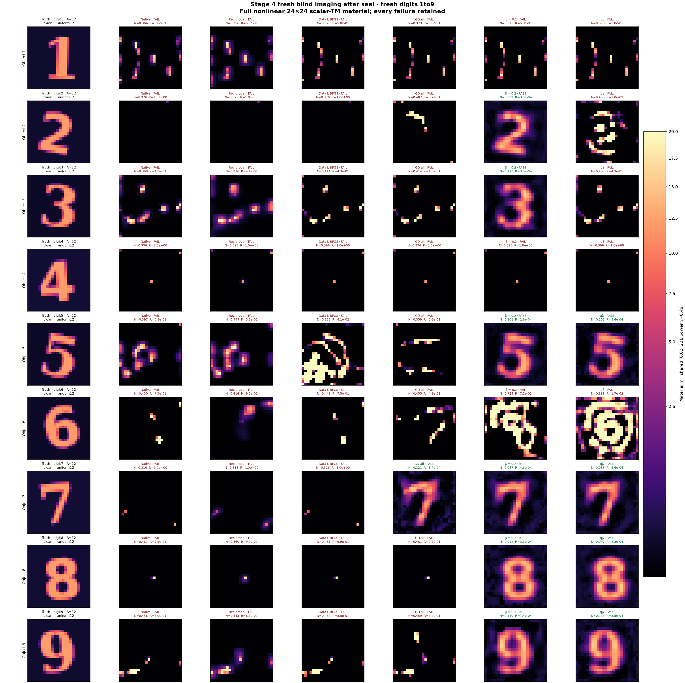
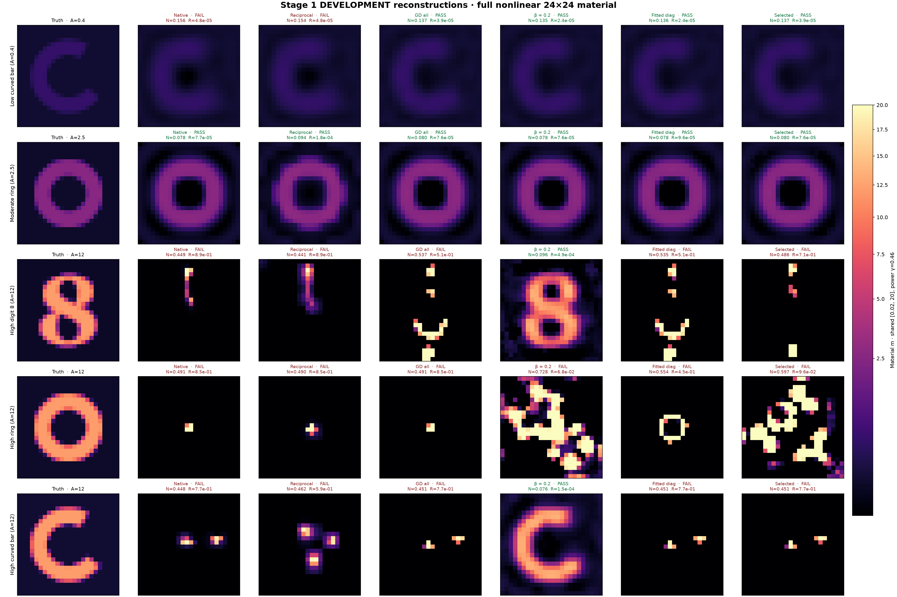
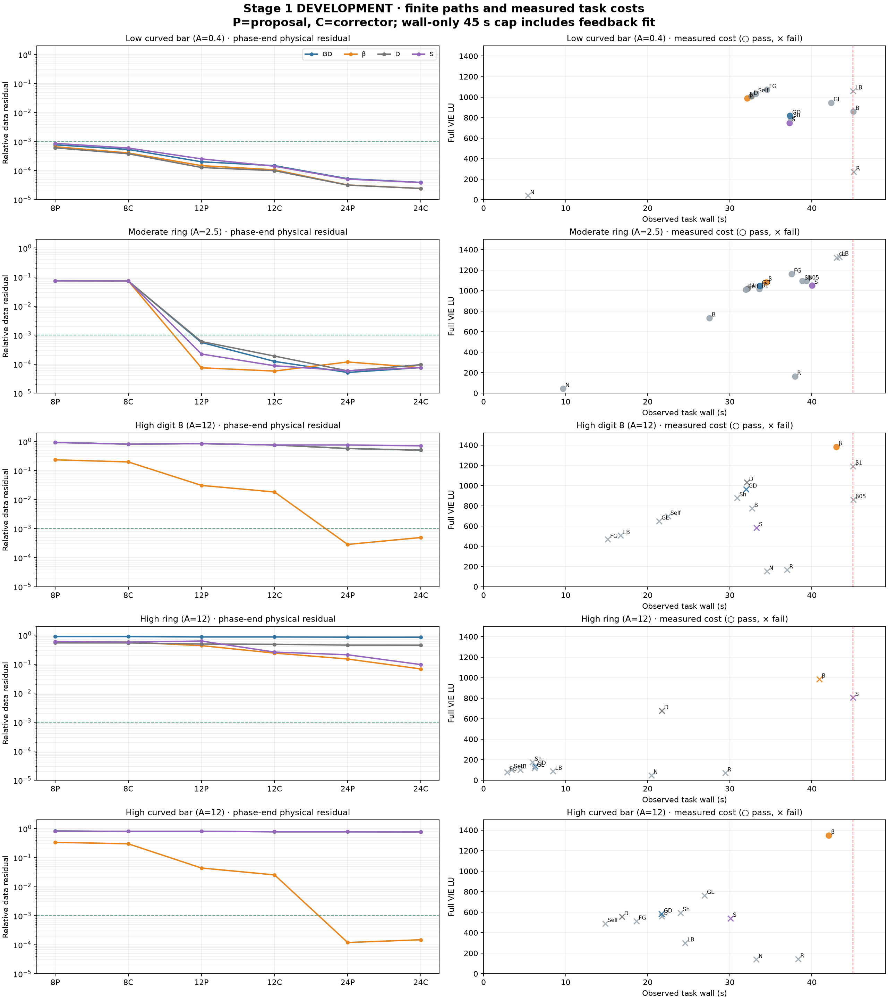
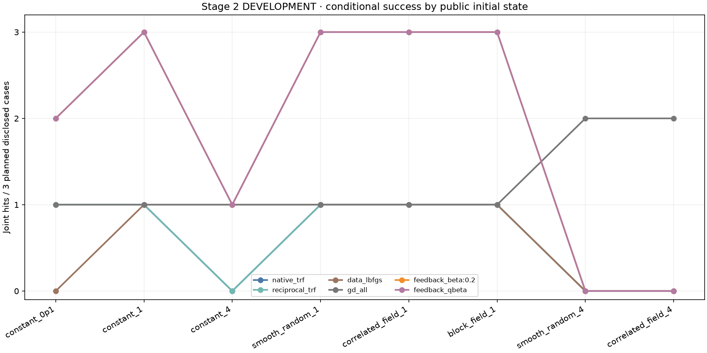
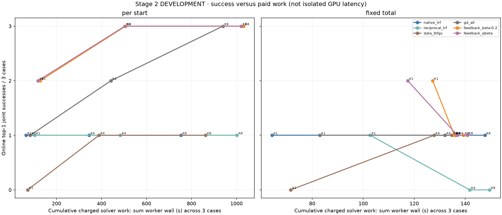
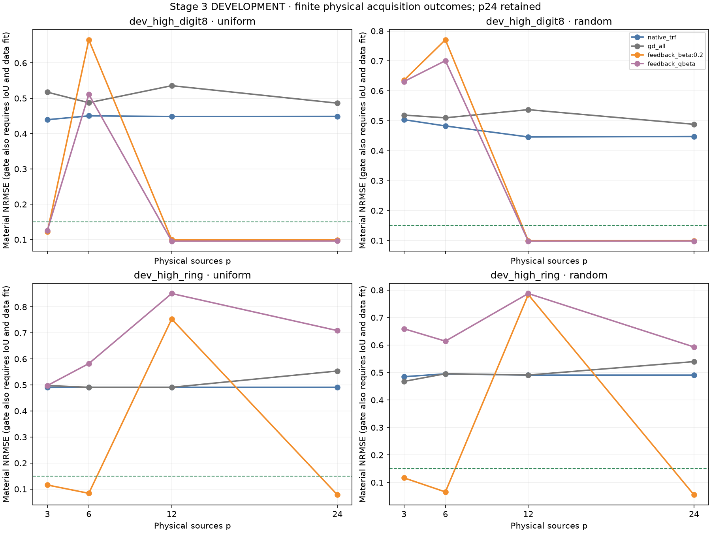
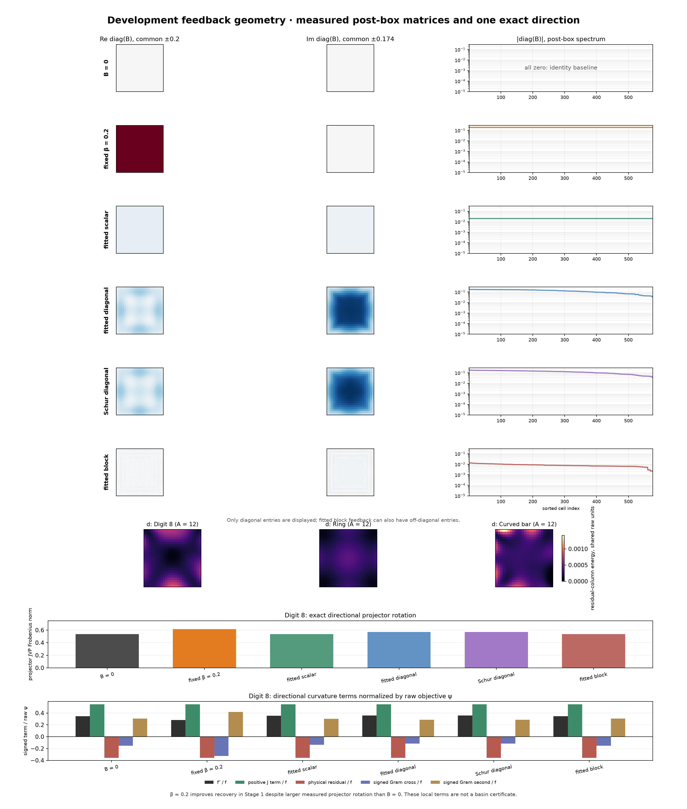

# FBG-R2：反馈残差几何与高对比度 Maxwell 成像

**本轮完成639项真实反演。新鲜高对比clean确认中，固定β=.2通过8/12，自动标量Q-beta通过6/12，原始GlobalDual通过3/12；Native、Reciprocal、Data三种普通对照均为0/12。改善来自反馈残差几何，尚无证据把收益归给A17 Schur，也没有总体省算。方法研究值得继续，TAP级普遍优势与原创性主张保持HOLD。**

这是24×24、576个全部未知实材料的完整非线性二维scalar-TM VIE。新鲜集包含九个新字体数字、三种非数字高对比形状及两个低中对比控制；全部132个预测先封存再揭晓GT。所有在线top1使用原始Maxwell分数，没有根据GT挑选。

|方法|高对比clean联合恢复/12|低中控制/2|噪声观测/8|高对比NRMSE中位数|高对比平均wall/s|平均LU|平均复RHS|
|---|---:|---:|---:|---:|---:|---:|---:|
|Native TRF|0|1|0|.3961|27.70|92.0|5520|
|Reciprocal TRF|0|2|0|.3851|34.00|126.3|6964|
|Data L-BFGS|0|2|0|.4050|19.25|407.3|9812|
|GlobalDual all stages|3|2|3|.3844|36.01|768.2|18436|
|固定β=.2反馈Gram|8|2|4|.1066|41.89|884.8|21208|
|自动Q-beta反馈Gram|6|2|4|.2432|41.22|922.4|22121|

所有方法名义上限相同：每观测45秒、2000原物理LU、60000复RHS。不可抢占计算与返回incumbent导致少量wall超支，最多约.90秒；新鲜确认没有LU/RHS超支。表中wall是任务实测，不是宣称严格等45秒。8个噪声观测来自4个对象各2个独立噪声方向，不能当成8个独立材料。

固定β恢复了数字2、3、5、7、8、9以及环、双岛；数字1、4、6和新弯条失败。原GD恢复数字7、环、新弯条，因此β相对GD增加6个对象，也丢失1个对象，并不支配它。Q-beta只恢复4/9数字，并未超过固定β。

[完整14对象图](figures/fresh_all_shapes.png) · [全部8个噪声观测图](figures/fresh_noise.png) · [逐案例评分](results/STAGE4_SCORES.json)

联合门预先固定为NRMSE≤.15、重建自身Otsu-IoU≥.7、完整相对数据残差clean≤.001/noisy≤.003。本轮不是所有数字成功，更不是精确唯一GT证明。14个新鲜对象才是统计簇；按对象聚类的描述性NRMSE差区间跨过0，不能从成功数制造总体统计显著性。

## 1. 本轮真正发现的机制

本轮最有价值的开发现象不是自动回归出了更漂亮的反馈矩阵。恰恰相反，简单正标量反馈 β=.2 进入了原始 GlobalDual 和成熟 Full-J 都未进入的材料区域，而以电流切向能量最小化拟合的对角、块反馈未显示同样收益。

同一24×24、576个全部未知实材料、12源×48复接收、k=2π、完整非线性disk-pulse VIE 下，五个已披露开发对象的64项比较保留全部失败。高对比数字8：β=.2 的材料NRMSE约.096、IoU约.914、原始数据残差约4.94e-4；高对比弯条：约.076/.845/1.48e-4。原始GD-all、Native/Reciprocal TRF、Data-L-BFGS在这两例均未恢复。高对比环仍失败，β的残差虽降至.068，材料NRMSE约.728，不能叫合法恢复或等响应解。

这两个正例还各做了一次原始总场方程的CPU实现验收；不是Born，也不是把辅助损失低当作恢复。验收只支持同一离散物理模型，不是跨网格或连续PDE结论。

## 2. 为什么不能说“减少反馈就更好”

固定反馈 B 时，真实电流不变，变换后的总场切向恰为 (G+B)T。于是 current tangent ridge 的确是一个有明确定义的场切向衰减问题。但它不保留真实数据残差的符号，也不是实际辅助目标曲率或未来搜索路径的最优设计。

两个层面的反证都实际保留了。代数上，B=−G 使变换后场恒等于入射 E，却没有把原来的材料反演变成线性。实验上，成功β的场切向能量可以是原来的2–3倍，projector也可转得更多；回归得到的更小切向却未成功。按一次原物理短试探筛选的候选也错过β，说明短期下降不等同长期盆地可达。

这一失败改变了理论方向：我们开始研究反馈如何改变**材料方向的符号**，而不是继续以场转动更小作为默认目标。

## 3. 均匀参考下的精确对比度项

在公共均匀材料m=b·1、正标量β、固定参考归一化一致时，本轮推导并经独立Sol复核：

$$
\nabla\widehat f_\beta(b\mathbf1)
=\nabla f_0(b\mathbf1)-c\frac{\beta}{1+\beta b}
\operatorname{diag}(QW^*WQ^*),\quad W=R(Q^*Q)^{-1}.
$$

对角项非负。两个目标在参考点的值相同，下降方向却相差一个由观测残差和内部总场共同决定的对比度提升场。这解释了为什么正反馈可能让部分本来被压低的像素开始增长；不是简单整体缩放辅助损失。

它只是一个局部条件命题：该场不是GT支撑概率，也不保证变号后会恢复形状。完整假设、证明、可变号阈值及源基不变性在 MATHEMATICAL_THEORY.md F09。Q-beta校准器从公共.1参考计算阈值中位数，固定截断[.05,.4]，空集合取0；不用GT，也不把β随每步材料连续变化而遗漏导数。

## 4. 算法、基线与费用

所有方法共享完整物理、材料box[.02,20]、8→12→24材料参数化、公开初值和同一普通平滑/TV。Native与Reciprocal均为成熟有界TRF、解析Full-J和x_scale=jac，不是弱化的自写GN。Data与GD采用匹配L-BFGS框架；Fixed-Gram与GD-late/all区分固定源权重、粗层路径和动态Gram。

反馈只是候选目标，在线top1始终按原始完整数据损失加共同正则选择。归档候选多数来自同一路径的阶段节点；本轮不是概率解集、后验质量积分或已证明的多个根分支。

开发β正例确实付出了更多物理工作：数字8为1383 LU/33408复RHS/42.99秒，GD-all为964/23136/32.00秒；弯条为1349/32592/42.07秒，GD-all为582/13968/21.68秒。Stage1只有同45秒wall上限，不能由此声称相同LU/RHS下增益。多初值阶段另行固定总预算和单初值预算；全部失败与提前停止保留。

## 5. 多初值与新鲜确认的解释边界

Stage2完成360项：三个开发对象、六方法、八个公共初值。固定单初值45秒的K1/4/8是同一K8运行的前缀；固定总预算45秒的K4/8是另外的短起点运行。必须同时看在线top1、离线best@K和实际消耗。选定八起点的命中比例不是连续材料空间的盆地体积。

|方法|单起点预算下，K1→K4→K8的在线联合成功/3|高对比数字8：八起点命中|高对比环：八起点命中|
|---|---|---:|---:|
|Native TRF|1→1→1|0/8|0/8|
|Reciprocal TRF|1→1→1|0/8|0/8|
|Data L-BFGS|0→1→1|0/8|0/8|
|GlobalDual all|1→2→3|3/8|2/8|
|固定β=.2|2→3→3|6/8|4/8|
|Q-beta|2→3→3|6/8|4/8|

这说明反馈在这组合法初值中提高了条件命中范围，但GD增加起点后也能达到3/3，不能说只有反馈能恢复这些材料。固定总名义45秒时，β与Q-beta在K4/K8均只恢复1/3，不能用增加K的结果宣称固定成本优势。实际总wall的最大值为K4的47.78秒、K8的50.24秒；这些必须叫名义预算分配，而非严格等时试验。K16、全box独立均匀随机初值和独立wavelet初值未运行。

新鲜确认在算法与六方法冻结后生成：九个新字体数字、环/双岛/弯条，共12个高对比对象，以及低/中对比两个控制。两种12源布局按预声明槽位分配；14份clean、四对象各两份独立噪声，共22观测、132预测。布局与形状存在混杂，算法在每个观测上严格配对。全部预测关闭前，GT不进入反演器或评分器。

最终逐案例和图像统计见 results/RESULTS_SUMMARY.json。新鲜确认的K=1，所以其best@K就是top1；不能用阶段迭代点包装成独立多根。Stage2的oracle best@K才是在不同公共起点之间离线选择，始终与在线物理选择分开。

## 6. 多照明和 A17 的真实边界

Stage3从同一旧公开高对比数字8/环出发，构造3/6/12/24真实物理源、均匀/随机两布局，48接收不变。24源真的新增了位置和入射场；可逆混合不增加独立信息。clean整体源幅度缩放保持本轮归一化目标相同，因此不重复跑等价能量条件；固定绝对噪声的能量消融尚未运行。

64项实际照明反演中，固定β通过11/16，Q-beta通过5/16，Native和原GD均为0/16。24源时β在两对象×两布局均通过4/4，Q-beta仅通过数字8的2/4；环在12源失败、却能在3/6/24源部分配置恢复。这是两个旧对象的采集消融，不是16个独立新物体，也没有单调的“源越多越好”。

参考场的24源Gram条件数已达约4.08e10/1.06e11，但本批并未因此出现分解失败，且β仍能恢复；不能把条件数直接当成功预测器。Stage3有一个失败的random-p24 Q-beta任务实际用了60024个RHS，超过60000名义上限24个，已标协议偏差并计费；不能把整个照明批次称严格物理预算合规。有限电流提案的跨源共享实材料相容残差约.206–.396，八套公开采集下均未满足预声明的严格相容门。这个诊断没有将提案送入成像，不能当成新材料分支。3源本身只有288个实观测，小于576材料，成功是先验辅助的图像接近，不是唯一可辨识证明。

A17共同core Schur差可以严格运输到共同exact-anchor的illumination-projector切向差；Stage0同时区分了current tangent-span projector与illumination derivative，保留了Galerkin到Full的尾项。576单元参考诊断中，一个12+24维current bank的相对切向尾项约.0477，拟合B差约.0397。这是条件近似的证据，不自动给出更低反演费用。

本轮主成像使用完整current tangent或完整参考伴随，不能把β或Q-beta的收益归给A17 Schur。另做10项成像探针：完整切向回归与Schur-Galerkin回归各只恢复2/5低中控制，三类高对比均失败。没有建立Schur独立成像或整体省算收益，也没有实现完整A17的候选交换选择器，不能泛化为A17无效。

另9项CIE机制对照将坐标与目标分开：仅使用ρ=c/(1+.2c)的Data-L-BFGS坐标变换恢复1/5（中幅度环），三个高对比均失败；联合current原型的β=0/.2在高数字8/环的4项均失败。它只有100次辅助交替和固定归一化，无成熟TSOM正则，不能当作对所有CIE-I/CSI的否证。

## 7. 原创性裁决

标量分式gauge直接对应已有CIE-I；Schur、ridge、变量投影和Grassmann投影导数也不是新工具。已有CIE-I联合优化modified contrast与contrast source，本文主要是完整物理消去current后的反馈Gram路径；不能拿本文的负面结果反驳成熟CIE-I/TSOM。

目前最值得继续的候选主张是：均匀参考的残差驱动梯度分解、它与可观测兼容残差逐单元能量的精确关系，以及参考归一化反馈Gram在新鲜高对比材料上的恢复增量。本轮8/12对3/12和多起点条件命中是真实正面证据，满足探索性继续条件；自动校准6/12却不及固定β，仍没有最优B设计结论。

按14对象聚类、等对象权重的描述性β−GD平均NRMSE差约−.0824，百分位区间约[−.1927,+.0405]，保留跨零区间。缺少成熟CIE-I/CSI/TSOM在新鲜集上的同预算强比较，且只做单频同网格合成scalar-TM。因此裁决是**继续方法研究GO；TAP级普适优势、原创性和A17必要性HOLD**。

直接先例与独立审查在 audit/PRIOR_WORK_LEDGER.md、audit/FINAL_SCIENTIFIC_REVIEW.md。ScholarQA尝试遇429且没有返回候选，保留错误记录；另作了少量已知CIE原文定位，未声称完成穷尽的新颖性检索。用户列出的FBG/A17X/FP-T附件未在定向本地检索中取得，未虚构阅读。

## 8. 交付与未完成项

代码、分阶段manifest、匿名观测、原始预测、数学审计、费用、失败和GT公开边界均保留。主四阶段620项，Schur/CIE补充19项，共639项运行返回，0运行异常；运行完成不是科学通过。各批次实测窗口之和约4106.08秒，未包含Python导入、传输和未测的历史Green成本。639任务、6次共享准备及生成/诊断/验收分别计费，不将worker-wall相加称并发历时。

两个开发高对比正例及14个新鲜clean反馈联合成功端点均另用CPU原始总场方程做过一次完整离散验收，全部通过；这不是跨网格、独立连续物理模型或唯一性证书。

负面证据包括：高对比失败图、反馈回归被box限制缩放/置零、短试探漏掉有用β、qβ初始阈值不能预测完整轨迹、K拆分导致单起点时间不足、源Gram病态风险与非单调照明收益。新鲜确认没有追加预算救失败样本。NOT_RUN包括K16、跨网格/三维、固定绝对噪声的能量比较、完整A17交换选择器及成熟CIE-I/TSOM新鲜强对照。

复现从 REPRODUCE.md 开始；重要公式见 MATHEMATICAL_THEORY.md，反馈设计见 ADAPTIVE_BF_DESIGN.md，后续理论缺口见 CODEX_TO_PRO_HANDOFF.md。

## 9. 直接回答Q1–Q10

|问题|本轮证据裁决|
|---|---|
|Q1 常数CIE反馈是否改善，原因是什么？|反馈Gram路径在新鲜高对比8/12对原GD3/12。其原材料坐标未变，所以该受控差别来自辅助残差几何；仅坐标和联合current是另两个已分开记录的有限开发探针。不能把等价gauge本身称凸化。|
|Q2 A17 current-fit B是否超过固定β？|没有。完整切向对角/块回归与Schur探针未恢复开发高对比。Q-beta有6/12，但它来自残差符号校准，不是A17 Schur，仍低于固定β的8/12。|
|Q3 哪种反馈最好？|本冻结研究中固定β=.2最强；自动标量次之。没有证明所有方向集、约束、数据上的对角/块反馈都无效。|
|Q4 真正改变盆地，还是只加速？|观察到不同粗层路径和预算下条件可达性；大量普通路径终止于高残差。没有证明无限时间的吸引域边界、全局收敛或拓扑分支变化。|
|Q5 多初值后如何？|反馈在八起点上高8命中6/8对GD3/8，高环4/8对2/8；GD到K8也能3/3。固定总名义45秒拆分没有保住反馈的K1优势。K16未运行。|
|Q6 更多照明如何？|β在16个采集变体11个通过，24源4/4；并非随p单调。原GD/Native0/16。真实新增源、可逆混合和clean整体能量缩放已区分；固定绝对噪声能量效应未运行。|
|Q7 高对比及新数字成果？|12新高对比8个β成功，含数字2/3/5/7/8/9共6/9；自动qβ4/9。β比GD新增6对象、损失新弯条1对象。没有全九数字成功。|
|Q8 自动B失败原因？|切向能量衰减不是残差有符号几何，box限制改变了原ridge最优解；短试探与局部变号阈值都不能保证后续轨迹。未因某单例证明一般算法无解。|
|Q9 A17 Schur有独立收益？|只验证了条件代数桥与一组低阶bank的实际尾项；成像配对2/5对2/5，没有整体优越证据。它不是完整A17交换策略的否证。|
|Q10 什么可写进TAP？|F09/F12条件推导、真实8/12与有限起点/照明证据可作候选内容；标准CIE/Schur/ridge不能冒充原创。最关键缺口是成熟CIE-I/CSI/TSOM及强参数化在新鲜集上的成本匹配比较。|
