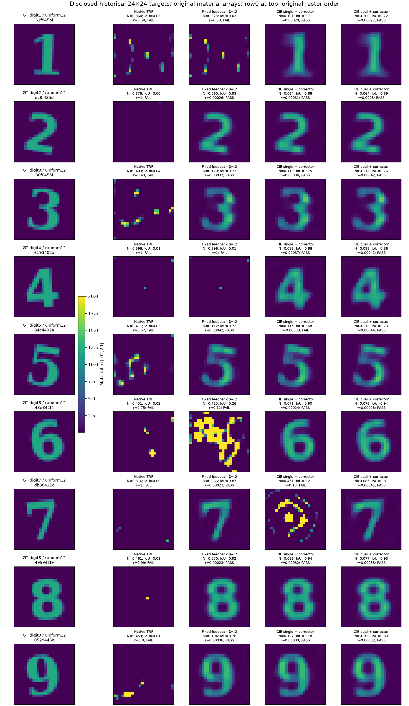
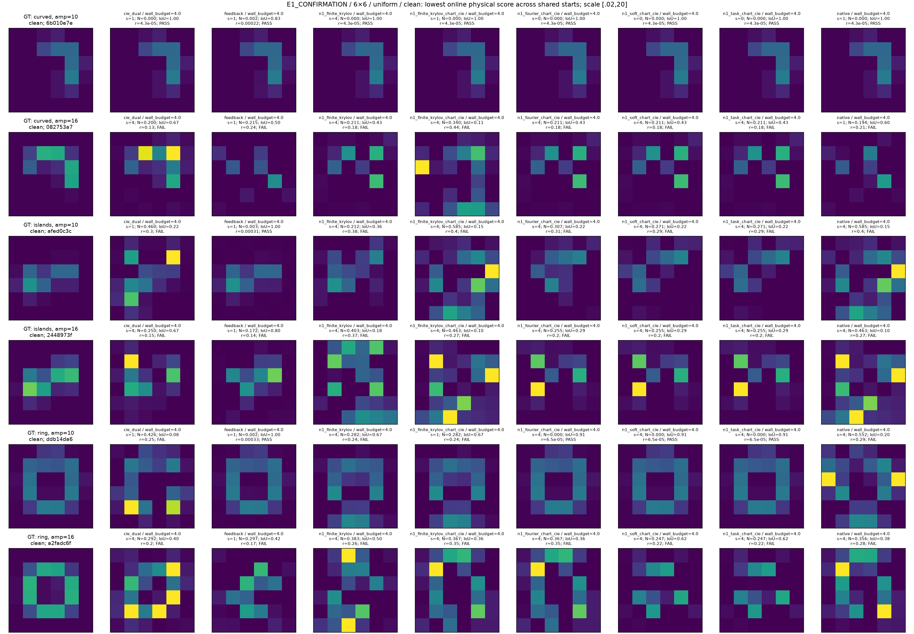
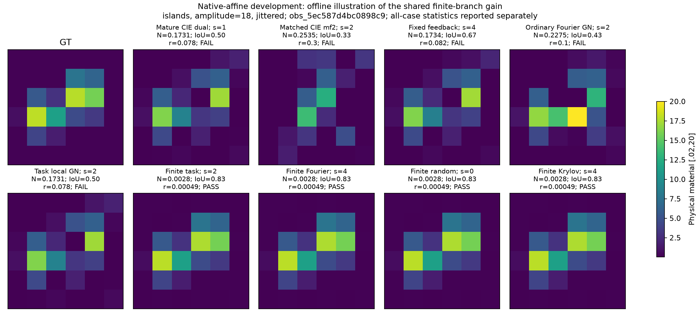
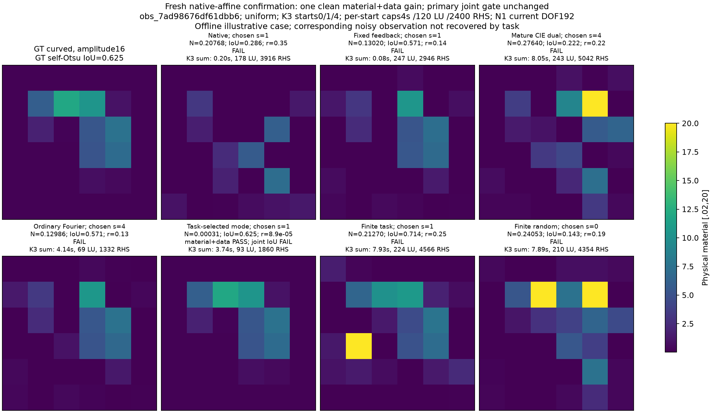
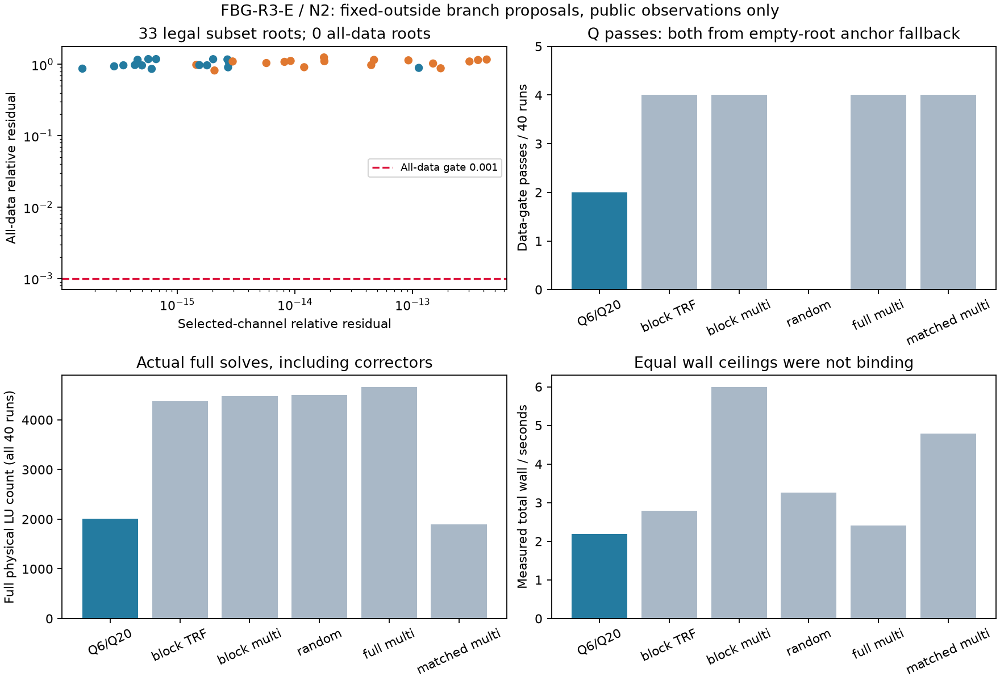

# Research FBG-R3-E：受控辅助电流释放与成熟 CIE 成像的实际研究

> 2026-11-01。二维 scalar-TM、完整多次散射 VIE。主研究与子任务均使用 Codex Sol；未使用 Astra、DeepSeek 或大型网络。主批次已保存5748条唯一推断执行回执，另记DEV、setup与失败成本；重复引用的封存结果不重复计数。成熟基线、N1有限正面证据、未复现的总体优势和N2负面结果分别归因。

## 1. 最重要的实际结果：高对比度数字 1–9 已经全部恢复，但贡献属于成熟 CIE

本轮补齐了此前缺失的强基线：按照 CIE-I / Fourier-TSOM 原理实现 DPCS/APCS、共享实材料读出、Fourier 模式增长、材料/电流不同反馈参数，以及原始 Maxwell 目标校正。在原来已经公开的12个576材料高对比度目标上，双 β CIE 加共同物理校正达到 **10/12 联合成功，其中数字1–9全部成功，另一个成功对象是双岛；环和新弯条仍失败。**

这纠正了“现有方法只能恢复某几个数字”的过早印象。它没有证明新的 N1 或 A17 选模有效；首先说明成熟辅助电流算法必须作为强对照，而不是以很短的交替原型代表它。

图中每幅材料有576个独立实未知量，统一色阶 [.02,20]。没有按数字模板、GT支撑或已知轮廓减少自由度。显示采用原历史 PIL 栅格的 row0-at-top 方向；物理数组和评分未作翻转。N 表示 RMSE/预声明材料增量12，r为完整原始观测相对残差。

| 同一历史12目标；45秒任务上限 | 数据成功 | 材料+数据成功 | 联合成功 | 中位 NRMSE | 中位 IoU |
|---|---:|---:|---:|---:|---:|
| Native Full-J TRF | 0/12 | 0/12 | 0/12 | .39924 | .01209 |
| 固定 β=.2 Feedback Gram | 8/12 | 8/12 | 8/12 | .10823 | .75556 |
| 单 β CIE + 原物理校正 | 9/12 | 9/12 | 8/12 | .10416 | .76924 |
| 双 β CIE + 原物理校正 | 10/12 | 10/12 | 10/12 | .09413 | .81530 |

联合门固定为 NRMSE≤.15、IoU≥.7、clean全数据残差≤.001。单 β 的数字5虽然达到材料和数据门，但IoU=.67826，仍记联合失败。双 β 相对固定反馈新恢复了数字1、4、6，却失去了环；不是逐对象支配。

**这些是已披露历史对象的成熟基线实验，不是本轮新盲测，也不是 A17/N1 的新增成功。** N1/N2没有通过扩大到576维的机制门，不能为它们制作不存在的576维预测列。完整12对象、失败图和误差图均保留：

- [全部12个目标](figures/fullwave_all_shapes.png)
- [九数字绝对材料误差](figures/fullwave_digit_errors.png)
- [逐案例原始评分](results/e3_all_scores.csv)

## 2. 实际研究问题与执行范围

研究分成三条独立证据链：

1. **成熟基线**：忠实适配 CIE-I / Fourier-TSOM 的算法结构，检验旧失败是否来自基线不足。
2. **N1**：在相同候选池、电流自由度、公共初始化和物理校正权限下，用材料步相关性选择、软释放或有限扰动辅助电流，检验是否增加正确材料恢复。
3. **N2**：固定补集，用精确有限 Maxwell 小核生成 Q6/Q20 条件根，与获得同一个小核的 block-TRF、多起点和随机提案比较。

完整阅读用户提供的 R3-T 报告与复算包，尤其是第5–7、10–12节。理论报告是输入，不是成像优越性的既成证据。原输入保留在 [input/FBG_R3_Reproducibility](input/FBG_R3_Reproducibility/)，生产接线和复算见 [MATHEMATICAL_AUDIT.md](MATHEMATICAL_AUDIT.md)、[FORMULA_CHECKS.json](audit/FORMULA_CHECKS.json)。

本轮不做全域根枚举，不把优化轨迹上的许多点称为独立分支，不做概率后验积分。没有引入新增频率来暗中帮助单频反演。

## 3. 真实物理、公共先验与成功定义

固定矩阵 G、E、S，源为列：

$$L(m)=I-\operatorname{diag}(m)G,\qquad
j(m)=L(m)^{-1}\operatorname{diag}(m)E,\qquad
Q=E+Gj,\qquad F(m)=Sj.$$

材料对所有照明共享，m为实数，box [.02,20]。使用冻结 R4 的二维 scalar-TM disk-pulse VIE，保留完整多次散射。它不是三维矢量 Maxwell 实验，也不是 Born 成像。

- 小网格4×4、6×6重新组装同类物理模型，6源、16接收；没有直接裁剪原576阶Green矩阵。
- 大网格24×24，12源、48复接收，k=2π，全部576材料未知。
- 公共先验只含原R4的平滑与平滑TV；所有相关方法具有同一材料box、公开初值和原物理评分。
- clean门为全数据相对残差≤.001；noisy门≤.003。材料NRMSE按合同中的材料增量归一化，不按预测图重新缩放。
- 预测前景采用重建自身的固定256-bin Otsu规则；不按GT逐图调阈值。

在线最终选择始终使用

$$\Phi(m)=\tfrac12\|F(m)-Y\|_F^2/\|Y\|_F^2+\mathcal R(m).$$

**top1不是取GT最近的候选。** GT只在预测封存后用于NRMSE、IoU与离线 best@K。这里的候选集是确定性/公开随机提案的求解器档案，没有定义 posterior density、概率质量或概率加权成像。best@K优于top1只能说明覆盖或选择差距，不能冒充已经能在线识别GT。

## 4. 理论如何转成代码，哪些数学成立却不保证成像

### 4.1 实材料读出与0/2/4阶

固定辅助电流行j与q，在无耦合正则、内点和无极点条件下，

$$m_{\rm CSI}=\frac{\operatorname{Re}\langle q,j\rangle}{\|q\|^2},\qquad
m_\beta-m_{\rm CSI}
=\frac{\beta\|j-m_{\rm CSI}q\|^2}
{\|q\|^2+\beta\operatorname{Re}\langle q,j\rangle}.$$

所以CIE与CSI在真实物理电流上相同，一般非物理电流偏离激活二阶差异；物理材料切向的直线外推通常只有四阶差异，精确物理材料路径差异为零。这解释了为什么“更准确的物理切向”和“允许有用的非物理探索”是不同机制。

共享实材料的法向缺陷是

$$N_*(V)=\Pi_{Q_*}^{\perp,\mathbb R}L_*V.$$

法向能量不是越大越好。完整多源复系数模式组的某些归一化trace本来就可能相同。当前实现保留完整复内积与共享实材料约束，不用复LS之后随意取实部代替它。

本轮进一步从读出恒等式直接推得：**纯法向正负电流seed在材料读出中的二阶项相同，正负差只有O(t³)。** 因此两个电流符号不能自动算作两个相反材料basin的机会。完整条件、精确有理式与证明见数学审计第11节；这不是所有混合N1轨迹失败的因果证明。

### 4.2 剖面材料步的两条通道

同一冻结联合线性模型中，新增电流群导致

$$H_{\rm new}=H-D^TD,\qquad
g_{\rm new}=g-D^Tv,$$

$$p_{\rm new}-p=H_{\rm new}^{-1}D^T(v+Dp).$$

代码同时更新曲率与梯度，用原物理材料JVP评估入围模式，加入实际box和共同先验。只看到Hessian降低并不说明信息增加，也不说明能跨盆地。

软释放在残差QR坐标中惩罚，使用同一α对H和g降阶；不是把候选模式缩小一个常数。相同span的dressing不增加方向，本轮保留no-op控制。生产正则局部曲率为正定IRLS近似，并非平滑TV精确Hessian；生产有界QP没有逐步完整KKT证书，不能写成认证最优材料步。

### 4.3 表示容量是第一道障碍

对于固定辅助电流族 j=j_a+Ua，数据拟合有标准投影下界：

$$\min_a\|W_y(Sj_a+SUa-Y)\|
=\|(I-P_{W_ySU})W_y(Sj_a-Y)\|.$$

初始原型只有一个接收方向、一个Fourier方向和一个候选，其最佳可表示数据尾仍为当前残差的约.554–.850。这是表示失败，不能通过加迭代或法向seed消除。我们据公开接收谱补全可靠可见方向，保留原失败而没有重写历史。

这个下界只约束辅助空间，不约束随后可以离开它的全材料corrector。另一方面，

$$F(m)-Y=(Sj-Y)-S L(m)^{-1}[j-\operatorname{diag}(m)(E+Gj)].$$

因此辅助数据小不等于真实物理数据小；小状态缺陷也可能被resolvent放大。

### 4.4 A17的归因边界

本轮N1采用A17强调的“模式对材料步的残差拉回与曲率作用”进行任务选模，**没有运行A17原生向量Galerkin模型的条件current exchange后端**。两个问题都出现Schur补，不足以证明A17原生exchange对本轮成像具有独立因果贡献。即使N1有收益，也须首先归为当前实现的材料任务选模收益。

## 5. 成熟 CIE 基线：为什么不能只运行很少的交替次数

按照2019年 CIE/FFT-TSOM 的算法原理，实际实现包括：

- 接收SVD及数据决定的DPCS；
- receiver-dark/APCS中的Fourier展开；
- 原生复系数PR-CG和二次方向步；
- 共享实材料的modified-contrast读出与合法box；
- Fourier mask和β分阶段变化；
- 材料与电流不同β的dual版本；
- 同一材料先验与原始完整Maxwell物理读回。

公开DEV中，按原论文类型的系数阈值较早停止时仅22/23步，物理残差仍为.3266/.0782。**相同mask/β，不改数据和初值，严格停止运行305步后，残差达到4.27e-4/2.66e-4。** 这说明简单100次或更短交替端点不足以裁决成熟CIE能力。

本轮为二维scalar-TM适配，Fourier列采用显式缓存计算；没有实现原三维论文CG-FFT的大规模复杂度，也没有称其为逐项重现三维论文实验。直接先例、全文可获取边界和停止规则见 [CIE_TSOM_BASELINE_AUDIT.md](CIE_TSOM_BASELINE_AUDIT.md)。

主要原始文献：

- [Zhong & Xu，2019，Contraction Integral Equation for Three-Dimensional Electromagnetic Inverse Scattering Problems](https://doi.org/10.3390/jimaging5020027)
- [Cross-Correlated Contrast Source Inversion](https://arxiv.org/abs/1906.10864)
- [A Penalty Method for PDE-Constrained Optimization in Inverse Problems](https://arxiv.org/abs/1504.02249)

辅助状态、状态约束释放、变量投影和Schur消元都有直接先例。不能将它们本身写为本轮原创。检索遇到服务429的缺口保留，未声称完成穷尽先例审查。

## 6. N1：已完成的机制实验与最后一个同容量分支

### 6.1 旧 anchored 原型：改进状态权重仍没有独立覆盖

开发集为3种固定几何×2幅度×2物理网格=12个材料合同，两种布局形成24观测，五个公共初值。布局/初值不是独立材料样本。

| K5在线结果 /24观测，每起点4秒 | 数据成功 | 联合成功 |
|---|---:|---:|
| 严格CIE single/dual | 13 | 10 |
| 固定β反馈 | 12 | 10 |
| GlobalDual | 8 | 8 |
| 普通材料梯度正负seed | 6 | 6 |
| CSI-state N1 finite task | 7 | 5 |
| CSI-state N1 finite Fourier | 7 | 5 |
| CSI-state N1 finite Krylov | 9 | 7 |
| CIE-state N1 Fourier / task | 10 / 10 | 7 / 7 |
| CIE-state N1 soft | 11 | 8 |

有限任务选模没有优于普通Fourier种子，现有新增端点覆盖不超过成熟CIE、固定反馈、Native的组合。组合仅用于判别是否新增案例，**不是等成本portfolio优越性表**。

另做了共同总预算控制：每起点.8秒、五起点，原生物理预付上限120LU/2400复RHS。固定反馈与CIE dual均9/24联合成功，N1 task/finite/Krylov均2/24。失败计算与预算停止全部入账，没有为了成功扩大预算。

### 6.2 旧分支的新鲜确认

冻结方法后，另生成6个变化对象，幅度10/16、两种布局、clean与相对复噪声1e-3。576次预测全部封存后才授权读取新目录GT。各方法共享3起点，每起点4秒/120LU/2400复RHS。

| K3在线联合成功 | clean /12 | noisy /12 |
|---|---:|---:|
| 固定β反馈 | 6 | 6 |
| 成熟CIE dual | 4 | 3 |
| Native | 2 | 2 |
| CIE-state N1 Fourier | 4 | 4 |
| CIE-state N1 task | 4 | 4 |
| CIE-state N1 soft | 4 | 4 |
| CIE-state finite Krylov | 2 | 2 |

任务选择和soft未优于Fourier；有限释放没有显示新增强基线遗漏的恢复。这个确认只针对当时冻结的 anchored 实现，不可追溯用于后面新变体。

### 6.3 为什么还必须补一个 native-affine N1

旧6×6 anchored实现虽补全了16个接收可见方向，但dark/APCS自由度只有约2个；成熟CIE可优化更多APCS。总DOF接近不代表自由度分配、仿射偏移与目标相同，不能由旧负面结果宣布整个方向失败。

最后分支固定数据决定的 jD，保留15个APCS core，加一个同秩替换的APCS群，共16空间复模式、6源、**192个实电流自由度**。与固定mf2 CIE具有同样容量，使用同一β=.2、源归一化joint目标、材料box与先验。所有选模共用池；普通Fourier、能量、随机、normal、材料步hard/soft及有限正负seed均纳入。原物理评分与source-weighted辅助评分明确分开。

本分支属于旧GT已披露后的受控开发，不重新称盲测。它从非物理DPCS电流起步，因此不能直接把物理锚点0/2/4阶定理套用到第一步。新代码包含不可省略的DP·e。

本分支实际运行660次，另外复用180条已封存的强基线记录作参考，不重复记成本。零执行异常，零LU/RHS上限越界。K5结果：固定Fourier、energy/random/normal、task hard/soft、固定mf2 CIE、完整成熟CIE及固定反馈均为 **6/12联合成功**；四种finite控制——任务、Fourier、随机、Krylov——均为 **7/12**。

共同新增的是高对比18、jittered照明的一个双岛观测 `obs_5ec587d4bc0898c9`。有限seed后的在线候选达到 NRMSE≈.002779、IoU=.83333、原数据残差≈.000493；普通局部任务选模、成熟CIE、固定反馈以及原材料正负seed在这个观测上均未成功。它是实际材料恢复增量，不是单纯IoU变化或辅助目标下降。

但该增量**不是A17任务选模独有**：四种有限current方法最终都能找到它，随机finite在K1已达到7/12，而任务finite需其他公共初值才补入该例。普通局部N1五起点汇总实际约67–71秒，finite约137–142秒，固定mf2 CIE约113秒、完整CIE参考约155秒；不同Green/QR及实际物理预算另计，不能只用更少LU宣称整链更快。

因此保留一个有限、正面的开发结论：在合理的原生APCS空间内，有限辅助电流探索能够产生当前公开局部corrector未达到的正确材料端点；**这份开发集尚无任务选模、normal排序或soft本身的独立增益，也没有证明不同Maxwell等响应根。** 全案例统计见 [e1_native_tsom_scores.json](results/e1_native_tsom_scores.json)。随后在冻结配置后生成了另一组新匿名对象，不复用旧确认集。

### 6.4 Native-affine 新鲜确认：一个真实材料增量，总体联合优势未成立

新配置于06:45:53 UTC冻结，之后才生成6个变化材料对象，幅度10/16、两布局、clean/noisy。648次预测于06:49:31 UTC全部封存，随后才授权读新目录GT。每方法三个公共起点，4秒/120LU/2400复RHS上限；零执行异常、零已记录物理上限越界。

| K3在线结果 /12观测 | clean 材料+数据 | clean 联合 | noisy 材料+数据 | noisy 联合 |
|---|---:|---:|---:|---:|
| 成熟CIE dual | 6 | 6 | 6 | 6 |
| 固定反馈 | 5 | 4 | 5 | 5 |
| Native | 4 | 4 | 4 | 4 |
| 直接材料正负seed | 6 | 6 | 6 | 6 |
| 普通Fourier N1 | 6 | 6 | 6 | 6 |
| 任务选择 N1 | **7** | 6 | 6 | 6 |
| finite Fourier / random | 6 / 6 | 6 / 6 | 6 / 6 | 6 / 6 |
| finite task | 3 | 3 | 3 | 3 |

原生task在一个clean、幅度16的弯条上，从两个公共初值恢复到 NRMSE≈.000310、完整数据残差≈8.9e-5；成熟CIE、固定反馈、普通Fourier及材料seed均未在该观测成功。**这是真实的36材料恢复，不应该被笼统写成“全部N1无效”。** 但它的IoU=.625，而GT自身按预声明Otsu与occupancy mask的比较也只有.625，故原联合门仍FAIL，不事后改门。noisy配对没有复现这项新增恢复。

从已付费日志可见，task选中随机字典中的 `random_native_3`，192→192实DOF；两个成功起点各只校正一个材料seed，与Fourier对照一致。完整费用分别44LU/906RHS与27LU/532RHS，Fourier各23LU/444RHS；相近wall不是相同实际物理工作。两个最终成功点均由共同原物理corrector读出，不能归因于辅助拟合本身。

为避免将“存在一个有用随机模式”冒充任务打分的独有能力，**在GT已披露后**另做24次针对性组件诊断：同一clean/noisy对象、相同三个起点和预算，比较普通random、energy、normal与soft。normal在一个clean起点、soft在另一个clean起点也恢复到相同材料；random/energy未恢复，全部noisy控制未恢复。该诊断明确不称新鲜确认、不外推成功率，原648次预注册结果不变。

最终N1判断：**有有限的、经原物理验收的开发和新鲜材料恢复正面证据；没有总体联合恢复提升，没有A17任务打分的独占机制证据，也没有证明finite task优于普通finite探索。** 原开发集7/12对6/12的generic finite增量未在新确认形成新增覆盖。576维N1优越性门保持NOT_RUN，下一步需要跨对象确认再扩大。

新鲜全图与成本见 [native确认汇总](results/e1_native_confirmation_scores.json)、[统一色阶clean图](figures/e1_native_confirmation_materials_side6_uniform_clean_p1.png)、[成功率与实际成本](figures/e1_native_confirmation_K1_K3_cost_curves.png)；事后组件独立保存于 [posthoc评分](results/e1_posthoc_mode_controls_scores.json)。

## 7. N2：找到了不同的条件根，没有找到新的完整成像解

在真实小网格上，固定补集的精确响应为

$$F_A(d)=F_0+O_A(I-\operatorname{diag}(d)C_A)^{-1}\operatorname{diag}(d)E_A.$$

使用真实4/6坐标支持，不是任意current latent。构造核的k个完整RHS计费；block-TRF、多起点、随机方法获得同一个核，没有让代数方法独占低成本精确物理。

240次执行、120个数值图册，共得到33个实且box合法的subset roots。选定通道残差≤4.27e-13，多个同图册材料RMS相距.875–3.143；但**全部观测残差为.822–1.251，没有一个提案达到全数据门。**

代数法两个成功端点来自没有根时的公共anchor回退，不是根提案的贡献。数量匹配的block多起点在数据门上4/40，代数法2/40；均2/40联合成功。没有N2独立增量。

这不否定原Q6/Q20条件理论：outside材料错误时，子观测根没有理由也是全部观测的根。它准确指出了直接拼接低维求根与全图corrector的缺口。没有声称576维根覆盖或严格all-roots认证。

完整实现、筛根、失败分类见 [N2_ALGEBRAIC_MULTIBRANCH.md](N2_ALGEBRAIC_MULTIBRANCH.md)。

## 8. 576维计算费用与资源使用

使用已有RTX4060/i9后端，共享不可变G/E/S，一个CUDA进程、2个私有stream和有限FIFO队列；源作为同一个LU的多RHS。没有安装CUDA服务、改变精度/驱动、许诺固定SM分配或将利用率当occupancy。

| 12目标方法 | 实际worker wall之和 /s | 完整LU | 实际复RHS |
|---|---:|---:|---:|
| Native TRF | 296.8810 | 1,192 | 71,520 |
| 固定β=.2 | 421.3715 | 20,391 | 489,024 |
| CIE single | 540.1542 | 15,926 | 381,660 |
| CIE dual | 540.2338 | 11,825 | 283,272 |

worker时间和1798.6405秒；两个2-lane队列实际elapsed合计930.279秒。共享setup约3.47665秒、6LU/72source RHS、3次operator upload单列，不按任务重复收费。SVD、Fourier G/S列、CG、inner material、校正和拒绝试探也保留。

这是同一硬件下的实际预算结果，不是CIE收敛上限。单β仅3/12完成全部current阶段，双β仅1/12完成；双β9/12到达mf10。**很多任务仍被wall截断，不能因当前失败就说成熟CIE再算也无效。**

Native的一些任务在45秒前按成熟TRF停止规则终止；没有人为删除剩余机会来制造优势，但也不能把未消费时间算作同等实际算力。本文同时给wall、LU和RHS，不只报迭代数。完整账本：[COST_LEDGER.csv](results/COST_LEDGER.csv)。

## 9. 真实失败、盲测偏差与不能声称的内容

- **旧E1真值访问偏差**：第一次E2离线评分时，评分器急切加载了旧集全部12个GT，E1尚未全部闭合。没有把GT数组/评分反馈给在线求解，但读取已发生。旧E1只能称开发/机制研究；修复lazy-loading不能追溯消除此事。新确认使用独立private目录，闭合后才读取。
- **粗网格IoU门问题**：旧12合同中4个GT自身的固定Otsu IoU只有2/3；材料精确恢复也可能联合FAIL。保留原门，同时单列材料+数据成功。第一组旧分支新确认GT自IoU≥.8889；第二组native确认的一个弯条GT自IoU=.625，确实影响其联合门。两个确认集不可混淆。
- **旧N1容量问题**：初始receiver空间不足、后续dark容量分配不足分别保留，不能都写成normal理论失败。
- **实际代码异常**：两个旧TRF seed因QP加法后的ulp越界发生运行异常，记录保留；后续统一将seed投影回相同公开box，不重跑旧失败。
- **成本缺口**：早期一次JSON序列化失败前已完成24LU/144RHS，wall未单独测量；第一次远程detached启动随SSH退出，实际物理成本不可恢复，标UNMEASURED。预算中断时少量未返回的aux计数标NOT_RECORDED，不填0。
- **没有概率或全根结论**：archive不是概率解集；subset roots不是全问题roots；不同迭代点不是独立等响应分支。
- **没有A17必要性证据**：当前没有原生Galerkin exchange对照，不能把任务相关Schur选模的任何结果直接计为A17独立贡献。
- **没有N1/N2的576维优越性结论**：扩大实验门按机制证据决定，未运行就写NOT_RUN，不能借成熟CIE图作N1成功图。

## 10. 论文判断与最短后续路径

当前最强的正面证据是**成熟辅助电流方法在同一高对比全波任务上恢复九数字**，它补齐重要比较缺口，但方法基础属于已有CIE/TSOM与物理校正。N1另有一个开发有限seed增量，以及一个新鲜clean材料+数据恢复增量；二者范围有限、机制不同，没有形成总体或576维优越性。不能以此宣布发明新的Maxwell全局算法。

本轮经严格推导与实现留下了有用的研究资产：完整联合导数、同秩材料步选模、坐标不变软释放、有限currentseed规范、精确有限小核与公平同核对照，以及把“表示能力”“辅助拟合”“物理恢复”“GT选择”拆开的证据。**数学结构正确不等于新成像收益成立。**

下一轮应优先解决：如何在合理APCS空间中，由当前数据与真实有限材料响应预测一个current proposal能否被物理恢复；而不是继续增加normal能量、扩大current自由度或更多随机seed。纯局部profile收益与有限恢复之间缺少的箭头，才是需要新理论的地方。新鲜task成功起点之一的原物理局部预测收益实际上为负，最后却成功，说明简单正收益门同样可能拒绝有用探索。

最终GO/HOLD裁决见 [PAPER_CANDIDATE.md](PAPER_CANDIDATE.md) 与 [独立科学复核](audit/SCIENTIFIC_REVIEW.md)。复现入口见 [REPRODUCE.md](REPRODUCE.md)，交接见 [CODEX_TO_PRO_HANDOFF.md](CODEX_TO_PRO_HANDOFF.md)。

完整源码、原始数组、全部逐运行轨迹和依赖快照见 [完整下载](ARTIFACTS.md)；结构化汇总 [RESULTS_SUMMARY.json](results/RESULTS_SUMMARY.json)、逐案例表 [RESULTS_BY_CASE.csv](results/RESULTS_BY_CASE.csv)、拒绝记录 [REJECTED_CANDIDATES.csv](results/REJECTED_CANDIDATES.csv) 一并公开。研究始于05:19 UTC，数值与科学结论在约两小时内关闭，未消耗完三小时软上限来补无价值的随机扫掠。

