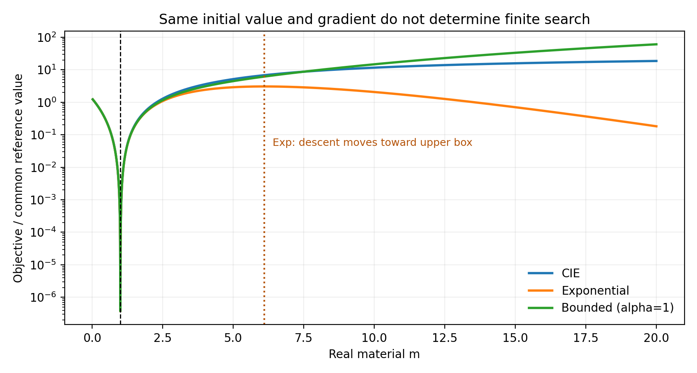
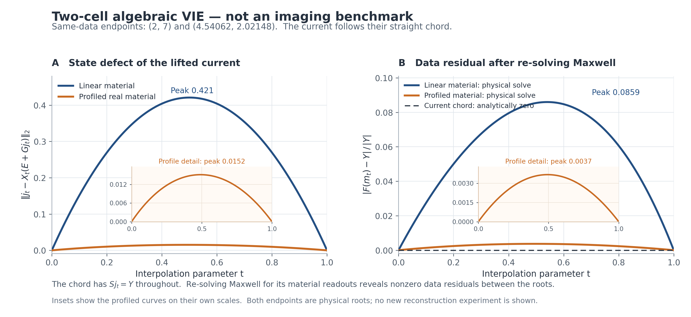

# 执行结论：最值得继续的是材料约束的法向几何

本轮的独立判断是：**继续争取一条超越成熟 CIE-I 的方法主线，但把数学中心从“寻找更好的反馈函数”转到“共享材料约束下，哪些辅助电流自由度值得释放，以及这种释放怎样改变材料更新”。** 保留 FFT-TSOM 的物理作用，利用 A17 对材料步相关性的认识，研究可计算的电流增广、替换和物理恢复；把小块代数多分支作为另一条独立算法，而不是一开始把所有模块串联。

这并非放弃 A17 到 CIE 的联系。恰恰相反，本轮获得了比外形相似的分式更明确的联系：CIE 的有限材料读出包含一个由共享材料不相容缺陷驱动的项；该项对一般非物理电流扰动是二阶，对真实 Maxwell 电流切向的直线延伸是四阶，对精确物理电流路径则恒为零。因此，A17 的物理切向模型与 CIE 的自由辅助电流不能混为同一个对象。它们的关系应通过材料可实现性和有限误差来描述。

## 四个最重要的结果

1. **有限 CIE 读出恒等式。** 对实材料、固定电流和固定正归一化的理想逐行材料块，令 $q=E+Gj$，$m_{\rm CSI}=\operatorname{Re}\langle q,j\rangle/\|q\|^2$，则
   $$m_\beta-m_{\rm CSI}=\frac{\beta\|j-m_{\rm CSI}q\|^2}{\|q\|^2+\beta\operatorname{Re}\langle q,j\rangle}.$$
   分母为正时，正 $\beta$ 造成单侧材料抬高，其幅度由本构不相容决定。它不是“真实材料敏感度自动变小”的定理。
2. **0/2/4 阶次区分。** 对上述实 modified-contrast 理想逐行块，精确物理路径上读出差恒为零；一般辅助电流扰动激活二阶差；沿 $T_h=(I-XG)^{-1}X_hQ$ 的直线电流路径，差从四阶开始。实材料的投影必须在 $\mathbb C^p\simeq\mathbb R^{2p}$ 上定义，不能删掉相位不相容。
3. **辅助电流释放的材料步公式。** 在固定局部联合最小二乘模型中，新增电流模式对剖面材料 Hessian 和梯度分别产生 $-D_C^TD_C$、$-D_C^Tv_C$。两项共同决定材料步，而非电流能量单独决定。可建立精确步差和稳定界；但这个 Hessian 不是 Fisher 信息，降低它有时只是删除了截断电流造成的虚假刚度。
4. **多分支的真实通道。** 两个同数据物理解之间，电流线性插值始终保持数据相容；其本构缺陷精确为 $t(1-t)\Delta X\Delta Q$。这给出一个可量化的松弛通道。相反，仅改变正定残差度量，不能把一个满列秩孤立精确根连续移到另一根。

这四项连接成一条可研究的逻辑：**物理电流流形与数据相容空间的相对几何，决定了应该释放什么、怎样控制释放，以及何时校正回真实材料。** 本文将它作为论文候选结构；并未宣称已经完成新颖性优先权认证或证明高维全局收敛。

## 推荐次序

**第一优先：受控辅助电流释放。** 完整材料 $m$ 加 FFT-TSOM 电流系数 $a$；以双侧材料步相关性、剖面步稳定性和完整物理候选评价选择电流模式。与成熟 CIE-I/FFT-TSOM、普通 Krylov 增广、自由全电流和能量选模分别比较。

**第二优先：小块代数多分支。** 在真实空间支持上构造精确有限响应，复用 Z-ALG 的条件小规模多根结构，生成多个材料候选后释放全材料做 corrector。它改变提案机制，应与共享同一精确小核的 block-TRF、多起点和普通材料提案比较。

**保留为机制对照：非线性反馈 Gram。** R2 的固定 $\beta$ 是已付费且有正面证据的基线。指数、有界反馈与非物理匹配 bias 用来区分一阶偏置和有限几何；在没有独立证据前，不把它们升级为主论文方法。

# 研究范围、原始来源与证据边界

## 实际研究组织

本轮实际使用主研究者及三个独立并行研究者，共四条研究线，覆盖任务书的八个角色；不是八个独立实例。

|实际研究线|覆盖角色|独立提出的结构|关键交叉审查|
|---|---|---|---|
|文献与 CIE/TSOM|A、F|成熟 CIE 结构；有限读出缺陷恒等式；2021/2026 直接近邻|核实原论文是复材料 LS；不能把实材料版本冒充逐字复刻|
|A17 与反馈算子|B、D|两类电流空间的区分；剖面 Hessian 释放及步界；算子合法性|确认物理切向上的四阶项；反例说明曲率下降不等于信息损失|
|新变量与分支|C、E|物理电流法向；精确根不动命题；有限电流弦线通道|确认 A17-X 已有有限端口与 row completion；不重复计创新|
|主研究者|G、H 与整合|源基/噪声协变；匹配 jet 反例；0/2/4 阶次桥接；候选筛选|区分已证命题、已有文献、代数核验和未运行成像|

每条线的完整研究稿纳入复算包。正文已经整合各线的 formulation、条件、失败机制和决定性实验。

## 来源冻结与可用性

主研究仓库固定版本为：

`6659aa49dff2535996d40962791e9a5a6e974adc`

A17 仓库本轮读取版本为：

`2ac81b989a2f13d62df9d5a7abd690a33c2189c7`

下文所有历史数字都来自已读取原文，未重跑历史预测数组。

|原始资料|取得和核对范围|
|---|---|
|A17|CORE_THEORY、CONDITIONAL_EXCHANGE、最终论文 TeX 入口及全部引用附录；局部 GN、非线性配对与成本结论|
|A17-X|正式完整中文报告；有限端口、共享材料 completion 及实/固定相位限制、缺陷传播、finite-response selector 既有内容|
|FBG-R2|任务书指定六份文档全部读到，另读 ILLUMINATION_GEOMETRY；以最终科学审查约束归因|
|Z-ALG|R2 原报告/理论；R3-DIGITS、R4-BASIN、R4-DIVERSITY 报告及相关理论|
|R10|BILATERAL_OPERATOR_THEORY、主报告和跨形状复用追加结论|
|FBG-R1|原始 Research_FBG_Report_ZH.pdf，25 页，完整文字已取得并核对核心推导|
|FP-T R1|原始 Research_FP_T_Report_ZH.pdf，26 页，完整文字已取得，重点核对常秩、伪根、高阶与坐标边界|
|CIE 2016/2019|2016 作者上传全文；2019 原始 XML/全文，含算法、实验和双 $\beta$|
|直接外部近邻|DCTMC、2025 约束松弛、2021 smart rewritings、2026 LUCIE 作者全文；WRI、CC-CSI、LRWI 按文末注明范围|

**SOURCE UNAVAILABLE：生成任务书的整个旧 ChatGPT Session 的逐条完整记录。** 本轮检索到相关上下文与原始报告，但不能把上下文摘要称为完整会话读取。上表指定的必需原报告本轮均已取得；子研究者工作稿中曾标“本线不可用”的 FP-T，已由主研究者取得补齐。

本轮运行的是小型复矩阵、两单元代数 VIE 和线性最小二乘核验。**没有运行新的 24×24/576 材料全波成像，没有新的 1–9 成功率，没有三维或实验数据性能结果。** 任务书允许先完成理论，本报告据此将真正昂贵的实验放在可执行 Handoff 中。

## 必须继承的正面与负面结果

FBG-R2 新鲜高对比 clean 联合门为 NRMSE $\le .15$、重建自身 Otsu-IoU $\ge .7$、完整相对数据残差 $\le .001$；主物理是 24×24 全部 576 个独立实材料、12 源×48 复接收、box $[.02,20]$、8→12→24 材料尺度。各方法名义上限一致，实际消耗并不相等。[R2]

|方法|高对比联合成功/12|平均 wall/s|平均 LU|平均复 RHS|
|---|---:|---:|---:|---:|
|Native Full-J TRF|0|27.70|92.0|5,520|
|Reciprocal Full-J TRF|0|34.00|126.3|6,964|
|Data L-BFGS|0|19.25|407.3|9,812|
|GlobalDual 全阶段|3|36.01|768.2|18,436|
|固定 $\beta=.2$ 反馈 Gram|8|41.89|884.8|21,208|
|自动 Q-beta|6|41.22|922.4|22,121|

固定反馈恢复数字 2、3、5、7、8、9，以及环和双岛；1、4、6 与新弯条失败。相对 GlobalDual 增加六个对象，也丢失一个对象。这个结果支持继续研究反馈残差几何；不支持成熟 CIE-I 已被超过、A17 Schur 是收益来源，或总体省算。成功固定反馈的场切向能量在部分案例增至原来的约 2–3 倍，直接否定“越衰减切向越容易成像”的默认解释。[R2]

普通多起点 GlobalDual 在部分既有对象也能扩大覆盖；R2 的某组 $K=8$ 多起点达到 3/3，但固定总时长分给更多短轨迹又可能伤害固定反馈。多源噪声重复不是更多独立材料对象。因此新方法必须对齐总探索机会与实际费用，不能把多起点本身的收益全部归给反馈。[R2]

R4-BASIN 的有限搜索曾把新数字 7 数据残差从约 .7625 降到 .01542，却把材料 RMSE 从约 5.05 增到 10.89；三个新目标联合门均失败。R10 的固定形状 rank64 在 320/320 查询通过，跨形状旧基却 0/192 通过，实际回退耗时约为直接 LU 的 2.249 倍。这些结论要求新算法检验空间结构变化与真实成本，不能继续把更多幅度射线或旧基直接复用当成突破。[R4B,R10]

A17 原论文已有局部 GN 步保真度与少量非线性正面结果；三个完整非线性配对的材料误差改善不等于加速，wall 均更高。这与 R2 尚未证明 A17 独立成像增量并不矛盾：两者问题、模型和实验作用不同。[A17]

# 统一物理与成熟 CIE-I 的实际机制

## 符号、材料和内积

使用离散同频模型
$$L(m)=I-X(m)G,\qquad j=L^{-1}XE,\qquad Q=E+Gj,\qquad F(m)=Sj.$$
主问题 $X=\operatorname{diag}(m)$，$m\in[.02,20]^n\subset\mathbb R^n$；$j,Q,E\in\mathbb C^{n\times p}$，$S\in\mathbb C^{r\times n}$。除明确讨论松弛变量外，假定物理 resolvent 可逆。符号 $j$ 是电流，$\mathcal J=DF$ 是材料 Jacobian，避免混淆。

复数据对实材料求导采用 $\langle A,B\rangle_{\mathbb R}=\operatorname{Re}\operatorname{tr}(A^*B)$。共享实材料的逐行空间是 $\mathbb C^p$ 作为 $2p$ 维实 Hilbert 空间。已知可分离噪声可一致白化源/接收；一般相关噪声应对向量化残差整体白化，不能无条件改成源端小 Gram。

原始物理验收目标为
$$\Phi(m)=\frac12\|\Sigma^{-1/2}\operatorname{vec}_{\mathbb R}(F(m)-Y)\|^2+\mathcal R(m).$$
公共先验 $\mathcal R$ 必须相同；坐标中的不同 ridge、TV 或支持约束会改变问题，不能归为纯算法收益。

## CIE 是联合电流方法，不只是一条分式

令 $r_\beta=\beta m/(1+\beta m)$，则状态方程逐行可写为
$$\beta j=r_\beta(q+\beta j),\qquad q=E+Gj.$$
固定同一电流与材料，其状态残差满足
$$\beta j-r_\beta(q+\beta j)=\frac{\beta}{1+\beta m}(j-mq).$$
因此，modified contrast、状态误差加权、临时非物理电流和材料读出相互耦合。若每次已经精确消去电流并仍优化相同 $\Phi$，只换坐标不能删除其错误局部极小。[L1,L2]

以接收矩阵薄 SVD $S=U\Sigma V^*$ 为基础，SOM 取噪声允许的前 $\ell$ 项，构造
$$j_D=V_\ell\Sigma_\ell^{-1}U_\ell^*Y,\qquad
j=j_D+U_Aa,\qquad U_A=(I-V_\ell V_\ell^*)\mathcal F_{M_F}.$$
$j_D$ 是所保留接收模态的数据确定部分；$U_Aa$ 是待求的模糊电流。有限截断的 APCS 不等于精确 $\ker S$。FFT-TSOM 进一步限制其低频 Fourier 内容，以保留对域内散射有影响且可稳定处理的电流。它约束电流而非要求材料只能属于一个深度 latent。[L1,L2]

|结构|真正作用|不能自动推出|
|---|---|---|
|分式材料读出|压缩 modified contrast；改变离物理流形时的材料更新|原材料反问题全局收缩|
|CIE 状态残差|对本构缺陷施加材料相关权重|同一原数据目标被等价凸化|
|显式辅助电流|扩大搜索空间，可暂时不满足 Maxwell 本构|辅助驻点已经是合法材料解|
|DPCS/APCS|固定可靠数据成分，将其余电流交给状态与正则|小接收奇异值就对材料无关|
|FFT-TSOM|限制域内电流传播自由度，降低不稳定性|永久截断不会损失目标形状|
|逐轮 $\beta$ 与模态数|改变材料读出和可用电流自由度|存在普适最佳日程|
|两种 $\beta$|电流与材料块使用不同更新几何|仍是同一个固定目标的标准 BCD|

成熟单 $\beta$ 版本的六元组是：优化 modified contrast $r$ 与 APCS 系数 $a$；所有源共享材料、DPCS 固定、物理状态通过残差弱实施；目标为各源归一化数据误差与 CIE 状态误差之和；每轮 APCS 的 Polak–Ribière CG 后接逐点材料 LS；子空间为接收 SVD 与低频 Fourier 的双层截断；全局化采用继承前阶段结果的小到大子空间及大到小 $\beta$。典型共同目标写作
$$\mathcal L_\beta(r,a)=\sum_{s=1}^p\left\{
\frac{\|Sj_s-y_s\|^2}{\|y_s\|^2}+
\frac{\|\beta j_s-\operatorname{diag}(r)(q_s+\beta j_s)\|^2}{\|E_s\|^2}\right\}.$$
它每块并非都精确求至全局最小。2019 使用 APCS 系数相对变化小于 $10^{-3}$ 的停止条件，并继承前阶段估计；这种停止量不等同于真实材料恢复证书。原文允许复材料；2016 的逐点 LS 为
$$r_i=\frac{\sum_s w_s\overline{(q_{is}+\beta j_{is})}\,\beta j_{is}}
{\sum_s w_s|q_{is}+\beta j_{is}|^2}.$$
2016 已允许空间变化的 $\beta$，所以“空间自适应反馈”本身也不能作为新的概念贡献。[L2]

|原文配置|Fourier mask 参数 $M_F$|反馈参数|正文所示边界|
|---|---|---|---|
|2016 Austria，$\epsilon_r=3.5$|$5\to7\to10$|$6\to2\to .5$；另试 $5\to3\to1$|两组可得到相近结果|
|2016 Austria，$\epsilon_r=4$|$5\to8\to10$|$8\to2\to .5$|仍出现内部伪目标|
|2019 例 1、例 2|$6\to10$|$6\to1$|常规两阶段配置|
|2019 例 1第二阶段|10|电流 $\beta_J=6$、材料 $\beta_R=1$|双参数加速|
|2019 例 2第二阶段|10|$(6,1)$，再试 $(3,1)$|前者过早停止；后者改善|
|2019 例 3改进配置|$4\to8\to10$|$6\to1\to .5$|用于去除中央伪影|

$M_F$ 是论文定义的频域 mask 尺寸，不是总计 $M_F$ 个电流未知量。2019 的三维实验使用 60 偶极照明、60 个接收位置的三个场分量，合成/反演采用不同网格并加入噪声；它与当前二维物理、材料定义和归一化不同，表中数值不能直接移植。[L1,L2]

双 $\beta$ 实现必须在两块之间恢复同一个物理材料 $m$，再分别映射为 $r_{\beta_J}(m)$、$r_{\beta_R}(m)$。把同一数值 $r$ 直接带到另一个 $\beta$ 会改变其代表的材料。即便做了正确运输，两块仍针对不同状态度量；共同物理零点不等于共同 Lyapunov 函数。本轮未找到覆盖该双参数版本的一般单调性定理。

还有一个容易混淆的极限：未重标定的 CIE 状态权重为 $\beta/(1+\beta m)$，故 $\beta\to0$ 同时降低状态误差相对数据误差的权重。本文后面的 $m_{\rm CSI}$ 是普通材料 LS 读出以及 CIE 读出的零参数极限；不是将整个未重标定联合目标直接置 $\beta=0$。

对照必须保留 DPCS/APCS、实际 FFT 子空间、材料/电流交替、分阶段与双 $\beta$ 版本。R2 的 100 次联合电流原型不能承担成熟 CIE 的上限。对新理论的清晰消融可先采用单 $\beta$ 的共同目标，而将成熟双 $\beta$ 另列强基线；不能为了方便证明而删掉强基线的真实能力。

## 直接近邻及已有边界

|已有路线|变量与结构|本轮必须超出的部分|
|---|---|---|
|CSI、MR-CSI|材料与 contrast source 联合；本构误差和数据误差|交替最小二乘本身没有新意|
|CIE-I/FFT-TSOM|modified contrast、两层电流子空间、分阶段处理|复杂 $\beta$ 或换函数不能独立支撑论文|
|WRI/罚方法|联合状态-材料并松弛 PDE；变量投影消元|升维、ALM、罚参数 continuation 都已有|
|DCTMC|数据线性的 $T$，中间允许非局部材料，逐步恢复局部性|把 $T$ 叫 observable quotient 不产生新理论|
|CC-CSI|把状态和数据误差在测量域交叉关联|新的输出缺陷项必须和它比较|
|2021 smart rewritings|NIE/CIE 与虚拟实验、源重组、电流正则组合|可逆源混合不增信息，但已有优化价值；不能称首次组合|
|2025 约束松弛分析|消元后材料相关 Gram；特定完备状态空间下凸二次|不能把加权残差或完备照明凸化当首次发现|
|2026 LUCIE|大参数先估电流/支持，再依据估计总场做线性材料恢复|“先电流后材料”已经有直接方案|
|LRWI|rank-2 moment lifting 加 PDE 松弛，随后促 rank-1|一般 nonlinear lifting 不应脱离该近邻|

2025 凸性结论要求其状态空间由指定源/测量 representer 张成、内积固定且算子对材料仿射；不覆盖任意 $p<n$ 的 576 材料反演。[L5] LUCIE 的作者稿和 2026 DOI 已核对，但确切在线日期未确定；它的已展示样例不能被改写为当前 $\chi\le20$ 的同预算验证。[L7] 原文与核查范围列于文末。

# 一般反馈、梯度与不能绕过的等价性

## 广义反馈表示：成立，但约束很弱

对给定 $B_f(m)$，假定 $P_f=I+XB_f$、$M_f=I+B_fX$ 可逆，定义
$$\widetilde X=P_f^{-1}X=XM_f^{-1},\qquad \widetilde G=G+B_f.$$
则
$$I-\widetilde X\widetilde G=P_f^{-1}(I-XG),\qquad
\widetilde Q=M_fQ=E+(G+B_f)j,\qquad \widetilde X\widetilde Q=j.$$
证明由直接乘法得到，不使用 $X^{-1}$，因此允许零对比单元。非对角 $B_f$ 通常令 $\widetilde X$ 非局部，不能把它自由当作原来允许的局部材料。$B_f=\beta I$ 给 CIE 的缩放版本，$r_\beta=\beta\widetilde X$；这说明 CIE 属于共同的反馈代数框架，不证明它是 A17 现有定理的严格特例。

更强的反向观察是：在当前正材料 box 内 $X$ 可逆，对任意光滑可逆 $M(m)$ 都可以设置
$$B_f(m)=(M(m)-I)X(m)^{-1}.$$
于是 $I+B_fX=M$。所以“存在一个精确 Maxwell 反馈表示”本身几乎没有筛掉任意度量塑形。要有物理独立性，还需要指定模式来源、共享材料约束、可计算缺陷和真实任务增量。

若同时运输度量 $C=M_f^{-*}M_f^{-1}$，则
$$\widetilde Q^*C\widetilde Q=Q^*Q.$$
相应目标逐点不变，连度量导数一起运输后梯度也不变。固定变换后欧氏范数得到的是另一个辅助目标，不能称作原目标的等价凸化。

## 一般 Gram 梯度恒等式

设 $M_\phi(m)=\operatorname{diag}(e^{\phi_i(m)})$，$\phi_i$ 为实函数，$M_\phi(m_0)=I$，$Q$ 满列秩，$c>0$ 固定。记
$$f_\phi=\frac c2\operatorname{tr}\{R H_\phi^{-1}R^*\},\quad
H_\phi=Q^*M_\phi^*M_\phi Q,\quad R=F-Y.$$
在锚点令 $H=Q^*Q$、$W=RH^{-1}$、$D=W^*W$、$K_{ij}=\partial_{m_j}\phi_i$。矩阵求导给
$$Df_\phi[h]=c\operatorname{Re}\langle W,DR[h]\rangle
-\frac c2\operatorname{tr}(D\,DH_\phi[h]).$$
两个目标的 $R$ 与 $Q$ 导数相同，而新增项为
$$DH_\phi[h]-DH_0[h]=2Q^*\operatorname{diag}(Kh)Q.$$
因此
$$\boxed{\nabla f_\phi(m_0)-\nabla f_0(m_0)=-cK^Td,\qquad
d_i=(QDQ^*)_{ii}=\|(RQ^\dagger)_{:,i}\|^2.}$$
共同材料正则在梯度差中抵消。若 $c$ 随材料变化，必须另加 $Dc$；若 Gram 加 ridge，则 $d$ 应用实际 ridge 逆矩阵重算，不能仍写为无正则 $RQ^\dagger$。

均匀参考 $m_0=b\mathbf1$、归一化权重 $(1+\beta m)/(1+\beta b)$ 给 $K=\beta I/(1+\beta b)$，恢复 R2 的 F09。该修正是 $O(\|R\|^2)$；真根处为零，不增加原 Jacobian 的秩。它与后文 CIE 的本构缺陷偏置共享“误差平方激活”的形式，但两个误差和两个优化问题不同，不能相互替代。[R2]

## 固定反馈的完整导数与 A17 接口

令 $T_h=L^{-1}X_hQ$。固定 $B_f$ 时
$$D[(I+B_fX)Q][h]=(G+B_f)T_h.$$
故 $V=(I+B_fX)Q$、$W=R(V^*V)^{-1}$、$D=W^*W$ 时
$$Df_B[h]=c\operatorname{Re}\langle S^*W-(G+B_f)^*VD,T_h\rangle_F.$$
这可以复用原 Maxwell LU 和一次多源伴随。若 $B_f$ 依赖材料，还需加入 $(DB_f[h])j$。将该项遗漏后依然称作自适应目标的精确梯度，是错误实现。

共同精确锚点下，两个指定 Galerkin 切向模型的 A17 Schur 差 $\Delta T_h$ 可以代入上述线性泛函得到辅助梯度差。它只比较指定模型；到 Full-J 的未解析尾项必须单列，不能把条件增量称为全误差证书。[A17,R2]

## 场强生成元和 projector 导数不同

题中的 $K^{\rm field}$ 使用冻结的 $H^{-1/2}$，描述
$$\frac{\operatorname{Re}\langle Z_{i,:},(GT_hH^{-1/2})_{i,:}\rangle}
{\|Z_{i,:}\|^2+\varepsilon},\qquad Z=QH^{-1/2}.$$
它对可逆源混合不变，但包含已照明子空间内部的幅度变化。真正的 leverage $\ell_i=(P_Q)_{ii}$ 的导数为
$$D\ell_i[h]=2\operatorname{Re}\langle Z_{i,:},[(I-P_Q)GT_hH^{-1/2}]_{i,:}\rangle.$$
单元例 $G=.1+.2i,m=1$ 中，$K^{\rm field}=.0588235$，而 $P_Q=1$ 恒定、导数为零。这足以说明不能用前者冒充后者。即便采用正确 projector 导数，R2 也已否定单纯压低其变化能够保证成像。

直接逐列构造完整 $n\times n$ 的 $K^{\rm field}$ 需要处理全部材料方向；按题中切向求解实现，代价可达 $np$ 个完整 RHS。若只取 $Kh$，可用一个方向的 $p$ 个 RHS 加场作用实现，但这没有免费提供所有方向的矩阵。节点附近分母敏感，应按已声明的任务度量、节点处理与正则报告；不能用未经审计的 epsilon 掩盖不可辨识性。

## 源基、噪声与 Gram 正则

$E\mapsto EC,Y\mapsto YC$、$C$ 可逆时，$Q\mapsto QC$、$R\mapsto RC$，原始 Gram 目标和 $d_i$ 不变。非酉混合通常改变未运输的 Frobenius 数据损失及噪声协方差。

固定 $\epsilon I$ ridge 不具有一般源基协变性。可用 $H+\epsilon H_{\rm ref}$，并令 $H_{\rm ref}\mapsto C^*H_{\rm ref}C$；或在已知源噪声协方差白化坐标里施加 ridge。若真实源协方差为 $C_s$，则 $H+\epsilon C_s$ 是协变形式。rank 截断也须在一致的白化/广义谱中定义。更多真实测量在正确噪声模型下增加信息；可逆源混合没有增加信息，但可改变数值正则和搜索轨迹。[R2,L6]

## 有界函数与匹配 jet：一个严格反例

$\phi=\alpha\tanh(K(m-m_0)/\alpha)$ 给
$$e^{-2\alpha}Q^*Q\preceq Q_\phi^*Q_\phi\preceq e^{2\alpha}Q^*Q.$$
这是度量等价界，不是 basin 界。考虑单元精确 VIE
$$F(m)=\frac{m}{1-gm},\quad Q(m)=\frac1{1-gm},\quad g=.5+.1i,\quad m_*=1.$$
Gram 目标消去物理分母后，任意正权重 $w$ 给 $f_w=C(m-m_*)^2/w(m)^2$，$C>0$。取 $b=.1,\beta=.2,\kappa=\beta/(1+\beta b)$：
$$w_C=1+\kappa(m-b),\quad w_E=e^{\kappa(m-b)},\quad
w_B=e^{\tanh[\kappa(m-b)]}.$$
三者在 $b$ 值和一阶导数相同；$w_E,w_B$ 的二阶导也相同。CIE 权重的导数符号始终朝向 $m_*$；指数权重却在 $m_*+1/\kappa=6.1$ 有局部极大，超过该点时梯度下降向 box 上界 20 移动。对有界权重，$x\operatorname{sech}^2x\le1/2$ 使 $1-(m-m_*)\phi'(m)>0$，故没有这个错误上界吸引。

这证明相同一阶、甚至二阶局部 jet 不能决定有限搜索。它**没有证明有界函数优于 CIE**：在本例 CIE 与有界权重都无该错误吸引域。新函数“有界”“更非线性”都不是性能证据。

{width=92%}

## 耗散、互易与安全性

对于有限维 accretive 算子 $A$，Cayley 变换 $C_A=(I-A)(I+A)^{-1}$ 满足
$$I-C_A^*C_A=2(I+A)^{-*}(A+A^*)(I+A)^{-1}\succeq0.$$
这需要指定内积中的 accretivity；一般复对称 Maxwell Green、radiation condition 或 Schur 补不自动提供它。$\rho(K)<1$ 也不能替代 $\sigma_{\min}(I-K)$，非正规算子可有很大的 resolvent。实 $\beta>0,m\ge0$ 的标量分母安全，不代表 transformed Gram 条件良好，更不代表材料逆问题稳定。[FBG1]

对 $\|B_fX\|_2\le\theta<1$ 有 $\sigma_{\min}(I+B_fX)\ge1-\theta$；这是保守可逆性门。动态失败应分别记为物理极点、坐标极点、Gram 病态、box 活动变化、驻点分支变化或预算耗尽。不能把它们一律叫“反馈发散”。

# 核心命题一：CIE 的有限材料偏置由法向缺陷激活

本节是本轮独立推导。其基础是已有 CIE 状态式和实最小二乘；新的研究价值在于有限缺陷恒等式、物理切向上的阶次抵消，以及它们对 A17/CIE 连接的约束。它们还不是“已确认文献首创”的结论。

## 理想实材料块的精确公式

固定某一单元的多源电流行 $j$ 及 $q=E+Gj$，采用固定正源权重；以下将权重吸收入射行的内积。记
$$a=\|j\|^2,\qquad b=\operatorname{Re}\langle q,j\rangle,\qquad c_q=\|q\|^2>0.$$
普通 CSI 的无约束实材料最小二乘是
$$m_0=\arg\min_{m\in\mathbb R}\|j-mq\|^2=\frac b{c_q},\qquad
e_0=j-m_0q,\quad \|e_0\|^2=a-\frac{b^2}{c_q}.$$
为避免和历史材料锚点混淆，本小节 $m_0$ 仅表示 CSI 读出。

**命题 1（有限读出偏置）。** 对固定实 $\beta\ne0$，令 $r$ 为实 modified contrast，精确求解
$$r_\beta=\arg\min_{r\in\mathbb R}\|\beta j-r(q+\beta j)\|^2.$$
若读出分母非零，则
$$r_\beta=\frac{\beta(b+\beta a)}{c_q+2\beta b+\beta^2a},\qquad
m_\beta=\frac{r_\beta}{\beta(1-r_\beta)}=\frac{b+\beta a}{c_q+\beta b},$$
并且
$$\boxed{m_\beta-m_0=\frac{\beta(ac_q-b^2)}{c_q(c_q+\beta b)}
=\frac{\beta\|e_0\|^2}{c_q+\beta b}.}$$

**证明。** 第一式来自一维实最小二乘正规方程。将 $r_\beta$ 代入分式逆读出，分母中的 $\beta^2a$ 抵消，得第二式；再减去 $b/c_q$ 即得框内恒等式。实 Cauchy–Schwarz 给 $ac_q-b^2\ge0$。因此，当 $\beta>0$ 且 $c_q+\beta b>0$ 时偏置非负。证毕。

该结果把正反馈造成的材料抬高限制在一个有物理含义的族内：缺陷为零时抬高为零，缺陷越大不意味着抬高越有利。背景错误、相位不相容、噪声或模型失配都可以制造缺陷。若当前物理数据梯度指向降低材料，继续抬高可能适得其反；局部下降方向仍不能保证跨盆地收益。

**适用边界。** 这是固定电流、固定权重、无耦合材料正则、内点解的理想块。box 活动时应在合法 $r$ 区间求解；仅当未裁剪读出仍位于同一无极点单调分支时，读出后 clip 才与之相容。越过 $r=1$ 的极点不能沿用这个等价性。加入 TV 后逐行公式不再是整个材料块的最优解。原文 2016 Eq.14 使用复 $r$；若为当前 576 实材料任务实现该材料块，应明确采用受限实版本，不能声称完全复刻了原论文材料步。[L2]

## 复材料版本及为什么不能混用投影

若允许复材料，令 $b_c=\langle q,j\rangle$，$m_0^c=b_c/c_q$，则同样的复 LS 给
$$m_\beta^c=\frac{b_c+\beta a}{c_q+\beta\overline{b_c}},\qquad
m_\beta^c-m_0^c=\frac{\beta\|j-m_0^cq\|^2}{c_q+\beta\overline{b_c}}.$$
若实现先做复 LS 再取实部，实际偏置为
$$\operatorname{Re}(m_\beta^c-m_0^c)=
\frac{\beta(c_q+\beta\operatorname{Re}b_c)\|j-m_0^cq\|^2}
{|c_q+\beta\overline{b_c}|^2}.$$
它与直接限制实材料不是同一算法。单源时任意非零复 $q$ 都能用一个复材料比值拟合 $j$，但未必能用实材料拟合。纯 $iq$ 方向的相位不相容会被复投影消掉，不能拿这种投影讨论实材料法向。

## 共享实材料的电流流形

回到物理锚点 $j_*=X_*Q_*$，每行 $q_i\ne0$。定义
$$\Pi_{q_i}^{\perp,\mathbb R}v
=v-q_i\frac{\operatorname{Re}\langle q_i,v\rangle}{\|q_i\|^2}.$$
对于任意电流增量 $V$，材料读出的一阶变化是
$$h_i= Dm_{\rm CSI}[V]_i
=\frac{\operatorname{Re}\langle q_i,(L_*V)_i\rangle}{\|q_i\|^2},$$
而剖面本构缺陷的一阶变化是
$$\boxed{De[V]=\Pi_Q^{\perp,\mathbb R}L_*V.}$$
这里“法向”首先指本构残差中的不相容分量。$\Pi_Q^{\perp,\mathbb R}L_*V$ 不是 $V$ 在普通电流欧氏度量中的直接正交投影；它在 $\|L_*V\|_F$ 诱导的度量中具有相应解释。不能忽略 $L_*$ 的非正规放大。

因为 $L_*$ 可逆且每行投影实秩为 $2p-1$，缺陷导数实秩为 $n(2p-1)$。每行选取随非零 $q_i$ 光滑变化的实正交补基，保留 $2p-1$ 个独立缺陷坐标，便得到满行秩约束；应用隐函数定理，物理电流集合局部为实维 $n$ 的光滑流形，切空间为
$$\boxed{V=T_h=L_*^{-1}\operatorname{diag}(h)Q_*,\quad h\in\mathbb R^n.}$$
辅助电流的环境空间实维为 $2np$，其中额外 $2np-n$ 维是共享实材料约束的法向自由度。这些自由度是搜索时允许的临时物理违约，不是更多材料信息。

节点 $q_i=0$、活动 box、复材料、张量本构和 rank change 需要分别处理。三维各向同性材料可把三分量及所有源合并为同一材料单元的行；任意张量材料不能使用标量行公式。映射到数据后，只有当实材料 Jacobian 在邻域恒秩 $s$，物理同数据 fiber 才局部为 $n-s$ 维。

## 定理 1：一般方向二阶，物理切向四阶，精确物理路径为零

设 $j(t)=j_*+tV$、$q(t)=q_*+tGV$，固定有界 $\beta$，各行非节点、材料读出保持内点且 $c_q(t)+\beta b(t)$ 远离零。

**一般方向。** 由前一节，$e_0(t)=t\Pi_Q^{\perp,\mathbb R}L_*V+O(t^2)$。代入有限偏置恒等式得
$$\boxed{m_{\beta,i}(t)-m_{{\rm CSI},i}(t)
=t^2\frac{\beta\|\Pi_{q_i}^{\perp,\mathbb R}(L_*V)_i\|^2}
{\|q_i\|^2(1+\beta m_{*,i})}+O(t^3).}$$

**真实物理切向。** 若 $V=T_h$，则 $L_*V=\operatorname{diag}(h)Q_*$，二阶系数为零。更强的是逐行精确恒等式
$$j_i(t)=(m_{*,i}+th_i)q_i(t)-t^2h_i(GT_h)_i.$$
将右侧投影到实 span$\{q_i(t)\}$ 的正交补，得到
$$e_{0,i}(t)=-t^2h_i\Pi_{q_i(t)}^{\perp,\mathbb R}(GT_h)_i,$$
故有限步长下精确有
$$\boxed{m_{\beta,i}(t)-m_{{\rm CSI},i}(t)=
\frac{\beta t^4h_i^2\|\Pi_{q_i(t)}^{\perp,\mathbb R}(GT_h)_i\|^2}
{c_{q,i}(t)+\beta b_i(t)}.}$$
展开分母即得到四阶首项与 $O(t^5)$ 余项。若对应系数恰为零，阶数可以更高；这里是一般阶次，并非每个方向严格恰好四阶。

**精确物理曲线。** 若 $j(t)=X(t)[E+Gj(t)]$ 始终成立，则每行 $e_0(t)=0$，所有合法 $\beta$ 读出完全相同的材料。证毕。

本定理解释了一个此前模糊的关系：A17 用于提高真实材料切向电流的保真度时，不能仅凭“它也是反馈”就推出 CIE 型材料读出的二阶改善。CIE 的有限读出效应主要发生在允许辅助电流离开物理流形的过程中。A17 的位置应是评价这些自由度怎样改变材料步、怎样返回物理流形，而不是把电流切向压小。

本定理**不否定 R2 反馈 Gram 的作用**。R2 每点使用精确物理电流，变化来自数据残差度量及其材料导数，根本不是本节固定电流的材料读出实验。把两类方法在同一“反馈”名下混为一谈，会得出错误结论。

# 核心命题二：A17 如何控制辅助电流的释放

## 两个不同的 current-space 问题

A17 原论文在固定材料、残差、先验与阻尼下比较指定 Galerkin 物理切向模型。条件增量为
$$\Delta\mathcal J=Y_C\Gamma_C^{-1}N_C,$$
替换则是相对共同 retained core 的两个增量之差。材料 GN 步同时依赖响应曲率和残差拉回；两个重要通道为
$$M_0\mathcal J_0^*Y_C,\qquad M_0N_C^*.$$
仅比较 $\|Y_C\|$、current energy 或接收奇异值会丢失其中至少一个通道。[A17]

但在 CSI/CIE 中新增一个自由电流模式，改变的是联合优化的可行方向。消去这些自由度后，材料曲率具有另一种符号结构。不能把 A17 的物理切向误差公式不经推导直接套到辅助电流释放上。

|电流空间操作|究竟改变什么|曲率变化性质|
|---|---|---|
|A17 物理切向增广/替换|同一真实 Jacobian 的近似|一般不定，含交叉项|
|CSI/CIE 自由电流增广|联合优化的搜索自由度|固定线性化剖面曲率为半负定差|
|新增真实照明/接收|真实观测信息|独立白化数据的信息增量半正定|

## 联合残差的实化线性模型

在固定当前 $(m,j)$ 和固定活动面上，写联合残差线性化为
$$b+Bh+A_Uc,$$
其中 $h$ 为自由实材料增量，$c$ 是电流系数的实化增量。物理锚点、固定状态权重 $P$、罚参数 $\rho$ 时可取
$$b=\begin{bmatrix}\Sigma_y^{-1/2}\operatorname{vec}_{\mathbb R}(Sj-Y)\\0\end{bmatrix},\quad
A_Uc=\begin{bmatrix}\Sigma_y^{-1/2}\operatorname{vec}_{\mathbb R}(S U_c\delta a)\\
\sqrt\rho\operatorname{vec}_{\mathbb R}(P L U_c\delta a)\end{bmatrix},$$
且
$$Bh=\begin{bmatrix}0\\-\sqrt\rho\operatorname{vec}_{\mathbb R}(P\operatorname{diag}(h)Q)\end{bmatrix}.$$
若采用材料相关 CIE 权重且当前本构缺陷不为零，$B$ 必须额外包含 $DP[h](j-XQ)$。后续代数不依赖上述简化形式，只要求 $b,B,A_U$ 是同一个实际目标的正确冻结线性化。

令 $P_U=A_UA_U^\dagger$ 为其 range 的正交投影，公共局部正则为 $\frac12h^T\Lambda h+\ell^Th$。消去 $c$ 得
$$q_U(h)=\frac12\|(I-P_U)(b+Bh)\|^2+\frac12h^T\Lambda h+\ell^Th,$$
$$H_U=B^T(I-P_U)B+\Lambda,\qquad g_U=B^T(I-P_U)b+\ell.$$
这是联合 Gauss–Newton/二次模型的剖面 Hessian；不是一般非线性剖面目标的完整 Hessian。非零残差二阶项仍可能影响全局行为。

## 定理 2：精确 downdate、材料步差与稳定界

加入电流候选列 $A_C$，令 $Z=(I-P_U)A_C$，对其非零列空间做薄 QR 得 $Z=QR$、$Q^TQ=I$。定义
$$D_C=Q^TB,\qquad v_C=Q^Tb.$$
由于 $Q$ 与旧 range 正交，$P_{U+C}=P_U+QQ^T$，于是
$$\boxed{H_{U+C}=H_U-D_C^TD_C,\qquad
g_{U+C}=g_U-D_C^Tv_C.}$$

若 $H_U\succ0$，旧步 $p=-H_U^{-1}g_U$，新步 $p_C=-H_{U+C}^{-1}g_{U+C}$，则
$$\boxed{p_C-p=H_{U+C}^{-1}D_C^T(v_C+D_Cp).}$$
令
$$\eta_C=\|D_CH_U^{-1/2}\|_2^2<1,$$
有
$$H_{U+C}\succeq(1-\eta_C)H_U,$$
$$\boxed{\|p_C-p\|_{H_U}\le
\frac{\sqrt{\eta_C}}{1-\eta_C}\|v_C+D_Cp\|_2.}$$

**证明。** 投影分解直接给 Hessian 和梯度两式。把新旧正规方程相减得步差式。记 $A=D_CH_U^{-1/2}$，则
$$H_{U+C}=H_U^{1/2}(I-A^TA)H_U^{1/2},$$
$$H_U^{1/2}(p_C-p)=(I-A^TA)^{-1}A^T(v_C+D_Cp).$$
因 $\|A\|^2=\eta_C<1$，取范数得所示界。证毕。

此外，旧材料步处因为新增自由电流而降低的联合局部目标为
$$q_U(p)-q_{U+C}(p)=\frac12\|v_C+D_Cp\|^2.$$
若 $D_C=0$，新增模式仍可能降低辅助残差，但材料步不变。若只按这项损失下降选电流，就可能优先选择“替当前材料解释数据”的自由度，而没有推动材料更新。这是 A17 双通道思想在另一类问题中的准确延伸。

## 不能把剖面刚度当信息

取单实单元 $G=0,S=\epsilon,L=1$，初始没有自由电流，公共正则为 $\lambda$。则
$$H_{\rm old}=\rho+\lambda.$$
释放一个电流后，直接消元得到
$$H_{\rm new}=\frac{\rho\epsilon^2}{\rho+\epsilon^2}+\lambda.$$
当 $\epsilon\to0$，真实观测对材料本就不敏感。旧 $\rho$ 项主要是冻结电流造成的虚假刚度，释放它是合理的。不能要求所有有用的模式都满足一个预设很小的 $\eta_C$；否则可能永远阻止必要的释放。

所以 $\eta_C$ 是**局部剖面步稳定指标**。候选可以通过分批增广、调整 $\rho$、切换 $\beta$、刷新线性化和有限 trial 来控制；大 $\eta_C$ 是一个需要处理的事件，不是证明模式无用。物理可辨识性仍由完整 $\mathcal J^T\Sigma^{-1}\mathcal J$ 判断。

## A17 的材料相关选择如何落地

对每个候选，至少保留三类量：

- $D_C$ 和 $v_C$：它怎样改变当前材料步，而不是只降低 current residual；
- $\eta_C$ 与实际步差：冻结局部模型是否接近退化；
- 原物理方向评价：对候选材料位移，用完整或有尾界的 $\mathcal J$ 检查 signed gain，并按约定预算做有限物理校正。

若 $p$ 为旧步、$\Delta p$ 为候选步差，完整冻结物理二次模型的 gain 为
$$\mathcal G_C=-g_F(p)^T\Delta p-\frac12\Delta p^TH_F\Delta p.$$
可用缓存 $u=r+\mathcal Jp$ 和一次方向作用 $z=\mathcal J\Delta p$ 计算；这正保留 A17 的残差项及曲率项。每个方向仍支付全部源的 RHS，近似方向需要可靠尾界。$\mathcal G_C>0$ 只意味着当前冻结局部模型更好，不保证长程 basin 或材料真值改善。[A17]

用于跨盆地探索时，不应强制每个辅助步的原始物理目标下降。若已经处于原目标严格局部极小，任何足够小的非零离开都会先增加原目标。正确做法是保存原物理 incumbent，同时允许有限、已计费的辅助轨迹；最终从完整物理验收过的候选中选择。否则 global search 在定义上已被局部接受规则禁止。[FBG1]

# 核心命题三：多分支来自物理可实现性，不来自任意 beta 分叉

## 正定度量不能移动孤立精确根

令固定观测的完整实白化残差为 $r(m)$，辅助目标
$$f_\theta(m)=\tfrac12r(m)^TW_\theta(m)r(m),\qquad W_\theta(m)\succ0.$$
若 $r(m_*)=0$、$Dr(m_*)$ 满列秩、材料在 box 内部、函数二阶光滑，则
$$\nabla f_\theta(m_*)=0,\quad
\nabla^2f_\theta(m_*)=\mathcal J_*^TW_\theta(m_*)\mathcal J_*\succ0,$$
$$\partial_\theta\nabla f_\theta(m_*)=0.$$
隐函数定理给局部唯一 stationary continuation，故
$$\boxed{\frac{dm_*}{d\theta}=0.}$$
这个定理不禁止改变非零残差驻点的 basin，也不禁止在不同初始化下得到不同根；它否定的是“从一个孤立精确根出发，缓慢变化正定反馈参数就自动遍历其他精确根”。加正则、奇异权重、rank 变化或活动约束后需另论，不能悄悄改变假设。

对一般非零残差 stationary branch，$dm/d\theta=-H^{-1}\partial_\theta\nabla f$ 仍可用；Hessian 奇异、活动面改变和 Gram rank 变化是不同事件。Pseudo-arclength 能处理部分折叠，不保证找到正确材料，更不等于 monodromy。

## 定理 3：两个物理解之间的有限松弛通道

设两个合法实材料满足
$$j_a=X_aQ_a,\quad j_b=X_bQ_b,\quad Q_s=E+Gj_s,\quad Sj_a=Sj_b=Y.$$
令
$$j_t=(1-t)j_a+t j_b,\quad X_t=(1-t)X_a+tX_b,\quad Q_t=E+Gj_t.$$
则对 $0\le t\le1$，数据始终相容，凸 box 中材料始终合法，并有精确本构缺陷
$$\boxed{e_t=j_t-X_tQ_t=t(1-t)(X_b-X_a)(Q_b-Q_a).}$$
**证明。** 观测线性给 $Sj_t=Y$。展开 $X_tQ_t$，端点物理方程消去两项，交叉项组合为所示乘积。证毕。

对标准无额外材料正则的 lifted 目标
$$\mathcal L_\rho(m,j)=\tfrac12\|Sj-Y\|^2+\tfrac\rho2\|j-X(E+Gj)\|_F^2,$$
得到
$$\boxed{\max_{0\le t\le1}\mathcal L_\rho(m_t,j_t)
=\frac\rho{32}\|\Delta X\Delta Q\|_F^2.}$$
因此 $\rho\downarrow0$ 时存在任意小的这个罚目标障碍。它来自离开物理电流流形的搜索空间扩展，不能用可逆材料坐标变换得到。同样，这不是全局凸化：它没有给出未知第二端点，也没有证明优化器会找到该路径。加入先验后须加上路径先验代价；固定有限 $\rho$ 的辅助驻点也未必物理可行。

## 剖面后的多源场角障碍

对一行 $q_a,q_b$ 与实材料 $m_a,m_b$，令 $q_t=(1-t)q_a+tq_b$，$\widehat m_t=\operatorname{Re}\langle q_t,j_t\rangle/\|q_t\|^2$。当 $q_t\ne0$，
$$\boxed{\|\widehat e_t\|^2=
\frac{t^2(1-t)^2(m_b-m_a)^2}{\|q_t\|^2}
\left[\|q_a\|^2\|q_b\|^2-(\operatorname{Re}\langle q_a,q_b\rangle)^2\right].}$$
**证明。** 写 $j_t=m_aq_t+t(m_b-m_a)q_b$，对实 span$\{q_t\}$ 取正交补，再用二维实 Gram 行列式。等价地将 $\|j_t\|^2-(\operatorname{Re}\langle q_t,j_t\rangle)^2/\|q_t\|^2$ 展开即可。

括号内的量同时包含源之间的比值不相容和实材料相位条件，因为
$$\|j\|^2\|q\|^2-(\operatorname{Re}\langle q,j\rangle)^2
=\sum_{s<t}|j_sq_t-j_tq_s|^2+(\operatorname{Im}\langle q,j\rangle)^2.$$
若 $\operatorname{Re}\langle q_a,q_b\rangle\ge0$，$\widehat m_t$ 是两端材料的非负权重平均，因此留在两端 box 内。若发生 clip，精确额外代价为
$$\|j_t-m_{\rm clip}q_t\|^2
=\|\widehat e_t\|^2+\|q_t\|^2(m_{\rm clip}-\widehat m_t)^2.$$
$q_t=0$ 时材料比值没有定义，直接使用缺陷 $\|j_t\|$，不能把公式中的 $0/0$ 当成相容。

这个结果把“释放多少自由电流”与两物理解之间的有限场变化联系起来。小 current tangent 能量并非唯一控制量；材料差、场幅度、共享源方向及相位共同决定通道障碍。

## 两单元的完整非置换例

取
$$G=\begin{pmatrix}-.06+.02i&.065+.007i\\.065+.007i&-.15+.02i\end{pmatrix},\quad
E=(1,.7)^T,\quad S=(1,1.3),$$
box 为 $[.02,20]^2$。$G$ 复对称、Hermitian 虚部正定，但未声称来自实际圆盘 Hankel 网格。数据定义为 $y:=F(2,7)$，其精确值及小数近似为
$$y=\frac{1826362941900+157970241200i}{315300667481}
\simeq5.792448701397235+.5010146107905695i,$$
有两个合法物理解
$$m^{(a)}=(2,7),\qquad m^{(b)}\simeq(4.5406220091,2.0214837292).$$
它们不是两个单元的简单交换。下述消元多项式有两个简单实根且回代分母非零，因此两个解都是局部孤立根；双精度残差为 $10^{-16}$ 量级、实 Jacobian 最小奇异值约 .00958、.01989，是独立数值核验。

具体消元：记 $a=G_{11},d=G_{22},b=G_{12}$，$A_0=S_1E_1,B_0=S_2E_2$，$C_0=b(S_1E_2+S_2E_1)-dA_0-aB_0$，则数据方程为
$$A m_1+B m_2+C m_1m_2-y=0,$$
$$A=A_0+ya,\quad B=B_0+yd,\quad C=C_0-y(ad-b^2).$$
消去 $m_2=(y-Am_1)/(B+Cm_1)$，其实数性要求
$$\operatorname{Im}(-A\overline C)m_1^2+
\operatorname{Im}(y\overline C-A\overline B)m_1+
\operatorname{Im}(y\overline B)=0.$$
解这条实二次式并检查分母、box、物理极点和完整响应，就得到上述两根。第二根的精确表达为
$$m^{(b)}=\left(\frac{3470613075400}{764347498747},\frac{394249570000}{195029801279}\right).$$
有理数运算把二次式化为非零常数乘
$$ (m_1-2)(764347498747m_1-3470613075400)=0.$$
由此精确检查两根简单、严格位于 box 内、回代分母非零。本例 $\operatorname{Re}_H G$ 负定，因为其首对角为负而行列式为 $.004775>0$。对任意正材料，$L$ 相似于 $I-X^{1/2}GX^{1/2}$，后者的 Hermitian 实部正定，故整个正材料 box 没有物理极点。非酉相似并不直接保证 $\sigma_{\min}(L)\ge1$。这里枚举使用的是模型与观测；已知端点只用于检查通道定理。

中点的线性材料/current 缺陷为 .42086；剖面实材料后约 .01519。重算 Maxwell 后的数据残差仍非零，不能把电流弦线的数据相容当作材料解。新增真实源 $E_2=(.2,1)^T$ 会使两材料的预测分别约为 $5.39402+.47505i$ 与 $3.24013+.23685i$，可区分它们；对原源做可逆标量混合不能做到。

{width=100%}

# 可观测商、Z-ALG 与局部 corrector 的准确位置

可以定义等价关系 $m\sim m'$ 当且仅当 $F(m)=F(m')$。但把 $u=F(m)$ 称作商变量是一个集合论事实，不自动给出低成本反演或材料解生成器。局部常秩时可用常秩定理建立有效坐标；全局 rank change、分离分支、材料 box 和噪声区域仍需单独处理。

有限噪声关系 $\|F(m)-F(m')\|\le\delta$ 通常不传递，因此不能直接作为严格 quotient。数据相容 $T$ 或电流空间会包含大量非物理状态；物理可实现性正是额外约束，不是后处理的无关细节。DCTMC 已明确利用中间非局部势与数据相容 T 的往返，相关基本思想应归给先例。[L3]

Z-ALG 的小系统代数根可以提供多个具体材料候选。精确群作用需证明 $F(gm)=F(m)$ 并保持采集标签与材料域；任意网格置换没有这个性质。Monodromy 需要一个明确的复代数覆盖、避开判别集的参数闭路和根延拓，不能用不同 $\beta$ 优化末端替代。已有 Q6/Q20 的条件完备性也不能扩展到任意 576 维全根枚举。[Z2]

分支档案应区分：精确物理解、噪声相容材料、非零残差驻点、不同初始化候选、同一点不同坐标表示。按数据相近直接合并会删除本来想保留的不同材料解；多解任务应同时保留材料差和任务差的多样性。单解成像只输出原物理分数最好的 top1，离线 best@K 另列。

局部 corrector 使用完整实 Jacobian。常秩、光滑正则根附近，无阻尼映射
$$T(m)=m-\mathcal J(m)^\dagger r(m)$$
满足
$$DT(m_*)=I-\mathcal J_*^\dagger\mathcal J_*.$$
在可观测法向上导数为零，在真实 fiber 切向上为一；满列秩时没有非零 fiber 切向。LM 的法向系数为 $\lambda/(\sigma_i^2+\lambda)$。这些是已有局部求解结构，不给远处候选进入邻域的保证。非零残差固定点、box 切换和 rank change 不能直接套用根处公式。[FPT]

# 独立变量路线、照明与 continuation 的筛选

## 不使用反馈的联合状态消元

固定材料时，令物理电流 $j_m=L^{-1}XE$、$z=L(j-j_m)$、$A=SL^{-1}$，暂取白噪声及单位状态度量。无约束全电流的联合问题可写为
$$\min_z\ \tfrac12\|r+Az\|_F^2+\tfrac\rho2\|z\|_F^2,
\qquad r=F(m)-Y.$$
消去 $z$ 得
$$z_*=-A^*(\rho I+AA^*)^{-1}r,$$
$$\boxed{\min_j\mathcal L_\rho(m,j)
=\tfrac12\operatorname{tr}\{r^*(I+\rho^{-1}AA^*)^{-1}r\}.}$$
证明由正规方程与 Woodbury 恒等式直接得到。噪声白化或固定正状态权重可吸入 $A$。材料相关状态权重必须保留其导数。这个例子说明，显式联合电流与材料相关残差 Gram 可以是同一松弛问题的不同表示；不能仅凭引入 Gram 就宣布新物理。该接收端 Gram 也不应无推导地等同于 R2 的源端 $Q^*Q$。[L4,L5]

全电流有 $2np$ 个实自由度，每个材料都可能通过非物理电流拟合数据。可实现性恢复与有限状态罚仍然必要。ALM 中可用
$$\mathcal L_{\rho,\lambda}=\tfrac12\|Sj-Y\|^2+\mathcal R(m)
+\langle\lambda,e\rangle_{\mathbb R}+\tfrac\rho2\|e\|^2,
\qquad\lambda^+=\lambda+\rho e,$$
但精确满足约束的 KKT 收敛只在常规正则性和子问题精度条件下成立；乘子、罚参数或约束拆分本身均有成熟先例。本轮不以“用了 ALM”作为候选新贡献。

## T-matrix：线性数据与非线性局部性

定义 $T=(I-XG)^{-1}X$，则 $F=STE$。当相关逆矩阵存在时，
$$X=T(I+GT)^{-1},\qquad T^{-1}+G=X^{-1}.$$
因此数据相容 T 的可实现性可明确写为
$$STE=Y,\qquad\operatorname{offdiag}(T^{-1}+G)=0,$$
$$\operatorname{diag}(T^{-1}+G)\in[1/m_{\max},1/m_{\min}]^n\subset\mathbb R^n.$$
在复对称互易模型下还应保持 $T=T^T$。第二组条件是非线性、非凸且可能病态的；第一组线性并没有把逆问题整体变成凸问题。完整 T 需要 $O(n^2)$ 存储和可能 $O(n^3)$ 的变换。低维材料 decoder 也不意味着 T 或 $X_h$ 自动低秩。

DCTMC 已交替处理数据确定的 T 块与局部材料近似，且允许中间非局部材料。本轮尚未发现一个足以替代 DCTMC 的通用新商构造，故 C3/C4 留为重要理论对照。更具体的机会是：只在可精确实现的小空间支持上生成不同材料根，再由完整问题检验，而非声称完成整个 T-space 的可实现性恢复。[L3,Z2,A17X]

## 照明：真实信息、场几何与优化自由度分开记账

在独立白化观测下，新增真实源的局部信息变化为
$$\mathcal I_{\rm new}=\mathcal I_{\rm old}+\mathcal J_s^T\Sigma_s^{-1}\mathcal J_s\succeq\mathcal I_{\rm old}.$$
它可以约束旧 null space 中满足 $\mathcal J_sh\ne0$ 的材料方向。相比之下，可逆源混合只是对已有数据做可逆线性变换；同步运输噪声协方差后信息矩阵不变。更多观测仍不保证某个非凸算法的实际成功率单调：归一化、Gram 病态、停止规则和计算预算都可能改变。

若有真实采集能力，可按当前多候选的预测差选源，例如在固定源功率与接收噪声下最大化
$$\min_{a\ne b}\ \|\Sigma_s^{-1/2}[F_s(m_a)-F_s(m_b)]\|^2,$$
或最大化任务材料子空间上的最小信息奇异值。这是主动辨识问题，不把候选当后验样本；源选择、再采集及额外求解均计入成本。前述两单元第二源提供了一个严格可算的区分例。

当 $p<n$，要求所有独立材料方向满足
$$GT_h\in\operatorname{range}(Q)$$
一般不成立。只有明确受限方向集合 $\mathcal H$，或控制
$$\sup_{h\in\mathcal H,\|h\|=1}\|(I-P_Q)GT_h\|$$
的近似闭合，才可使用低维照明子空间模型。这个误差是模型适用条件，不能靠“源很多”省略。R2 的 24 源改进与参考 Gram 病态可以同时成立；应报告谱、白化和重建，不能只报告 source count。[FBG1,R2]

## 八种 continuation 与各自能做的事

|continuation|改变的对象|所需新增观测|可以期待与主要限制|
|---|---|---|---|
|$\beta$|CIE 材料/状态几何或 Gram 度量|无|可改变非零残差驻点与 basin；孤立精确根不动|
|反馈函数图册|$M_\phi$ 及其完整导数|无|可改变有限路径；匹配局部 jet 不保证同 basin|
|电流子空间|APCS 的维数、方向或系数正则|无|释放本构法向；也可能让电流替材料解释数据|
|材料尺度|材料空间的近似与逐级恢复|无|平滑初始化；最终须释放全部 576 材料|
|PDE 约束|$\rho$、状态度量、乘子|无|允许低障碍非物理通道；须恢复可实现性|
|照明/频率|真实激发或已测数据子集|可能有|真实新源增信息；对旧数据插值不等于新测量|
|stationary branch|驻点及参数、弧长|无|可跟踪部分折叠；非零残差驻点不等于材料根|
|联合 continuation|电流空间、反馈强度、物理可行性|无或有|可协调释放与恢复；全部改变同时进行会妨碍归因|

建议先固定其他列，仅比较电流选择与有限材料 proposal 的增量。只有各自机制得到支持后再联合 continuation，避免不可解释的大算法。

## 动态失败的事件分类

|事件|最小诊断|应采取的算法响应|
|---|---|---|
|物理 resolvent 接近极点|$\sigma_{\min}(L)$ 或可靠条件估计|减小物理步、重新锚定，记录近共振|
|反馈坐标接近极点|$\sigma_{\min}(I+B_fX)$、$r\to1$|拒绝该坐标区间或换图册，勿误记为物理失稳|
|Gram 病态/rank 变化|白化后的谱与 ridge 敏感性|固定规范的协变正则，记录有效秩|
|线性/内层求解失败|真实残差与迭代停止量不符|回退精确求解或降低子问题要求，计入费用|
|材料触及 box|活动集变化、投影步|使用活动面模型；重算局部理论量|
|stationary branch 折叠|Hessian 小奇异值、切线失效|可做有限弧长探索；不得假称找到物理根|
|辅助成功、物理失败|$Sj\approx Y$ 但 $F(m)$ 残差大|保留诊断，拒绝为最终成像解|
|数据成功、材料失败|原数据小但离线材料指标差|研究可辨识性/错误分支，不能只报残差胜利|
|总预算耗尽|统一成本账本|输出已验收 incumbent，完整计费|

同样，接近上界不必然是数值发散；它可能是辅助目标本身偏好错误边界。单元指数权重反例已明确展示这种情况。

# 两条进入下一轮的具体算法

下面只保留两条主候选。第一条改变联合电流空间的释放与替换；第二条始终用真实材料有限响应产生多根提案。它们先单独比较，不以模块数量论创新。

## 候选一：受控辅助电流释放

### 六元组与与原生 TSOM 的区别

|六元组|具体规定|
|---|---|
|优化变量|完整实材料 $m$ 与多源辅助电流的系数 $a$，不使用深度材料 latent|
|物理约束|所有源共享同一实材料；中间允许本构缺陷；输出重新解完整 Maxwell|
|目标|固定阶段的原数据误差 $+\rho\|P_\theta(m)e(m,j)\|^2/2+\mathcal R(m)$；局部释放另有明确系数控制|
|更新|正确实化的联合 GN/LM；电流系数剖面化；材料步相关选模、同秩替换和有限探索|
|子空间|接收可见 backbone、Fourier-APCS，以及公共 Fourier/Krylov/A17 候选池；全部获取成本入账|
|全局化|有限正负 current seed、短辅助轨迹、全材料 corrector 与物理 incumbent；不强制所有探索步原目标下降|

建议第一版在已付物理锚点上使用
$$j=j_*+\mathcal U a,\qquad j_*=j_{\rm phys}(m_*),$$
使法向结构有确切含义。$\mathcal U$ 包含接收可见方向及投影 Fourier 模式，可靠接收成分由数据项约束。**这与原生“固定 DPCS 加 APCS”的仿射空间不同。** 若直接保留 $j_D+U_Aa$，物理锚点未必属于这个截断空间；必须增加已计费的锚点模式，或承认当前点非物理并用完整一般线性化。成熟原生 CIE/FFT-TSOM 继续独立作为强基线。

固定阶段可选 $P=I$ 的 CSI 分支，或 $P_\beta=\beta(I+\beta X)^{-1}$ 的 CIE 状态分支。先固定 $P,\rho$ 比较选模，再研究其 continuation。对 $e\ne0$，必须使用
$$D(Pe)[h,\delta j]=PL\delta j-P\operatorname{diag}(h)Q+(DP[h])e.$$
若选择归一化的 $(I+\beta X)^{-1}$，应同步调整 $\rho$ 并声明与原 CIE 状态权重的关系。一个空间复模式在 $p$ 个源下通常对应 $2p$ 个实系数，不能按一个实自由度比较容量。

### 一个必须排除的假创新：A17 dressing 的空间等价

若旧 current 空间为 $V$，dressed candidate 满足 $\overline C=C+VK$，则
$$\operatorname{span}[V,\overline C]=\operatorname{span}[V,C].$$
对同一冻结联合残差导数，$A_{\overline C}=A_C+A_VK$，于是
$$\boxed{(I-P_{A_V})A_{\overline C}=(I-P_{A_V})A_C.}$$
因此硬释放的剖面 Hessian、梯度及精确材料步完全相同。证明就是投影删除旧空间中的分量。只要运输正则与可行集，原非线性 joint 搜索集合也相同。

这个等价性把 A17 的可能作用进一步限定为：选择不同 raw candidate、同秩替换、计算有限任务收益，或用可靠更新节省费用；仅把同一候选换成其 dressing 没有创造新方向。同秩替换应从共同 retained core 分别比较两个增量，不能把旧完整空间上的追加误当替换。

### 真正连续的软释放

非零列缩放不改变 projector，因此 $C\mapsto tC$ 并不能逐渐释放一个 mode。设候选残差 QR 为 $Z=QR$，对新增坐标使用 $u=Ra_C$ 并添加 $\gamma\|u\|^2/2$。它等价于原系数中的 $\gamma Z^TZ$，不是任意坐标里的裸 $\gamma I$。

令 $D=Q^TB,v=Q^Tb$、$\alpha=(1+\gamma)^{-1}$。精确消去 $u$ 给
$$q_\gamma(h)=q_U(h)-\tfrac\alpha2\|v+Dh\|^2,$$
$$H_\gamma=H-\alpha D^TD,\qquad g_\gamma=g-\alpha D^Tv,$$
$$p_\gamma-p=H_\gamma^{-1}\alpha D^T(v+Dp).$$
若 $\eta_0=\|DH^{-1/2}\|^2$，则 $\eta_\gamma=\alpha\eta_0$，且
$$\|p_\gamma-p\|_H\le
\frac{\alpha\sqrt{\eta_0}}{1-\alpha\eta_0}\|v+Dp\|.$$
给定暂时稳定目标 $0<\eta_{\rm target}<1$，可取
$$\gamma=\max(0,\eta_0/\eta_{\rm target}-1).$$
这是可复现的局部控制，不是最优超参数结论，也不是全局 Lyapunov 证明。QR 正交旋转不改变此惩罚；非正交重新参数化须运输 $R$。大的 $\eta_0$ 触发软释放、刷新或探索，并非永久淘汰该模式。

### 模式角色、材料任务与有限 seed

在物理锚点，先按所有方法共用的固定正 current 度量，取候选在旧 current 空间正交商中的代表，再对整组白化，完成改基不变性审计。否则 $C\mapsto CT+UK$ 的纯改基也可能改变 raw normal energy，造成假的选择差异。实际诊断使用新旧联合解之间的真实电流动作 $V_C=\delta j_C-\delta j_{\rm old}$：
$$N_*(V)=\Pi_{Q_*}^{\perp,\mathbb R}L_*V,\qquad
\zeta_C=\frac{\|N_*(V_C)\|_F^2}{\|L_*V_C\|_F^2}.$$
零动作单列为 no-op。这个量标识不相容成分，不按 $\zeta_C$ 最大化。还可记录实际动作的 CIE 二阶偏置与物理梯度是否对齐，但它只是诊断。实际筛选使用完整或有尾界的物理二次模型；廉价 reduced 预筛若无误差界，只能称 proposal。

**为什么不能按整组 normal energy 选模。** 若一个空间复模式对全部 $p$ 个源都有独立复系数，采用等权源 Frobenius 度量，每行完整的 $2p$ 个实系数方向去掉 $q_i$ 的一个实方向后，法向 trace 为 $2p-1$。因此整组的法向能量比例可能对每个模式都恰为
$$\frac{2p-1}{2p}=1-\frac1{2p}.$$
证明只需对每行复源标准基及其 $i$ 倍求投影范数和，再乘 $|(L c)_i|^2$ 后求和。它根本不能排序这些模式。带残差的实际电流动作、材料步和物理 gain 才能区分任务价值。这给出了第二条反对单纯 current-energy 选择的明确理由。

本段的 $r,\mathcal J$ 均指同一噪声模型下实化白化后的残差和 Jacobian。令 $\Delta p=p_\gamma-p$、$u_F=r+\mathcal Jp$、$z=\mathcal J\Delta p$，原物理先验的局部模型为 $(\ell_F,\Lambda_F)$，有
$$\mathcal G_C=-\langle u_F,z\rangle_{\mathbb R}-\tfrac12\|z\|^2
-(\ell_F+\Lambda_Fp)^T\Delta p-\tfrac12\Delta p^T\Lambda_F\Delta p.$$
这里不把联合求解器的额外 LM 数值阻尼计成原物理收益或测量信息。若先验非二次，可另用其真实有限差代替上述先验二次项。
每个 finalist 的 $z$ 支付全部源的 tangent RHS，缓存 $\mathcal Jp$ 也收费。box 变化后对实际约束步重算，不能把无约束预测归给裁剪后的步。

局部槽选择有正预测收益的动作；探索槽允许非正局部收益，但要求合法材料、有限 current/defect 预算与预先固定的材料移动尺度。若已处于精确数据根且正则梯度为零，采用正阻尼或最小范数 GN 解时 $b=p=0$，仅开放更多模式仍然得到零步。奇异无阻尼系统可存在任意零空间解，不能把这种未指定的解选择混入机制。必须显式付费启动有限探索：

1. 在候选 QR 坐标中，取 $v+Dp$ 的方向；它为零时，取 $DH^{-1}D^T$ 的主特征向量 $w$。
2. 分别固定新坐标 $u=\pm\tau w$；局部材料响应为 $h(u)=p-H^{-1}D^Tu$。
3. 用预注册材料距离 $\|h(u)-p\|_{M_\chi}=\delta_m$ 确定 $\tau$，同时满足电流和缺陷预算。若一阶材料响应为零，单列为二阶机制对照。
4. 在初始物理 current 坐标中固定该 seed 做少数联合更新，不随新的 QR 改变被固定的物理动作；然后解除为软释放并提高物理可行性要求。
5. 将所得材料重新正演并运行共同全材料 corrector；保存合格新解、重复根或失败，全部计费。

不能把已知另一物理解用于 seed；两端点通道定理只用于解释和核验。正负 seed 也不保证找到第二根，必须与相同尺度/预算的普通材料多起点、随机/Fourier current seed 比较。

### 伪代码

```text
INPUT: G,E,S,Y, noise metric, box, common prior, public initializer
       fixed mode pool, fixed episode/seed/JVP budgets
incumbent <- physical common initialization
for each permitted physical anchor:
    solve full Maxwell; create affine current anchor and FFT backbone
    charge dictionary/reference acquisition
    for each permitted release episode:
        restore a verified physical anchor before choosing a new group
        form exact b,B,AU, including DP[h]e when e != 0
        solve old constrained joint model; obtain local H,g,p
        for each candidate group C:
            QR of (I-P_AU) AC; remove exact span duplicates
            compute D,v,eta0 and invariant soft-release gamma
            compute actual material/current action
            tag normal activation; pre-score physical task gain
        verify the fixed number of finalists with paid full JVPs
        execute local trial; retain at most one finite exploration group
        for each permitted positive/negative finite current seed:
            hold seed briefly; release softly; run bounded joint rollout
            refresh derivatives after chart/basis changes
            stop on illegal state or exhausted budget
            full physical solve and common all-material corrector
            update incumbent only using verified original objective
            archive qualified material, duplicate, or failure separately
OUTPUT: incumbent, qualified material candidates, full cost/event ledger
```

建议最小配置为每 anchor 8 组等实维候选、2 个 release episode，每 episode 最多 2 个 finalist JVP 和一对正负 seed；每 seed 先固定坐标 3 步、再联合 9 步，存活物理候选上限 3。它们是可修改但须预注册的实验设置，不是已验证最佳参数。完整校正的实际评估次数须从共同预算扣除，不能把 corrector 当免费一步。

**成本。** 新物理锚点一般需要一次 $n$ 阶 LU 与 $p$ 个源 RHS；一个 JVP 需要同 LU 下的 $p$ 个 RHS，伴随同样付源块成本。$q$ 个新的空间传播原子通常另需 $q$ 个完整 RHS；普通 Fourier 原子未必需要 LU，但 $G/G^*$ 作用仍计费。QR、材料 QP 和小 Schur 的代数成本也单列。不能预先宣称该候选比 Full-J 或原生 FFT-TSOM 更快。

**收敛边界。** 固定空间、固定目标、正确导数和常规信赖域假设下，可采用已有局部驻点收敛理论。空间替换、有限 seed、参数变化和 archive 选择组成的整个算法尚无全局收敛定理。值得验证的是固定预算的机制增量与稳定性，而非给它套用一个不适用的收缩结论。

## 候选二：小空间支持的精确多根提案

### 六元组

|六元组|具体规定|
|---|---|
|优化变量|提案阶段为真实支持内 $d\in\mathbb R^k$，$k=4$ 或 6；校正阶段为全部 $m\in\mathbb R^n$|
|物理约束|原 box、共享实材料、有限核无极点；outside 仅在提案阶段暂时固定|
|目标|部分原观测的代数相容式用于生成候选；全部原数据和共同正则用于评价与校正|
|更新|条件 Q6/Q20 多根枚举、合法性检查、完整数据评分、全材料 corrector|
|子空间|真实坐标支持 $U_A$，公共 2×2、2×3/3×2 块；不把稠密形状参数误称低秩端口|
|全局化|切换空间支持、保留不同合法根、按分数及材料多样性分配固定候选预算|

该候选始终用材料的真实有限响应评价提案，不依赖离开物理流形的辅助 current 优化，因此与候选一有明确区别。

### 精确有限响应及缺陷证书

参考材料 $m_0$、支持列 $U_A$ 与 $D=\operatorname{diag}(d)$ 给
$$V_A=L_0^{-1}U_A,\quad C_A=U_A^*GV_A,\quad
E_A=U_A^*Q_0,\quad O_A=SV_A.$$
由 $L_0(j-j_0)=U_AD[U_A^*Q_0+U_A^*G(j-j_0)]$，得到
$$j-j_0=V_A\eta_D,\qquad \eta_D=(I-DC_A)^{-1}DE_A,$$
$$\boxed{F_A(d)=F_0+O_A(I-DC_A)^{-1}DE_A.}$$
同时矩阵行列式引理给
$$\det L(m_0+U_Ad)=\det L_0\det(I-DC_A).$$
它是固定 outside 条件下完整非线性模型的精确消元，不是 Born。所有原源保留在 $E_A$、所有接收保留在 $O_A$。[A17X,R10,Z2]

若从任意端口电流 $\eta$ 读出实材料 $D$，令 $e_A=\eta-D(E_A+C_A\eta)$，则
$$F_A(D)=F_0+O_A\eta-O_A(I-DC_A)^{-1}e_A.$$
这是已有 A17-X 缺陷传播的端口版本。本轮不将其列为新定理。精确小核已经可用时，直接算真实候选响应同样便宜；误差证书不能被包装为无条件加速。

### Q6/Q20 的适用边界

设 $k=2s$，选择一个已有接收行与 $s$ 个已有源，写
$$t=o(I-DC_A)^{-1}Dq.$$
定义 $w=o(I-DC_A)^{-1}D$、$v=o+wC_A$，则
$$wq=t,\qquad w_i=d_iv_i.$$
当 $q$ 满列秩，可写 $w=w_0+cN$、$Nq=0$。实材料相容为
$$w_i(c)\overline v_i(z)-v_i(c)\overline w_i(z)=0,$$
复代数求根中 $z$ 独立，最后检查 $z=\overline c$。已有 Z-ALG 条件定理在最高次块非退化、有限 lift 等条件下给商维数 $\binom{2s}{s}$；约化、分离条件成立时可从小乘法矩阵恢复简单根。因此 4 个实材料对应 Q6，6 个对应 Q20。[Z2]

必须检查 $p\ge s$、所选源子核秩、最高次块、共轭 lift、材料实性、节点、box、先验和物理极点。$p<s$ 为不支持当前核，图册退化为未解决，不等于物理无解。噪声方程的子集根也未必拟合全部观测。不能把 Q6/Q20 的条件完备性外推为 576 维全根求解。

**条件包含性。** 若一个完整数据解与锚点只在支持 $A$ 内不同，满足上述非退化条件且枚举无截断，则它必在提案集合内。证明是该解满足选定观测与共享实材料方程，条件完整枚举覆盖其根，正确合法性检查不会删除它。一般真材料并不只在 4/6 像素内不同，因此没有完整成像覆盖保证。

### 支持、候选与伪代码

支持队列使用公共小块：一部分按已付原物理梯度 $\|g_A\|/\sqrt{k}$ 排序，一部分固定循环遍历尚未尝试的小块。后一部分不能在梯度很小时删除，否则错误局部极小处不再有探索。A17 支持排序另作独立消融。源子集可由 $E_A$ 列主元 QR 选择，接收按 $O_A$ 行范数选择，尝试次数预先冻结。

所有合法根用完整源/接收评分。先按材料距离聚类，每簇保留原分数好的候选，再按固定配额保留低分数与不同材料簇；不得用响应相同作为唯一去重标准，也不得使用 GT。若截断根集合，应撤销完备性主张。

```text
INPUT: original physics/data/noise, box/prior, public spatial block queue
       fixed support/channel/seed quotas, Q6/Q20, common corrector
anchor <- common data-driven initialization; preserve incumbent
while budget permits:
    obtain or reuse same-anchor L0 factorization and physical fields
    A <- next block from fixed gradient/cyclic policy
    solve L0 VA = UA                         # k full RHS, charged
    form CA, EA, OA using all original sources and receivers
    choose a fixed number of original source/receiver subsets
    roots,status <- conditional Q6/Q20
    for each returned root:
        verify realness, conjugacy, nodes, box/prior, finite resolvent
        evaluate all-data original response with the exact small kernel
        store qualified seed or explicit rejection reason
    seeds <- fixed score/material-diversity selector
    for each selected seed:
        run the common full-material corrector within its quota
        verify original physics; update incumbent and qualified archive
    change anchor only under the frozen policy; rebuild changed kernels
OUTPUT: incumbent, qualified distinct materials, unresolved/truncated cases,
        full setup/proposal/failure/corrector costs
```

**成本。** 已有锚点 LU 时每支持新增 $k$ 个完整 RHS，另付 $GV_A$、$SV_A$、QR 与代数系数装配；每候选为 $k$ 阶 LU、$p$ 个小 RHS 和输出乘法。改变锚点一般要新 $n$ 阶 LU。全材料 corrector 的每一次完整求解另计。与其比较的 block-TRF 必须使用同一精确小核，不能让新方法免费用小核、让基线每步重做大 LU。

沿单条真实支持方向还能形成有理标量目标，并对驻点多项式实根、端点及极点分段进行线内完整搜索；这属于既有有限响应的可计算扩展。但 R4 已显示更低线内残差不等于材料恢复，故不把增加幅度射线数作为主候选。

## 未升格为第三主候选的反馈函数路线

一般 $M_\phi$ 的六元组可明确为：完整材料 $m$；反馈可逆、box 与完整 Maxwell；辅助 Gram $f_\phi+\mathcal R$；完整含 $DM_\phi$ 的梯度/信赖域；受限空间/低秩反馈字典；有限图册 continuation 后接原数据 corrector。它有可实现的算法，但目前主要贡献仍是辅助度量塑形。

因此将它用于 E0：比较 CIE、exp、bounded、$K^{\rm field}$、受限 A17 生成元，以及同梯度非物理 bias
$$f_{\rm bias}(m)=f_0(m)-c\,d_0^TK(m-m_0).$$
这个对照有相同锚点梯度，却没有给它额外 Maxwell 解释。只有在匹配局部 jet、相同先验和实际成本之后出现可解释的有限优势，才重新考虑把它提升为论文主方法。本轮没有证明一个新反馈图册在同 jet 下严格胜过 CIE；已完成的是去伪与机制边界。

# 已完成核验、比较矩阵与决定性实验

## 本轮真正运行了什么

下表来自交付代码实际产生的 JSON。误差定义与随机种子保存在各脚本中；不同表项的误差尺度不同，不把它们合并成一个平均“精度”。

|核验|实际结果|说明|
|---|---:|---|
|一般反馈梯度恒等式|绝对误差 $2.42\times10^{-15}$|实材料、复多源|
|完整解析梯度对中心差分|相对误差 $1.51\times10^{-10}$|小型复矩阵|
|非酉源混合的原 Gram 目标|差 $3.55\times10^{-15}$|正确运输源坐标|
|固定 $\epsilon I$ ridge 的非协变性|目标差约 2.00467|改用协变 ridge 后约 $3.55\times10^{-15}$|
|有限 CIE 偏置恒等式|约 $10^{-16}$|同一个 current 的两个理想读出|
|一般 current 的最后减半阶次|2.00041|理论一般二阶|
|物理切向直线的最后减半阶次|4.01631|理论一般四阶|
|剖面 Hessian / 梯度 / 步差|约 $10^{-16}$|直接消元与公式一致|
|材料步界|实际 .26285，界 .35395|$\eta=.17907$ 的一次冻结模型|
|A17 dressing 增广材料步差|$2.47\times10^{-17}$|同 span 的等价性负控制|
|运输后的软释放改基步差|$7.37\times10^{-18}$|裸系数 ridge 的步差约 .02085|
|整组 normal trace|.75，误差 $1.11\times10^{-16}$|$p=2$，不能据此排序模式|
|精确有限响应|相对误差 $1.44\times10^{-15}$|已有 A17-X 结构的复算|
|法向缺陷导数|相对误差 $5.12\times10^{-11}$|独立中心差分|
|两单元根与无极点证书|有理数精确检查通过|无需浮点阈值证明两简单根|
|电流弦线障碍恒等式|绝对误差 $5.65\times10^{-16}$|端点已知的通道核验|

有界 Gram 的一次广义特征值落在约 $[.8933,1.6196]$，理论允许界为 $[.2466,4.0552]$。该检查只核验 Loewner 界，不是 basin 试验。单元同 jet 例、两单元双根例以及所有随机矩阵均在复算包中明确标为代数实验。

这些结果支持公式、反例和机制可辨别性。**它们没有证明候选一或二已经超越成熟 CIE-I，也没有新的 8/12 或 576 维成像成功率。**

## 完整算法矩阵的使用方式

附录将完整矩阵按同一算法 ID 拆为三个横向面板，合起来涵盖 14 列；另交付一张可筛选的原始 CSV，18 行算法。任务书 A0/A1、B1–B3、C1–C4、D1–D5 全部覆盖，新增受控释放、CC-CSI、LUCIE 和 WRI/WRI*。所有路线均列变量、电流表示、非线性形式、目标、子空间、照明、搜索、数学成熟度、近邻、贡献、风险、成本与优先级。

筛选结论是：A0、A1 为强/正面基线；B3 与 C2 的具体新规则收敛到候选一；B2、D2、D5 的精确有限核与 C4/D1 的条件多根结构支持候选二；B1/C1 保留为机制对照；C3 是必须比较的已有框架；D3 只在形状条件成立时可用；D4 为新增真实信息的互补路线。

## E0–E3 的实验顺序和通过含义

|阶段|问题与强对照|最关键的判断|何时停止扩张|
|---|---|---|---|
|E0：代数与同 jet|CIE/exp/bounded/物理生成元/非物理 bias；current lifting/T 对照；所有恒等式|区分坐标、度量、法向与有限路径；排除同 span 假增量|导数、实/复限制、改基或物理可实现性错误|
|E1：小真实网格选模|成熟 FFT-TSOM、同池随机/能量/Krylov、A17 切向、受控释放、全 current|同实际费用下，预测材料作用与有限物理收益能否持续兑现|只改善 surrogate；同空间或更多模式解释全部收益|
|E2：多根提案|Q6/Q20、同有限核 block-TRF、普通多起点、多 $\beta$/图册、共同 corrector|合法多根和物理校正后的增量是否超过同机会数/同预算|只改善观测子集；更多种子解释全部收益；图册经常失效|
|E3：完整高对比|576 实材料、原 12 对象及独立新对象、噪声/初始化、成熟 CIE 强基线|跨结构成像联合门与真实成本；新方法的独立贡献|以弱化 CIE、免费 proposal 或 oracle 排名得到“优势”|

小真实网格使用仓库同一 TM/VIE 组装器重新生成 4×4 和 6×6 系统，不随意截取大网格子矩阵。建议初轮以 3 类结构×2 种对比度、5 个公开初始化为机制集，保留单独校准实例。用公开校准测得的成熟基线 50 次材料/电流交替时间 $T_0$ 作为计时单位，冻结 $T_0,2T_0,4T_0$ 等预算点，并至少加入覆盖完整预注册 $\beta/M_F$ 日程与合理停止的共同成本点。50 次不是成熟算法的停止上限。记录 LU、复 RHS、Green/FFT、QR/SVD、小核与失败费用。

E1 先固定 $\beta$、模式容量与候选池，仅比较选择，再考察释放稳定处理，最后才联合 continuation。E2 给所有方法相同精确核和 corrector；原 incumbent 永远保留，有限 proposal 可暂时使原分数变差。top1 与离线 best@K 分开，噪声重复与独立材料样本分开。

升级 E3 的条件是：在不止一个事前定义的结构类上，出现同预算的明确机制收益，且已排除改基、容量、种子数量与额外观测解释。这个条件只是允许扩大验证，不等于已达到发表门槛。详细执行步骤、输入版本、预算和失败分类已写入独立 Sol Max 任务书。

# 新颖性审计与论文定位

## 已有、此次推导与尚未成立的三层边界

|层次|包含内容|应该怎样写入论文|
|---|---|---|
|已成熟/已属原项目|CIE 分式与交替、TSOM、Schur/variable projection、WRI/DCTMC；A17 原双通道；A17-X 有限端口/相容/缺陷；Z-ALG 条件商|明确引用，不计为本轮首次贡献|
|本轮独立推导并核验|实 CIE 有限偏置与 0/2/4；共享材料法向；释放材料步界及反例；同 span 去重；整组 trace 常数；精确根不动；有限弦线/场角障碍|可作为候选理论核心，继续查新，不宣称已确立优先权|
|待实验与进一步理论|任务相关选模的有限收益、超越成熟 CIE、小块提案改善高维 basin、跨结构稳定性|明确作为待检验假说；不能用代数小例替代|

这些推导使用的基础工具并非 Maxwell 独占：双线性状态约束、实最小二乘、常秩定理、Schur 补同样适用于其他波动问题。其具体研究内容在于多源共享实材料、Maxwell 切向 $L^{-1}X_hQ$、有限多次散射与当前强基线的连接。独立贡献须体现在可辨别的结构和新选择原则，不能只依靠给一般恒等式换电磁名称。

## 三种论文叙事的取舍

**Narrative B 最值得优先推进。** 主题应是“共享材料可实现性与任务相关电流释放”。以有限 CIE 读出、0/2/4、profile 材料步及同空间负控制为理论链，保留 FFT-TSOM，要求成熟同成本基线上的独立改进。它既尊重已有方法，也最直接连接 A17 的材料更新相关性。

**Narrative C 作为独立竞争路线。** 题目应落实为“小空间精确多根提案与全材料校正”，而不是笼统的全局 quotient/groupoid。已有 Z-ALG 代数核提供可靠起点；新的问题是多根究竟能否比同核 block 优化和普通多起点更有效地提供候选。两单元精确例和通道定理支持理论解释，不代替高维结果。

**Narrative A 降为支撑层。** 一般反馈等价、梯度运输、source covariance 和同 jet 反例值得保留；任意 exp/tanh 或可逆 $M$ 没有足够独立性成为当前主论文。若日后发现受 Maxwell 限制的非标量图册具有同 jet、同成本的严格有限优势，再提升其地位。

## 对任务书七个论文问题的直接回答

1. **最可能达到 TAP 级别的新理论是什么？** 共享实材料法向与 CIE 有限读出之间的可计算联系，以及由它导出的材料任务相关电流释放/替换条件。需要把该条件落实为真实 TM/VIE 和成熟 FFT-TSOM 的可靠增量，不能仅停在法向命名或单个恒等式。

2. **最可能真正超过成熟 CIE 的算法是什么？** 候选一优先：保留 Fourier backbone，以实际材料步、完整物理 gain 和有限法向探索来决定电流动作。其优势机会在于按当前任务决定自由度，而非所有对象共用经验模式日程；费用增加是主要风险，不能预先断言成功。

3. **哪些适合 Inverse Problems / SIAM？** 物理可实现流形、剖面法向与材料步界、有限通道障碍、离散/连续 fiber 的区分，以及带退化和噪声条件的可证明分支提案。若只做特定网格的选模调参，理论期刊叙事不足；若能进一步证明近似核的选择误差与有限物理验收关系，则更有机会。

4. **怎样保留 A17 的独立性？** A17 仍回答“哪个物理 current 表示更忠实于指定材料任务”；本轮回答“哪些自由辅助 current 动作值得暂时允许”。两者不是同一 Schur 问题。算法中分别审计 A17 候选/评分与普通 Krylov、同池随机选择；若没有独立增量，论文应归于共享材料几何，不能强行挂 A17 贡献。

5. **R2 的 8/12 应承担什么角色？** 它是固定反馈改变搜索几何的正面动机、完整 576 材料合同和不可丢失的复现基线。它不是本轮新结果，不证明 A17 已产生收益，也不证明成熟 CIE 已被超过。实际成本及四个失败对象同时保留。

6. **怎样证明没有重新包装？** 先给出明确不等价的变量/约束操作；再通过 transported metric 不变、raw/dressed 同 span、裸 ridge 改基、匹配 jet、同候选池与同核对照排除伪贡献；最后要求完整物理结果的独立增量。查新需要继续覆盖未得全文的近邻，本轮不把未发现相同公式写成“世界首次”。

7. **什么实验足以支持论文？** 成熟 CIE/FFT-TSOM 的忠实实现、同实际预算曲线、多独立结构和初始化、噪声、全材料原物理验收、选择器/释放/搜索机会消融，以及失败与成本完整报告。当前 $10^{-15}$ 恒等式、0/2/4 斜率和两单元多根只支持理论与概念验证，不能单独支撑成像优越性。

## 最终独立判断

**本轮应继续改进辅助电流优化，并把真正的可观测多分支问题作为第二条独立路线；暂时停止把新的标量反馈函数作为主要创新来源。** 最值得继续推导的结构是：共享实材料物理流形在辅助 current 空间中的法向、它对材料读出和剖面步的有限作用，以及数据相容空间如何经过这些法向通道连接不同材料候选。

这条选择有具体的正面依据：有限 CIE 偏置精确可算，物理与辅助方向的阶次不同，current 释放对材料步的两通道后果可控，两个合法材料间的有限松弛障碍有闭式。它也经受了必要的反例：任意图册不保 basin，同 span dressing 不增加自由度，normal trace 不一定有选择能力，孤立精确根不会被度量 continuation 自动搬走。

因此，已经得到一个可检验且与简单 $\beta$ 调参不同的“结局 A”候选：**以材料可实现性几何指导电流选择、有限释放和物理恢复。** 候选二保留更直接的代数分支生成机会。下一轮的任务不是继续堆模块，而是用已规定的强对照决定哪一个具体机制确实值得成为新方法。

# 参考资料与获取审计

以下标签在正文中直接对应来源。下载、读取全文与仅获取摘要分别列明；历史数字来自原报告，当前代数数字来自附带脚本。本报告没有将未取得正文的论文用作具体定理证据。

## 用户原始研究

- **[A17]** 原最终论文、核心理论与条件交换，固定 SHA 为本报告来源冻结版本：[仓库](https://github.com/migodam/a17-maxwell-certified-exchange/tree/2ac81b989a2f13d62df9d5a7abd690a33c2189c7/closure_final/manuscript)。已读入口及所有引用 TeX。
- **[A17X]** Research A17-X 正式完整中文报告：[原报告](https://github.com/migodam/b1-probabilistic-maxwell-imaging/blob/6659aa49dff2535996d40962791e9a5a6e974adc/research/a17x_f3_competition_audit/pro_source/report/RESEARCH_A17X_FULL_REPORT_ZH.md)。已读正文。
- **[R2]** FBG-R2 指定六文档及照明几何：[原目录](https://github.com/migodam/b1-probabilistic-maxwell-imaging/tree/6659aa49dff2535996d40962791e9a5a6e974adc/research/research_fbg_r2_adaptive_feedback)。全部已读，以最终科学审查限制归因。
- **[Z2]** Z-ALG R2 原报告、数学理论与一般 quotient：[原目录](https://github.com/migodam/b1-probabilistic-maxwell-imaging/tree/6659aa49dff2535996d40962791e9a5a6e974adc/research/research_z_alg_r2)。已读正文；另读 R3-DIGITS 报告。
- **[R4B]** Z-ALG R4-BASIN：[原目录](https://github.com/migodam/b1-probabilistic-maxwell-imaging/tree/6659aa49dff2535996d40962791e9a5a6e974adc/research/research_z_alg_r4_basin)。报告和理论已读。
- **[R4D]** Z-ALG R4-DIVERSITY：[原目录](https://github.com/migodam/b1-probabilistic-maxwell-imaging/tree/6659aa49dff2535996d40962791e9a5a6e974adc/research/research_z_alg_r4_diversity)。报告已读。
- **[R10]** 双侧响应、固定形状及跨形状复用：[原目录](https://github.com/migodam/b1-probabilistic-maxwell-imaging/tree/6659aa49dff2535996d40962791e9a5a6e974adc/research/p3l_r10_bilateral_structure)。理论、报告与 followup 已读。
- **[FBG1]** Research_FBG_Report_ZH.pdf，25 页：[原 PDF](https://chatgpt.com/library?file_id=libfile_8e0adb443eb88191bbb6b2bd4eb7df0a&account_id=0dc0cf97-6ec4-4161-b931-df57a5b8e476)。完整文字已取得并核对核心推导。
- **[FPT]** Research_FP_T_Report_ZH.pdf，26 页：[原 PDF](https://chatgpt.com/library?file_id=libfile_3964a0c7385481919601f972dd73acbb&account_id=0dc0cf97-6ec4-4161-b931-df57a5b8e476)。完整文字已取得并核对常秩/横向校正及限制。

## 已取得正文的外部核心近邻

- **[L1]** Zhong, Y.; Xu, J. (2019). *Contraction Integral Equation for Three-Dimensional Electromagnetic Inverse Scattering Problems*. Journal of Imaging 5(2), 27. [DOI: 10.3390/jimaging5020027](https://doi.org/10.3390/jimaging5020027)。全文 XML/数学、算法、实验已读；[PMC](https://pmc.ncbi.nlm.nih.gov/articles/PMC8320915/)。
- **[L2]** Zhong, Y.; Lambert, M.; Lesselier, D.; Chen, X. (2016). *A New Integral Equation Method to Solve Highly Nonlinear Inverse Scattering Problems*. IEEE TAP. [DOI: 10.1109/TAP.2016.2535492](https://doi.org/10.1109/TAP.2016.2535492)。作者全文已读；[作者页面](https://www.researchgate.net/publication/296475773_A_New_Integral_Equation_Method_to_Solve_Highly_Nonlinear_Inverse_Scattering_Problems)。本地 PDF 下载受限不等于未读可访问全文。
- **[L3]** Levinson, H. W.; Markel, V. A. (2016). *Solution of the nonlinear inverse scattering problem by T-matrix completion. I. Theory*. Physical Review E 94, 043317. [DOI: 10.1103/PhysRevE.94.043317](https://doi.org/10.1103/PhysRevE.94.043317)；[作者全文](https://arxiv.org/abs/1401.3319)。理论和算法已读，未声称逐幅复验其所有实验。
- **[L4]** WRI/数据空间 dual：Rizzuti 等，2021，*A dual formulation of wavefield reconstruction inversion for large-scale seismic inversion*，[作者正文](https://slim.gatech.edu/Publications/Public/Journals/Geophysics/2021/rizzuti2020dfw/rizzuti2020dfw.html)。目标、消元、dual 部分已读。van Leeuwen–Herrmann 罚方法另见下方摘要审计。
- **[L5]** van Leeuwen, T.; Yang, Y. (2025). *An analysis of constraint-relaxation in PDE-based inverse problems*. Inverse Problems 41(2), 025009. [DOI: 10.1088/1361-6420/adab89](https://doi.org/10.1088/1361-6420/adab89)；[机构全文](https://ir.cwi.nl/pub/34830/34830.pdf)。主要定理及条件已读，不声称逐字核查全部数值附录。
- **[L6]** Bevacqua, M. T.; Isernia, T. (2021). *Quantitative Non-Linear Inverse Scattering: A Wealth of Possibilities Through Smart Rewritings of the Basic Equations*. IEEE OJAP. [DOI: 10.1109/OJAP.2021.3063248](https://doi.org/10.1109/OJAP.2021.3063248)；[作者预印本](https://arxiv.org/abs/2012.15252)。相关改写、虚拟源和正则部分已读。
- **[L7]** Bevacqua, M. T.; Isernia, T.; Crocco, L. (2026). *A Low-Nonlinearity Approach to Inverse Scattering via an Unconventional Exploitation of the Contraction Integral Equation*. IEEE AWPL. [DOI: 10.1109/LAWP.2026.3660123](https://doi.org/10.1109/LAWP.2026.3660123)；[作者全文](https://www.researchgate.net/publication/400394332_A_Low-Nonlinearity_Approach_to_Inverse_Scattering_via_an_Unconventional_Exploitation_of_the_Contraction_Integral_Equation)。正文已读；确切 online 日期未核实，只确认 2026 年。
- **[L8]** Sun 等 (2017). *Cross-Correlated Contrast Source Inversion*. IEEE TAP. [DOI: 10.1109/TAP.2017.2673758](https://doi.org/10.1109/TAP.2017.2673758)；[作者全文](https://arxiv.org/abs/1906.10864)。子研究者已核公式与 Algorithm 1；三误差目标、交替 PR-CG 和材料线搜索已确认，未逐图复验。

CC-CSI 在本文记号中使用数据误差 $R$、状态误差 $e$ 及交叉项 $R-Se$；最后一项使用背景接收映射，不是完整 $SL(m)^{-1}e$ 的精确输出证书。LUCIE 第二阶段是依据估计总场构造 $S\operatorname{diag}(m)\widehat Q$ 的线性数据恢复，不能简化成逐行 $j/q$。

## 摘要、元数据或未独立读到原全文

|工作|本轮证据边界|
|---|---|
|CSI 1997，DOI 10.1088/0266-5611/13/6/013|官方摘要；原全文未读。材料 LS 另由 CIE 正文和直接推导核对|
|FFT-TSOM 2011，DOI 10.1109/TAP.2010.2103027|SOURCE UNAVAILABLE：原论文未独立取得；具体算法从 2016/2019 全文复原|
|van Leeuwen–Herrmann 2016 penalty，DOI 10.1088/0266-5611/32/1/015007|核摘要/结论，未标全文已读；[作者预印本](https://arxiv.org/abs/1504.02249)|
|LRWI，DOI 10.1109/TGRS.2020.3037856|核摘要；rank-2 lifting 与 PDE 松弛为近邻；[作者页面](https://arxiv.org/abs/2006.16492)|
|DCTMC II，arXiv:1505.06777|摘要；SOURCE UNAVAILABLE：未读全文|
|FBE-CIE 2020，DOI 10.1109/TMTT.2020.2978165|摘要/书目；SOURCE UNAVAILABLE：未读全文|
|Multiresolution CIE 2020|机构摘要；[机构页](https://iris.unitn.it/handle/11572/260153)；SOURCE UNAVAILABLE：受限全文未读|
|Proximal ADMM CIE，DOI 10.1109/TMTT.2023.3298203|摘要；SOURCE UNAVAILABLE：不据此宣称其具体收敛结论|
|旧 ChatGPT 完整会话|SOURCE UNAVAILABLE：只取得相关上下文，未把摘要当逐条完整会话|

截至 2026-10-31 的这次查新足以识别直接近邻与限制不当首创主张，但不是穷尽所有文献的证明。下一轮投稿前仍应补齐上述全文，并围绕核心有限偏置、阶次结构和受控释放检索同义表述。
