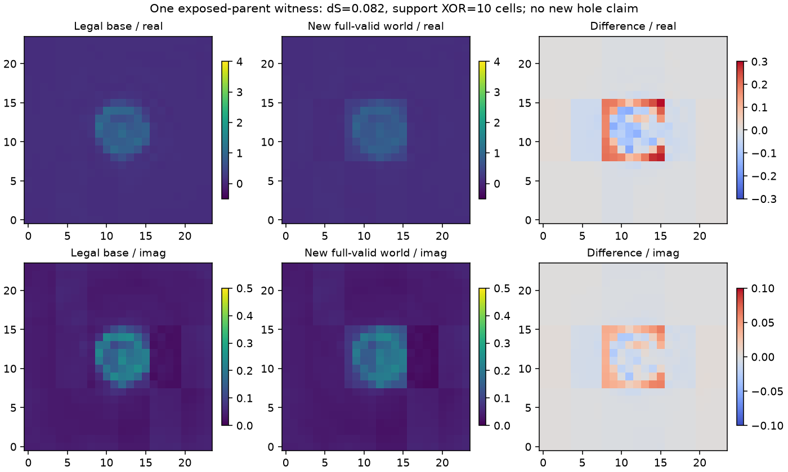

# Research G：统一材料空间中的下一解搜索

2026-10-15 · candidate-only · 已执行E0与有界历史后端E1 · 不训练大模型

[中文网页](https://migodam.github.io/b1-probabilistic-maxwell-imaging/research/research_g_20261015/) · [原始Markdown](https://raw.githubusercontent.com/migodam/b1-probabilistic-maxwell-imaging/main/research/research_g_20261015/RESEARCH_G_REPORT_ZH.md) · [实际材料图库](MULTISOLUTION_GALLERY/index.html) · [完整证据](https://github.com/migodam/b1-probabilistic-maxwell-imaging/releases/tag/research-g-20261015)

**本轮科研判断为NO_GO_SEARCH：尚未建立值得扩大的持续新结构搜索优势。** 这不否定本轮找到的一个合法边界变化world，也不意味着完整Maxwell材料空间不存在更多解。主要缺口是跨对象重复发现与机制归因，而不是posterior未校准。

1. **发现多少：**三个观测各有3、3、1个材料代表和1、2、1个结构代表（都含base）。新增结构只有一个；两轮重复同一world不能算两次。它是边界/支撑变化，不是新孔洞拓扑。
2. **单位成本：**bandit在首轮36states/864RHS中命中这一个结构，另外三方法为0；这是单对象描述性命中，没有稳定优越性证据。
3. **Best-of-4：**所有方法两轮平均复材料MAE均0.04224802，和base相同；没有最佳新方法。
4. **corrector保留：**唯一新结构从不相容raw提案修正为相容，投影retention约.138；大量其余提案失败或回到既有邻域，不能只数raw多样性。
5. **历史帮助：**径向32-parent分组验证中，增加历史没有稳定改善下一结构预测。失败/材料重复存在关联，不能推出更好的反事实动作。
6. **是否超越baseline：**没有建立持续、跨对象地超过continuous-scale static/multi-start；G实验冻结时未接入完整T包，T-guided未运行，因此完整五臂比较未完成。
7. **PPO/GRPO：**不值得现在训练；先积累共同corrector下的跨对象结构发现轨迹。
8. **进入非平凡3D：**尚不具备资格。保留真实二维witness与失败，不由一个近门槛边界变化升级为一般3D机制。

## 1. 为什么不能把很多随机图当作多个材料世界

同一散射观测可能容许材料边界、损耗与介电分布改变。我们要保留的是不同的**物理材料**，且这些材料通过相同完整离散方程与观测规则。不同latent编码、轻微纹理或不同优化器状态都不能单独构成新世界；反过来，散射预测接近也不能把材料不同的候选删掉，因为这种歧义正是研究对象。

本轮完整阅读Pro包三份文档，保留其feasible-world、post-correction discovery、不可变success ledger与成本原则。直接用户预算384states/12288复RHS/10800秒取代Pro的1664-state建议，不叠加T的192state额度。G既不是posterior calibration项目，也没有必须使用NN的前提。

## 2. 与T的分工及本轮正式物理身份

E0时T尚无已提交physical handoff。因此，本轮使用用户明确允许的**完全相同、已经核验的历史冻结后端**：A30 commit `717d3d26a290248bd2b9aeb55f3d03694b407b84`，原adapter与Research A commit `f1b674eb4893e39126701ed48f3d3dcef3098c3c`中的GN函数，函数未改。不是另写T forward/corrector、nucleation或A17消融，也不是T新机制的试验。

物理是24×24标量TM/VIE、8源32接收器、complex128/float64、cell mass1/576，Reχ∈[-.5,4]、Imχ∈[0,.5]；逐source Re32后Im32，原观测和sqrt(2)/σ白化，gain固定1，相容阈值23.785449004057032。绝不混入B1径向Mie的gain/噪声约定。已保存Green/receiver矩阵与source-order descriptor是target身份的一部分。

历史八条件只有三个weak base合格，按原残差/材料合法性而非truth选中250069/73/77；新G各做一次付费full验证，预测重放、solver与c=χE诊断通过才继续。其余五条件保留E0失败，不用有利truth替换对象。三个对象已曝光，不是新的blind confirmation。

G冻结与数值收口时未导入T完整candidate/backend包，时间点记录见`results/T_HANDOFF_STATUS_AT_G_CLOSE.json`。发布整理时已看到T的公开提交`2102f6a`及candidate index，另记`results/T_HANDOFF_STATUS_AT_PUBLICATION.json`；这不追溯改变已经完成的实验。C=T-guided仍为NOT_RUN/本轮未接入，不能拿legacy结果冒称完成了T/G五臂共同corrector实验。没有向T chat发消息，也没有修改T工作树。

## 3. E0先解释旧成功与旧失败

旧径向1920个proposal的raw多样性很高，但multi-start有331/384条raw新颖提案修正后落回全部prefix合法材料的旧邻域；static为145/384。该邻域指标不证明相同动力学吸引盆或连通解分支。静态原本使用八个径向保护box，因此它的正面结果不能直接替代G的无孔数分类全field搜索。

旧二维有限编辑没有invalid→valid；保护格最大实际偏差0。唯一满足≥6格数字新洞定义的finite提案被保留却仍不相容；不能解释成“corrector把洞全填了”。C1训练proposal是受限四维径向材料，A30 Sparse64的35.69%是truth-fit容量，二者都没有提供已训练好的A30 full-field生成器。

654个合法duplicate曾改善留存代表full residual。我们把first-member改为pairwise-safe truth-free质量替换，在相同缓存池/成本上重放：369次替换、不丢原结构邻域覆盖，但没有新物理world。二维旧6格计数的3→4在新多尺度标准下仍3→3，不能挑有利门槛宣布新结构。完整[E0报告](E0_REPORT_ZH.md)、JSON与逐trajectory表保留。

## 4. 一套连续材料动作与四个搜索选择器

权威对象是576格复χ，而非固定孔洞专家。可用动作包含相关全域重启、连续位置/尺度/幅度的局部材料加减、多尺度分布改变。当前全域restart以合法base加独立Haar系数为起点；它不是全材料域均匀prior，也不是完整1152维支持。局部mask可以在不同位置创建或消除support，但有限带宽和corrector表示仍有限制。

static在连续尺度/有符号幅度上预定分层，不用0/1/2孔类别。QD用固定emitter混合及active archive的低使用/新颖parent；bandit用同动作库Beta(.5,.5)，只有**修正并full验证后相对全部prefix合法ledger的新结构**才获正reward。材料contrast新颖与结构reward分开。每三步第0步强制global，比例1/3，不能被筛掉；本轮无proxy screening，所有生成提案均full求值，screened-out false-negative audit不适用。

所有方法原样共享32实Haar GN两步、trust=.35、拒绝后×.3，最后最小full residual材料再做独立freshfull验证。既有fixed-step corrector可能继续移动已相容状态；它是历史regression corrector，不冒称T的proposal-retentive设计。

active archive为pairwise-separated材料/结构代表；success ledger保留全部合法端点含duplicates，frontier存失败而不安装。最低full residual选Top1；TopK保留合法base后做固定field/structure覆盖。少于K保持短集合，不填invalid。所有在线结果先冻结，独立进程才读已暴露truth。

## 5. 两轮同预算结果

每轮每方法三parent×三轨迹，每轨迹raw+两次corrector+独立验证，共36个新state。正常cache复用保留，没有为凑相同RHS额外求解；这次实际每方法都是864复RHS。共享三个base验证另计一次，不在每方法重复累加。

| 方法（首轮） | 新states | 复RHS | 合法端点 | 材料新颖events | 结构新颖events | Best-of-4复MAE | 旧定义Coverage@4 |
| --- | --- | --- | --- | --- | --- | --- | --- |
| multistart | 36 | 864 | 2/9 | 0 | 0 | 0.04224802 | 33.3% |
| static_scale | 36 | 864 | 2/9 | 1 | 0 | 0.04224802 | 33.3% |
| QD | 36 | 864 | 2/9 | 2 | 0 | 0.04224802 | 33.3% |
| bandit | 36 | 864 | 3/9 | 1 | 1 | 0.04224802 | 33.3% |

两轮只变first/quality archive，动作、随机种子、corrector、阈值保持配对。第二轮同一表，当前小pilot没有触发质量替换，Best-of-2/4/8与Coverage均未改善。E0修复在旧池中有用，并不保证新search trajectory受益。

bandit描述性结构效率为1/36 states（不含共享base）或1/864 RHS，其余三方法为0；只有一个对象命中，不能当作统计胜利。三步bandit轨迹只含极少正reward，没有足以识别学习价值的行为重叠/反事实实验。QD产生了额外材料contrast代表，但没有新结构事件。

## 6. 同一观测究竟保留多少世界

| 同一观测 | 材料代表（含base） | 结构代表（含base） | 新增结构 |
| --- | --- | --- | --- |
| p250069_weak_a1_snr20 | 3 | 1 | 0 |
| p250073_weak_a1_snr20 | 3 | 2 | 1 |
| p250077_weak_a1_snr20 | 1 | 1 | 0 |

上表对同一观测跨四方法、跨两轮重新做固定顺序pairwise packing。两轮重复世界只算一次；不同观测的数字也不能相加成解释同一个观测的世界。18个合法端点ID加三个base共21个记录，不等于21个不同材料。

### 唯一结构witness的物理意义

`p250073`的bandit局部移除提案raw残差89.9456，两次原GN后25.7212→22.3180，独立full验证与重复预测一致，base残差20.8919也合法。solver/backward与共享本构缺陷约1.4e-15。它确实是从不相容提案修正得到的另一个合法field。

它相对base dM=0.02304008，低于材料分离.03；但dS=0.08176702、support改变10格，通过预定.08/6格结构规则。support由42到52格，约是base support的24%增加，图像是**边界/支撑扩张**，两者数字孔数仍0。mask幅度门槛.20/.25/.30下改变13/10/8格；dS门槛加倍到.16则不再计结构不同。这是近工程门槛的有限witness，不作不连通分支、全局新拓扑或普遍重要world的证明。

两轮精确重复这一world不是独立复现。它的Best-of-K未胜过base，不能归功于历史学习；但也不能仅因没有新孔洞类别，就把真实边界材料差异删掉。

## 7. correction retention与失败归因

72条新轨迹中raw full-valid为0，末端full-valid=18；54条仍不相容，所有付费计算保留。70条raw满足对parent结构编辑规则，只有14条在终点仍保留该结构差异（包含不相容终点）；14条合法终点从raw结构新颖回到prefix结构邻域。新结构events=2，跨paired重复去重后只有1。

144个材料QP中120个报告收敛，24个达迭代上限/未收敛。未收敛flag保留，正式材料仍由独立full验证决定；不声称达到优化stationarity或全局最小。唯一结构witness的两步QP均报告收敛。不能把归因全部推给generator：有限corrector带宽、两步预算、初始化与实际物理约束仍混杂。

## 8. 离线成像与几何覆盖

全部方法、两轮的Best-of-2/4/8复MAE相同，均值.0422480213；三个parent分别.04351438/.03477679/.04845289。Top1也全部选base。所有Top4/Top8都短于请求K，不补图。

原RMS/1.2≤.1的Coverage@K为1/3，support IoU≥.8的几何coverage也是1/3。G新尺度距离≤.1给3/3，但那是不同归一化的**另一指标**，不能替换旧目标宣称全部成功。`p250077`真值有一个≥6格洞，所有合法候选仍无洞，hole recall为0；其它两个truth无洞时该recall为NA，不填1。软件phase-field的开孔演示没有改善这些真实Maxwell结果。

## 9. 历史信息与RL判断

E0按32个parent五折，结构B−A log-loss差+0.003786、区间跨0；B对matched-history shuffle也无稳定优势。history-only D有预测关联，合法性/材料重复也能预测；这些可能反映动作分层和搜索耗竭阶段，不代表能选择更好提案。

没有logged propensity与跨动作counterfactual物理端点，不做off-policy价值判断。新二维轨迹只有三个对象，bandit的一次局部命中不能证明learning收益。暂缓PPO/GRPO、GRU、Diffusion和大型field generator；本轮没有提交其物理训练计划。

## 10. 理论与文献边界

Pro包的数学说明保留：生成器分布经corrector与validation后的推前才决定发现；raw多样性不能代替endpoint多样性。防御global探索的漏发现界依赖未知的正到达概率，不证明我们有限Haar/mask空间覆盖任意结构。连续参数可以改变support拓扑，但不等于某个训练decoder可达任意材料。

LITERATURE_MATRIX中已有topological sensitivity+GN、生成器后修正、unstructured QD/NSLC、surrogate illumination、PPO/GRPO先例。此处阅读了提供的矩阵，未把34篇源包阅读层级冒称本轮独立全文核验，也未重新做宽泛文献综述。普通archive、Beta bandit、材料约束GN与这些基本数学不是新算法定理；本轮未建立强IEEE TAP原创性。

## 11. 费用与下一步

新states 291/384、复RHS 6936/12288，GPU0。受控数值wall 76.305/10800秒、CPU 72.442秒，含E0、物理/优化/验证、失败评分尝试、统计与图库；没有将交互写代码、阅读或上传耗时伪装成数值执行。原A30/A/B/C1/P2/T账本不变。

先停止本轮付费运行，保留93states/5352RHS余额，不为挽救优势继续加提案。后续先只读接入T最终提交的physical handoff，核对target/packing/单位/共同corrector，再注册同预算五臂比较及跨对象独立复现。当前单witness只值得保存和机制复查，不够进入非平凡3D或RL训练。

**NO_GO_SEARCH**
