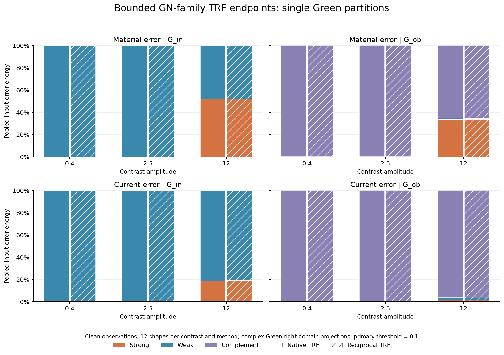
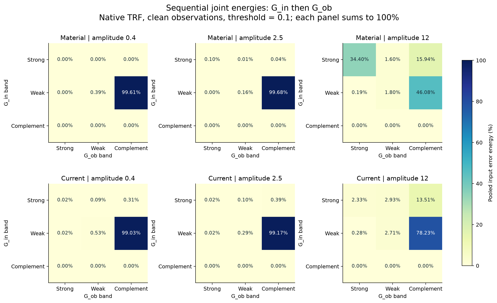
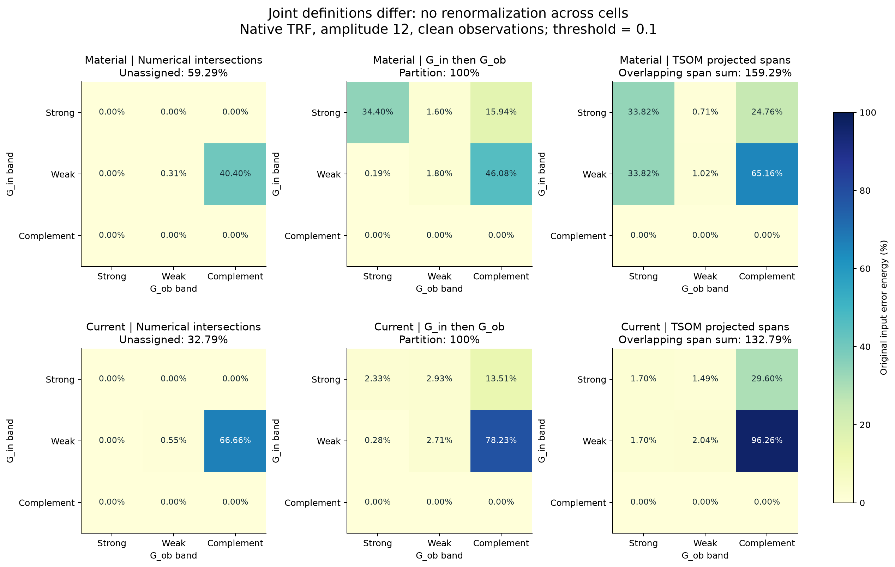
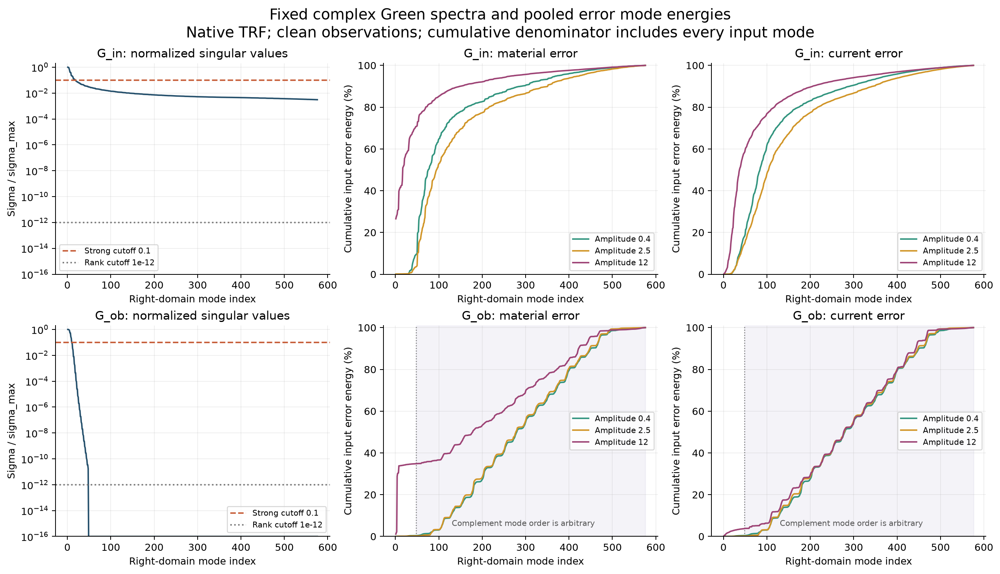
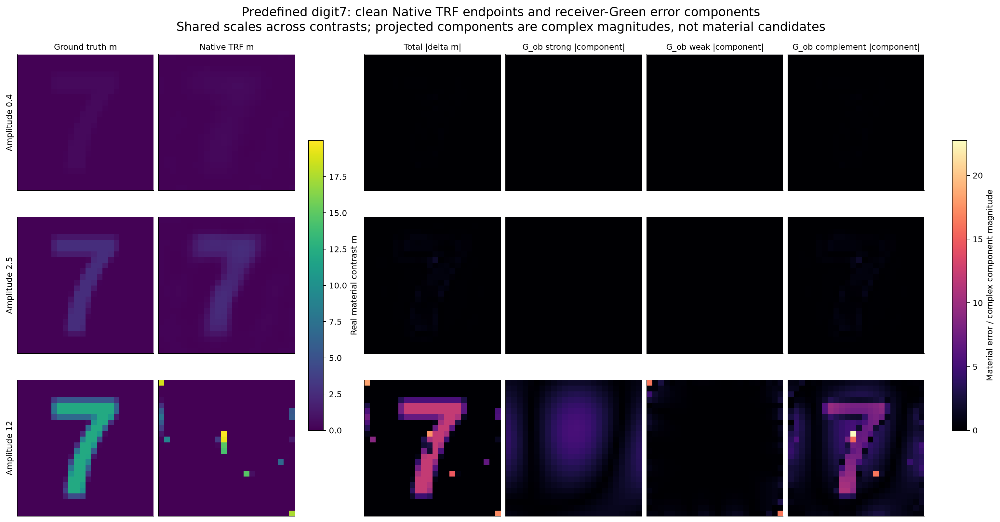

# GN–GT误差在Green强、弱、补空间及Two-fold中的能量分解

## 1. 先看实际结果

本轮分析了冻结R4-Diversity中的 **144个576材料端点**：Native TRF与Reciprocal TRF，各12种形状×3档对比度×clean/noisy。这里“GN”具体是使用解析Full-J的有界GN家族TRF，不冒称无约束纯GN。没有重新优化，也没有按投影结果筛选对象。

分析对象是旧求解器在原8→12→24多尺度及共同正则下，按原始物理目标返回的线上top1材料；不一定是最后一次迭代，也没有用GT挑选最接近的端点。

主要结论：**低／中对比度的材料误差几乎全部在接收Green的补空间；高对比度失败时，相当一部分误差已经进入两个Green的强方向。** 因此不能把所有GN失败都解释成“只剩弱方向细节没修好”。

以下主表为Native、clean、每档12种形状的**合并平方误差能量比例**。强定义为σ≥.1σ_max；弱为1e-12σ_max<σ<.1σ_max；补为右域数值零空间。不是普通范数百分比。

| 材料增量A | Gin强 | Gin弱 | Gin补 | Gob强 | Gob弱 | Gob补 |
|---|---:|---:|---:|---:|---:|---:|
| 0.4 | 0.005% | 99.995% | 0% | 0.003% | 0.388% | **99.609%** |
| 2.5 | 0.153% | 99.847% | 0% | 0.099% | 0.153% | **99.748%** |
| 12 | **51.933%** | 48.067% | 0% | **33.819%** | 1.019% | 65.162% |

这里Gin=内部G，Gob=接收S，使用原复算子的右奇异向量。材料误差投向这些坐标是几何诊断，不等于材料Jacobian的可观测性；下文另外计算真正的电流误差与传播能量。

Reciprocal得到相近结论：Gob补空间占比分别99.611%、99.599%、65.395%；高对比Gob强方向33.854%。完整噪声、方法、逐对象表见[逐案例统计](results/requested_per_case_statistics.csv)与[聚合单算子表](results/aggregate_single.csv)。

## 2. 空间、秩与百分比如何定义

固定原始采集与背景：

- Gin：576×576，电流到内部场。
- Gob：48×576，电流到接收场。
- 12个照明为列，所有材料576格未知，box [.02,20]，k=2π。
- 沿用完整二维scalar-TM disk-pulse VIE；没有Born替代、没有重新裁剪物理网格，也没有额外乘面积／k²。

主门槛下，Gin为 **19强＋557弱＋0补**；Gob为 **9强＋39弱＋528补**。19个Gin强模式占其Frobenius算子能量97.426%，9个Gob强模式占99.618%。

“补空间”指右域range(G*)的正交补；Gob输出只有48维，所以不能用其左奇异向量直接分解576维材料误差。Gin本例满秩，因此没有非零补空间；不能为了凑三组人为制造Gin补空间。

对误差X，分组投影P_b给出

$$\eta_b(X)=\frac{\|P_bX\|_F^2}{\|X\|_F^2}.$$

每个算子的强／弱／补相加100%。普通范数比例是sqrt(η)，不相加100%；CSV也保留norm_pct、分量RMS与绝对平方能量。这里“能量”是离散L2/Frobenius平方范数，未计算E/H总电磁储能。

主表先对12个对象的分量能量求和，再除以12个对象的总误差能量；不是无说明地平均百分比。另有逐例均值与[PASS/FAIL条件表](results/conditional_success_energy.csv)。同一对象的两种噪声、两种参数化是相关重复，144不是144个独立材料。

## 3. Two-fold：你问的四种强弱组合

按项目原有投影构造的顺序，先内部方向、再接收空间：

$$X_{ab}=P_{{\rm ob},b}P_{{\rm in},a}X.$$

以下为材料误差。前一个“强／弱”指Gin，后一个指Gob：

| A | 强强 | 强弱 | 弱强 | 弱弱 | 含任一补空间 |
|---|---:|---:|---:|---:|---:|
| 0.4 | 0.003% | 0.000241% | 0.000125% | 0.389% | 99.607% |
| 2.5 | 0.102% | 0.007% | 0.002% | 0.163% | 99.727% |
| 12 | **34.396%** | **1.597%** | **0.189%** | **1.798%** | **62.020%** |

五项合计100%（有显示舍入）。高对比完整9格如下：

| Gin \ Gob | 强 | 弱 | 补 |
|---|---:|---:|---:|
| 强 | 34.396% | 1.597% | 15.940% |
| 弱 | 0.189% | 1.798% | 46.080% |
| 补 | 0% | 0% | 0% |

这张表是**串联投影的能量分配**，不能直接把各格改名为两个子空间的严格交集。反序也已计算，保存在[twofold.csv](results/twofold.csv)。例如高对比“强强”反序为33.376%，不是34.396%。

串联顺序也会改变另一算子的边际分配：上表Gob补空间各格合计62.020%，单独Gob投影是65.162%，二者对应不同操作，并非漏算。完整两种顺序、不同阈值、噪声与Reciprocal都在数据中。

## 4. 如果真的取交集，数字是什么？

使用固定sin-angle容差1e-9求**数值交集**，未声称符号精确认证。强强、强弱、弱强的交集维数均为0；Gin弱∩Gob弱为20维，Gin弱∩Gob补为509维。它们一共529维，另有47维不能获得共同强弱标签。

高对比材料误差的严格交集口径为：

| 类别 | 能量比例 |
|---|---:|
| Gin强∩Gob强 | 0% |
| Gin强∩Gob弱 | 0% |
| Gin弱∩Gob强 | 0% |
| Gin弱∩Gob弱 | **0.307%** |
| Gin弱∩Gob补 | **40.400%** |
| 不在任何共同分类交集中的剩余 | **59.293%** |

因此，“交集四格”不能硬凑成100%。这也不表示两个算子没有强敏感响应，而是没有足够大的共同精确子空间来承载这些标签。

实际TSOM常用的是投影后再正交化的空间

$$Z_{ab}=P_{{\rm ob},b}V_{{\rm in},a},\qquad P_{Z_{ab}}=Z_{ab}Z_{ab}^{\dagger}.$$

它既不同于交集，也不同于简单串联作用。高对比材料误差对这些空间的投影百分比合计 **159.293%**，因为重叠；电流误差合计132.788%。本例Gin只有两个互补非零组，可严格推得“投影后空间总能量＝原能量＋共同分类剩余能量”，所以159.293%=100%+59.293%。不是凭空多出了物理误差，更不是概率。

一个直接例子：Gin强19维投向Gob强9维后，正交化得到全部9维；Gin弱557维投向Gob强后也得到同一个9维空间。因此这两格各有33.819%的材料误差投影，但不能算作两份不同误差。

完整推导、数值角度和rank容差见[数学定义](MATHEMATICAL_DEFINITIONS.md)。

### 旧Two-fold实际使用的28维chart

还直接计算了旧实现的组合：[Gob强9维，内部强模式投影到接收模糊空间后的19维]。这里接收模糊空间合并Gob弱与补空间，保持同一套19维内部系数，不能用两个分别参数化的投影空间替代。该chart与548维剩余组成正交三分组。

| A | 材料：Gob强 | 材料：第二fold | 材料：chart外 | 电流：Gob强 | 电流：第二fold | 电流：chart外 |
|---|---:|---:|---:|---:|---:|---:|
| 0.4 | 0.00283% | 0.00861% | **99.98856%** | .00000949% | 1.47569% | 98.52430% |
| 2.5 | 0.09879% | 0.19103% | **99.71018%** | .0000514% | 1.85653% | 98.14342% |
| 12 | 33.81859% | 23.45687% | **42.72454%** | 1.70335% | 26.31648% | 71.98017% |

因此高对比材料误差约57.28%与这个固定28维chart对齐，而低中对比残余材料误差几乎都在chart外。它提示两类任务该优先处理的误差不同；**并不保证把材料自由度锁成28维就能恢复**，因为这套chart原本是复电流空间。该补充直接读取已存谱与误差，0新LU，约.043秒，见[实际TSOM chart表](results/actual_tsom_chart_summary.json)。

## 5. 材料误差与真正的电流误差差别很大

Gin/Gob实际作用在复电流上，因此额外使用原非线性VIE计算了

$$E_j=j(\widehat m)-j(m_*),\qquad
\Delta Q=G_{\rm in}E_j,\qquad \Delta Y=G_{\rm ob}E_j.$$

Native clean的电流误差比例：

| A | Gin强 | Gin弱 | Gob强 | Gob弱 | Gob补 |
|---|---:|---:|---:|---:|---:|
| 0.4 | 0.419% | 99.581% | 0.00000949% | 0.417% | 99.583% |
| 2.5 | 0.513% | 99.487% | 0.0000514% | 0.167% | 99.833% |
| 12 | 18.778% | 81.222% | **1.703%** | 2.040% | **96.257%** |

同一个高对比任务中，材料坐标误差有33.819%在Gob强方向，实际电流误差只有1.703%在Gob强方向。两种对象不能混为一谈。它们由精确有限关系联系：

$$E_j=L(\widehat m)^{-1}D_{\widehat m-m_*}Q(m_*).$$

总场乘法和resolvent会混合谱方向。另做的保实静态控制 [Re G;Im G] 在高对比Gin给出48.394%强／51.606%弱；原复G为51.933%／48.067%，主要结论一致。两者都不能替代完整非线性材料Jacobian。

## 6. 再乘G后的能量，不等于原误差能量

单算子SVD允许直接算传播后的分量能量Σσ_i²||v_i*X||²。对真正的电流误差：

| A | Gin强承担的内部场误差能量 | Gob强承担的接收场误差能量 |
|---|---:|---:|
| 0.4 | 9.367% | **60.015%** |
| 2.5 | 14.124% | **64.128%** |
| 12 | **91.476%** | **99.831%** |

所以高对比只有1.703%的电流误差输入能量在Gob强方向，却贡献99.831%的接收场误差能量。不能因为输入能量中强方向份额小，就认为它对观测不重要。

绝对误差也保留，不只看比例：

| A | 合并材料RMSE | 材料误差平方和 | 电流误差平方和 | 内部场误差平方和 | 接收场误差平方和 |
|---|---:|---:|---:|---:|---:|
| 0.4 | 0.06655 | 30.615 | 1.496 | .002083 | 1.526e-9 |
| 2.5 | 0.32514 | 730.719 | 37.338 | .045595 | 1.886e-7 |
| 12 | 4.99021 | 172124.010 | 8858.236 | 296.232 | 3.736744 |

这些量有不同坐标／单位，不在材料、电流与场之间直接比较数值大小。源能量和几何固定，组内对照有意义；不是焦耳。

此外，若先按Gin强弱拆current，再分别传播到接收，各部分的场会发生相消。各孤立场能量之和／实际接收误差能量，低／中／高分别约 **5857.82、1585.42、1.2573**。低中对比data误差已很小，所以相消比值很大。代码保留有符号交叉项，不能把这类场能量表强行归一化冒称四格各自承担的实际误差。

## 7. 阈值、噪声与GN成功／失败

.1是明确的主阈值，不是唯一自然划分。固定谱仅算一次，预声明.03/.3敏感性；保存系数后另提供完整阈值响应，不重解Maxwell、不按GT选择有利阈值。

例如高对比材料误差：

| σ/σ_max强门 | Gin强能量 | Gob强能量 |
|---|---:|---:|
| .001 | 100.000% | 34.076% |
| .01 | 89.679% | 33.942% |
| .03 | 70.857% | 33.925% |
| .1（主门） | 51.933% | 33.819% |
| .3 | 39.752% | 30.399% |

Gin在.001时全部方向都被称strong；所以不能脱离阈值宣称“唯一有多少误差在强方向”。Gob结构性补空间528维及其误差份额更稳定。

旧Native clean联合成功数为3/12、9/12、0/12；对应数据误差中位数约5.36e-5、2.19e-4、.831。低中对比的残余材料误差可能包含有限分辨率、正则偏差等，高对比端点则仍有很大的原数据误差。当前分解没有认证材料多解、局部rank或全局唯一性。

预先固定数字7作为空间示例，各档均保留；不是按成功率挑图。显示的是公开A归一化后的材料和误差幅值，不是将不同图片各自拉伸。

## 8. 实际执行与复现

- 固定历史资产：R4-Diversity，端点GT均已按原研究闭合后公开；本轮为OFFLINE_DIAGNOSTIC，不是新盲测。
- 144个CPU GN/TRF端点全部保留，CUDA重复结果未作为独立对象混入。
- 新做的计算：36个唯一GT与144个端点的完整多次散射电流，共 **180 LU／2160 source RHS**；**0次新GN优化**。
- 主分析实测 **5.56秒**，其中这些新current求解约1.38秒；静态谱／交集／Two-fold均跨目标复用。该时间是误差分析成本，不是完成144次成像的时间。
- 旧源码、结果和门槛未修改；未做SHA或重复公式误差地板检查。

[复现命令](REPRODUCE.md) · [结构化汇总](results/SUMMARY.json) · [完整请求表](results/REQUESTED_TABLES_ZH.md) · [成本](results/COST_LEDGER.csv) · [数据清单](audit/SOURCE_MANIFEST.json)。

[完整复现包与阅读包](ARTIFACTS.md)一并提供，保留全部144案例和原始投影系数，方便其他session直接复用，不必再次求解Maxwell或重算SVD。

本轮最有用的判断是：**低中对比的剩余误差主要处于固定Green的弱／暗坐标；高对比失败会同时丢失强谱坐标。Two-fold的“交”“串联投影”“投影后子空间”必须分别计量，不能用同一张四格百分比表代替。**

