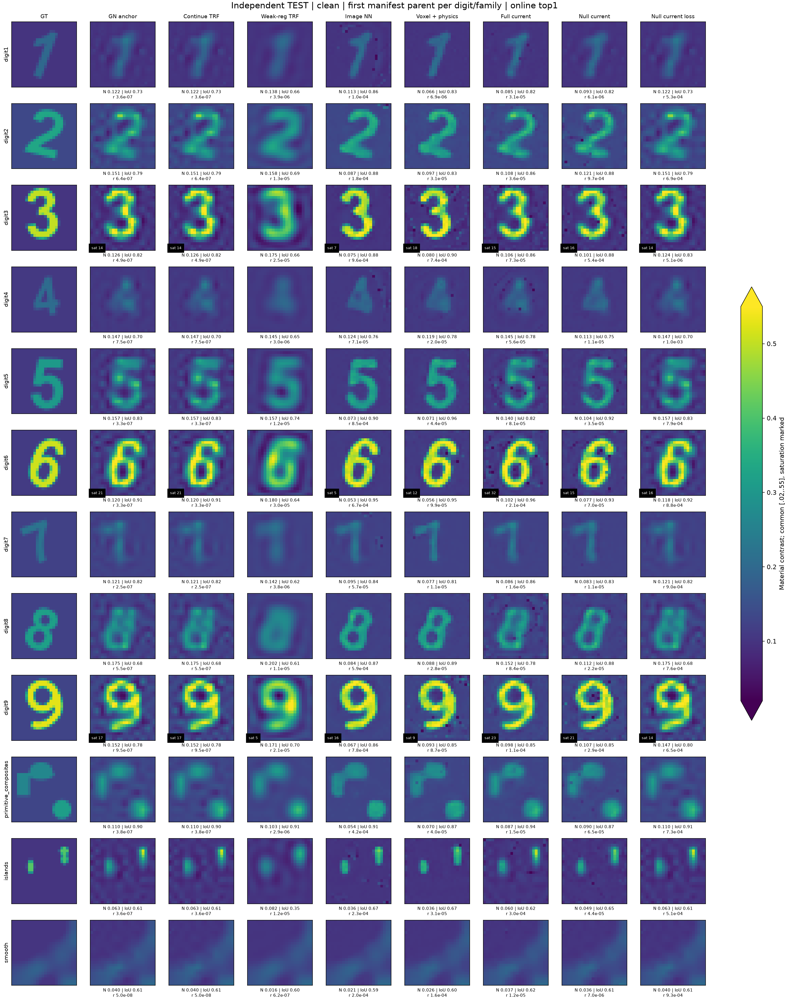
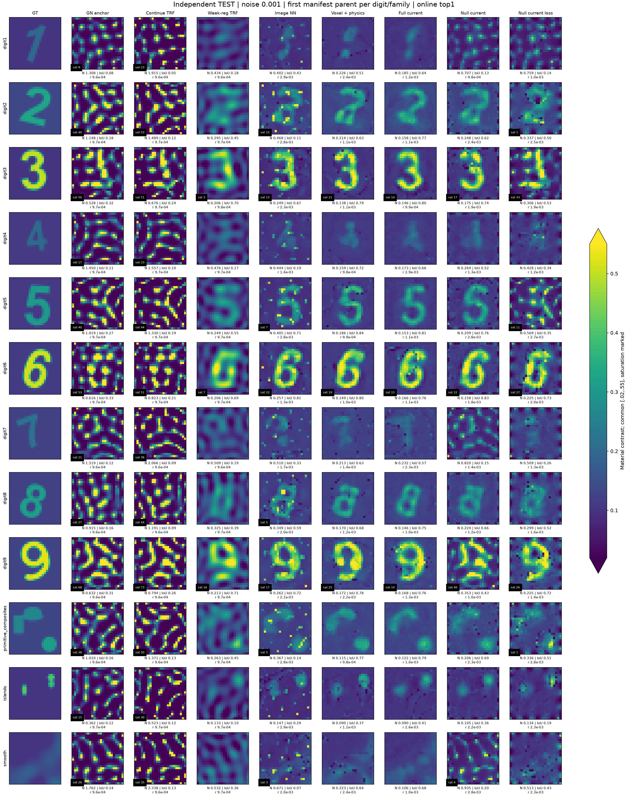
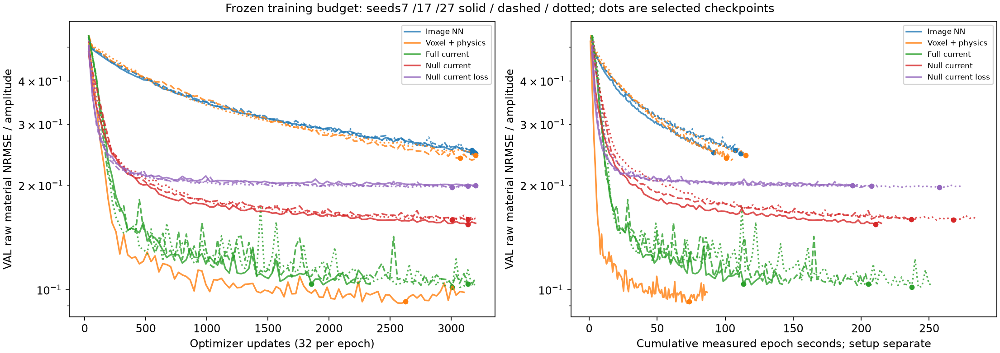
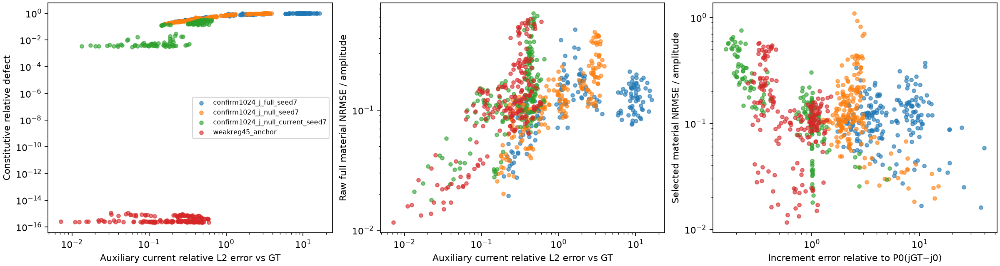
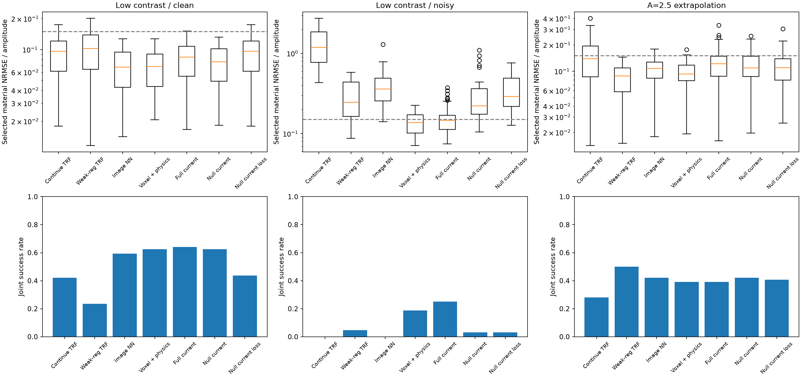
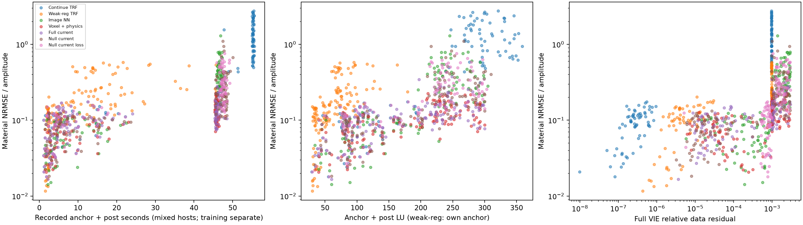

# GN–NN R3：完整材料与 Green 接收零空间电流的学习补全

**状态：核心实验完成；零空间优越性未成立。** 2026-11-07。1024个训练母体、64个验证母体、64个独立确认母体；五种输出/损失设置、三个训练种子、两种两级Cascade和完整算子过滤消融。全部确认预测及在线排名先封存，再读取TEST材料评分。

本轮最有用的结论是：**可以用学习先验改善GN材料图，但“GN–GT电流误差主要在接收零空间”并不能推出“把网络限制在该零空间更好”。** J-null在clean下比J-full略低的材料误差，未转化为带噪优势；带噪时J-full在三个种子中都优于J-null。V-physics的seed7很好，但另外两个种子的训练没有达到同样效果。不能用这一个好种子宣布voxel物理输入已稳定胜出。

[全部逐案例图，包括失败](figures/all_test_cases/GALLERY.html) · [逐案例数值](results/RESULTS_BY_CASE.csv) · [完整分组统计](results/RESULTS_SUMMARY.json) · [训练权重、输入、候选和日志下载](https://github.com/migodam/b1-probabilistic-maxwell-imaging/releases/tag/gn-nn-completion-r3-20261107) · [复现](REPRODUCE.md) · [理论交接](CODEX_TO_PRO_HANDOFF.md)

## 1. 先看真正的成像

下图按冻结manifest顺序，选择每个数字及非数字类别的第一个母体；clean/noisy展示同一母体，不按结果挑选。五个NN列为预声明主种子7。全部192个测试观测以及其他训练种子的数值、材料数组均保留。统一色阶为[0.02,0.55]，超过显示范围的像素数标为sat，未把每张失败图单独拉伸。

### 低对比、无噪声

### 低对比、相对复噪声0.001

带噪GN输入虽然全部满足数据门，材料图却有明显振荡。继续严格最小化数据会加重这个问题；弱正则和学习先验能抑制部分振荡。这里展示的是**逆问题正则化与材料补全**，不是已经枚举到新的等响应根，也不是高对比吸引域成功。

## 2. 实验到底比较了什么

物理沿用24×24、576个独立实材料、12源×48复接收、二维scalar-TM disk-pulse完整VIE，材料box[0.02,20]。每个多尺度阶段都解576阶物理系统；没有Born替代，没有已知数字支撑。训练材料增量为0.1、0.2、0.4，背景0.08–0.15；2.5仅用于未训练外推。本轮不包含A=12实验。

内部G在冻结数值阈值下满秩。接收S复秩48，使用其**完整528维/源零空间**。没有Weak64/128，没有509维交集，没有弱谱截断。网络用16/32/64通道残差U-Net，完整576材料输出或12源完整复电流输出；空间下采样是CNN结构，不是固定材料弱空间。

| 臂 | 输入与输出 | 隔离的作用 |
|---|---|---|
| V-image | GN材料＋公开噪声，物理特征置零；输出完整材料残差 | 普通图像先验 |
| V-physics | 再加入背景Jacobian残差回投影和当前总场实虚部 | 整个物理输入包 |
| J-full | 同样物理输入；输出完整复电流，再共享实材料LS读出 | 电流表示＋非线性读出 |
| J-null | 同一电流头，投影到全部接收零空间后读出 | 相对J-full的硬零空间约束 |
| J-null-current | 与J-null相同，但监督投影GT电流差 | 电流监督是否等价于材料收益 |

前四臂统一材料L1＋0.1边缘L1。第五臂为电流损失消融。voxel头约12.11万参数，current头约12.15万；原始实输出自由度分别576和13824，零空间电流有效自由度12672。**不是同维坐标变换**。J-full/J-null才是隔离接收投影作用的直接对照。

训练使用TRAIN统计、AdamW、lr=0.001、batch64、最多100轮、验证15轮无改善停止。五臂分别运行seed7/17/27；没有按TEST挑选种子。两级共享权重Cascade只运行seed7，它保留锚点总场与回投影特征，不是每层重求Maxwell的展开网络。

GN输入采用成熟有界TRF、解析Jacobian、8→12→24参数化，45秒/500LU/30000复RHS上限、停止容差1e-12。每个NN最多5个候选槽：GN、半/全提案、两份校正。共用完整VIE校正，每份最多3秒/8次函数评估，整个增量后处理最多10秒/100LU/6000RHS。在线先要求数据合格，再选最接近完整NN提案的材料；无合格提案则回退合格GN。GT只在封存后计算误差和best@K。

## 3. 主种子7：在线结果，而非best@K

NRMSE为材料RMSE/真实材料增量。联合门是NRMSE≤0.15、IoU≥0.7，且完整VIE相对残差clean≤0.001/noisy≤0.003。下列每格均为64个母体；全部臂的在线top1均通过数据门，但材料联合成功差异很大。

| 方法 | clean NRMSE | clean联合成功 | noisy NRMSE | noisy联合成功 |
|---|---:|---:|---:|---:|
| GN输入 | 0.0931 | 27/64 | 1.0164 | 0/64 |
| 继续数据TRF，最多10秒 | 0.0931 | 27/64 | 1.3477 | 0/64 |
| 独立弱正则TRF，最多45秒 | 0.0972 | 15/64 | 0.2958 | 3/64 |
| V-image | **0.0670** | 38/64 | 0.3989 | 0/64 |
| V-physics | 0.0691 | 40/64 | **0.1403** | 12/64 |
| J-full | 0.0817 | **41/64** | 0.1569 | **16/64** |
| J-null | 0.0760 | 40/64 | 0.2933 | 2/64 |
| J-null-current | 0.0930 | 28/64 | 0.3361 | 2/64 |

J-null相对J-full的clean平均误差改善约7.0%，带噪误差却高约87.0%。clean/noisy配对按64母体bootstrap，J-full相对J-null的平均NRMSE改善为0.0654，95%区间[0.0434,0.0901]。该区间只反映这批母体、固定训练种子，不包含数据生成规则和所有训练随机性的总体不确定性。

V-physics在seed7带噪数据上相对GN平均误差降低约86.2%，相对固定弱正则对照降低约52.6%。这是真实的在线材料收益，但还不能概括为相对所有强正则方法的优势：本轮没有测试按噪声discrepancy stopping、正则权重路径或其他成熟结构先验。

完整的原NN、在线、合格best@K、旧排序、IoU与成本见[结果表](results/REPORT_TABLES.md)。独立弱正则行保存了公共GN用于比较，因此该行best@K仅是离线参考池；它的在线结果始终只取自己的端点，不能把公共GN当作免费的冷启动候选。

## 4. 三种子确认改变了最终判断

| 方法 | noisy NRMSE，seed7/17/27 | noisy联合成功，seed7/17/27 |
|---|---|---|
| V-image | 0.3989 / 0.3969 / 0.3661 | 0 / 0 / 0 |
| V-physics | 0.1403 / 0.3820 / 0.3992 | 12 / 0 / 0 |
| J-full | 0.1569 / 0.1652 / 0.1266 | 16 / 11 / 19 |
| J-null | 0.2933 / 0.3215 / 0.2720 | 2 / 2 / 1 |
| J-null-current | 0.3361 / 0.3381 / 0.3169 | 2 / 2 / 1 |

V-physics的seed17/27在验证阶段已经表现不佳：选中checkpoint的验证材料NRMSE约0.240/0.244，seed7为0.0923。因此差异不是测试OOD才出现，也不能通过事后换种子掩盖。现有证据支持“冻结训练预算下，物理输入的利用对训练初始化敏感”，尚未证明具体原因是死ReLU、归一化、梯度冲突或容量。本轮保留失败，没有扩大学习率/epoch搜索。

J-full在三个种子中均稳定超过J-null的带噪表现。若下一轮只保留一个**稳健竞争对照**，应保留材料损失训练的J-full；若研究更简洁的材料先验，则保留V-physics，并先解决训练稳定性，不能直接宣布它最优。

seed7的两级V-physics Cascade将noisy NRMSE从0.1403降到0.1157，联合成功12→23/64；clean为0.0690、42/64。J-null Cascade仅从0.2933降到0.2645，2→4/64；clean反而从0.0760升到0.0827。**Cascade有有限正面证据，只有一个种子，不是稳健性定论。**

## 5. 跨规则、非数字与幅度外推

TEST有32同分布和32跨字体/生成规则母体。seed7的noisy ID/OOD NRMSE分别为：V-physics 0.1409/0.1397，J-full 0.1536/0.1602，J-null 0.3192/0.2675。联合成功分别9/3、10/6、2/0，每组分母32。跨规则材料误差没有整体崩溃，但形状成功门更困难。

非数字并未剔除。noisy下，primitive/islands/smooth的seed7 NRMSE：V-physics为0.1233/0.1316/0.1307；J-full为0.1269/0.1494/0.1778；J-null为0.2332/0.2379/0.3969。完整family表在[FAMILY_SUMMARY.csv](results/FAMILY_SUMMARY.csv)。

**数据合同限制：** 生成器循环索引使数字1/4/7对应A=0.1、2/5/8对应0.2、3/6/9对应0.4；这在TEST评分前从源码识别并记录。数字/幅度没有独立交叉。没有GT标签输入泄漏，但NN可学习数据相关性；不能据此声称任意数字×幅度泛化。全部样本原样保留。

未训练A=2.5的32个配对对象中，clean联合成功：GN16、继续TRF18、弱正则16、V-physics13、J-full17、J-null17；noisy分别6、0、16、12、8、10。弱正则noisy NRMSE0.0833，优于V-physics0.1042和J-null0.1444。**训练范围外没有稳定NN优越性；普通先验是不能删除的强对照。** 这些是实际完成端点，部分传统优化器达到时间上限后有不可中断库调用超时，严格预算计数另列；不以这个外推结果制造等时速度优势。

## 6. 为什么“零空间里有大部分电流误差”仍然不够

本轮测得GT–GN电流误差中，接收零空间能量比例平均为clean **98.09%**、noisy **91.85%**。但必须分清四个对象：辅助电流、共享材料读出、本构缺陷、材料重求后的真实散射。

$$
j_a=j_0+P_0Z,\qquad Sj_a=Sj_0,
$$

$$
e=j_a-D_m(E+Gj_a),\qquad F(m)-Sj_a=-S(I-D_mG)^{-1}e.
$$

第一条保住辅助接收响应；第二条说明读出材料后，**本构缺陷经完整resolvent传播，真实数据仍会改变**。所有主材料损失网络在128个低对比观测上的完整原提案都未直接通过数据门，需要物理校正。J-null没有免除这项费用。

### 自然GT电流投影：可达到参考，不是材料最优下界

离线取 $j_0+P_0(j_{GT}-j_0)$，再作同样读出和原物理验收：

| 条件 | 材料NRMSE | 数据合格 | 联合成功 | 本构缺陷中位数 |
|---|---:|---:|---:|---:|
| 低对比clean | 0.00846 | 64/64 | 47/64 | 0.00520 |
| 低对比noisy | 0.25706 | 0/64 | 0/64 | 0.10403 |
| A=2.5 clean | 0.00554 | 32/32 | 22/32 | 0.00766 |
| A=2.5 noisy | 0.03174 | 1/32 | 1/32 | 0.02756 |

clean中存在极好的零空间电流读出，网络未学到它，因此不能把学习失败直接归因于零空间容量。noisy中这个自然投影本身失真，说明固定GN接收响应、去掉可观测电流差、再非线性材料读出会引入偏差。但该oracle只是电流L2最近投影，**不是所有零空间电流中材料误差最小者**，它失败不能证明材料不可表示。

J-null-current在noisy中对投影电流目标的相对误差约0.250，J-null约2.56；前者预测电流更准，但在线材料反而较差，0.336对0.293。J-full甚至具有很大的辅助电流误差和本构缺陷，却能读出更好的材料，再通过物理校正。**当前材料损失下，电流头更像一个有物理结构的非线性材料decoder，不应宣称它已恢复真实内部电流。**

上图包含全部主种子观测，包括A=2.5外推；精确物理弱正则端点作为本构缺陷接近零的对照。混合条件下的散点用于展示不同量并不等价，不能从中直接推断因果相关系数。

### 576材料上的读出几何

在真实锚点，未裁剪LS读出导数为

$$
\mathcal R_m[V]_i=\frac{\operatorname{Re}\langle Q_i,(L V)_i\rangle}{d_i},\quad d_i=\|Q_i\|^2.
$$

受限电流的实材料Gram为

$$
C=\mathcal R_mP_0\mathcal R_m^*=D_{1/d}\operatorname{Re}[(LP_0L^*)\odot\overline{QQ^*}]D_{1/d}.
$$

固定公开背景及一个公共训练锚点的数值诊断均给出秩575，1/3/6/12源皆如此。在额外精确包含条件 $P_0E=P_0(G-G^*)=0$ 下，$d$ 是读出导数的法向；冻结矩阵仅测得很小的有限精度泄漏，不把它提升为一般Maxwell精确秩定理。GT误差沿这个方向的能量只占clean约0.0000189%、noisy约0.002289%。因此**单个缺失一阶方向不足以解释J-null的主要失败**。局部材料读出维度也不等于物理等响应材料维度，因为这里允许不相容辅助电流。

完整推导及有限读出偏差公式见[MATHEMATICAL_THEORY.md](MATHEMATICAL_THEORY.md)。

## 7. 物理校正、排序与软过滤

V-physics seed7 noisy原NN NRMSE0.1198，校正/选择后0.1403；J-null为0.2326→0.2933。校正付出一定材料精度，却使材料通过真正的全波数据门。全尺度校正位移在原提案方向上的投影保留中位数约0.999/0.994，并没有把所有提案拉回原GN。在线最终材料相对GN的RMS位移平均约0.178/0.156。

同一候选池若改用旧data+TV最低排序，noisy V-physics变为0.3787，J-null变为0.8184。新在线规则的实际价值是：在数据允许范围内保留学习先验；不是用GT偷选。seed7 noisy合格best@K均值与在线top1相同到所报告精度，主要改善不只是离线oracle覆盖。

预先选定16母体32观测的全算子过滤消融：

| noisy子集，16母体 | 无过滤NRMSE | 固定背景过滤 | 当前Jacobian过滤 |
|---|---:|---:|---:|
| V-physics | 0.1522 | 0.1324 | 0.1424 |
| J-null | 0.3051 | 0.2145 | 0.2192 |

两种过滤使用完整有界ridge问题，不截取弱特征向量。V-physics联合成功2→3/16，J-null始终0/16。固定背景与当前Jacobian接近，仅说明本次低对比小子集上公共线性化具有复用潜力；没有证明它在高对比或其他几何下可通用。详见[secondary结果](results/secondary/RESULTS_SUMMARY.json)。

## 8. 费用、失败和协议边界

TRAIN2048个观测锚点全部到达24×24材料阶段，其中1202数值停止、843预算停止、3次SVD数值停止；**不能把全部锚点叫充分收敛**。总计486326LU、26588616复RHS。一个初始SVD崩溃另耗30.37秒，操作计数未知，不能补零；其公开输入重跑后再次数值停止，保留最后接受材料。

本地M4与远端i9四个P核worker共同生成GN，单线程BLAS。训练使用本机MPS；4060当时被其他任务占用，没有打断或抢占。17个最终模型训练进程合计3470.6秒，预测进程合计67.3秒；它们与CPU物理计算有重叠。训练数据、准备、训练、热推理、校正分别收费，不能把并行任务wall之和当作实际历时。

seed7低对比noisy每例增量后处理均值：V-physics0.699秒、8.31LU/258.75RHS；J-full0.981秒、8.91LU/296.63RHS；J-null2.291秒、13.84LU/601.88RHS。都另需共同GN及训练成本。独立弱正则45秒上限对照平均实际18.812秒，属于自己的冷求解。**这不是跨机器端到端加速试验。**

所有最终NN低对比结果都在记录的增量预算内。部分继续TRF和弱正则结果在不可中断库调用结束时略超wall，保留实际费用；[FINAL_ANALYSIS.json](results/FINAL_ANALYSIS.json)及[费用账本](results/COST_LEDGER.csv)同时列严格预算联合成功。外推clean继续TRF的18/32实际联合成功中，严格记录预算内为10/32；不能只引用18而隐藏超时。

还有两项重要限制：

1. **IoU门并非对连续材料GT自洽。** 事后校准发现，对GT本身作同样Otsu，与alpha≥0.5支持比较，只有47/64低对比母体达到0.7，其中digits16/16、primitive16/16、islands10/16、smooth5/16。冻结门没有修改；它对平滑材料混入分割定义误差。47不是所有重建的理论成功上限，不能用它重标定通过率。材料NRMSE与family分组应并读。
2. **严格GN并非噪声最优对照的终点。** 1e-12停止的纯数据优化会过拟合。已有弱正则对照证明普通先验可以显著改善，尤其A=2.5。下一轮必须加入事前冻结的噪声discrepancy停止与正则路径，再决定NN的独立收益有多大。

## 9. 论文判断与下一步

**实现与受控比较：PASS。稳定低对比材料补全：有限正面证据。硬接收零空间优越性：不支持。普适高对比恢复、完整电流恢复、独立TAP级算法新颖性：HOLD。**

CNN/对比源学习已有直接先例，例如[Si等2024两阶段对比源学习](https://www.mdpi.com/1424-8220/24/18/5997)；零空间网络也有[Deep Null Space Learning](https://arxiv.org/abs/1806.06137)。本轮不把U-Net、投影或校正重新命名成新理论。值得继续的候选贡献是：在相同全波观测、共享实材料读出和计费校正下，展示硬接收零空间约束的收益与代价，并用读出几何、噪声相容性和监督目标解释结果。

下一轮建议优先三件事：

- 保留完整voxel与J-full材料损失两条路线，解决V-physics的训练随机性；不再用固定Weak64/128。
- 把硬 $P_0$ 改为**可观测分量的有界软允许**或噪声一致性约束，作为待检验假设。J-full表现更稳只是支持做这项实验，不等于已证明软释放最佳。
- 用独立随机化的数字×幅度×背景数据，加噪声匹配普通TRF正则对照；明确分割评价定义。保持新测试封存，不在本批已披露TEST上继续追求好分数。

本轮未运行：2048训练母体、Cascade的17/27种子、LNO/Möbius/Transformer、高对比A=12、跨物理离散/真实测量、噪声discrepancy普通对照。所有未运行项不是失败也不是成功证据。

## 10. 代码、数据与复现入口

[ALGORITHM.md](ALGORITHM.md)给出实际接口，[REPRODUCE.md](REPRODUCE.md)包含生成、GN、训练、公开输入推理、封存评分和历史重绘命令。新观测只需同几何的48×12复数Y与公开噪声等级；不需GT或数字标签。独立入口组合已运行模块，CLI接线已检查，本轮没有额外重跑一遍完整包装入口。

下载Release的所有分卷并解压到同一目录，保留research/路径。包含1024训练母体数据、全部GN锚点、17确认权重及5pilot权重、所有候选、完整费用与日志；存档GT是公开后的离线复现资料，不能再称为新鲜盲测。数据封存采取流程隔离而非操作系统安全沙箱；归档曾复制原始字节，数值TEST评分在所有预测封存后才执行。没有用校验哈希或重复物理精度实验充当科学证据。
