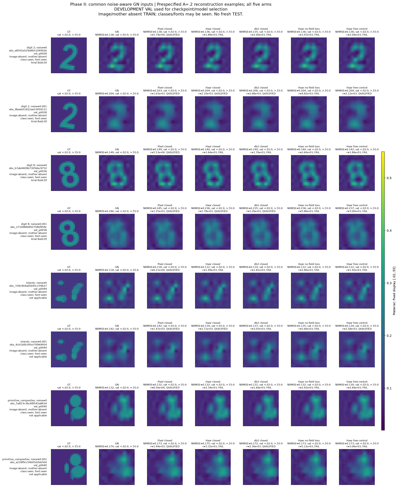
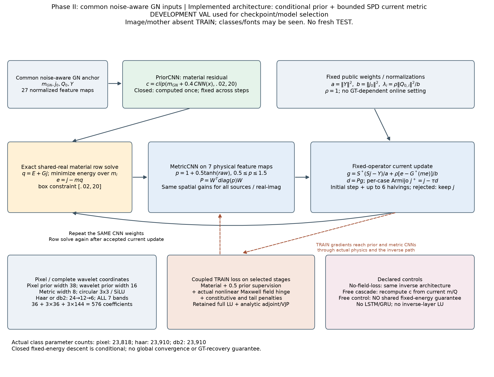
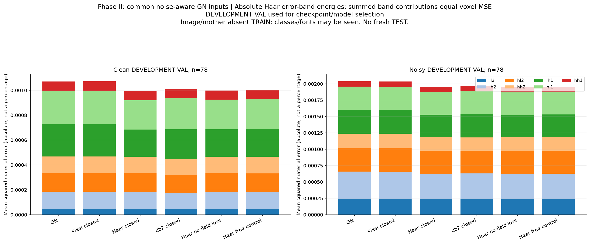
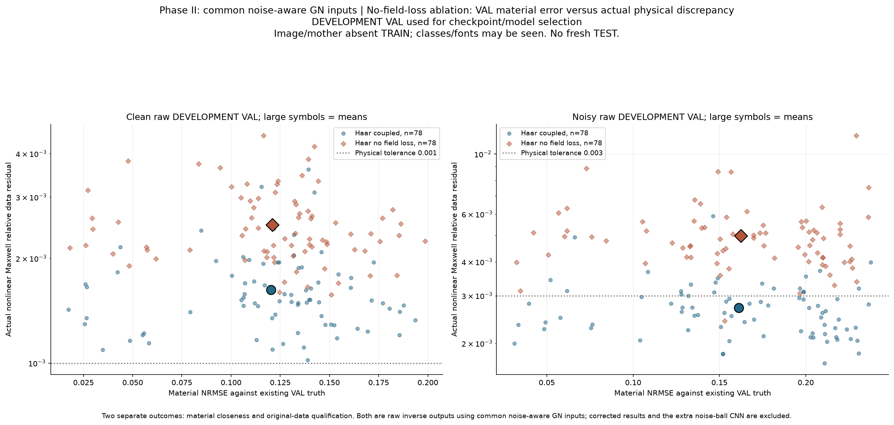
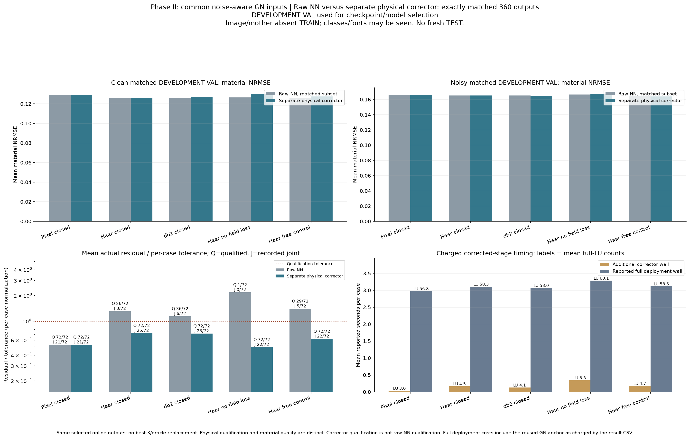
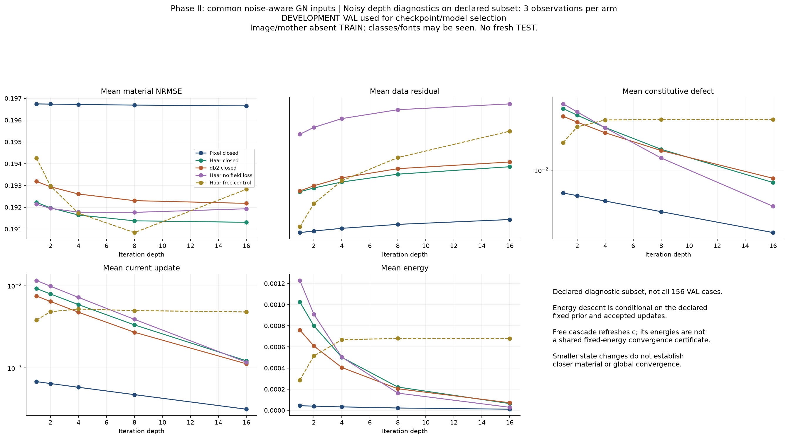

# GN–NN R5：正反向耦合 Loss、无损小波与物理闭环 CNN

本轮已经把修改落实为代码和真实训练：**完整非线性Maxwell场损失参与反传；每个循环模块都是CNN；完整Haar/db2坐标进入学习；闭环更新对应明确的条件能量与固定点条件。** 不再把重复调用普通CNN当作不动点算法。

实际完成两种共同GN输入、11套从头训练的权重、78个VAL母体的配对开发实验。最明确的正面结果是：同一Haar模型加入真实场损失后，第二阶段noisy原始材料的数据合格数由**1/78提高至58/78**。材料平均误差变化很小；小波和固定点机制没有获得普遍成像优势。**新算法主张HOLD。**

本轮是**DEVELOPMENT TRAIN/VAL**，不是新鲜TEST。具体VAL图像及母体未参加训练，但VAL用于checkpoint与方法分析，类别／字体可以见过。没有用旧R4 TEST再冒充新盲测。

[实际算法](ALGORITHM.md) · [完整推导](MATHEMATICAL_THEORY.md) · [逐案例与汇总](results/RESULTS_SUMMARY.json) · [成本账本](results/COST_LEDGER.csv) · [数据身份](BLIND_AND_DATA_PROTOCOL.md) · [复现](REPRODUCE.md)

## 1. 先看真实成像

下图为第二阶段共同噪声感知GN输入，预先指定A=.2的数字2、8、islands、组合几何，clean/noisy全部保留。图中是**CNN原始材料输出**，有些尚未通过物理门；不能因形状接近就算成功。色阶固定[.02,.55]，饱和单元单独标注。

[第二阶段完整图册与图表](figures/noiseaware/FIGURE_INDEX.md) · [严格GN起点的第一阶段图像](figures/03_prespecified_val_reconstructions.png)。主图不按GT误差挑对象，完整26页图册包含全部156观测及所有主对照。

## 2. 这次的Loss确实同时包含逆向与正向

逆向过程从GN出发，预测条件材料先验、迭代电流并读出mᵏ。每个训练批次的选定迭代材料都实际进入

\[
F(m^k)=S(I-D_{m^k}G)^{-1}D_{m^k}E.
\]

训练损失包含材料MSE、先验中心MSE、**100倍真实完整场的容许误差项**、本构缺陷及末两步变化。主场项为

\[
L_F=\operatorname{mean}_k
[\max(0,\|F(m^k)-Y\|/\|Y\|-\delta)]^2,
\]

δ为clean .001、noisy .003。正演使用原complex128保留LU，解析伴随把场梯度传回材料读出、CNN预条件器及先验CNN。它不是 detached 的最终验收，也不是用辅助Sj代替真实材料F，更不是Born数据。

训练深度随机取2/4/6；深度≤4检查所有阶段，6步检查2/4/6。验证和部署深度固定4。所有主对照相同。每次Loss都有实际选定材料的完整正演；没有声称闭环内部每步都完成精确材料正演。

场损失与噪声停止是两件事：逐尺度TRF只提供GN输入；完整场Loss则直接参与NN训练。本轮第二阶段同时使用二者。

## 3. R表示物理循环，每个学习模块都是CNN

PriorCNN从固定GN输入预测完整576维条件先验c；闭环内固定c。MetricCNN每轮读取当前材料、本构缺陷、总场及梯度，输出有界正定预条件器。随后执行物理下降和共享实材料行最小化。没有标准RNN隐藏单元、LSTM或GRU。

像素模型23818参数，Haar/db2为23910，相差约.4%。周期边界只用于图像卷积和坐标变换，不改变原电磁G/E/S。所有576材料仍未知，层内不求完整L逆；GN、训练完整场Loss、最终验收仍需要实际Maxwell求解。

闭环使用

\[
\mathcal E(m,j)=\tfrac12\|Sj-Y\|^2/a+
\tfrac\rho{2b}\|j-D_m(E+Gj)\|^2+
\tfrac12\sum_i\lambda_i(m_i-c_i)^2.
\]

a、b、λ来自公开GN状态，ρ=1。材料读出是这个目标的一元行最小化；CNN学习P=Wᵀdiag(p)W，.5≤p≤1.5；电流更新是实际合格的预条件下降。固定c时，该确定性块有同一能量的下降结论。自由级联对照每轮改变c，不享有这条跨迭代结论。

这和旧推导的联系是明确写出映射、度量与导数，而不是把旧GN公式换名字。旧源可核实的方程是T=m−(JᵀJ+μI)⁻¹Jᵀr，精确根处DT=μ(JᵀJ+μI)⁻¹。本轮新映射含学习先验和辅助状态，**不是旧T的等价实现**；一般非零残差曲率不能忽略。原始完整FP-T报告仍不可访问，来源界限见[源审计](audit/FIXED_POINT_SOURCE_AUDIT.md)。

## 4. Haar／Wavelet完整保留误差，学习不等于无损预测

两级分解24→12→6，共七个子带：36个LL2、108个第二层细节、432个第一层细节，总数576。Haar和db2均使用完整正交周期分解与转置合成。没有Weak64/128，也没有扔掉高频。

\[
\|m-m_{GT}\|^2=\sum_b\|W_b(m-m_{GT})\|^2.
\]

等权完整系数MSE与材料MSE相同，不是额外信息。CNN在更小的6×6／12×12子带学习先验及度量，再合成为全空间物理更新。网络能否学好细节仍由数据和结构决定，不能由变换无损性保证。

像素与小波CNN的感受野、共享方式和计算量不同；参数接近不能把对比升级成纯坐标变换的严格因果结论。[MWCNN](https://arxiv.org/abs/1805.07071)已有完整多层子带CNN/IWT；本轮不宣称发明这种表示。

## 5. 实际数据和训练范围

复用24×24、12源×48接收、k=2π、box[.02,20]的完整scalar-TM disk-pulse VIE。材料幅度A=.1/.2/.4，clean和相对复噪声.001。主对象是独立实像素材料，不是数字分类或模板拟合。

128个TRAIN母体／256观测，78个VAL母体／156观测；母体及其衍生物不跨集合，输入统计只取本轮TRAIN。旧R4权重没有作为初始化。每臂最多12轮、patience6、seed7、batch8；第一阶段no-full-field早停7轮，其余主臂12轮，第二阶段五主臂均12轮。它是有限开发试验，不能冒充充分训练或多种子确认。

第一阶段保留严格GN。第二阶段只共同改用逐尺度噪声感知GN，其他结构、Loss、深度和预算不变，并从头重训。256个新TRAIN锚点实际生成，156个既有VAL噪声停止锚点复用并计入必要部署费；不覆盖旧文件。

## 6. 完整场Loss的独立作用

以下为第二阶段**原始CNN材料**，每噪声档78母体：

|方法|clean NRMSE／合格数|noisy NRMSE／合格数|
|---|---:|---:|
|普通噪声感知GN|.12413 / 78|.16378 / 78|
|像素闭环＋场Loss|.12429 / 78|.16370 / 77|
|Haar闭环＋场Loss|.12019 / 0|.16121 / 58|
|db2闭环＋场Loss|.12133 / 4|.16194 / 70|
|Haar闭环不加完整场Loss|.12093 / 0|.16241 / 1|
|Haar自由级联＋场Loss|.12048 / 0|.16079 / 63|

同一Haar表示的noisy平均真实残差由.004997降到.002706，合格数1→58；材料NRMSE只有.16241→.16121。这是场条件起效的实证，不能包装成GT恢复大幅提高。clean中Haar虽略改善材料，却仍未达到.001数据门。

## 7. 相同完整物理校正之后

预声明数字2、8、islands和组合几何的所有匹配母体实际为36个，clean/noisy共72观测。各臂相同10秒／100LU／6000RHS上限、相同.5/1提案和TRF校正；在线排名只看完整物理资格与到CNN提案的距离。全部失败、实际费用、候选及离线best@K保留。

|方法|平均NRMSE|联合成功／72|平均增量LU|
|---|---:|---:|---:|
|共同噪声感知GN|.14773|21|—|
|像素闭环＋场Loss|.14776|21|3.00|
|Haar闭环＋场Loss|.14577|25|4.49|
|db2闭环＋场Loss|.14590|23|4.13|
|Haar闭环不加完整场Loss|.14844|22|6.29|
|Haar自由级联＋场Loss|.14575|22|4.65|

校正后所有主对照均72/72数据合格，联合成功还要求NRMSE≤.15与IoU≥.7。Haar有4个相对GN的净联合成功增量，但均值改善很小、实际物理费用不同，且都是用于选择模型的VAL。没有独立新TEST或统计普遍胜出的结论。

第一阶段严格GN的noisy平均NRMSE达1.94183；新像素闭环原始输出为.88369，Haar为1.02928。输入过拟合仍会影响整个系统。把两阶段改进全归因于NN或小波是不成立的。

## 8. 固定点条件更明确，仍不保证深度越大越好

纯平方数据项会追逐观测噪声，GT即便物理相容也未必是固定点。因此另行增加一个同容量／同训练预算的Haar对照，把内层接收项也改成与场Loss一致的噪声容许项。若c恰为真实材料、e=0且观测残差在容许球内，则该状态确实是不动点；学习先验仍可推动c不同的GN端点。该条件和局部导数见数学附录，不声称NN已经知道GT。

实际额外72观测校正后，联合成功仍为25/72：clean20→19、noisy5→6，平均NRMSE仅.145773→.145694。这个修改让数学目标更一致，尚未带来明显成像收益。

在预先指定的三个VAL母体／两噪声档上，固定部署深度4不变，仅诊断16步。第二阶段Haar闭环noisy真实残差均值.002533→.003046，能量却.000501→.0000636。自由级联的真实残差.002569→.004681。闭环稳定性有所约束，**辅助能量下降仍不等于真实F每步改善**。

原因仍包含A17启发我们关注的实现反馈：F(m)−Y=(Sj_a−Y)−SL(m)⁻¹e。场Loss在训练中监督了这项合成结果，但有限训练未给逐步证书；有限ρ也可能形成有本构缺陷的折中固定点。不能把这个局部下降算法称为已完成的GT不动点求解器。

## 9. 费用、归因与下一步

实际新计算为**182819次LU／3886836复RHS**。11次训练（含VAL选择）占161328LU；loss伴随、source和Full-J接收转置RHS分列账本。已知任务秒数1973.85不能当作并行总耗时。历史GN复用费不计作本轮新执行，却仍计入独立部署。NN反传FLOPs和部分RHS细分类保持未知，不补造。

这轮实现了用户要求的三个结构：GN后补全；正反向耦合Loss；由CNN组成、具有明确目标和固定点条件的完整小波闭环。它还没有证明这些结构足以形成更好的通用成像器。最有希望的下一步是跨子带联合上下文、足够训练与多种子，以及在新鲜独立TEST上检验可实现反馈误差；不能只增加循环次数或重新锁Weak64/128。

[SOM-Net](https://arxiv.org/abs/2209.03567)已有电流／材料交替展开及物理变量联合Loss。已有小波CNN、变量度量下降、行最小化和Schur结构都应正确归因。本轮的完整材料正演Loss区别于只由辅助电流计算接收场的监督，但尚不足以据此宣称原创TAP算法。ScholarQA检索／验证遇到429，两个已知种子的官方全文另行核实，未声称完成全面先例排查。

[最终科学审查](audit/FINAL_SCIENTIFIC_REVIEW.md) · [直接先例证据](audit/PRIOR_ART_CLAIM_LEDGER.md) · [复现与代码入口](REPRODUCE.md)
