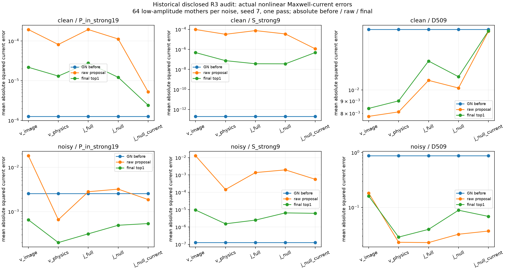
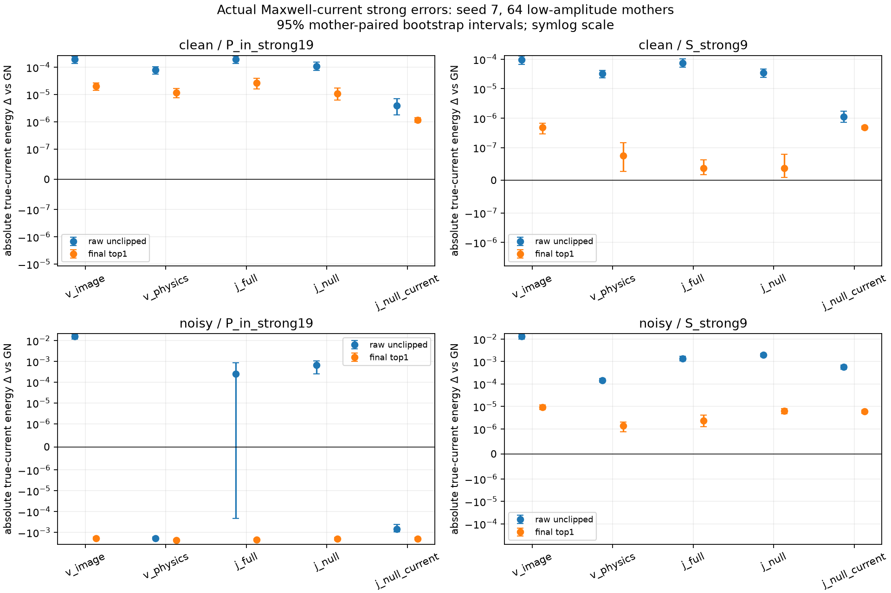

# E0：已披露 R3 的强方向绝对误差审计

**实际运行完成，历史开发诊断。** 全部17模型×192观测=3264个模型观测完成；新R4 TEST真值未参与此实验。主审计177.4秒，6532 LU、79920复RHS。所有量来自原完整VIE重新计算的真实电流，辅助电流另列。

以下为seed7、单级模型、64个低对比母体的均值。能量是离散平方Frobenius范数，正差表示相对GN变差，负差表示改善。

| noisy方法 | 内部强19 ΔE | 接收强9 ΔE | 接收可见48 ΔE | 联合暗509 ΔE |
|---|---:|---:|---:|---:|
| V-physics | -0.00234746 | +1.39804e-6 | -0.0753137 | -0.844633 |
| J-full | -0.00223286 | +2.36457e-6 | -0.0743625 | -0.833642 |
| J-null | -0.00205677 | +6.35150e-6 | -0.0517053 | -0.784718 |

接收强9的noisy GN绝对能量均值为1.25854e-7。J-full三个种子的最终值分别为2.49042e-6、2.98559e-6、1.40267e-6；J-null为6.47735e-6、4.24086e-6、5.16052e-6。**硬接收核并没有自动保护材料重算后的最强接收方向，三种子中J-null都比J-full的这个绝对误差更大。** 这描述有限冻结对象，不是一般算法定理。

clean下J-full最终内部强19 ΔE=+2.64283e-5、接收强9 ΔE=+3.68571e-8，而暗509 ΔE=-0.00463261。不能只报告暗空间改善并宣称所有方向都改善。

## 能说明什么，不能说明什么

- 带噪GN在全部可见48方向的电流误差很大，而最强9方向已经较准确；NN可以同时改善前者、损害后者。能量百分比不足以看出这个事实。
- 强方向更新量不是强方向误差。逐案例保留ΔE、更新能量和交叉项；符号由更新与原误差的相对方向决定。
- clean GN拟合精度远低于NN校正门.001，noisy门为.003。真实场误差增大可部分涉及不同停止精度与噪声容许范围，不能单因果归为NN架构。
- 原始电流头不是真实物理电流。硬核在辅助层的接收保持，经过共享材料读出后未必保持；这正是下一阶段本构与场损失需要裁决的问题。
- 历史raw的float32下界与double .02有舍入差异，最大4.47e-10，没有实质box裁剪。因此不把它当作大的裁剪机制；raw→final主要包含物理校正和候选选择，而非单独隔离校正器。

逐案例、分幅度、分种子、顺序Two-fold、真交集、母体配对区间与噪声交叉项见`results/e0/`。新R4成像结论需等待独立数据训练和冻结后的TEST评分，不能由本E0替代。

本次历史E0的主强门为.1，没有为了.03/.3再重复历史物理解算。新TEST能量入口会在同一遍已需运行的真实电流计算中，使用缓存谱同时记录.03/.3敏感性；该项运行前保持NOT_RUN，不据此改变NN训练投影或选阈值。
