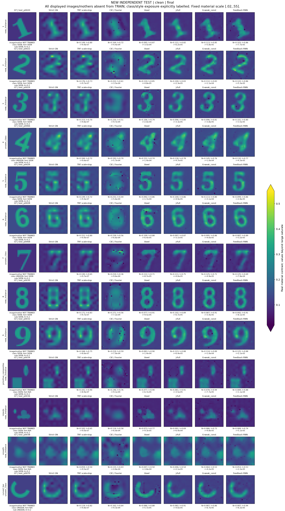

# GN–NN R4：强方向保护与递归物理反馈

已完成：504 TRAIN、78 VAL、108 独立 TEST 母体，各有 clean/noisy 观测；20 套权重、26 个运行、5,616 条封存测试结果。具体测试图像和母体全部未参与训练，类别／字体是否见过逐图标注。

[中文报告](RESEARCH_REPORT_ZH.md) · [全部测试图册](figures/all_test_cases/GALLERY.html) · [A17 式反馈 RNN 结果](RECURRENT_FINDINGS_ZH.md) · [数学推导](theory/A17_RECURRENT_FEEDBACK.md) · [复现](REPRODUCE.md) · [下一轮理论交接](CODEX_TO_PRO_HANDOFF.md)

Voxel Cascade 的 clean 联合成功为 91/108，严格 GN 为 47/108。噪声下，逐尺度停止 TRF 已接近 Voxel 的平均材料误差；硬暗电流空间没有成为更好的默认选择。二次反馈 RNN 对 J-full 有有限改进，但尚未超过 Voxel；循环到 16 次会漂移，不能当作不动点收敛算法。新算法论文主张为 **HOLD**。

所有失败、预算停止、实际成本、传统停止对照及未见类别／字体结果均保留。数据、权重与完整数值归档的下载信息在发布后写入 ARTIFACTS.md；本仓库不保存大型数组。
