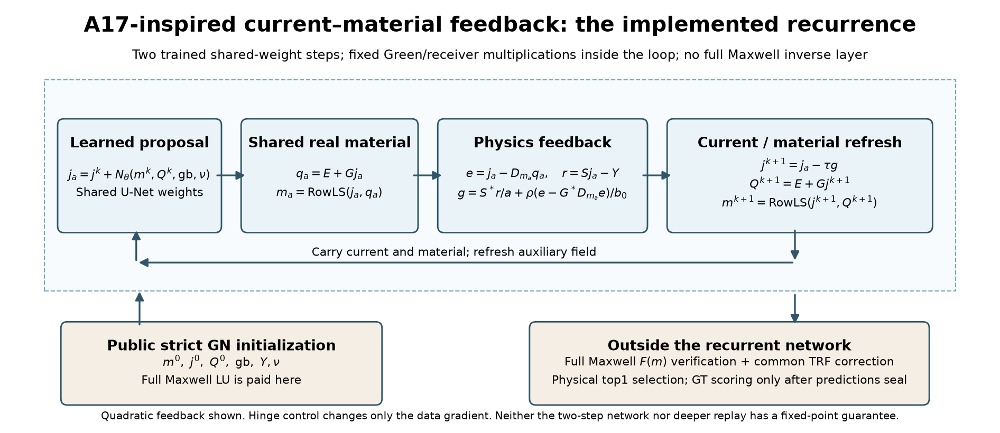
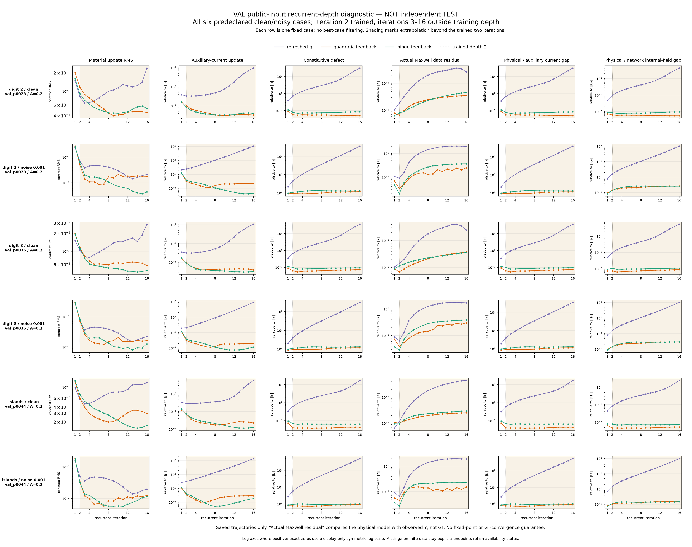

# A17 启发的电流—材料反馈 RNN：已经实现什么，还缺什么

可以把“电流补偿 → 共享实材料读出 → 物理反馈 → 再补偿”做成共享权重的递归网络。本轮已从头训练并运行三个版本。但目前证据支持**两步展开网络**，不支持“反复调用直至收敛到 GT”的说法。完整公式与假设见[数学推导](theory/A17_RECURRENT_FEEDBACK.md)。

## 1. A17 的启示落实在哪里

辅助电流 \(j_a\) 读出材料 \(m_a\) 后，令 \(e_a=j_a-D_{m_a}(E+Gj_a)\)，严格有

\[
j(m_a)-j_a=-L(m_a)^{-1}e_a.
\]

这就是只看直接接收投影时漏掉的材料实现反馈。即使 \(S(j_a-j_0)=0\)，反馈项仍可能改变真实接收场。A17 的 dressing 提醒我们看直接路径之后的再散射；当前实现没有求其 retained／Schur 小块，不能把架构启示算成已验证的 A17 算法收益。

为避免在网络层内求完整逆，使用固定材料的一步联合残差下降：

\[
g=S^*(Sj_a-Y)/\|Y\|^2+
\rho\{e_a-G^*D_{m_a}e_a\}/\|j_0\|^2,
\qquad j^+=j_a-\tau g.
\]

步长由固定材料的二次模型求出，再刷新共享实材料读出。只有固定 \(G,G^*,S,S^*\) 的乘法，层内零 LU；材料更新仍不依赖 GT。完整 GN 初始化和最终真实 Maxwell 验收继续支付 LU，不能称作整个反演已经无逆。

三个新模型使用同一121,528参数骨干、seed7、两次权重共享、同一TRAIN504／VAL78母体，全部从头训练：只刷新辅助总场；二次数据反馈；噪声容许反馈。原J-full是无显式反馈的强对照。

## 2. VAL 实际比较：反馈的收益主要在哪里

下表为78个母体／噪声档的平均校正后在线 top1 NRMSE。**VAL用于模型选择，不是独立测试。** 每个母体clean/noisy相关；没有合并成156个独立物体。

|方法|clean NRMSE|noisy NRMSE|noisy平均校正LU|
|---|---:|---:|---:|
|Voxel|0.08925|0.18049|8.090|
|原J-full|0.09541|0.23909|9.577|
|只刷新总场|0.10938|0.44985|10.500|
|二次反馈|0.09541|0.22530|8.141|
|噪声容许反馈|0.09854|0.36082|10.192|

二次反馈显著优于“只刷新场”这个较弱控制，但相对原J-full，noisy材料NRMSE差为−0.01379，母体配对区间跨零；校正LU减少1.436，区间[−2.488,−0.410]。因此当前较明确的是该VAL比较中的校正调用量变化，尚不能宣布真实材料恢复普遍提高。跨批次wall差异还包含执行时序／并发，不当作纯算法速度证据。

噪声容许项具有让合格物理状态保持不动的数学性质，但本次并未变成更好的经验结果：它相对二次反馈的noisy NRMSE高0.13552。正确的局部目标性质和较好的成像是两件事。原始表、配对分析及费用见[只读机制分析](delegated/energy/VAL_FEEDBACK_FINDINGS.md)。

## 3. 为什么不能把两步模型直接循环到不动点

在预指定的数字2、数字8、islands三个VAL母体上，分别对clean/noisy延长到16次；没有读GT误差来选择深度。表中是三母体平均**真实完整VIE对观测残差**，不是辅助电流残差，也不是GT材料误差。

|版本|clean：2次→16次|noisy：2次→16次|
|---|---:|---:|
|只刷新场|0.01477→0.31446|0.07307→1.86568|
|二次反馈|0.00783→0.03272|0.03868→0.23308|
|噪声容许反馈|0.00972→0.03747|0.02481→0.32790|

反馈抑制了辅助电流／本构缺陷的剧烈增长，但没有让真实数据残差随深度改善。材料增量变小也不代表物理一致：电流与真实材料电流之间仍可保持明显差距。因此TEST只部署训练过的两次迭代；16次诊断没有用于挑选测试深度。

这与理论相符：固定材料的物理下降层可以收缩，NN仍可每轮重新注入误差；整个复合映射没有因此自动收缩。两次权重共享属于RNN式展开；尚不是经过证明的DEQ／不动点求解器。

还存在另一种停点：联合反馈梯度为零时，数据项与本构项可能互相抵消，未必分别为零。因此即使循环停止，也要另看本构缺陷和读出材料的真实 \(F(m)\)。当前网络刷新的是辅助场 \(E+Gj\)，并没有把每次材料反解都精确完成；这正是省去层内完整逆的代价。

## 4. 封存后的独立 TEST 结果

108个新母体，clean/noisy分别评分；具体图像和母体都没有参与训练。所有方法和权重先冻结，公开候选封存后才计算GT指标。下表每格为平均材料NRMSE／联合成功数，分母各108。

|方法|clean|noisy|
|---|---:|---:|
|Voxel|.0961 / 91|.1709 / 29|
|原J-full|.1041 / 83|.3053 / 15|
|只刷新辅助场|.1170 / 67|.3920 / 10|
|二次反馈RNN|.1035 / 84|.2251 / 18|
|噪声容许反馈RNN|.1040 / 88|.3256 / 8|
|逐尺度discrepancy普通TRF|.1333 / 42|.1737 / 7|

二次反馈相对J-full的noisy平均增量是真实的，但65个母体改善、42个变差、1个相同，中位配对改善只有.00870；A=.4分层反而较差。RNN只有seed7，没有三种子确认。它不能据此取代Voxel，也不能声称优于高效的噪声停止对照。原严格GN初始化已占去约45秒，当前层内零LU没有转化为全系统加速。

[独立成像图与逐组结果](RESEARCH_REPORT_ZH.md) · [全部TEST图册](figures/all_test_cases/GALLERY.html) · [费用账本](results/COST_LEDGER.csv)

## 5. 下一步应优化什么

首先应让网络识别**当前**本构／数据缺陷，而不是反复施加两步训练时学到的补偿。可检验的后续方向是残差条件输入、不同展开深度训练、受控的学习预条件器，以及“学习材料选择＋物理可实现性恢复”分工；这些本轮没有运行，不能作为成果。

还要避免一个目标冲突：如果把所有数据合格的物理材料都设为整个网络的不动点，网络就无法从已经数据合格的GN端点继续补全材料。物理层可以保持这些点，学习先验则负责选择材料。最终仍需独立对象评价它选得是否更接近GT，不能仅凭收敛或辅助残差宣布成功。

[SOM-Net（IEEE TGRS, DOI 10.1109/TGRS.2022.3217162）](https://arxiv.org/abs/2209.03567)已有电流／材料交替展开与物理损失。因此本轮不主张发明这类网络。真正值得继续检验的是：可实现性反馈能否在相同训练信息、候选机会和完整物理费用下，改善真实材料恢复。独立TEST结果与主实验一起归档。
