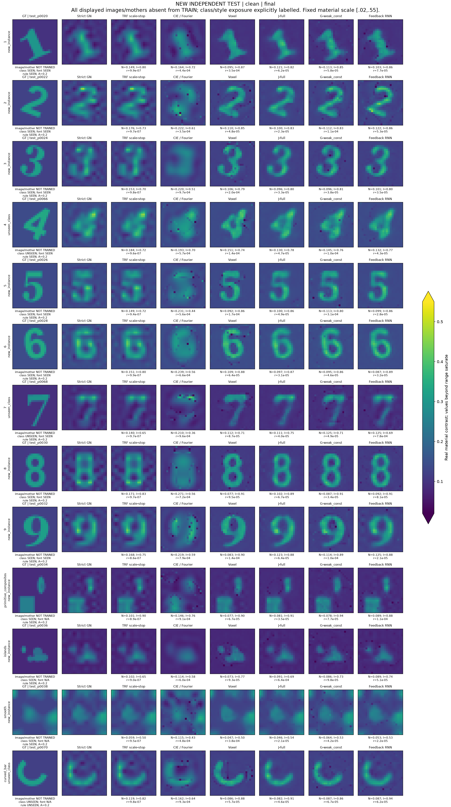
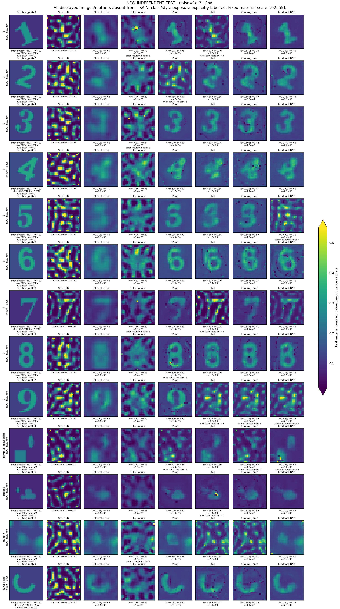
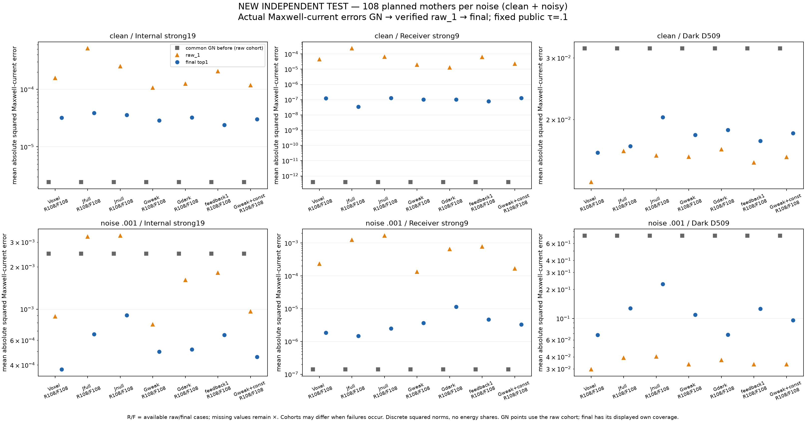
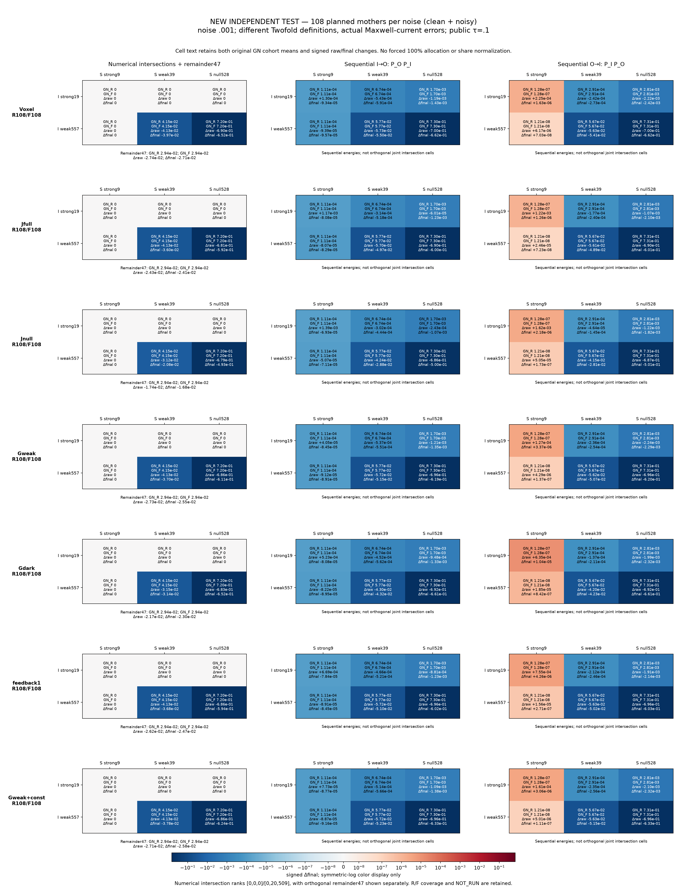
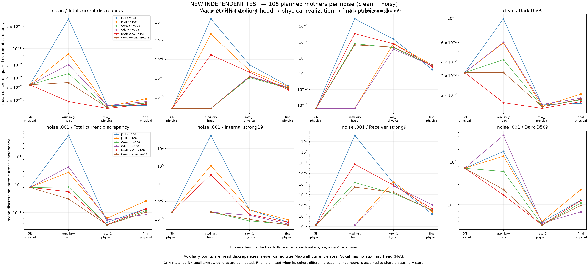
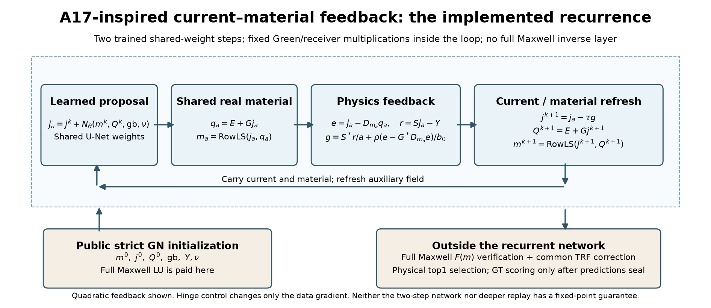
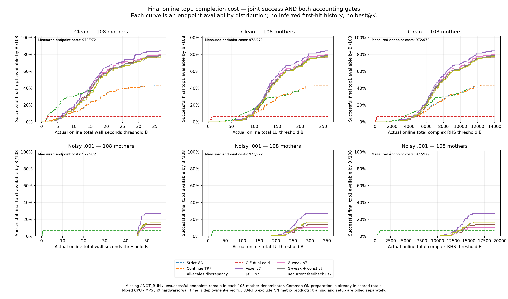

# GN–NN R4：强方向保护、暗电流补全与独立泛化

本轮完成了真实的独立测试：**504 TRAIN、78 VAL、108 TEST母体；每母体clean/noisy配对；20套NN权重、26个方法／种子确认运行、5,616条封存结果。** 所有材料图都是24×24、576个未知实对比度的完整非线性scalar-TM VIE反演，没有用Born观测替代全波数据。

最重要的结论是：**voxel补全在clean材料成像上有明确收益；硬暗电流约束没有成为更好的默认表示；显式反馈RNN能改善完整电流网络的一部分失败，但尚未超过voxel，也没有成为可反复调用至收敛的不动点求解器。** 噪声下，普通TRF的停止方式比原先表面上看到的NN增益更重要。新算法论文主张判为 **HOLD**，不是否定已经得到的成像和机制证据。

[完整逐案例图册](figures/all_test_cases/GALLERY.html) · [结构化汇总](results/RESULTS_SUMMARY.json) · [逐观测评分](results/TEST_SCORES.csv) · [费用账本](results/COST_LEDGER.csv) · [RNN专门分析](RECURRENT_FINDINGS_ZH.md) · [数据与20套权重](ARTIFACTS.md) · [复现](REPRODUCE.md)

## 1. 先看真实图像与数据身份

下面13个母体在评分前就选定：数字1–9及四个非数字对象，均取清单中预指定A=.2对象，不按成败换图。**每张具体图像及母体都没有参与训练。** 数字4、7和弯条的类别也完全未进入TRAIN/VAL；其他行分别标明类别、字体／生成规则是否见过。

色阶固定为[.02,.55]。越界颜色饱和单独标注，不逐图拉伸。完整图册包含全部216份观测、全部26个运行及失败／预算停止结果；无损WebP仅用于降低网页体积，主图保留PNG。原始提案与最终top1分图，不能把raw看起来像GT就当作物理成功。

[clean原始提案](figures/final/main/test_clean_raw.png) · [noisy原始提案](figures/final/main/test_noisy_raw.png) · [数据身份清单](audit/DATASET_IDENTITY_MANIFEST.csv)

## 2. 实验合同与实际完成范围

物理为固定G/E/S、12源×48复接收、k=2π、材料box[.02,20]的二维disk-pulse离散VIE：

\[
j=(I-D_mG)^{-1}D_mE,\quad Q=E+Gj,\quad F(m)=Sj.
\]

材料为未知背景b∈[.08,.15]加幅度A∈{.1,.2,.4}的连续抗锯齿形状。背景、幅度、类别、轮廓、字体和GT都不是求解器输入。全部阶段8→12→24改变的是材料参数化，物理系统始终576阶。这里没有新鲜高对比度A=2.5或12的算法确认。

TRAIN含252数字、252非数字母体；VAL78个新母体用于checkpoint及方案选择；TEST分为60个已见类别的新实例、18个未见类别对象、30个未见字体／规则对象。clean/noisy及同母体衍生物不跨集合。新主网络从头训练，不使用见过4/7的R3权重；两份可选微调仅从本轮自己的R4模型开始。

共同骨干是通道16/32/64的残差U-Net，两次权重共享，27通道公共输入为GN材料、背景Jacobian残差回投影、GN总场实虚部及公开噪声。这些通道宽度不是Weak64/128材料截断。当前路径不采用那种截断。

五套基础权重分别为Voxel、J-full、J-null、G-weak、G-dark。完整电流为13,824维实输出；528／557／509维是每照明的复电流空间，不能说成同等数量的实材料自由度。Soft-dark的VAL选择落在α=1，按合同复用J-full，没有虚构第六套独立软空间权重。Voxel/J-full/G-weak补17、27种子；J-full/G-weak分别增加本构或内部场损失；另有三个反馈RNN和一对匹配微调，共20套权重。

[VAL后投影alpha扫描图](figures/ablations/val_posthoc_alpha.png)：它不是从头训练不同alpha的对照，不能扩大解释成所有软暗架构都失败。

物理合格门为clean相对残差≤.001、noisy≤.003。联合成功还要求NRMSE=RMSE/A≤.15、Otsu-IoU≥.7。原门不改。GT自身按此Otsu规则仅99/108通过形状门，因此也给出连续材料误差；这个校准不是重建可达IoU的严格上限。

08:03:14UTC冻结方法、权重与在线规则，此后才推理TEST；全部公开候选封存后，于09:02UTC后开始数值GT评分。5,616行全部保存、全部存在物理合格top1；5510条COMPLETED、106条BUDGET_STOP。后者全属于noisy继续TRF，不能把数据合格等同材料恢复。GT隔离是明确的数据流协议，不宣称操作系统隔离。能量审计的NOT_RUN表另列216个继续TRF的“NN raw_1”阶段：该传统方法没有这类网络原始提案，其最终结果齐全，不能将此表误读成216条测试缺失。

## 3. 材料恢复：哪些正面结果成立

下表每格为平均NRMSE／联合成功数，分母各108母体。均值覆盖所有计划案例，不删失败后求均值。此表主NN为预声明seed7，其他种子另报。

|方法|clean|noisy|
|---|---:|---:|
|严格GN / Native TRF|.1301 / 47|.8976 / 0|
|继续同一TRF|.1301 / 47|1.0741 / 0|
|弱正则TRF|.1431 / 18|.3104 / 2|
|仅末层discrepancy TRF|.1311 / 48|.6151 / 0|
|逐尺度discrepancy TRF|.1333 / 42|.1737 / 7|
|CIE/Fourier结构参考|.1796 / 7|.3983 / 0|
|Voxel Cascade|**.0961 / 91**|**.1709 / 29**|
|J-full Cascade|.1041 / 83|.3053 / 15|
|J-null Cascade|.1096 / 82|.4446 / 8|
|G-weak Cascade|.1015 / 86|.2356 / 11|
|G-dark Cascade|.1043 / 84|.2423 / 9|
|G-weak + 本构损失|.1033 / 85|.2366 / 17|
|二次反馈RNN|.1035 / 84|.2251 / 18|

**clean正面结果是真实的。** Voxel相对严格GN提高联合成功47→91，平均材料误差降低；未见类别clean为16/18、未见字体／规则25/30。4/7没有训练过，不是把同一张训练图拿来展示。此收益来自监督材料先验，不是新增了测量信息，也不证明唯一性。

**noisy不能只与过拟合GN比较。** 原严格GN在noise下大量预算停止，继续拟合反而更差。旧discrepancy只在24层检查，粗层可能已经拟合噪声；新增的每尺度停止控制在TEST评分前写定并运行。它将noisy NRMSE降到.1737，几乎追平Voxel seed7的.1709。

分组后，noisy Voxel只有已见类别新实例的平均误差更低：.1652对.1759；未见类别为.1805对.1743，未见字体／规则为.1763对.1690，均值反而较差。对应联合成功仍为5对0、7对2，说明形状门与平均连续材料误差给出了不同侧面。不能用ALL均值覆盖这些差异。

三种子也不能隐去：Voxel noisy NRMSE为.1709／.1639／.1945，成功29／29／28，但三种子共同成功仅15个母体；J-full对应15／14／5，共同成功仅3个。没有根据TEST挑seed。G-weak三种子噪声均值都差于逐尺度停止对照。

在线规则是先原始全波数据合格，再选最接近完整NN提案的材料，不是按GT排名。本轮主要noisy NN比较中，数据合格best@K没有隐藏出一批在线遗漏的更好材料；较低的all-best常来自不合格raw提案。各方法K实际不同，不能统一称best@5，更不是概率后验或严格分支枚举。

## 4. 强方向绝对误差：答案不是“全部被破坏”或“全部被保护”

能量均指离散平方范数，不是电磁功率。对真实物理电流，固定投影误差的变化为

\[
\Delta E_P=2\operatorname{Re}\langle Pe,Pu\rangle+\|Pu\|^2.
\]

因此更新幅度与误差增减分开。新TEST重算GT、raw材料及最终材料的真实电流，辅助头另列；同一材料跨方法出现时复用求解，实际9921LU／119052复RHS，属于离线诊断，不算在线NN费用。

下表为noisy、108母体的真实电流绝对误差均值：

|结果|内部强19|接收强9|联合暗509|
|---|---:|---:|---:|
|共同严格GN|2.4884e-3|1.404e-7|.71963|
|Voxel|3.7188e-4|1.8371e-6|.06738|
|J-full|6.6364e-4|1.4685e-6|.12764|
|J-null|9.0575e-4|2.4954e-6|.22650|
|G-weak|4.9754e-4|3.6435e-6|.10912|
|G-dark|5.1546e-4|1.1428e-5|.06798|
|二次反馈RNN|6.5548e-4|4.6670e-6|.12583|

noisy下，各主NN减少了内部强方向误差和暗空间误差，却增加接收强方向误差。clean下，原GN的内部强19已很准，J-full从2.4208e-6增至3.8580e-5，其他主NN也有增加。**所以“强方向”必须说清是哪一个算子、哪一种噪声、哪个阶段。** Voxel也存在这种权衡，不能把它全归因于电流输出头。

接收强误差增加还受停止目标差异影响：严格GN拟合远低于NN物理合格门；noisy又存在拟合噪声与接近GT场的区别。误差绝对值增加是事实，但不自动意味着材料图像更差。必须同时看GT材料、真实场误差及数据残差。

固定谱沿用0.1强门；G内部无非平凡数值零核，557是弱空间；接收零空间528。Two-fold同时给两个顺序投影与真正数值交集。当前交集只有弱×弱20、弱×接收核509等非零块，另有47维未分类余项，不能把顺序表当作互斥物理分支。

[clean Two-fold](figures/test_energy/twofold_clean.png) · [弱／零方向绝对误差](figures/test_energy/weak_null_absolute.png) · [三种子能量确认](figures/test_energy/three_seed_confirmation.png)

## 5. 为什么辅助接收零空间没保护最终接收强方向

对读出材料m_a及辅助电流j_a，令e_a=j_a−D_ma(E+Gj_a)，严格有

\[
F(m_a)-F(m_0)=S(j_a-j_0)-SL(m_a)^{-1}e_a.
\]

第一项是辅助接收更新，第二项是材料实现反馈。理想硬接收核只能消掉第一项，不能消掉第二项。G-dark在noisy下的暗空间误差虽降得多，最终接收强误差仍升到1.1428e-5，直接说明不能拿辅助投影作真实强方向保证。

进一步，内点物理锚点的“读材料再求真实电流”导数是斜投影 \(L^{-1}\Pi_Q^{\mathbb R}L\)，不是固定Green的正交投影。完整电流头还有大量对材料读出一阶不变的方向；材料损失好，不要求辅助头已经物理相容。硬电流空间也不自动意味着材料表达失败——本轮没有证明其读出Jacobian失秩。

G-weak还可能通过限制\(\|G\delta j\|\le\sigma_{20}\|\delta j\|\)减小辅助场变化，而非直接保护真实材料强方向。但没有更新范数约束就不能给出稳定证书。完整推导、适用假设及标准工具归因见[数学合同](MATHEMATICAL_THEORY.md)。

本构损失并非统一解药：它在G-weak的VAL上改善约7%，合法触发微调；新TEST中noisy平均NRMSE却略差于未加项模型，联合成功11→17。FullVIE微调相对同起点材料微调的noisy均值降低.01179，但53胜53负2平，中位差0，联合成功19→16。这是混合结果，不能只取均值作胜出证据。

[逐项损失与匹配微调图](figures/ablations/test_loss_quality.png)。固定材料损失、0.01本构项、0.01内部场变化项分别报告，没有把它们一次全打开再归因。

## 6. 用户提出的A17式反馈RNN：已经做了，也保留失败

网络补偿电流后读出共享实材料，再用G/G*/S/S*下降数据／本构残差，刷新辅助场进入下一次同权重网络。层内不求完整L逆，但初始严格GN和最终物理验收仍求解Maxwell。当前没有实际A17小Schur预条件器，不能把它叫作A17条件交换算法。

二次反馈RNN相对J-full的noisy NRMSE从.3053降到.2251，联合成功15→18；相对只刷新辅助场的控制更好。但A=.4反而比J-full差，只有seed7，没有三种子架构确认；也没有超过Voxel或高效普通噪声停止对照。

在三个预指定VAL母体、clean/noisy共六观测上把两步模型循环到16次：反馈抑制辅助电流的剧烈增长，却使真实VIE残差变差；二次反馈的平均残差clean从.00783到.03272、noisy从.03868到.23308。该诊断没有用于选择TEST深度。**两步共享权重网络不能自动当作可无限迭代的不动点网络。**

固定材料的残差梯度层有标准下降／条件收缩结论，NN复合映射没有由此继承收缩。物理合格GN在噪声球反馈中本来就可能不动，而仍与GT不同；学习先验负责材料选择。联合梯度停住也可能只是数据／本构项抵消，所以固定点仍需独立看e及真实F(m)。

[三个版本的VAL表、16次全案例轨迹和下一步架构问题](RECURRENT_FINDINGS_ZH.md) · [完整A17连接、法向几何与证明](theory/A17_RECURRENT_FEEDBACK.md)

## 7. 成本与下一步优先级

|方法|clean总秒|noisy总秒|noisy LU|noisy复RHS|
|---|---:|---:|---:|---:|
|严格GN|13.20|45.37|234.62|12859|
|逐尺度停止TRF|5.33|.377|11.51|595|
|CIE/Fourier参考|1.50|9.81|9.99|359|
|Voxel|14.77|47.41|240.80|13094|
|J-full|14.55|48.26|242.32|13197|
|二次反馈RNN|15.32|48.41|242.08|13178|

这是记录的混合M4/i9/MPS流水线均值，不是统一硬件的纯算法速度；共同严格GN已计入NN，旧准备中普通方法未使用的NN特征从必要部署费扣除，但实际执行账本保留。相同55秒上限不等于相同实际开销，更不等于已做满额传统多起点。

曲线表示最终在线top1已经完成、联合成功且在实际成本B以内的比例，不捏造首次命中轨迹，也不把离线best@K当在线结果。LU/RHS不包含NN、CIE模式乘法等全部算术；相应操作单列账本，不能只因LU少就宣称更快。

本轮没有整体加速结果。层内省掉完整逆，改变不了昂贵的严格GN输入已占去大部分时间。下一轮最有价值的是：在**新鲜确认集**上训练使用噪声感知／更短初始化的模型，或从可复用公开参考状态开始，而不是继续在45秒过拟合输入后增加网络层。当前没有偷偷更换某个NN的锚点。

第二个可裁决问题是精确物理场刷新与便宜近似刷新的差别：先用固定材料恢复作为控制，再研究不做完整逆的多步反馈／A17预条件器。当前欧氏剖面反馈会改变读出的材料，不等于精确的保材料斜恢复。其价值必须同时体现真实材料、场相容性和费用，不能只看辅助缺陷。

原始CPU总时间未在所有求解器中记录，保持NOT_RECORDED，不由wall冒充；LU/RHS、壁钟、固定乘法和CIE模式操作分别保留。准备中17个误用停止策略的端点及中断费用未知部分保留；bestK文字范围作了元数据修正，没有重算物理或改变指标。详细口径见[数据与成本](DATASET_AND_COSTS.md)。

## 8. 论文归因与最终判断

可以保留：独立图像／类别／字体测试中的clean材料补全正面结果；固定暗投影经过材料实现后不能保护真实强方向的机制证据；显式反馈对完整电流网络的有限noisy增量；以及噪声停止、辅助读出和递归深度的真实反例。

不能声称：概率解集或全根覆盖；GT唯一性；高对比度新恢复；current空间普遍胜过voxel；全闭环transverse收敛；不用Maxwell正演的反演器；或全系统加速。

[SOM-Net（IEEE TGRS, DOI 10.1109/TGRS.2022.3217162）](https://arxiv.org/abs/2209.03567)已有电流／材料交替展开。CSI、本构残差、SVD与Landweber反馈也有成熟先例。因此本轮**不足以仅靠组合模块宣布新的TAP算法贡献**。真实成果是可复现的成像、受控比较和能决定下一步架构的机制边界；是否形成新方法，仍需代价更低且稳定超越voxel／噪声感知普通对照的独立确认。

[独立证据提取](delegated/review/INDEPENDENT_TEST_FINDINGS.md) · [最终科学裁决](audit/FINAL_SCIENTIFIC_REVIEW.md) · [交给下一轮理论分析](CODEX_TO_PRO_HANDOFF.md)
