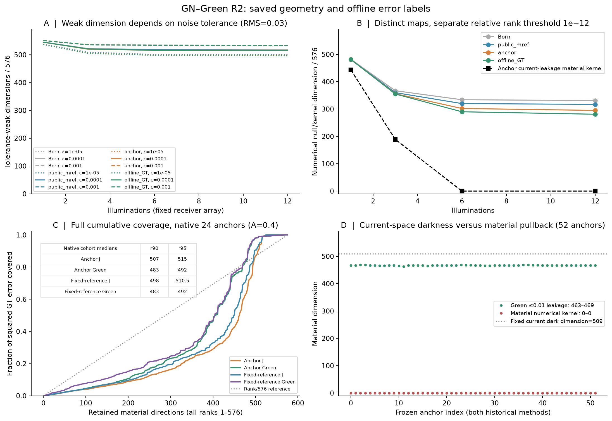

# GN–Green R2 · 有效材料搜索空间

[中文报告](RESEARCH_REPORT_ZH.md) · [网页](https://migodam.github.io/b1-probabilistic-maxwell-imaging/research/research_gn_search_space_r2/) · [数学](MATHEMATICAL_THEORY.md) · [复现](REPRODUCE.md) · [下载](ARTIFACTS.md) · [下一轮交接](CODEX_TO_PRO_HANDOFF.md)

48低对比端点＋4控制完成共享实材料空间判定；36正则对照、96搜索任务与12停止诊断完成。509复电流暗方向不等于材料latent；最弱64维只覆盖约3%GT误差，宽弱空间仍约500维。Green/soft搜索未改善在线top1，严格停止零正则TRF四例平均NRMSE改善约18.5%。历史开发证据，非新鲜盲测，未训练NN。

