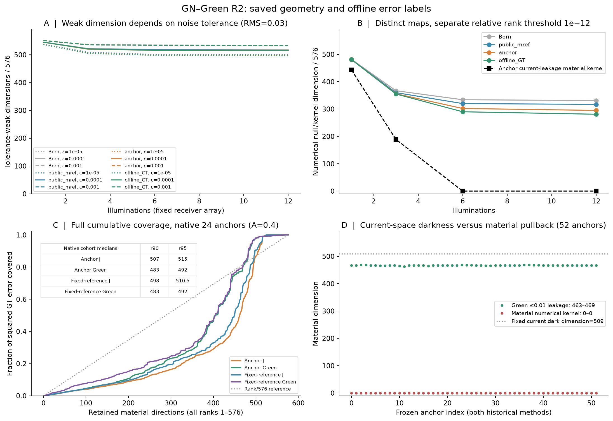
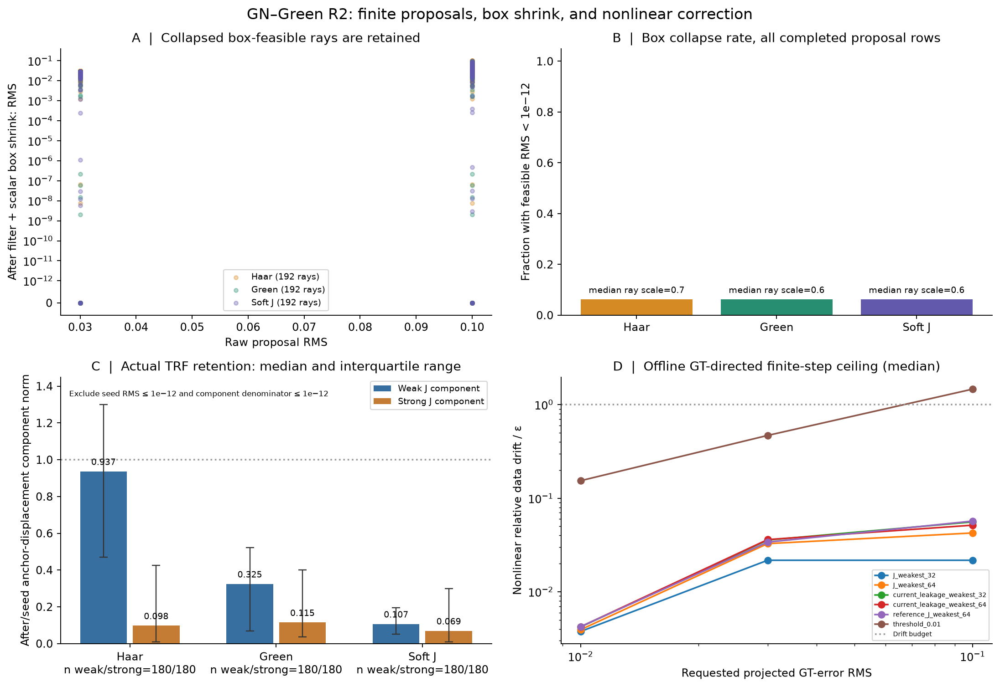
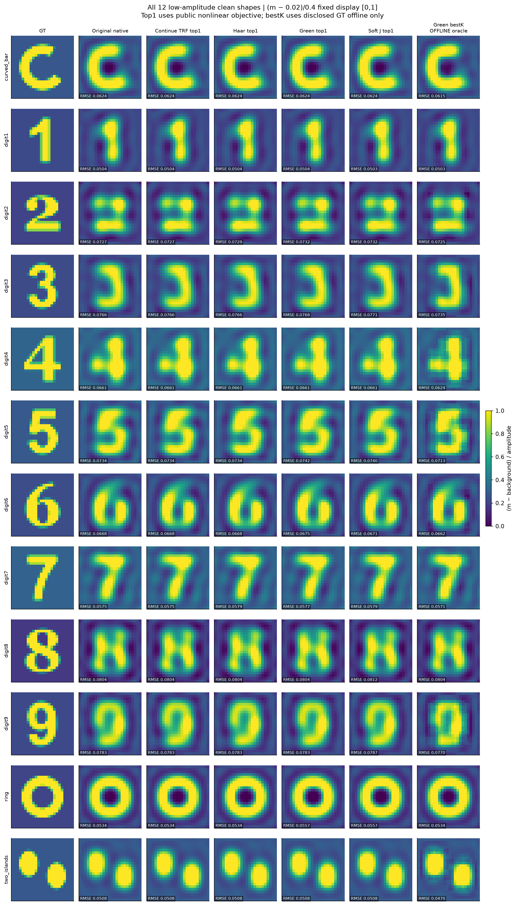
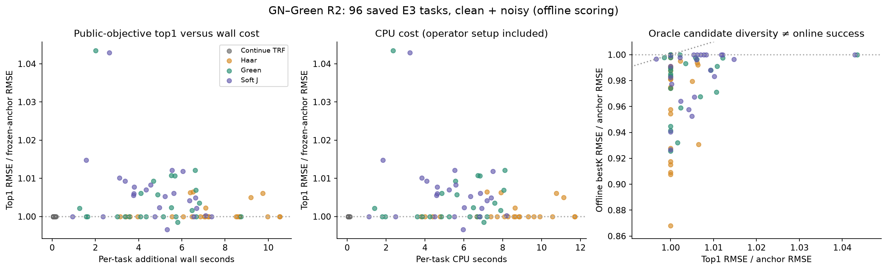

# GN–Green R2：往 GT 搜索的材料空间究竟有多大？

**完成日期：2026-11-07。状态：空间判定完成；小型搜索未建立在线增量；NN 尚未训练。**

本轮使用12种已披露历史材料、24×24独立实材料、12源×48复接收、完整非线性二维 scalar-TM VIE。主分析包含48个低对比端点；另有4个中高对比端点。全部结果是开发与机制证据，不是新鲜盲测。物理核与冻结历史算法未修改。

[数学推导](MATHEMATICAL_THEORY.md) · [算法与接口](ALGORITHM.md) · [逐案例表](results/RESULTS_BY_CASE.csv) · [完整费用](results/COST_LEDGER.csv) · [复现与下载](REPRODUCE.md) · [下一轮理论/NN交接](CODEX_TO_PRO_HANDOFF.md)

## 1. 最重要的答案

**“暗电流空间很大”不能直接变成“有一个很小、很好学的材料 latent”。** 固定 Green 的暗空间有509个复电流方向；施加共享实材料和全部照明以后，严格泄漏算子的材料数值核为零。然而在指定移动尺度和允许数据变化下，仍有约516–533个弱响应材料方向。

这片近似空间能覆盖大部分 GN–GT 误差，但误差没有集中在最弱的几十维：按不看GT的物理谱排序，最弱64维只覆盖约3%的误差平方能量。达到95%覆盖，当前 Green 排序需要中位492维，Jacobian排序需要515维。这是当前物理排序的结果，**不是任何学习表示都至少需要492维的下界**。

小型在线搜索未赢：Green和Jacobian过滤后的top1没有总体改善；普通Haar提案的离线best@K反而略好。进一步诊断发现，去掉正则并收紧停止条件后，普通TRF在四个对象上都更接近GT。因此目前最有价值的结论是：**先分清可移动性、正确搜索方向、优化停止偏差，再决定NN输出什么。**

## 2. 实际完成了什么

| 实验 | 实际范围 | 状态 |
|---|---:|---|
| E1 主空间分析 | 48个低对比端点＋4个中高对比端点 | COMPLETE |
| 共享电流约束与源数 | 52端点×1/3/6/12源，208行 | COMPLETE |
| E2 原权重/0.1倍/零正则 | 12个clean Native端点×3臂 | 36/36 |
| E3 普通/Haar/Green/软Jacobian | 12形状×clean/noisy×4臂 | 96/96 |
| 停止容差补充诊断 | 4形状×3权重，同预算、单列 | 12/12 |
| 有限步表示探针 | 24端点×6空间×3尺度 | 432次完整物理验收 |
| 同形状低幅度控制 | 数字7、环；A=0.1/0.2/0.4 | 6个完整VIE数据对象 |

12个独立低对比材料的不同噪声、参数化端点不是48个独立对象。额外数字7和环的A=2.5/12只作空间对照，不构成新的高对比搜索成功证据。NN、完整TSOM反演截断消融、新鲜盲确认均未运行；单独的仿射电流chart表示误差扩展亦未完成。

## 3. 从509维电流暗空间到真实材料方向

令 $L=I-D_mG$，总场 $Q=E+Gj$，接收算子为 $S=G_{ob}$。材料方向产生的真实电流变化为

$$\mathcal T_mh=L^{-1}D_hQ,\qquad h\in\mathbb R^{576}.$$

固定暗电流空间是内部弱方向与接收核的交集；令 $U$ 为它的67维复正交补。实际需要检验的是

$$\mathcal A_mh=\operatorname{pack}_{\mathbb R}(U^*\mathcal T_mh)=0.$$

这要求**同一个实材料方向同时满足各照明的电流约束**。因此只看一个576维Green矩阵的弱方向数会高估可搜索材料自由度。

复用的固定谱中，内部G为19强＋557弱、无数值补空间；接收G为9强＋39非零弱＋528补空间（强门0.1，数值秩门1e-12）。这是各自右定义域的算子分解，不是完整多源材料Jacobian的秩。[固定谱维数表](results/FIXED_OPERATOR_DIMENSIONS.csv)保留复域/实化口径。

| 使用源数 | 材料泄漏数值核维数，低对比48端点 | 泄漏能量≤1%的近似维数，中位数 |
|---:|---:|---:|
| 1 | 443 | 480 |
| 3 | 189 | 467 |
| 6 | 0 | 466 |
| 12 | 0 | 467 |

数值秩统一用未平方泄漏算子的SVD、相对阈值1e-12。12源最小/最大奇异值比为5.76e-10至4.20e-9，故不只是Gram小特征值舍入造成的“满秩”。这里没有符号核认证。

**尤其不能由材料泄漏核为零推出材料唯一。** 这里只能证明 $\ker\mathcal A_m\subseteq\ker J_m$；小集合为空不能推出大集合为空。Full-J的数值弱空间仍很大，且阈值、有限非线性、box和观测噪声还要分别处理。

## 4. 多大的空间才能覆盖 GN–GT 误差？

所有基均从公开物理与当前材料构造，再离线计算GT覆盖；没有按GT排序。能量指Euclidean材料误差的平方范数比例。

| 保留最弱方向数 | 当前 Full-J 覆盖中位数 | 当前 Green 广义谱覆盖中位数 |
|---:|---:|---:|
| 32 | 1.36% | 1.43% |
| 64 | 2.65% | 2.94% |
| 128 | 5.53% | 6.20% |
| 256 | 13.43% | 18.03% |
| 512 | 94.12% | 99.07% |

1%泄漏宽空间在低对比端点有466–469维，中位覆盖77.63%的GT误差。完整8/16/32/64/128/256/576表与逐像素box违反数见[覆盖表](results/e1/coverage.csv)。全秩累计曲线见[逐维数据](results/coverage_dimension.csv)。

| 基，48个低对比端点 | 90%覆盖所需前缀维数中位数 | 95% | 99% |
|---|---:|---:|---:|
| 当前Full-J | 507 | 515 | 520 |
| 当前Green材料拉回 | 483 | 492 | 509.5 |
| 公共背景Full-J | 498 | 511 | 518.5 |
| 公共背景Green材料拉回 | 483 | 492 | 509 |

0.5是偶数个端点取中位数的结果，单例维数始终是整数。最弱谱前缀不一定是最佳压缩：接近不可见的方向可能包含很少实际误差，而有用的误差集中在仍有微弱响应、排序靠后的方向。

用 $K=J/\|Y\|$，材料RMS步长 $r$ 和数据变化容差 $\varepsilon$ 定义

$$d_{r,\varepsilon}=\#\{i:r\sqrt{576}\,\sigma_i(K)\le\varepsilon\}.$$

在 $r=0.03$ 时，clean主口径 $\varepsilon=10^{-4}$ 给出中位516维，覆盖99.32%误差；noisy主口径 $10^{-3}$ 给出533维，覆盖99.96%。clean容差是诊断选择，不是声称存在1e-4观测噪声。全部半径—容差—源数表在[dimensions.csv](results/e1/dimensions.csv)。

| 材料RMS尺度，12源低对比48端点 | 容差1e-5 | 容差1e-4 | 容差1e-3 |
|---:|---:|---:|---:|
| 0.01 | 507 | 525 | 539 |
| 0.03 | 497.5 | 516 | 533 |
| 0.10 | 488 | 507 | 525 |

上述为弱维数中位数。少量对象的离线误差PCA单列：12个clean Native误差中心化后样本秩11、95%样本方差需要10个主成分；48个相关端点中心化秩47、95%需要11个成分。这是有限样本统计，绝不表示物理材料自由度只有10或11维，也未证明新对象能由这些样本主成分表示。[PCA原数值](results/SAMPLE_ERROR_PCA.json)。

图中覆盖曲线使用24个Native端点，表格使用Native/Reciprocal共48端点；图例已明确样本范围。不同口径的中位数不应直接混用。

## 5. 固定背景能否跨对象复用？

单独最弱32/64维基在背景与GN端点之间明显旋转：最大主角度中位数约89°。但最弱谱密集，截断基容易因近简并而变化，不能把这个角度直接解释成新的物理分支。

更有用的量是完整软滤波算子：按相同物理容差构造，当前与公共背景算子的相对Frobenius差中位数仅1.32%（clean1.47%、noisy1.09%）。因此**固定背景软过滤器值得下一轮直接对照**，而固定一组最弱特征向量系数未表现出同样稳定性。本轮测量了算子差，没有运行固定背景过滤器的搜索替代实验，也没有建立跨高对比对象稳定性定理。

## 6. 有限步能走多远，校正是否全部拉回？

首先做离线表示探针：将已知历史GT误差投到各空间，归一到预定RMS，再沿同一射线缩步满足box。它只衡量表示能力与有限步可行性；在线算法不能得到这个GT方向。

| 空间 | 试探数 | 接受数据漂移门的次数 | 实际RMS中位数 |
|---|---:|---:|---:|
| Full-J最弱32 | 72 | 72 | 0.0126 |
| Full-J最弱64 | 72 | 72 | 0.0132 |
| Green最弱32 | 72 | 72 | 0.0139 |
| Green最弱64 | 72 | 72 | 0.0121 |
| 固定背景Full-J最弱64 | 72 | 71 | 0.0135 |
| Green泄漏≤1%的宽空间 | 72 | 38 | 0.0300 |

432次中48次实际RMS≤1e-8，故窄空间全部通过不能忽略被box阻断的射线。宽Green空间覆盖更多误差，却不自动满足绝对数据容差；相对电流泄漏约束与绝对观测漂移是不同条件。

在线Haar提案每臂192条射线，其中180条非零，12条被box压到接近零。实际corrector使用全部576维TRF，而不是固定的弱/强分块映射。以原anchor为原点测量：

| 提案 | 校正后弱位移/校正前弱位移，中位数 | 强位移保留比例中位数 |
|---|---:|---:|
| Haar | 0.937 | 0.098 |
| Green过滤 | 0.325 | 0.115 |
| 软Jacobian过滤 | 0.107 | 0.069 |

非零180条/臂。普通结构提案保留很多弱位移；过滤提案更容易回落。**保留弱位移不等于接近GT，拉回也不是全局不可达证明。** 位移保留比来自 $(m_{after}-m_{anchor})$，不是误把校正量 $(m_{after}-m_{seed})$ 当成保留量。

阻尼GN在精确内点解、无正则条件下的局部导数为 $\lambda(J^TJ+\lambda I)^{-1}$。这个条件结论解释“强方向收缩、弱方向较中性”的可能机制，但实际TRF有box、正则、非零残差和全局化；本实验只报告测得的收缩行为。

## 7. E2：原GN确实还有停止与正则偏差

12个clean Native端点，原smooth和TV均1e-4。每臂45秒、500LU、30000复RHS上限，以先到者停止。成熟TRF按原容差真实提前结束，没有为了耗满45秒重复调用。

| 正则权重倍数 | 材料NRMSE中位数 | 相对原端点的平均NRMSE变化 |
|---:|---:|---:|
| 1 | 0.16611 | 0 |
| 0.1 | 0.15729 | −0.00902 |
| 0 | 0.16187 | −0.00513 |

主实验原停止容差是ftol/xtol1e-10、gtol1e-8。36个端点均达到其尺度化梯度门，最大值小于9.53e-9；并非执行失败。但这个绝对门对已很小的归一化目标可以过早停止。

发现该现象后，另列四对象的停止诊断，全部三项容差改为1e-12，预算与物理不变，不覆盖主实验：

| 对象 | 原端点NRMSE | 严格停止＋零正则NRMSE | IoU | 原始数据相对残差 |
|---|---:|---:|---:|---:|
| 弯条 | 0.15600 | 0.12044 | 0.898 | 8.14e-7 |
| 数字2 | 0.18186 | 0.15710 | 0.773 | 1.35e-6 |
| 数字7 | 0.14380 | 0.09974 | 0.796 | 8.29e-7 |
| 环 | 0.13346 | 0.12424 | 0.962 | 7.23e-7 |

四例平均NRMSE从0.15378降至0.12538，约18.5%相对下降。相反，严格停止但保留原正则时，四例材料误差都增加。这是**正则目标偏好与停止容差共同作用的证据**，不是“数据不包含这些信息”的证明。四例是观察主实验后选定的开发诊断，不是独立确认；不能据此承诺所有对象同幅改善。

误差在同一anchor强/弱材料空间中的变化保存在[E2分量变化](results/E2_ERROR_SUBSPACE_CHANGE.csv)，投影梯度与活动边界保存在[端点驻点诊断](results/e2/ENDPOINT_STATIONARITY.json)。

同形状A=0.1/0.2/0.4控制也表明，降低笔画幅度并不消除非零背景反馈。数字7的零背景Born相对误差为17.3/19.5/24.8%，公共背景线性化误差为2.60/4.33/8.82%；环对应14.6/18.6/27.1%与1.21/3.68/10.4%。这些是正演线性化控制，不是新增反演成功。

## 8. E3：搜索的在线收益与离线覆盖必须分开

所有方法使用相同原数据目标、相同smooth/TV、相同box及公开原端点。每臂同为45秒预算上限，候选最多8条；基构造、失败与校正均收费。过滤后不重新放大到原RMS，box用单一射线缩放，不逐像素裁剪。在线top1只按共同目标排序，GT只在预测封存后的评分器读取。

| 方法，24端点 | top1误差/原误差中位数 | best@K/原误差中位数 | 联合通过 | 实际wall中位数 | LU/RHS中位数 |
|---|---:|---:|---:|---:|---:|
| 继续原TRF | 1.0000 | 1.0000 | 6/24 | 0.065 s | 2 / 120 |
| 普通Haar＋TRF | 1.0000 | 0.9802 | 6/24 | 7.086 s | 67 / 3636 |
| Green材料拉回＋TRF | 1.0008 | 0.9888 | 6/24 | 5.013 s | 49.5 / 3162 |
| 软Jacobian＋TRF | 1.0054 | 0.9962 | 6/24 | 4.858 s | 50 / 2616 |

误差采用RMSE/A；共同历史联合门为NRMSE≤0.15、重建自身Otsu阈值IoU≥0.7和数据门。全部96个top1均达到历史数据门，但只有6/24端点/臂达到联合门。数据相容不足以自动选出更好的材料。

best@K是保存的anchor、top1、8个物理评估seed与8个每seed校正候选的离线最优；最多18槽且可能重复。它不是18个独立根，也不是全部优化迭代的best。所有保存seed确实经过完整物理评估并参与在线目标排序。GT最佳选择只作事后覆盖分析。

表中best@K允许包含尚未达数据门的seed。若只保留历史数据门合格的候选，Haar误差比中位数变为0.9811（约1.89%改善），Green和soft仍为0.9888、0.9962；结论不变。Haar的384个before/after槽仅192个满足数据门，而两种过滤都是384/384。**过滤改善了候选数据可接受性，但没有转化为更好的GT恢复。**

**没有证据表明Green过滤比继续GN或普通结构提案更接近GT。** 两种过滤各仅1/24在线材料误差微降，整体中位数略变差；普通Haar的oracle改进约1.98%，Green约1.12%，软过滤约0.38%。不能把这种小幅oracle覆盖当成已经实现自动恢复。原停止规则对照极早停止，补充诊断进一步说明下一轮应先修正停止/正则口径，再声称搜索越过了普通优化的能力。

主图为全部12种clean形状、统一材料色阶；noisy逐例数据完整保留。图中Green best@K为GT离线选择，不能当成在线成像。所有方法的低对比背景仍显示出结构/正则偏差，没有删去失败形状。

## 9. 成本、失败与复现边界

两CPU worker、每worker单线程BLAS；使用已有Apple Silicon环境，无CUDA资源。主搜索144份预测全部封存，其中12份E3 clean continuation复用E2同结果，故132次独立成功物理运行。另有36次驻点诊断。

已恢复计数总和至少 **5059 LU、322164复RHS**。E2主实验8.36秒、E3独立运行399.50秒、严格停止补充63.53秒，均为各任务数值wall之和，不是并行总历时。E1保留成功案例55.07秒和额外子源11.37秒；有限步与幅度控制3.25秒。

原生数值库在长worker中发生过退出/内存损坏；最终采用每任务新进程完成。8次可记录corrector失败已计入费用；未封存的原生进程失败与重复准备有部分成本无法恢复，明确为UNKNOWN，不能当0。因此总计是已知下界，不提出完整系统加速百分比。

固定G/S历史谱直接复用；每个Green搜索臂的当前材料拉回需要在现有LU上增加576个复RHS，计入在线预算。当前J与基没有使用E1诊断缓存免费生成。历史固定谱冷启动时间未单独计量，冷启动总成本不完整；本轮没有新速度优势主张。

## 10. 下一轮最应研究什么

1. **不建议现在锁成weak32/weak64 latent。** 当前物理排序的95%覆盖需要约492–515维。保留完整材料输出，再软物理过滤，是更直接的候选架构；这仍只是基于几何证据的建议。
2. **先学习空间结构与正确符号。** 大弱空间只说明数据不敏感，不告诉网络往哪里走。学习目标可为完整材料残差，训练损失分别约束GT误差、物理数据变化、box和校正后存活位移。
3. **把box纳入过滤问题。** 当前射线收缩不是唯一可行策略；可研究带box切锥约束的软滤波二次问题。本轮未运行，不计作贡献。
4. **优先复核固定软滤波器。** 它跨这批低对比对象仅约1.32%算子变化，可与动态过滤器做真实成本和恢复对照，而非跟踪不稳定的小谱前缀。
5. **先把普通优化做公平。** 对后续训练标签和基线冻结更合适的停止规则，并把数据项与正则偏差分离。四例普通TRF已有约18.5%平均NRMSE相对改善，远大于当前过滤搜索的oracle小幅收益。

本轮可支持的是“暗电流—共享材料—有限可行搜索”的定量诊断链，以及一个否定盲目弱32/64压缩的实例证据。未建立新成像算法优越性、NN可学习性、真实多分支覆盖或GT全局可达定理。
