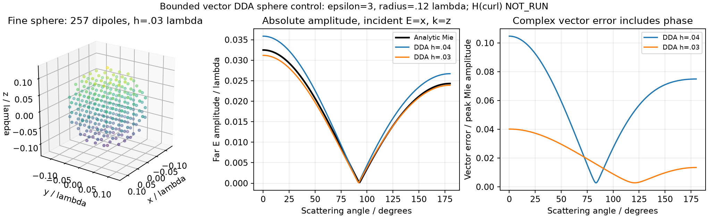
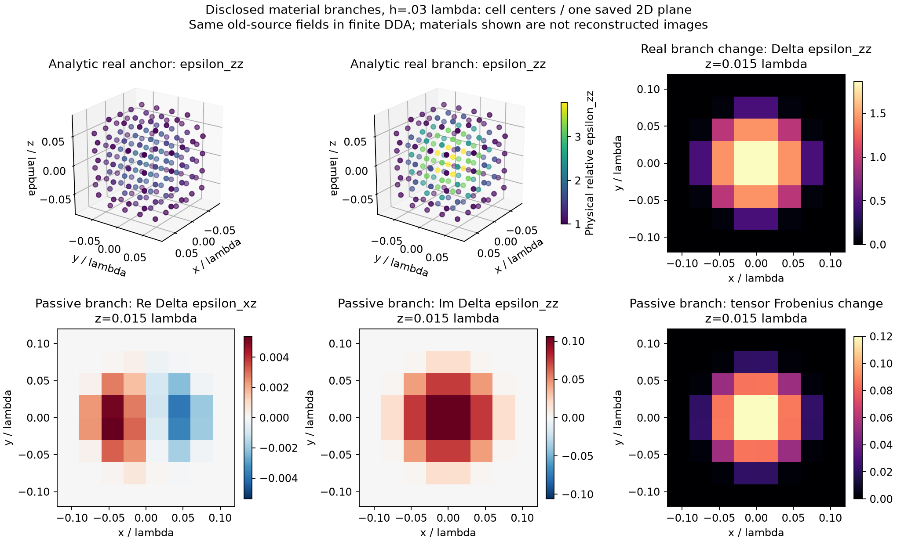
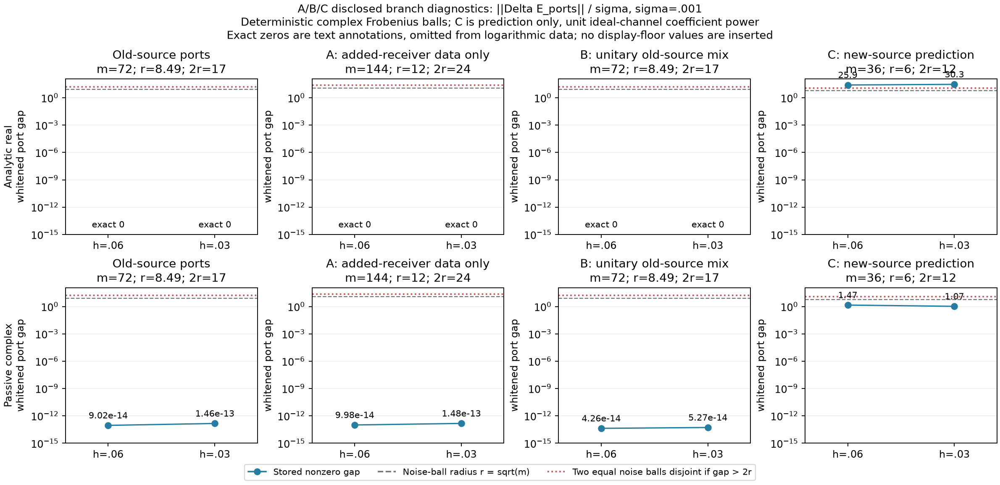

# MAX-STRUCT-R1：最小机制实验与停止结论

2026-11-02。**本轮建立了有限照明张量同场族的具体证据和适用边界，没有建立新的成像优势。** M 停在表示范数的实现资格，T 停在可用异常维数与误差界；因此没有启动新鲜成像、数字扫参、NN 或 ROM。本报告包含未完成项，不把运行完成写成科学通过。

原始数值研究在本地隔离工作树封存；2026-11-02 按用户后续“结果都要放 GitHub”授权，将报告、代码、结果与图发布到现有 B1 仓库。此次发布不新增实验，也不改变科学结论。阅读入口：[README](README.md)、[数学证明](THEORY_DERIVATIONS.md)、[逐项状态](THEORY_STATUS.md)、[复现](REPRODUCE.md)、[独立审查](audit/FINAL_INDEPENDENT_REVIEW.md)。

## 一、先回答最终问题

|问题|本轮答案|
|---|---|
|实际利用了什么物理结构？|固定 μ 下，有限照明只激发每点张量的部分方向；令 ΔεE_s=0 可保持全部原场和任意接收数据。|
|普通磁场或成熟 CIE 是否解释了全部收益？|没有新的表示/成像收益可供归因。M 尚未完成合格对照，不能判断普通磁场是否足够。历史 10/12 仍属于成熟双 β CIE＋共同 corrector。|
|单调性证书真的非空吗？|没有建立。没有合法统一 k<p，也没有完整 δ；本轮不生成“认证支撑图”。|
|张量多解是信息限制还是算法失败？|已构造的原照明同场族是信息限制，算法即使精确也不能区分；不能把它推广到受限实/对角/块常材料的所有情况。|
|正面结果是否来自更多 cost、prior 或新观测？|F 分支使用公开开发锚点及明确张量类，无恢复优势。C 臂的分离来自真正新增照明方向，且仅为预测；被动例增加方向后仍低于噪声分辨尺度。|

## 二、冻结来源和三维物理能力

主仓库固定在 `7317601b43b914525c21f09e5a60020552ea677b`。已读取指定 Atlas 01/02/03/05/06/09/10/11/12、registry/index，以及 FBG-R3 三份报告和实际 CIE 实现、R4-BASIN 与非对称图册报告。引用的“研究结论交付”聊天提供推导背景；附件不是额外执行指令，未执行其脚本或验证 SHA。

历史边界保持：R2 固定 β=.2 在其新鲜高对比集 8/12；R3-E 成熟双 β CIE＋共同原物理 corrector 对历史 12 目标 10/12，九个特定数字通过，环和弯条失败。这不是新盲测、N1/A17 收益或充分迭代后的性能上限。R4 更低 residual 可伴随更差材料。旧 Z-ALG-E1 六实材料/四实观测已存在非置换二维等响应图册，current 图册未通过总成本优势；本轮不宣称首次发现项目连续多解。

找到并复用 A17/A9 的真实三维 dyadic Green 核，新增适配将物理 ε、内部 E、激发 Eexc、极化密度 j、物理对比电流 J 及近/远场分开。时间因子 exp(−iωt)，λ₀=ε_b=μ_b=Z₀=1。自项使用 CM＋辐射修正；这是真实矢量 DDA，**不是兼容边/面有限元，也不是连续精度证书**。所有源严格横向，接收器在材料外。出射背景核代替 PML，不能把不存在的 PML 误差写成已验证零误差。

半径 .12λ、ε=3 球与独立解析 Mie 控制：

|网格 h/λ|cell 数|远场复矢量相对误差|散射截面相对误差|线性方程残差|
|---|---:|---:|---:|---:|
|.04|123|10.47%|21.81%|1.40e−15|
|.03|257|3.66%|5.99%|2.01e−15|

仅做这一次必要细化，没有调精度阈值。球体阶梯体积误差分别约 +8.75%、−4.13%；较小线性残差没有消除物理离散误差。控制的实际内波长约 .577λ，网格约14.4/19.2点每内波长；曲面几何误差仍显著。

## 三、M：未达到可判定表示优势的实现资格

固定 μ 的磁场空间与 SPD Hodge 消元数学成立，但现有 point-dipole 场在偶极位置有奇异结构，cell 中心 H 不构成一个带 mass、curl、弱残差对偶范数和边界 trace 的兼容离散空间。把它做 L² SVD，即使谱更快下降，也不能回答用户要求的 H(curl)、重建 E/J 和完整端口误差。

因此 M **NOT_RUN**：没有运行不合格的 L²-only 优势图，也没有高对比双球/四状态族或成熟 CIE 扩 mode 成本比较。预设 gap .06/.12λ 在 h=.03λ 只有2/4格，即便几何可以采样，仍不能补上这个数学接口。这个结果是实现资格未完成，**不是对固定磁场机制的否证**。所需最小后续工作是兼容开边界 vector discretization 或有可靠内部场导数的独立参考；本轮不为此新建大型求解框架。

## 四、T：条件命题成立，非空证书没有落地

原文 [Albicker–Griesmaier](https://doi.org/10.3934/ipi.2022032) 使用实无损非磁 q=1−ε_r⁻¹、连通外补集、磁 Herglotz/磁远场及 T_B 的 curl 能量。正 q 条件下有效探测系数 0<α≤q_min；一般两个非零介质比较必须保留散射算子修正。

有限压缩的推论清楚：若 B⊂D 时至多有统一已知 k 个负方向，且 k<p、总算子误差≤δ，则 λ_(k+1)<−δ 可以排除 B⊂D。但原文例外空间依赖材料、辐射 Calderón 及紧算子谱。本轮没有获得先验统一且可算的 k<p，噪声之外的求积/离散/校准 δ 也无严格界。没有把 scalar Helmholtz 本征计数移植过来，没有从 GT 区域选 k。

T 状态 **INCONCLUSIVE**，数值 probe 扩展 **NOT_RUN**，并非存在 k≥p 的已证 VACUOUS 情形。闭合壳违反补集连通条件；三维 torus 通孔不同。原文不提供这里可直接引用的“恰恢复壳外包络”定理。旧数字非零有损 host 的笔画不是空气背景的天然 contrast support；换 Green 或相减数据不自动恢复定理资格。详细页码和符号见 [原文审查](research/delegated/theory/THEORY_QUALIFICATION.md)。

## 五、F：合法材料确实改变，原照明仍同场

只使用公开开发锚点，**OFFLINE_DIAGNOSTIC**；没有读取未知测试 GT 或选择最像 GT 的分支。盒边长 .24λ，h=.06/.03 对应64/512 cells；两源都是沿 z 传播的 x/y 极化。12个半径 .6λ 的外部 receiver 读取完整 xyz 近场，每两源72个复数据；另加24个半径 .8λ receiver。H 差仅指 cell 中心有限 DDA H，不指 H(curl)。

**实 SPD 解析例**：ε=I+b(x)e_ze_zᵀ 与 ε'=I+3b(x)e_ze_zᵀ，b 为半径 .1λ 内光滑 bump。原横向场没有 z 分量，二者连续 Maxwell 散射都为零。**被动复对称例**：以给定正定矩阵加 .25iI 作锚点，用 q=E₁×E₂ 和 Δε=c b qqᵀ 构造方向；这是转置 dyad，不是 Hermitian dyad。最大 cell 变化范数冻结为 .12，基准损耗保证合法余量。

|例／h|材料 Frobenius RMS 变化|原 E 相对差|原白化端口差|更新后最小损耗主值|
|---|---:|---:|---:|---:|
|实解析 /.06|.48849|0|0|0（合法无损）|
|实解析 /.03|.45260|0|0|0（合法无损）|
|被动复 /.06|.03820|9.40e−16|9.02e−14|.21951|
|被动复 /.03|.02646|2.81e−15|1.46e−13|.19901|

归一化材料幅度固定为1。实例细网格 ε 实部主值范围[1,3.7905]；被动例[2.1685,3.2310]，损耗主值[.1990,.3561]。所有主张局限于原照明、声明材料类与唯一适定的 forward。

秩资格有实质区分：被动例单个复源的实堆叠秩为2，两个源的实堆叠秩为3；故两源下逐 cell 复对称仍各有一个复自由度，**实对称扰动已无该同场自由度**。已知轴对角类无零行，整盒块常张量把所有位置叠加后秩3，二者同场族也消失。实解析例因特殊轴向盲分量，实/复/对角/块常均保留相应自由度。增加独立 x 传播、z 极化后两例局部复秩达到3，只排除此类核，不证明外部反演全局唯一。见 [逐类秩记录](results/families/RANK_CLASSES.json)。

**细化限制必须保留**：被动例每个网格重新求场再构造核，所得分支不是同一个冻结材料。为避免把这种零残差误当连续验证，另将粗 q 线性插值，再乘相同解析 bump，在细网格重新 forward；原端口白化差为 **.00187848**，不再严格为零。外推点在 bump 支撑外，对该方向无贡献。这是一次固定构造的误差诊断，两个网格不足以认证连续收敛率或噪声级误差界。被动例连续同一分支验证仍 **INCONCLUSIVE**；实解析例的连续结论来自方程证明。

### A/B/C：增加哪种观测才有信息

A 新 receiver 下原照明差仍在舍入量级；B 对两个旧源做全列酉混合，使用保留 LU 真正求解混合 RHS，差也仍在舍入量级，噪声度量保持一致。C 对独立方向/极化求解两个材料的新响应，再由完整 transfer 差选单位理想源系数功率的最佳相干组合。

噪声合同为确定性复 Frobenius 球，σ=.001，m个复数据白化半径√m；不是 CN 的95%门。单次 C 源有36复通道，半径6，两个等半径球要保证不相交需间距>12。

|C 候选内预测|h=.06|h=.03|噪声尺度判断|
|---|---:|---:|---|
|实解析分支|25.944|30.332|超过12，分离来自新照明|
|被动复分支|1.471|1.070|未超过12，不能保证分开|

C 已执行两个材料的独立新源 forward；**没有实施独立真实采集或在线拟合锚点成像**。理想平面波系数 R=I 不是实际天线功率标定；候选库包含 GT 未证明。不能把预测源选择冒称采集完成或 CIE 改善。

### 有限噪声：满秩也可以弱到无法分辨

在被动粗网格锚点加一个振幅 **.02** 的合法独立源，局部复秩已为3。沿最弱复对称方向归一化 ||V||_F=1，用显式 Neumann 区间界而非采样最大 resolvent 得 K≈38.5417，合法 t=.282843。该区间内预测 pair 上界 .166134，实际 pair 距离 **.0174955**。

这里实际构造的 y 含半个噪声半径的预定随机方向扰动。ρ=√108≈10.3923；锚点残差5.19615，分支5.19611，两者都解释同一个 y。充分余量ρ−r₀≈5.19615超过上述界。结果是**单条合法射线的构造性歧义下界**，不是材料误差上界、完整椭球或连续 PDE 严格证书。三源满秩与低噪声可恢复不是同一件事。

## 六、D：局部动力学和源基空实验

复用真实4×4 Hankel–Green 的公开 G/E/S，使用声明的16实材料开发根、六源；没有再造随机传播矩阵冒充 Maxwell。

- **D1**：固定 β_current=1、精确 current LS，无 prior、内点，β_material=.2/1/4 的根处方向导数匹配同一个 M；h=1e−5 时最大差约1.09e−10，谱半径 .836636，符合自然度量中的[0,1]谱。离根 β 差为二阶。加入共同 prior 后该数据根不再是共同固定点；活动 box 使映射不光滑，但本次测试方向仍一阶抵消，不能声称所有约束必破坏抵消。单个重置 PR 步的方向差商加法缺陷 .05358、与精确 M 差 .42141，不能把它们拼成一个 Fréchet Jacobian。
- **D2**：历史 digit3 成功、ring/curved_bar 失败的实际轨迹受 wall 停机；现存记录缺完整 current/旧梯度/方向。只完成记录资格审计，完整状态回返研究 NOT_RUN。没有 fixed point、周期或 chaos 证据，不扩大研究。
- **D3**：完整六列酉混合，没有减少 RHS。原生逐列重归一化改变目标，终点材料轨迹差约 .00297；正确 full metric 加 sourcewise PR/耦合列步长仍有 .00325 的轨迹差；正确 metric 加 global PR 则运输一致到约8.5e−16。列式差异第一步已经出现，不能只归因 PR 历史。固定16步、同历史重置；没有 basin 或新鲜成像成功率主张。

细节：[基线审查](BASELINE_AUDIT.md)、[D1](research/delegated/audit/D1.json)、[D3](research/delegated/audit/D3.json)。

## 七、成本、失败和未运行项

**新增真实 Maxwell：15 LU、72 forward 复 RHS；另有208个保留 LU 的三角 RHS。** D1另计546个小 current/JVP Cholesky 系统及其 RHS；它们不是免费的，也不是新的完整 Maxwell LU。三个数值进程测得 wall 求和约 **1.4365s**、CPU 求和约 **1.6897s**，是小模型已计时运行，**不是整轮研究历时或算法速度比较**。核构造/文件输出的具体计时边界见账本；绘图、元数据审查单列。资料下载、代理推理、工具启动及部分审查没有完整计时或计费接口，记 null；不写“总费用为零”。

失败保留：共享浅克隆缺 promisor 对象；历史依赖在 sparse worktree 缺失；两次 Python 启动失败；ScholarQA 搜索限流与全文403/418；被动新源不分辨；M/T 资格未满足；被动同一连续分支误差尚无认证。详见 [FAILURES](FAILURES.md)、[COST_LEDGER](COST_LEDGER.md)、[标准回执](audit/receipts/)。

因为 M 没有建立表示/成本优势、T 没有非空证书，阶段 C **NOT_RUN**。无九数字重复、无广扫、无 NN；ROM 缺同合同的共置互易无损时序数据，**NOT_RUN**，不合成虚构宽带观测。

## 八、停止理由和可审查的下一步

本轮最强结论是信息边界，不是新反演器。接下来若继续，应先只补一项明确缺口：为 M 建立兼容内部 H(curl)/端口合同；或为 T 证明统一可用 k 与完整 δ；或为 F 的冻结被动材料分支取得独立连续一致性证据。每项都会改变当前资格判断。继续增大 β 搜索、改变 prior、加数字或把新源的收益归给旧数据算法，都不能消除这些缺口。

理论查新仅覆盖指定原文及限定邻近文献；5/6 ScholarQA 搜索操作受到429，不以“未搜到”宣称首次。新贡献定位限于本项目的显式张量类区分、有限噪声射线、信息增加/坐标变化的对照和可复现实验，不宣称发明磁场形式、shorted operator、单调性或 source encoding。
