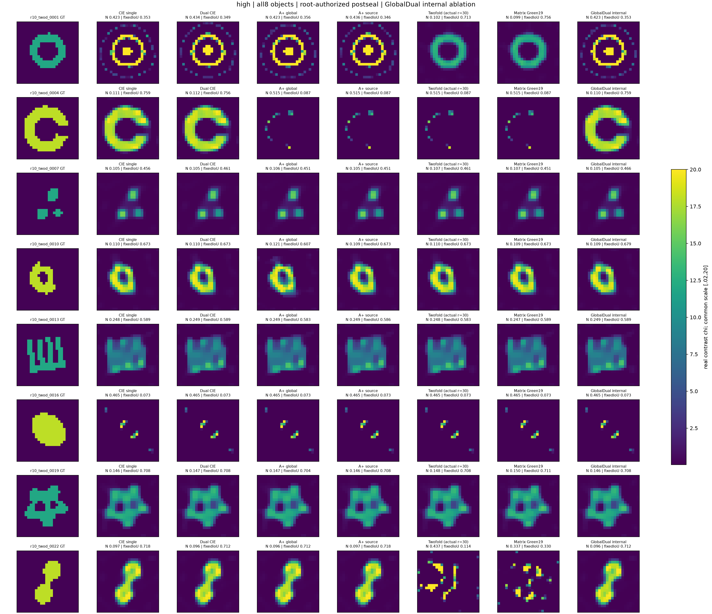
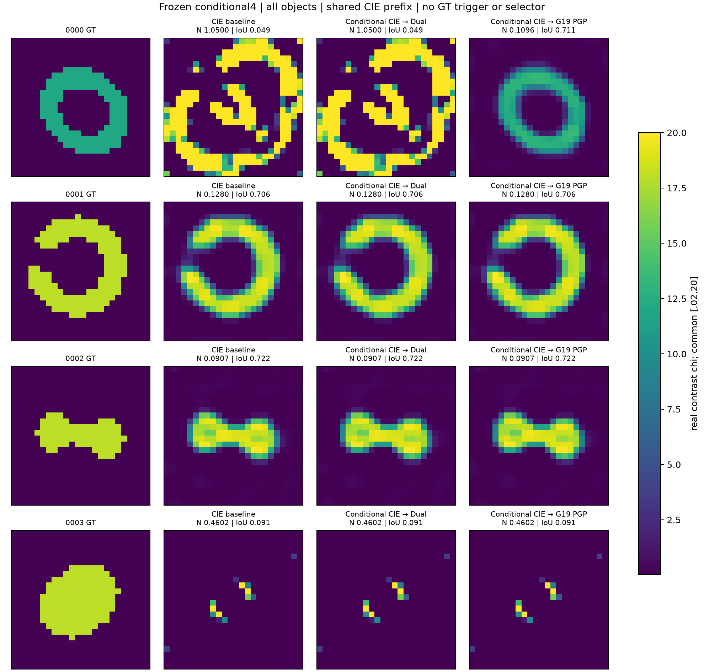

# MAX-STRUCT R10：Green分母、能量归因与CIE补偿路径

本轮在R9基础上实际完成更大范围的CIE/A+比较，并从公式提出、实现和检验低秩矩阵分母。R1–R9原始结果未改写。24材料×7方法主确认、3例结构修正、4个新材料的条件补偿、18条三维主反演和3条固定预算续跑均已完成封存；各队列独立评分，不能合并成一个确认成功率。

## 最终判断的依据

**原A+仍有真实的局部材料恢复作用，但不是当前值得默认替换成熟CIE的方案。新Green矩阵分母提供了一条不同的有效路径，也出现明确反例。** 本轮的评价不要求所有对象获胜；真正限制主张的是：收益目前不能由公开指标提前稳定定位，部分高对比对象发生大幅退化，且平均完整任务CPU增加。

最重要的新正例不在历史弯条上：一个新高对比环中，CIE/原A+的NRMSE约.423，新Green19降至.099，原始数据残差由13.7%降至.960%。同时，一个新高对比桥由CIE的.097恶化至Green19的.337；开缝壳中CIE约.111，而原A+和新分母都约.515。三个例子明确说明辅助材料规则改变了到达的区域，不能说明它普遍把原Maxwell目标凸化。

多数普通对象的连续材料差异很小，完整物理corrector会把不同辅助路径带到近似终点。部分成功数差异只是NRMSE在.15附近跨线；不能把11/24对8/24描述成每一例都有显著退化。另一方面，上述环、桥、开缝壳的差异很大，确属需要解释的物理优化现象。

## 1. 本轮究竟改了什么公式

固定辅助current J，令Q=Einc+GJ、e=J−D_mQ。原A/A+使用

`a_i=1+(β−Gii)m_i`，`z_i=m_i/a_i`，`u=β e/a`，`R_A=(I+D_z Goff,block)u`。

Goff,block只包含互不重叠2×2块内非对角作用，不是完整G去掉对角线。A+的Möbius/MM主要降低这个既有材料读出的计算费用，并未解决完整非局部反馈。没有证据表明原物理自项Gii数值写错。

本轮新实现为

`R_K=β[I+βD_m−D_mK]⁻¹e`，`K=PGP`。

P来自公开背景算子的强右子空间，不能读取目标GT；材料仍有全部576个独立实未知量。Green19只用G；Two-fold增加接收子空间。**新确认的实际秩是19和30，历史DEV才是19和28。** 早期文档把历史28沿用到新集是文字标签错误，实际basis、小LU、代码和运行一直使用新算子自动给出的30，阈值.1没有改变。

Woodbury把分母求解缩为19/30维小系统。材料导数完整保留分母随m变化的项；不是冻结分母后的近似梯度。current更新、FFT/APCS表示、初始化、prior、合法box和最终完整Maxwell验收均继承。小LU和额外材料内循环全部收费。

### 已建立的数学结果

- **DERIVED：** 精确材料导数及Woodbury伴随，近似误差式 `R_K−R_G=−A_K⁻¹D_m(G−K)R_G`。静态小Green尾不保证小材料误差，材料乘法、遗漏耦合和resolvent共同决定作用。
- **PROVED_UNDER_ASSUMPTIONS：** 对本轮精确解析二维盘脉冲G，Im_H G是严格正的全角度辐射Gram。因此PGP分母在非负m、β上定性可逆。它不是冻结浮点矩阵的区间证书、统一条件数界、材料唯一性或全局收敛定理；不自动覆盖其他离散或3D。
- **DERIVED反例：** 即使正分母下的单变量m²/(1+m)²也在m>1/2时有负二阶导数。分式归一化不保证全局凸。对原损失施加单调变换也不能据此声称消掉错误吸引域；R9已有相关边界，本轮不重记原创。
- **EMPIRICAL：** 24个历史状态中，局部one-hop反馈谱半径<.168，而投影全域反馈后期18个状态>1，小分母minσ仍为.312–.688。局部耦合弱、Neumann级数不收敛、矩阵接近奇异是三件不同的事。

详细推导、标准定理来源及独立代码审查见[THEORY_DERIVATIONS](THEORY_DERIVATIONS.md)、[prior-art](PRIOR_ART_AND_NOVELTY.md)和[审查记录](delegated/denominator_score/INDEPENDENT_REVIEW.md)。新颖性不建立在重新命名Woodbury、Möbius、Two-fold或耗散性上。

## 2. 新24材料主确认：全部结果

八家族各有low/high/mixed三个独立材料：环、开缝壳、多岛、曲条、梳状体、包覆体、穿孔星形、桥。low χ2.5，high χ12/18，mixed含两级；ROI host χ.1。全部576维未知，12源/48接收，1%期望复噪声，box[.02,20]。高contrast的12/18按既有家族规则分配；本设计不能单独识别contrast与家族的因果作用。

同一有限离散生成/反演，不能称跨网格或实测。168条反演全部完成、无运行失败，先封存全部公开预测再统一读GT。实际每条3000辅助步；共同原物理corrector最多3000接受步/12000评估，无wall截断。140条由投影梯度准则停止、4条由相对函数变化停止、24条到迭代上限，不能将全部终态称为已收敛。

|方法|主材料成功/24|平均NRMSE|中位NRMSE|平均完整child CPU秒|角色|
|---|---:|---:|---:|---:|---|
|CIE-single|11|.16287|.13801|157.71|主要成熟基线|
|Dual-CIE|10|.16346|.13829|153.98|主要成熟基线|
|A+global|8|.18044|.14531|169.49|原one-hop材料改进|
|A+sourcewise|10|.18045|.14479|174.98|匹配Dual current的材料消融|
|Green19矩阵分母|8|.17669|.14638|187.66|本轮新候选|
|Two-fold30矩阵分母|8|.18099|.14544|192.53|接收子空间候选|
|Global-Dual|10|.16369|.13894|150.13|内部matched-current控制|

主材料成功沿用已冻结NRMSE≤.15、共同χ>1的IoU≥.7及合法性，**不是研究停止门**。完整连续分数、旧Otsu口径、区域误差、停止原因和全对象配对见[原表](delegated/twod_score/scored/SCORES_FINAL.csv)。主support在GT读取前冻结，避免将混合材料低χ相从分母中删除。没有按GT选择候选或迭代。

|方法|low平均NRMSE / 成功8例|high平均NRMSE / 成功8例|mixed平均NRMSE / 成功8例|
|---|---|---|---|
|CIE|.16907 / 4|.21316 / 3|.10638 / 4|
|Dual-CIE|.16907 / 3|.21460 / 3|.10671 / 4|
|A+global|.16959 / 2|.26514 / 2|.10660 / 4|
|A+sourcewise|.16949 / 3|.26533 / 2|.10653 / 5|
|Green19|.16967 / 2|.25363 / 2|.10676 / 4|
|Two-fold30|.16984 / 2|.26646 / 2|.10669 / 4|

low和mixed的平均连续差很小，不能从成功数跳变推导大幅优劣。高对比有实质性的相反路径结果，值得逐例研究。对象配对bootstrap仅为这个设计的描述性区间，不是任意几何总体或多重比较校正后的显著性保证。

### 三个决定性的新正反例

|对象|CIE|Dual|原A+global|Green19|Two-fold30|原物理现象|
|---|---:|---:|---:|---:|---:|---|
|0001 高χ12环|.42288|.43372|.42275|.09889|.10248|新分母把残差13.7%降至约.960%，进入不同可恢复区域|
|0004 高χ18开缝壳|.11109|.11170|.51514|.51514|.51514|CIE残差.968%，A类均58.98%；新分母没有修复原A的坏路径|
|0022 高χ18桥|.09741|.09625|.09608|.33700|.43720|CIE/A+残差约.974%，新分母仍16.85%/14.40%，出现反向损害|

0004的A类在约482–580物理接受步后到投影梯度停止，不能把失败统一解释为预算用完。0022的Green19由函数变化停止，Two-fold30到3000上限；需要分别看停机类型。0001的矩阵分母到3000步时已达到材料/数据正例，若要继续追求其最终驻点，需要另计预算，不能把尚未收敛说成完全解决。

[全部low](FIGURES/twod_comparison/MATERIALS_low.png)、[全部mixed](FIGURES/twod_comparison/MATERIALS_mixed.png)、[成本与性能](FIGURES/twod_comparison/COST_PERFORMANCE.png)同时保留，没有只展示获胜形状。

## 3. FFT-TSOM提供了什么，A+提供了什么

本轮重用历史69次运行449状态，并对新24对象七臂的所有终点与同m末stage做独立能量审计。新诊断只为24份GT current补24次576阶LU/288源RHS；端点和联合状态全部复用已保存数组，没有为图反复解forward。

这里“能量”指离散平方Euclidean/Frobenius范数，不是电磁储能。Green/S右空间的材料坐标投影不等于材料Jacobian可观测性；Two-fold顺序投影、数值交集和实际FFT/APCS affine空间分开记录。

历史b20d同FFT空间下，Global→A+的材料误差能量19753.828→136.765，物理current误差1184.654→8.566。40ac则31785.863→32500.705、1062.402→1080.634。末mf12的辅助oracle不可表示能量分别仅.232和.205；不能用“给A+更多Fourier模式”解释b20d，也不能把小oracle尾当作40ac必然能恢复的保证。

辅助current与材料导出的物理current必须分开。一个历史状态满足200.610=781.243+624.985−1205.618，其中最后一项是有符号cross。小辅助误差可能来自抵消，不能当作小物理current误差。物理corrector不受辅助affine空间约束，其结果低于辅助oracle floor不矛盾。

新集复用20个(rank,mf)空间缓存，得到96个case-oracle，所有七臂同对象共享实际表示。全部168终点和168同m配对均有结果、没有缺失。完整能量百分比、绝对量和cross见[energy原表](delegated/twod_energy/scored/STATE_ENERGY.csv)及[全算子分带](delegated/twod_energy/scored/SINGLE_OPERATOR_ENERGY.csv)。不能因某带百分比升高就说该带绝对误差更大。

## 4. 失败后做了什么修正

### 4.1 先排除开发例的替代解释

在公开b20d/40ac上，保留原Gii的Green19仍得到.0404/.0540；因此不能将改善归为删掉或修正了自项。只把旧one-hop的材料优化器换成相同8步L-BFGS-B，得到.3846/.6235，没有复制新矩阵分母的结果。错误传参导致的两次inner60试跑已中止、保留并计费，正式控制实际确为8步。

R9完整current低罚权方法也曾恢复40ac，因此矩阵分母不是项目首次恢复该对象，更不是已经胜过所有物理优化路线。普通磁场、Hodge或source encoding没有在本轮替代实现；没有将未运行路线记成贡献。

### 4.2 输入/输出投影的单次结构修正

G的强右奇异空间是current输入空间。PGP额外删掉了场输出的(I−P)GP；GP则保留该强输入的完整输出。公开算子测得这部分Frobenius相对幅度16.83%，即约2.83%的强输入输出平方范数。三个末stage的残差变化为8.48%、3.76%、2.86%，两个版本的小系统均未在这些点接近奇异。

这给出有根据的可检验修改，不能据小截断误差直接推导材料改善。本轮仅在已解封0001/0004/0022上把PGP改为GP，rank19、inner8、全部其他配置不变；结果属于**EXPOSED_POSTHOC_STRUCTURAL_DIAGNOSTIC**，不替换原24确认。PGP耗散定理不自动覆盖GP。

三条实际修正已完成且封存后评分：GP的NRMSE分别为.10167、.51514、.43608，原PGP为.09889、.51514、.33700。环正例仍在，开缝壳没有改善，桥反而更差；三个完整child共701.64 CPU秒。桥的Phi从.01421降至.01040，但材料更差，GP到3000上限，PGP先由relative-F停止。不能把不同停止成本藏起来，也不能由GP的标准更佳Green逼近推导更佳反演。这个有根据的修正已被实际检验，没有继续调rank、β或阈值去救它。详见[三例完整表](delegated/right_projection_score/FINAL_COMPARISON.csv)。

### 4.3 补偿CIE，而不是强行替换所有材料读出

CIE主确认中只有0001和0016未达到公开CN99噪声球；其余22例数据合格，但主材料成功只有11。这要求把数据未拟合的坏路径和数据合格的材料偏差分开。对后者，改优化器不能自动提供额外信息或保证选出GT。进一步利用已保存GT current核对：GT24/24均在各自实际观测的CN99球内；CIE数据合格但材料未达主描述门的11例，GT和估计都合法且同在该噪声球。这是具体的有限噪声双材料实例，不是精确多解、信息论下界或24例联合99%保证，soft prior仍可偏好其中一份。

事后让CIE与Green19全部跑完、再按最低原Phi选择，平均NRMSE从.16287改善到.14960，但成功反降到10/24：增加0001，同时0000和0021因很小的材料变化失去原门槛成功。完整两臂CPU为8288.66秒、单CIE的2.19倍。没有免费丢弃未选臂，也没有用GT选best@2。这不是值得直接宣传的低成本改进。

据此另冻结更保守且公开可执行的补偿：CIE已经位于噪声球内就原样返回；不合格才运行Green19并用同原Phi选候选。普通Dual-CIE同触发重试作为额外候选/成本对照。仅用四个全新high对象做最后独立确认，家族为环、开缝壳、桥、包覆体，seed2026110711，沿用家族contrast映射。没有因触发不足而追加困难对象。这个规则本身不是新的数学定理，价值取决于实际触发、额外恢复和费用。

**四对象确认现已完成，条件补偿得到一次新的独立恢复。** CN99白化范数门25.16542来自576个复观测、声明σ和99%卡方半径；不是用GT拟合阈值。两个对象触发，共四个fallback，全部选择封存后统一评分。

|全新对象|触发|CIE NRMSE|CIE→Dual|CIE→Green19|结论|
|---|---|---:|---:|---:|---|
|0000 χ12环|是|1.05000|1.05000|.10958|Green19恢复；IoU .04899→.71098，白化范数135.70→23.10|
|0001 χ18开缝壳|否|.12797|.12797|.12797|三部署完全同一CIE材料，fallback未运行|
|0002 χ18桥|否|.09071|.09071|.09071|三部署完全同一CIE材料，fallback未运行|
|0003 χ18包覆体|是|约.46018|约.46018|约.46018|全部失败，白化范数约702；没有按GT换方法或加预算|

材料成功为CIE 2/4、CIE→Dual 2/4、CIE→Green19 **3/4**；平均NRMSE为.43222、.43222、.19711。三个部署视图的完整child CPU分别692.84、1015.55、1013.44秒；Green19补偿为单CIE的**1.46倍**，与同触发Dual重试成本接近。物理576阶LU为8054、11560、10225，新分母另有19阶小LU。三个视图共享CIE prefix，不能相加；实际整个实验八个科学inverse及一次零物理启动失败的unique child CPU为1336.14秒。

这是“对未拟合数据的CIE增加一条有互补性的合法路径”的初步独立证据，比全体替换材料步更合适。它不会改善已经noise-compatible却材料不准的CIE终点；未触发时按构造原样返回CIE，而不是证明CIE已恢复GT。四对象只产生两个触发，不能据3/4对2/4作统计显著或总体成功率主张。环的效果在两批独立几何中出现，但尚不能预测所有环、壳或其他拓扑的收益。完整候选、未选择成本、失败和未运行臂见[独立审查](delegated/conditional_confirmation_score/REVIEW.md)。

## 5. 三维和独立网格的边界

本轮真正运行四个三维材料、六个观测条件共18主反演，使用12³材料、三分量dyadic Maxwell、60源及180接收分量；其中两对象为18³独立生成→12³反演。CIE/Global/A+三臂共用完整物理corrector。新低秩分母尚未移植3D，不能把原A+三维结果当作新分母的验证。

源为外部真实电偶极，不是非法纵向平面波；非周期零填充FFT和CM+RR自项、同LU多RHS及伴随均继承实际全矢量实现。高ε9内部波长在粗网格约6.67格，细网格10格，gap/壳厚仅两粗格。18→12差异单列，不能靠同算子低残差宣称连续Maxwell准确。R9 Mie及原3λ电尺寸负证据仍然有效。

18条主预测已全部封存后统一评分，无失败。下表是χ相对L2，不与二维幅度NRMSE混用；所有物理corrector都达到80接受步上限。

|材料/观测|CIE χ误差|Global控制|A+global χ误差|CIE/A+数据残差|
|---|---:|---:|---:|---|
|ε9立方体 matched12|.06082|.05486|.05758|2.979% / 2.978%|
|ε2壳/ε9芯 matched12|.49222|.48836|.49656|2.993% / 2.993%|
|ε9/ε2双体 matched12|.39200|.39929|.38306|3.082% / 3.069%|
|ε5空心体 matched12|.31816|.32140|.32124|3.004% / 3.005%|
|ε9立方体 18→12|.30701|.30372|.30005|3.173% / 3.173%|
|包覆体 18→12|.50825|.50199|.50806|2.998% / 2.999%|

实心高介电体三臂都恢复较好，A+差别小且有正有负。包覆体与空心体虽接近噪声拟合，χ误差仍大；不能只看端口。跨网格的两份clean端口差分别24.80%和6.41%，超过3%测量噪声，且实心体材料误差由matched的约.06上升至约.30。这个离散效应远大于当前A+相对CIE的差别，不能宣传成连续3D优势。

这里继承的选择目标Phi3=mean_s[||F_s−Y_s||²/||Y_s||²]、R0，无1/2；三臂一致，但不是生成iid σ的ML目标，也不同于二维全Y归一化Phi。真实σ白化残差另列，不能把源归一化冒称噪声白化。全部逐cell/区域指标见[三维原表](delegated/vector_score/scored/FINAL_SCORES.csv)。

已保存场还给出更明确的解释：matched包覆体GT和CIE估计的白化残差平方分别10806.71和10754.59，均低于单case CN99界11043.23，虽然材料χ误差为49.2%；空心体也有相同的双合法材料现象。因此这些较大材料偏差不能全部归为“还没把数据拟合好”。反之，cross条件下，原coarse材料GT的残差平方分别749142和60516，远超同一噪声界。用这个coarse forward既要求返回原coarse材料、又要求拟合该fine数据到测量噪声内，两要求在本观测下直接冲突。不能把所有cross失败归罪于A+或CIE；也不能据此断言整个coarse材料类都不存在拟合解。核对只用保存场，新增forward为0，详见[噪声/模型分离](delegated/vector_score/scored/NOISE_MODEL_COMPATIBILITY.json)。

双体80步后公开PG∞约1.3–1.9e−5，比其他组更明显未收敛。为区分预算与材料metric，本轮另从三个已封存m80出发，各追加最多80步同原物理corrector，三臂同样重置L-BFGS历史、不重跑aux；属于曝光后的预算诊断，不替换原18结果。其余已noise拟合的对象没有为追求分数盲目延长。

追加三臂已全部完成：CIE的χ误差从.39200降至.35572，Global从.39929降至.36594，A+从.38306降至.35225；三者都从CN99噪声球外进入球内，真实相对数据残差约3.022%–3.029%。这直接表明原80步确有预算限制，但多算80步仍只带来部分材料改善，且A+相对CIE的差从.00894缩至.00347，不能归为A+特有收益。三者再次达到预算上限，PG∞仍5.4–9.1e−6；没有证明已经到同一个或不同的精确驻点。额外243次5184阶LU和29160复RHS、GPU整child496.69 CPU秒另计，原prefix不重计。见[追加评分](delegated/vector_continuation_score/SCORES.csv)及[材料前后图](delegated/vector_continuation_score/MATERIALS.png)。

## 6. 成本、复现和论文资格

二维主168任务实际完整Windows child CPU28475.421875秒，约7.91 CPU小时。四lane主对照和两lane候选各固定P核、BLAS1，并行wall不能相加称总历时。Green19平均完整CPU较CIE增加约19.0%，Two-fold约22.1%；这组数据不支持低成本的普遍成像改进。等CPU和等物理LU保存点另列，不能用相同3000辅助迭代替代公平费用比较。

GPU释放后已真正用于3D。对同一v08 CIE、同数据与预算，从FFT/GMRES改用库提供的retained dense LU，完整任务wall882.21→200.07秒，约4.41倍；物理corrector约5.05倍。第一次公开单点探针不足以外推整任务，这里另有完整任务实测。旧慢运行、中止、等待、setup、GT评分和标签修正均保留收费。此次优化不改精度/驱动/物理，不能计为A+算法收益。

全部cost与unknown见[COST_LEDGER](COST_LEDGER.md)，复现入口见[REPRODUCE](REPRODUCE.md)。未提供硬件/模型工具账单费率，不能伪造货币费用。

**论文判断应落在受限的机制与算法证据上。** 当前可以写清楚：局部材料传播的能力与损害、两批独立高对比环的恢复、同表示下的正反路径、定性分母资格，以及真实成本。四对象补偿确认提供了可公开执行的简单算法正例，且与同成本量级的Dual重试有差别；但样本和触发数仍少，三维没有同类增量，closest-prior全文也有缺口。目前可形成诚实完整的机制论文初稿，尚不能将TAP/Inverse Problems级新算法优势视为已经充分建立。下一轮最值得推进的是同冻结补偿规则的多家族独立确认，以及公式中的`A_K⁻¹ D_m(G−K)R_G`如何预测有害/有利的材料方向；不是继续放大rank或β扫描。不要把这一轮称作“所有测试均需获胜才可发表”：真正缺的是可解释的适用条件、重复增量与费用论证。

没有新增NIE、NN训练或Fresnel实测，相关已有结果继续引用R8/R9。Two-fold最接近文献的全文公式对照仍有访问缺口；已读摘要和明确文献来源保留。机制性论文草稿已提供，但期刊级算法优势不能由希望发表的结论倒推。

最终根线程[科学审阅](FINAL_SCIENTIFIC_REVIEW.md)另列归因限制：最后四对象未运行Global-Dual fallback，不能把完整部署的增量唯一归为分母；主24则已有匹配global current控制。
