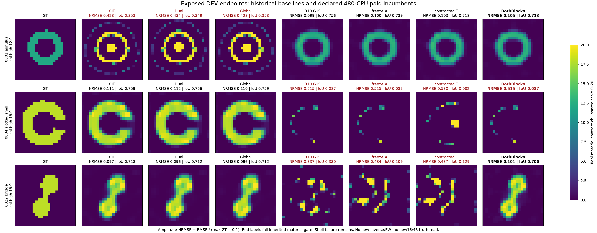

# MAX-STRUCT R11 · 执行中的证据交接

**状态：IN_PROGRESS。48对象288次主比较与16对象80次确认已完成封存评分；配对网格64次、新三维50次仍在执行。** R10冻结证据保持；本页不是整轮最终结论。

## 48对象扩大结果已经完成

CIE/Dual/Global/G19/freezeA/contractedT恢复21/22/23/23/16/23例，平均NRMSE分别.15908/.13827/.13822/.14675/.22593/.13505。Global、G19、contractedT成功集合逐对象完全相同。contractedT修复新桥(.36949→.08307)、梳状体(.48253→.22211)的额外损伤，但两者均未增加冻结成功数，也没有比Dual产生清楚的同成本收益。共同实际CPU前缀下Dual/G19成功22/21、Dual/contractedT22/20。不要只报终点23/48而省略费用。

[48对象完整中文判断](CONFIRMATION48_REPORT_ZH.md)、[全部48对象图集](delegated/twod/independent48/plots/PLOT_REPORT.md)。有效科学child共49968.922CPU秒；旧控制中断的完整费用部分未知，保留全部48并另报47对象成本敏感性。CIE→G19/→Dual/→Global三种付费条件策略均23/48，没有分母专属组合收益。

## 最新独立结果：修正没有通过推广检验

16新对象×5臂80次已全部GT前封存并评分。CIE/Dual/Global/原Green材料分母/BothBlocks的材料成功为**4/5/6/7/5**。原Green平均NRMSE .14485、实际CPU约CIE的1.269倍；BothBlocks平均.17357、CPU1.310倍。BothBlocks毁掉一个原Green恢复的新高对比环，因此不将旧桥开发正例升级为默认算法。

[16对象完整判断、全部图和成本](CONFIRMATION16_REPORT_ZH.md)。同全波LU视图成功数不变。CIE+Dual、CIE+Both两付费组合均5/16，后者更贵。新补current-only旧三例全失败，支持两块交互的解释，不能支持普遍恢复优势。48主比较与三维合同保持，不因该负结果停机或调参。

## 已完成的主要发现

1. 分母梯度中的强抵消主要含普通CIE已有的β收缩项。10个真实曝光检查点中，β项范数是Green新项的2.288–5.390倍，早期方向相反；不能把抵消全部归咎于Green。
2. freezeA与保留CIE收缩的contractedT都保住了环，却没有救回开缝壳和桥。固定材料块凸不等于逆问题凸，二者也不是moving分母目标的MM。
3. 新控制BothBlocks把Green分母真正接入current与material两块，保持原FFT/APCS、PR、β、初值、prior和corrector。历史桥的NRMSE由材料-only Green的.337降到.10088，同时环仍约.105；开缝壳仍约.515。桥已在辅助stage2/3改变路径，不是同起点corrector突然变强。
4. CIE在桥上约.097，仍略优于BothBlocks；因此这是修复Green对桥的损害，不能写成桥上打败CIE。环的CIE约.423，Green各版本约.10，是保留的开发优势。
5. 真实同状态current曲率只中等改善，reset方向cos却很低；单一条件数改善不能预测成功。标准resolvent结构给出强Green通道饱和的解释，但尚未建立充分的成功预测规则。
6. 原物理端点线段和精确face Hessian将失败分开：环/CIE、壳/Green坏点接近box驻点，free Hessian正；桥仍有负曲率和错号乘子，不能统称已收敛。详见理论第14–16节。
7. 真三维两个旧开发对象×6臂已完成：Green仅轻微改善v04幅度误差且IoU更差，v09全部有高核心衰减。所有臂320步cap，不称收敛或三维优势。见[三维已完成报告](VECTOR_DEV_REPORT_ZH.md)。
8. 固定吸收型分母8次曝光DEV已完成，K19对K0各1/4恢复，分别仅壳/桥；原环收益丢失。利用耗散Green得current增益上界，仍不保证材料恢复；复CIE/复移位本身已有先例。不继续相位扫描，保留[推导与边界](ABSORPTIVE_DENOMINATOR_DERIVATION.md)及全部失败。

## 已冻结并实际启动的扩大研究

|组|独立材料|实际计划反演|硬件与范围|
|---|---:|---:|---|
|主二维确认（已完成评分）|48，8拓扑×high/mixed×χ8/12/18|288，6臂|i9 P核，CIE/Dual/Global/fullG19/freezeA/contractedT，480 whole-child CPU与成本曲线|
|BothBlocks后续确认（已完成）|16，8拓扑×high/mixed|80，5臂|Mac两lane，CIE/Dual/Global/fullG19/BothBlocks；全臂同硬件，不合并Windows原CPU|
|新三维确认|8个规定设计，4拓扑×high/mixed|40 matched +10 cross-grid|4060与Mac按对象分流，真3分量dyadic，12³全部1728材料未知量，sourceCIE/Dual/Global/fullGreen/contractedLagged|
|配对网格补充（逆解运行中）|8个新独立材料|64，matched24/cross48→24各四臂|CIE/Dual/Global/G19；两条件不是16材料，主288结束后接续同4P核|

二维两组都在各自新对象生成前冻结；16与48组均已在完整封存后评分。三维生成端已完成8 matched12及2个18→12观测，新确认正在执行；这不是已经取得50个三维重建结果。cross-grid两观测不是两个新独立材料，且不与matched成功数合并。

主48在132次完成后发生控制程序故障，四个在途attempt中断、三次恢复准备失败；全部保留，最终288已完成。受影响case0022原中断CPU有未知项，完整费用不能由成功重试CPU代替。48主表与47敏感性均保留，详见[attempt清单](delegated/twod/independent48/CONTROL_ABORT_INVENTORY.json)。配对网格64正在运行，[PLAN_V2](delegated/diagnostics/crossgrid8_protocol/PLAN_V2.md)说明共同projected target与噪声。离线诊断的一次过宽检索误显示该组私有生成metadata的inner字段一行，已披露；线上算法/选择均未使用，未改对象或重抽。

三维分母采用公开固定`span(Einc,G Einc)`的rank120投影。top32最大奇异模式对晚期defect传播遗漏很大；source空间也不完整，不能宣称完整G或连续Maxwell精度。full/freezeA/contractedT已完成一次必要的真实3N共享材料导数接线核对，完整反演正在运行。保持FP64、真实LU/RHS与全部失败成本。

## 补充预算与停止诊断

同对象Green实际CPU余量下，CIE/Dual的7个公开规则触发corrector重启已完成，新增62.86 CPU秒，成功仍4/5，未消除原Green的7/16增量。部分提前正常结束，不称实际等花费；L-BFGS历史重置也明确保留。首次CN99命中在65个命中状态全部使NRMSE更差；已保存轨迹没有先成功后丢失成功的例子，不能简单用提前停止解释本组失败。以上均为解盲后的诊断，不改主结果。

## 可直接阅读

- [执行中的中文综合报告](RESEARCH_REPORT_ZH.md)
- [全部已完成成本及未完成边界](COST_LEDGER.md)
- [英文论文工作稿](PAPER_DRAFT.md)

- [公式、证明与边界](THEORY_DERIVATIONS.md)
- [研究如何根据失败转向](RESEARCH_LOOP.md)
- [文献与新颖性定位](PRIOR_ART_AND_NOVELTY.md)
- [真实轨迹图](FIGURES/exposed_development/STAGE_CORRECTOR_TRAJECTORIES.png)
- [主48对象冻结合同](delegated/twod/INDEPENDENT48_CONTRACT_PROPOSAL.md)（文字提案保留；实际冻结状态以configs中的正式JSON为准）
- [BothBlocks16冻结合同](delegated/diagnostics/bothblocks_confirmation/FROZEN_CONTRACT.json)
- [三维正式冻结合同](configs/vector_confirmation_contract.json)

16和48对象已给出上述明确判断；配对网格及新三维仍须等待完整封存评分。本轮没有用开发正例替代扩大实验，也不会读取GT调整运行中的算法。最终报告保留全部失败、原物理残差、材料误差、允许CPU/实际费用/物理LU三种比较及其区别。
