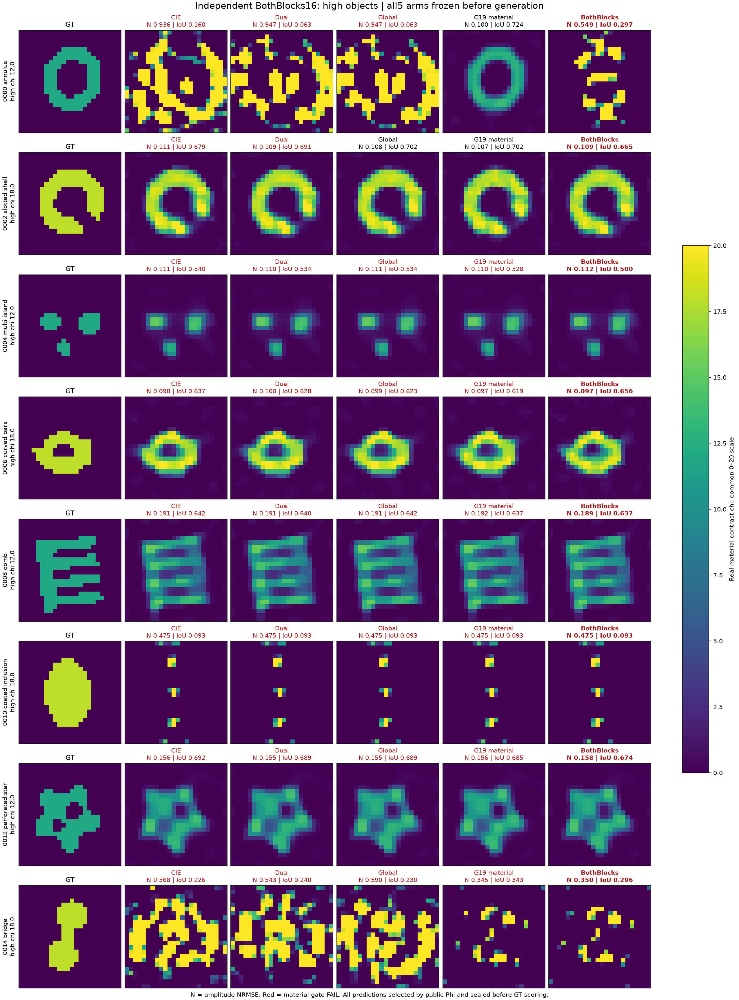
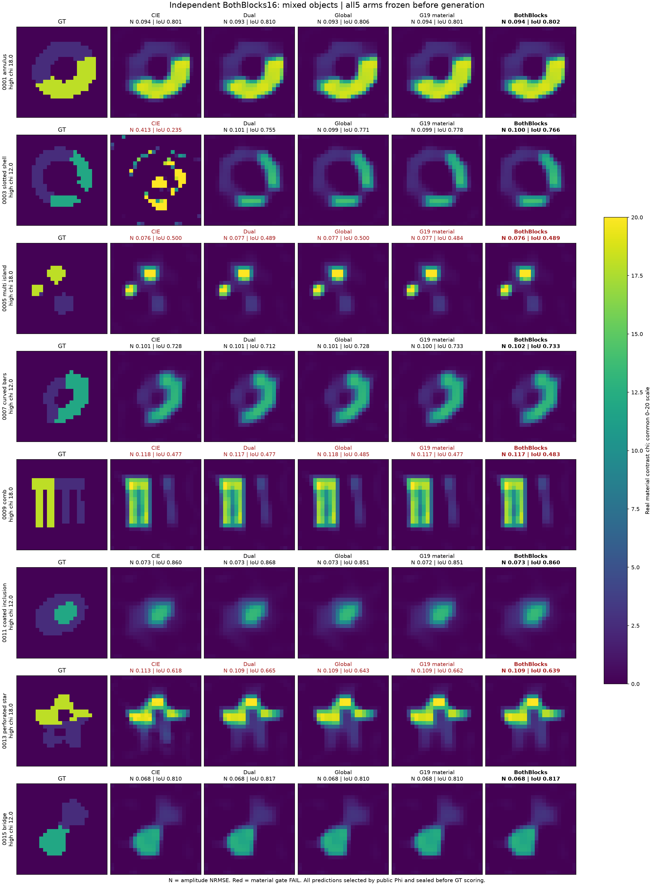

# 16个独立高对比/混合对象：修正的确认结果

**判断：两块Green修正不应替代原Green材料分母。** 它在旧桥上的正例没有在本组形成增量，甚至破坏了一个原Green能恢复的新环。原材料-only Green在本组相对CIE保留了恢复增量，但有实际成本代价；这也不是要求它在所有对象上都胜出。

本组16材料×5臂80次全部完成；预测、组合选根、共同LU预算选择在GT读取前封存。0执行失败、0重试。成功与失败均展示；不能把“执行成功”当“材料恢复成功”。48对象主比较与真三维研究仍在运行，本页只代表这一组。

|方法|材料成功|数据CN99合格|平均幅度NRMSE|中位NRMSE|平均实际CPU秒/对象|
|---|---:|---:|---:|---:|---:|
|CIE|4/16|12/16|.23134|.11219|47.96|
|Dual-CIE|5/16|13/16|.21068|.10889|48.57|
|Global-Dual控制|6/16|13/16|.21344|.10855|47.39|
|原Green材料分母|7/16|14/16|.14485|.10358|60.85|
|两块Green修正|5/16|13/16|.17357|.10891|62.84|

这批所有方法实际自然结束都在240 CPU秒以内，480秒只是统一允许上限。原Green实际CPU总和为CIE的1.269倍；两块修正为1.310倍。共同已达到的全波LU预算下，成功数仍为4/5/6/7/5，但物理LU相同不代表辅助运算免费。

## 哪些变化有实质意义

高对比环0000是明确反例：CIE NRMSE .9364，原Green .1003且IoU .7237，两块修正却变为.5495和.2968。既有开发环、开发桥的正例不能用来遮掉这个新失败。

高对比开缝壳0002中，原Green/两块的NRMSE .1068/.1089很接近，IoU .7022/.6649分居冻结门两侧；不能把这次成功标签变化夸大成和环同等严重的崩溃。混合开缝壳0003则CIE失败，Dual、Global、原Green及两块均恢复，说明这一例收益不是Green独有。

两块对原Green的paired平均NRMSE差为+.02873，10000次high/mixed分层对象bootstrap 95%区间[+.000176,+.084961]，5胜11负。主比较支持拒绝“普遍匹配两块就能修复”的说法。多个方法/子组的探索比较不作未经校正的普遍显著性宣传；仅16对象的区间也不代表所有几何总体。

原Green相对CIE增加3个成功，相对Dual增加2个；增量中包含大幅环恢复，也包含边界IoU变化。应同时看逐对象连续误差和完整图，不能只把7对4当作全面优势。原Green仍有高对比包覆体、桥及细结构共同失败。

## 两种付费组合也没有解决问题

预声明CIE+Dual与CIE+BothBlocks都实际支付两个候选，再按同一原Phi选根，结果均5/16。前者部署CPU总和1544.51秒，后者1772.86秒；后者约多14.8%，未带来成功数增量。两组合共用了实验中的CIE运行，研究账本不会将其重复相加。

由于全臂自然结束早于240秒，240+240的同允许预算视图等于完整终点；它不是同实际花费证明。组合也没有额外信息或GT选根。

## 补齐四格消融后的解释

三个已曝光对象的Green-current/ordinary-material控制已另行完成。环/壳/桥NRMSE为.4220/.5151/.5546，全部失败；其中桥的两块Green则.1009。因此旧桥修复不是“current单独更好”，而是两个非线性更新块的路径交互。完整表见[四格开发报告](delegated/diagnostics/current_only_dev/REVIEW_ZH.md)。

这是一条有内容的负结论：即使两块使用同一Green残差族，也不产生全局恢复保证；当前双β仍无共同目标。单块凸化、较好current条件数及更多Green能量都不足以预测材料恢复。它没有否定原Green在特定环上的实际价值。

另外，本组12–14个数据CN99合格而只有4–7个材料成功，且多种方法留下很相似的平滑/缺失细结构。正在对全16×5做零新FW的truth/candidate Phi、prior与有限噪声球诊断；不能在完成前将这些失败一律叫错误basin或一律叫不可辨识。

## 全部图像与原始事实

- [全部80条评分](delegated/diagnostics/bothblocks_confirmation/SINGLE_ARM_SCORES.csv)
- [事实与成本汇总](delegated/diagnostics/bothblocks_confirmation/FACTUAL_SUMMARY_ZH.md)
- [配对不确定性](delegated/diagnostics/bothblocks_confirmation/PAIRED_UNCERTAINTY.csv)
- [实际CPU轨迹](FIGURES/bothblocks_confirmation/PAID_CPU_FRONTIERS.png)
- [全波LU轨迹](FIGURES/bothblocks_confirmation/PAID_LU_FRONTIERS.png)

80次反演精确child CPU4281.798299秒，队列wall2182.972411秒；生成1.372750 CPU秒、controller .448456秒，评分/绘图77.417秒另计。current-only三例DEV128.297977秒另计，不混入确认成功数。
