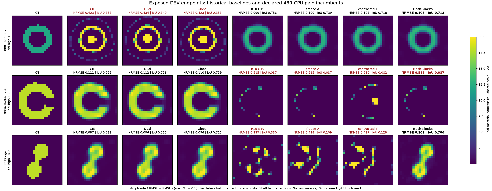
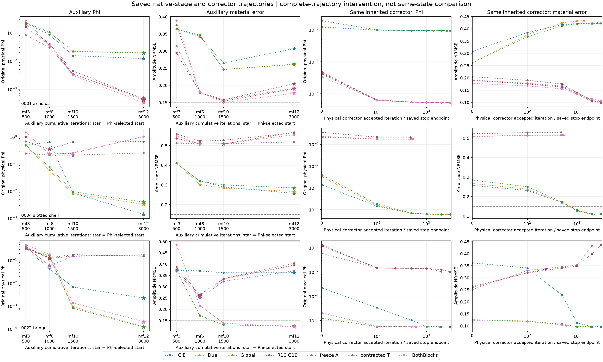

# R11 已公开状态的机制诊断

这里全部是OFFLINE_DIAGNOSTIC，材料GT只用于事后解释。它不是新确认结果，也不用于新的在线选择。当前结论比“Green分母会屏蔽误差”更具体，也更有限。

## 一、真正测量的变量

材料块e=J−D_mQ，A=I+βD_m−D_mK，w=A⁻¹e。完整梯度由本构项、分母metric项和同一prior组成。最初候选解释是metric梯度抵消了本构修复；因此冻结A是最小干预。五个曝光对象的早/晚stage各一状态，共10个实际m/J/Q/Y快照，保存每一梯度、有限材料步、原物理Phi变化及事后GT变化。

这些状态位于full材料读出之后，full再次求解时步小具有选择偏差；不能把固定状态的额外更新解释成公平整条算法胜出。ordinary最初曾漏同一prior的seed，随后补了相同prior的控制；两个版本和费用均保留，不隐藏错误。

## 二、哪一个解释被否定

早期metric与constitutive梯度强反向，metric/constitutive范数约.771–.958，确实会改变材料方向。但继续将metric拆成β项与Green K项后，10个状态的β项是K项的2.288–5.390倍；早期β项反向，K项反而同向。这说明“所有抵消都是新Green导数造成”不成立。普通CIE已有的标量收缩占了主要部分。

冻结A的单步降低原始本构缺陷10/10，降低固定权重损失10/10，却使moving损失上升10/10；原Phi仅7/10下降。桥的两步Phi均上升；包覆体早期Phi下降而GT误差上升。这是固定块凸与真实材料恢复之间的决定性反例，不能称外层凸化或MM。

## 三、完整重放与两种简单修正

一次fullGreen开发重放的m/J/Q/Y与R10冻结候选完全相同，排除R11成本观察器改变算法路径。随后freezeA完整五对象、只冻结T=I−D_zK的contractedT完整三对象都已实际完成。后者保留普通CIE z=m/(1+βm)收缩及原prior，是更针对非局部feedback的控制。

|曝光对象|CIE NRMSE|材料-only Green|freezeA|contractedT|两块Green|
|---|---:|---:|---:|---:|---:|
|环0001|.42288|.09889|.09985|.10339|.10517|
|开缝壳0004|.11109|约.51514|.51514|.52961|.51514|
|桥0022|.09741|.33700|.43375|.43710|.10088|

NRMSE均按幅度归一化；完整IoU、Phi、停止原因及成本见原始CSV，不能只凭NRMSE判成功。图中展示GT与所有主要方法，保留坏图。freezeA与contractedT保住了环，却没有修复壳和桥，否定“删除分母导数就能普遍修复路径”。

## 四、为何转向current块

材料-only Green改变了如何解释辅助current，却保留普通CIE current步。于是检验另一种最小机制：同一Green残差族同时进入current与material。原Fourier/APCS容量、PR、初始化、双β、prior与corrector不变。由于两块β不同，不能称共同辅助目标下降法。

桥的修复已出现在辅助阶段：stage2材料-only/两块NRMSE=.33464/.13887，stage3=.39511/.12208；同一公开Phi规则选出的corrector起点也不同。共同corrector后为.33700/.10088。它支持“current干预改变了材料路径”，不是同一个起点的corrector突然变强。桥上CIE仍约.097，因此是恢复被Green破坏的能力，而非该例击败CIE。环的开发优势保留，壳反例保留。

同状态current曲率诊断使用真实APCS独立state坐标，包含端口项、全部source weights。六个状态中Green/普通最大曲率比为.783–1.001，条件数仅中等降低；两种reset梯度步cos为.079–.325。方向改变比纯缩放更明显。壳的条件数也改善却仍失败，故“条件数降低”不是成功预测器。这是正交state坐标reset诊断，不等于原非正交Fourier PR历史下的下一步。

## 五、目前能解释什么、还不能解释什么

分母同时改变残差权重与有效照明，低秩改动可以增权也可以减权；它没有统一的正定优越顺序。只改善当前错误current的拟合也可能使错误材料更稳定。full-G均匀材料的可解析通道显示，Green current导数在强耦合通道趋于饱和，而普通CIE随Green特征值增长；这个结构解释了修改两块的动机，尚不能从任意几何预测恢复成功。

当前开发证据足以否定简单的“冻结即可凸化”说法，并提出有可验证收益的两块修正；尚不足以建立环必胜、壳必败的几何分类定理。新48组检验分母及冻结规则，新16组专门检验两块修正，三维检验矢量/非紧Green限制。它们的完整结果将决定应保留哪条算法主张，而不是挑选开发正例作为最终论文结论。

进一步沿上述已保存current方向分解未包含的G−K传播：原始Green残差比例可达.661，但经过实际分母和材料权重后的current导数剩余比例仅.012–.0585。壳同样小，仍失败。故本轮不因静态能量尾大就盲目增加rank；真正要解释的是辅助current与材料耦合方向，而非只比较一个未加权投影百分比。完整12行结果见RESULTS/current_remainder_exposed，零额外正演、零GT读取。
