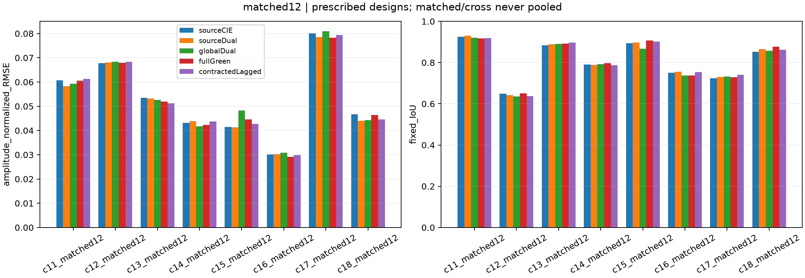
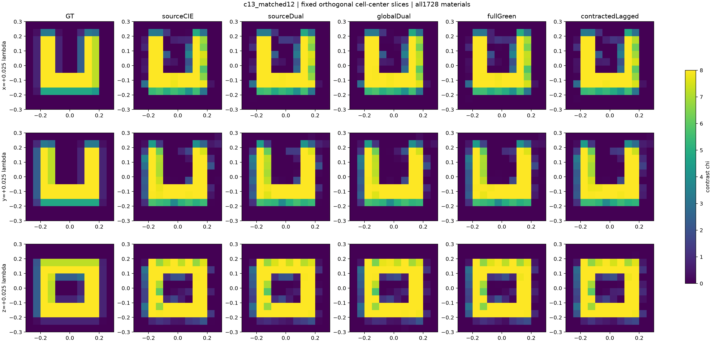
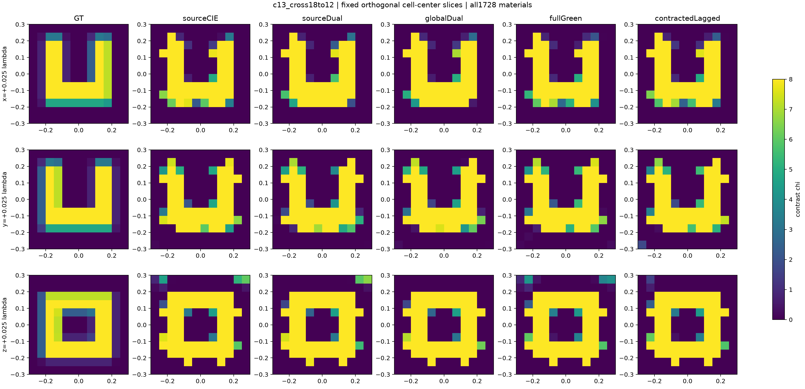

# R11 真三维确认：50次反演已完成

**最终判断：新分母已经完成真正三分量Maxwell材料反演；本组主要形态可以重建，但没有复制二维环/开缝壳那样明显的分母专属增量。** 8个新设计的matched结果总体接近普通CIE/Dual-CIE。跨网格两例仍可识别形态，却存在共同的材料偏差与超出声明噪声球的数据失配。这里不补设一个三维二元“成功”门，不把小幅指标胜出写成新盆地突破，也不把未达到高精度写成完全没有图像。

本轮50个冻结任务已经全部结束；后续仅评分、分析与发布。GT于全部公共预测及400个成本前缀封存后，经过root独立核对才开放，授权见[记录](audit/VECTOR50_ROOT_POSTSEAL_AUTHORIZATION.json)。没有新增物理求解、调参或重新选择候选。

## 物理与比较范围

- 12³=1728个共享实各向同性contrast未知量；每源5184个复矢量current分量，60个外部偶极源、60个三分量接收点。所有材料未知，不使用GT支撑缩减。
- 0.6λ ROI，固定背景、实材料box [0,8]、共同初值0.25、R=0、3%圆对称复噪声；dyadic Green、CM+RR自项与FP64完整物理验收。
- 8个规定设计、4类拓扑及高/混合材料，五法共40个matched任务。另两个同对象18→12观测产生10次反演，不是两个新增独立材料。
- CIE、Dual-CIE、Global-Dual、fullGreen、contractedLagged。三维分母K使用公开`span(Einc,G Einc)`的rank120投影，**不是二维G19，也不是完整G或二维BothBlocks**；完整正演仍用原dyadic算子。
- 每臂相同320 accepted-step原物理corrector；全部50臂均到迭代预算终点，不能称已充分收敛。实际线搜索请求、LU/RHS、费用与投影梯度另列。

这是有限矢量离散模型上的算法适配与跨网格检验，不是2019 CIE作者设置的原样复现，也不是连续PDE误差证书。

## 完整终点的材料结果

|方法|8 matched平均χ相对L2|幅度NRMSE|平均固定IoU|2 cross平均χ相对L2|cross平均IoU|
|---|---:|---:|---:|---:|---:|
|CIE|.228436|.052930|.808690|.464833|.752628|
|Dual-CIE|.226079|.052185|.812481|.454391|.753932|
|Global-Dual|.231274|.053312|.803822|.433562|.762925|
|fullGreen-r120|.227803|.052675|.813349|.467138|.763631|
|contracted-r120|.227738|.052625|.812590|.463195|.762708|

均值不掩盖逐对象差异：fullGreen在5/8个matched对象的χ误差低于Dual；相对Dual在c13/c14的材料误差与IoU都略有改善；c16误差改善但IoU较差，c15/c18则误差较差而IoU稍好。没有出现二维独立环上从严重错解到正确形态的数量级改变。三维分母并非“不能成像”，而是此时普通基线已经取得相近成像。

c12最能说明归一化的限制：fullGreen幅度NRMSE约.06798，但χ相对L2约.55979；其他方法也相近。稀疏或混合材料的低全域幅度误差不能替代内部高相恢复。应同时阅读分相RMSE/bias、χ相对误差与三维切片。

## 跨网格的共同困难

8 matched的40个终点全部在声明CN99球内；两个cross的10个终点全部在球外。CN99统计与求解使用的source-normalized Phi3分开，未人为放大噪声去获得资格。

缓存的12/18干净观测差为：c13 **17.6827%**，c18 **3.5287%**，相对于3%名义噪声已不可忽略。c13的空腔形态仍在，但边界与强度发生明显补偿；c18仍可识别双体/连接结构，材料细节不准确。这个差异证明当前跨网格模型误差是实质问题，不能把共同困难全归给材料优化；它也不证明粗模型中不存在更好的可拟合候选，因为所有方法仍在有限预算终点。

fullGreen在c13跨网格的χ误差略低于Dual（.41354对.41797），在c18则较高（.52074对.49081）；两例平均并未取得材料优势。Global的平均材料误差最低，但其平均数据残差不是最低，再次说明更低Phi与更准材料不是同一排序。

## 成本与失败的边界

每个对象的五法及matched/cross保持同host。Mac和4060各完成25个有效任务；不把不同平台的原始秒数混成算法加速。固定CPU/wall/LU前缀只采用封存前公开Phi选择，所有400个前缀都实际可用，root逐项核实材料与已付state一致。

原GPU c17/Dual在315接受步因资源查询超时中断；失败的320个5184阶LU与19200/19020 primal/adjoint RHS保留计费。完整同设置重试只是恢复原任务，不是删掉一次坏结果。其重试前缀只能叫attempt内成本，不能冒充端到端。完整8对象主表与排除整c17的7对象成本敏感性同时保留。

在剔除工程受影响c17的共同7对象中，冻结成本前缀的平均χ相对L2如下；这不是以GT挑选预算，实际原子操作完成费用仍可能低于界限。

|前缀|CIE|Dual|Global|full-r120|contracted-r120|
|---|---:|---:|---:|---:|---:|
|480 CPU秒|.272986|.275537|.262353|.292668|.282006|
|960 CPU秒|.224142|.236028|.219623|.240806|.219703|
|320个5184阶LU|.214921|.213179|.217818|.215365|.214734|

full在这些前缀没有材料均值优势。contracted在960 CPU前缀优于Dual，但与普通Global几乎相同，不能将其全部记为新分母收益；320-LU差异已很小。额外材料小系统费用仍计入CPU，不能称同LU就同总成本。

后续查询重试、自然逐臂排空、30秒有效空闲快照缓存只改变资源协作开销；原物理、算法、精度与预算不变，工程收益不记作新算法优势。所有临时历史场spool在正常归档后释放。科学运行已结束，不追加更长corrector。

完整原表、分相误差、前缀、成本与全图见[三维全图报告](delegated/vector/REPORT.md)及[HTML入口](delegated/vector/REPORT.html)，向量producer成本见[统一账本](delegated/vector/COSTS.json)。最终总账按矩阵阶数分别累计，失败费用不会被重试有效费用覆盖。

## 对本轮主张的影响

1. 真三维实现与有限预算成像已完成，不能再标NOT_RUN。
2. matched主要形态有用，但目前没有足够幅度的分母专属优势；原二维正例不能据此自动外推到三维。
3. 跨网格不是仅换一张测试图：观测模型差异会把同一材料推到补偿性形态。现有结果不能区分所有剩余优化预算与模型适配责任，更不能给出全局不可辨识性结论。
4. 最适合保留的论文主张仍是二维条件恢复收益、材料相关metric如何改变路径，以及可重复的成功/反例与成本边界；三维提供真实适用性检验和限制。

依用户决定，以上作为本轮终态交付，不据此启动新算法或扩大计算。
