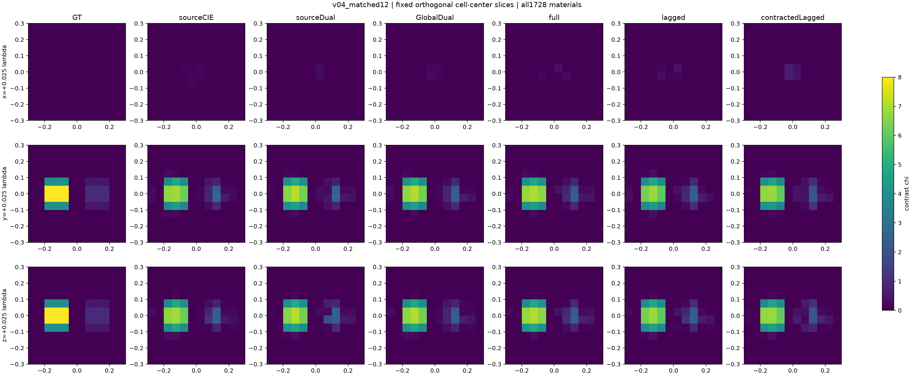
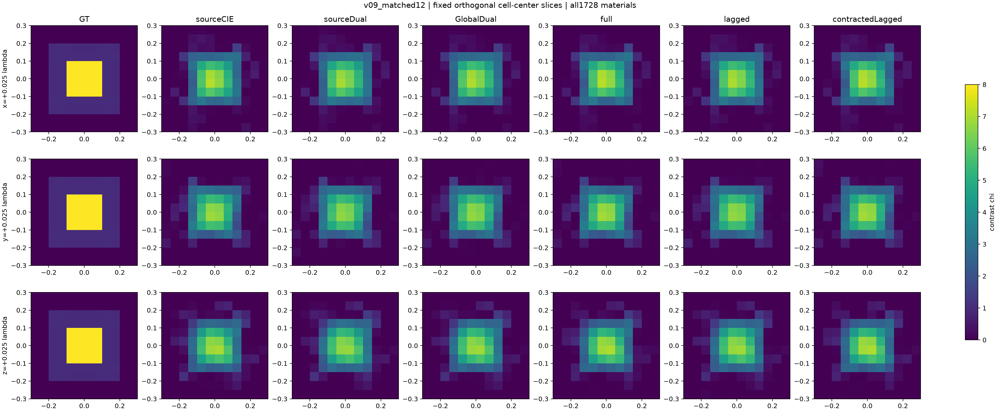

# 真三维 Green 分母：已完成的公开开发对照

**结论先行：新分母已实际进入完整三维矢量材料反演，但这两个旧公开对象尚未显示有意义的共同恢复增量。** 小误差改善与结构指标改善并不一致；全部方法使用完320个corrector接受步，不能称充分收敛。新的8对象/50次确认仍在运行，本页不以两个开发对象替代它。

## 物理与实验范围

复用R10的CM+RR dyadic有限点Maxwell模型，12³=1728个独立实各向同性contrast，三分量current共5184维/源，60个外部电偶极源及60个三分量接收位置。原材料范围、实材料prior R=0、3%复噪声、初始化及FFT/APCS容量均保持。每个材料候选均由完整原物理LU验收；不是二维TM堆叠，也不是只做两个体素的谱实验。

CIE/Dual采用成熟sourcewise current，Global及Green三版本用global current；三维Green仅改变材料块，未实施二维BothBlocks。K使用公开固定span(Einc,G Einc)的rank120 Galerkin投影；full表示完整材料导数，不表示完整Green。lagged冻结A，contractedLagged冻结非局部T。方法、β、子问题和预算见正式configs及源码。

全部12个预测先封存，再按根线程授权读取这两个已经曝光的GT；新确认GT保持关闭。两个对象都是matched-grid开发，不是新的连续物理或跨网格证据。后续预定18→12确认用于进一步检验离散影响。

## 全部结果

|对象|方法|幅度NRMSE|相对contrast L2|IoU χ>.5|原物理LU|臂内CPU秒|
|---|---|---:|---:|---:|---:|---:|
|v04|CIE|.02216|.21105|.86765|327|676.88|
|v04|Dual-CIE|.02213|.21079|.80000|331|690.98|
|v04|Global|.02120|.20194|.85507|328|680.39|
|v04|Green full|.02038|.19410|.81690|333|733.25|
|v04|freezeA|.02304|.21950|.84286|330|706.20|
|v04|contractedT|.02192|.20883|.75342|329|711.86|
|v09|CIE|.10049|.49575|.63089|327|679.66|
|v09|Dual-CIE|.09987|.49268|.66981|326|680.12|
|v09|Global|.09995|.49310|.64165|324|673.94|
|v09|Green full|.10143|.50037|.63534|326|717.88|
|v09|freezeA|.09992|.49292|.64662|326|702.83|
|v09|contractedT|.10131|.49978|.63687|325|696.28|

幅度NRMSE使用全1728体素及公开幅度8，稀疏对象的大量背景会降低该数值；相对contrast L2以GT contrast范数归一化，因此同时报告。不能只凭v04的.02宣布精确材料恢复。所有12个候选合法且都在声明CN99数据球内；v04原Phi约.000933、v09约.000894。原Phi为源归一化目标，CN99另用σ白化，不混为同一个量。

v04 Green full相对Global仅将幅度NRMSE降低约.00082，却将IoU由.855降为.817。v09全部版本都出现高核心衰减和边缘模糊；Green full的物理Phi略低，但材料误差反而略高。v09高相真值为8，各方法高相平均偏差约−2.8。它是明确的共同难例，而不是用低残差冒充成功。

## 完整可视证据

切片位置按网格中心固定，没有按重建效果挑选。v04中央x切片为空是该对象几何本身，完整三维图另外保留：

- [v04体视图](delegated/vector/dev_postseal_scores/figures/v04_matched12_volume.png)
- [v09体视图](delegated/vector/dev_postseal_scores/figures/v09_matched12_volume.png)
- [Phi/原物理LU曲线](delegated/vector/dev_postseal_scores/figures/matched12_Phi3_physical_LU.png)
- [全部材料指标](delegated/vector/dev_postseal_scores/MATERIAL_AND_PHYSICS.csv)

## 成本与失败含义

表中是臂内计时，完整进程setup、失败/探针、数据生成和评分见总账。旧普通DEV6沿用默认CUDA线代库，后续Green6采用已测cuSOLVER；所以本页不能把臂内CPU差精确归因于算法。两者都使用FP64，未降低物理精度；新确认同host各臂使用同后端配置。

所有12臂均达到320 accepted-iteration cap。v04最终投影梯度约2.2e−6至5.7e−6，v09约1.1e−7至3.6e−7，均不据此宣布已经收敛。结果可用来说明该有限预算下没有明显Green优势，不能证明增加预算绝不改变它。付费CPU/wall/物理LU前缀逐状态保存，不以相同迭代冒称相同成本。

rank120源传播空间对最终current误差覆盖很小，但这不是完整材料Jacobian的不可观测性证明；current是3N复向量，材料是N实标量，不把一个空间的能量比例当另一个空间的恢复上限。此前二维实际加权传播诊断也说明，静态Green能量遗漏本身不足以决定是否扩大rank。

## 当前行动

不围绕这两个开发对象调β、rank或success阈值。继续已冻结的8种规定高/混合设计、40 matched及10 cross-grid任务；同一对象各臂在同host，跨网格不算新增独立材料。最终独立结果决定Green三维适用范围，而不是这里的轻微数值差。
