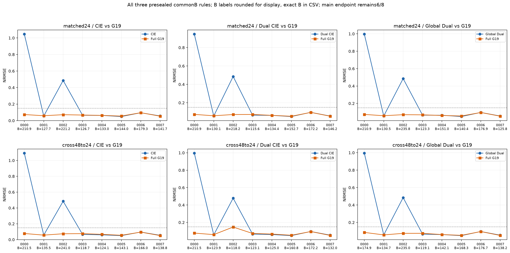
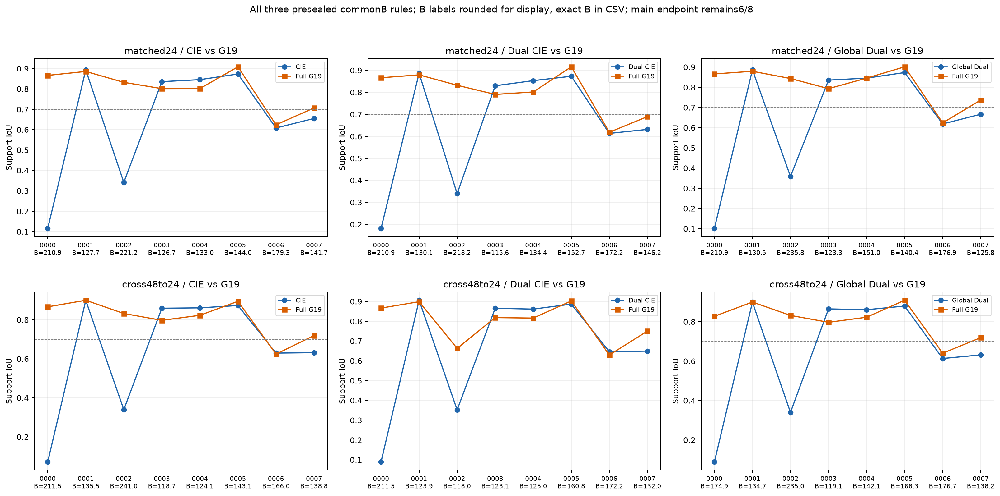

# Complete commonB comparisons and endpoint transition audit

Pure reindex of already authorized ALL_SELECTION_SCORES.csv. No GT array, new scoring, FW, optimizer, iteration or budget selection. All three reference-vs-G19 rules are shown under each grid condition. B is pair-specific min(actual reference endCPU, actual G19 endCPU); both original full children remain charged. Main final endpoint stays6/8 G19, and no7/8 commonB view replaces it.

|Grid|Reference|Reference atB|G19 atB|G19 final|B min..max CPU seconds|
|---|---|---:|---:|---:|---|
|matched24|cie_single|4/8|7/8|6/8|126.65625 .. 221.25|
|matched24|cie_dual|4/8|6/8|6/8|115.625 .. 218.203125|
|matched24|global_dual|4/8|7/8|6/8|123.328125 .. 235.828125|
|cross48to24|cie_single|4/8|7/8|6/8|118.65625 .. 241.03125|
|cross48to24|cie_dual|4/8|6/8|6/8|117.953125 .. 211.484375|
|cross48to24|global_dual|4/8|7/8|6/8|119.078125 .. 235.03125|

Exact B for every independent material (not a common fixed budget across pairs):

|Case|matched CIE|matched Dual|matched Global|cross CIE|cross Dual|cross Global|
|---|---:|---:|---:|---:|---:|---:|
|r11_crossgrid8_0000|210.859375|210.859375|210.859375|211.484375|211.484375|174.90625|
|r11_crossgrid8_0001|127.734375|130.0625|130.484375|135.453125|123.859375|134.6875|
|r11_crossgrid8_0002|221.25|218.203125|235.828125|241.03125|117.953125|235.03125|
|r11_crossgrid8_0003|126.65625|115.625|123.328125|118.65625|123.0625|119.078125|
|r11_crossgrid8_0004|133.015625|134.359375|151.03125|124.109375|125.015625|142.09375|
|r11_crossgrid8_0005|143.953125|152.71875|140.4375|143.0625|160.75|168.265625|
|r11_crossgrid8_0006|179.265625|172.234375|176.890625|166.046875|172.1875|176.734375|
|r11_crossgrid8_0007|141.65625|146.21875|125.796875|138.765625|132.046875|138.171875|

Transitions below describe lower-originalPhi endpoint selection, never a GT-selected budget or iterate:

|Case/grid/reference|B|G19 NRMSE atB→final|G19 IoU atB→final|G19 originalPhi atB→final|Transition|
|---|---:|---|---|---|---|
|r11_crossgrid8_0002/cross48to24/cie_dual|117.953125|0.1468783971264435 → 0.07218446783099193|0.6627218934911243 → 0.8493150684931506|5.489638145244268e-05 → 5.226340650979941e-05|COMMON_B_FAIL_FINAL_PASS|
|r11_crossgrid8_0007/cross48to24/cie_dual|132.046875|0.05063338308236595 → 0.05316369947471709|0.75 → 0.6842105263157895|5.235211989320803e-05 → 5.229477039541896e-05|COMMON_B_PASS_FINAL_FAIL|
|r11_crossgrid8_0007/cross48to24/cie_single|138.765625|0.05098415409940922 → 0.05316369947471709|0.7192982456140351 → 0.6842105263157895|5.2334168452630646e-05 → 5.229477039541896e-05|COMMON_B_PASS_FINAL_FAIL|
|r11_crossgrid8_0007/cross48to24/global_dual|138.171875|0.05095113547056791 → 0.05316369947471709|0.7192982456140351 → 0.6842105263157895|5.233546136900476e-05 → 5.229477039541896e-05|COMMON_B_PASS_FINAL_FAIL|
|r11_crossgrid8_0007/matched24/cie_single|141.65625|0.053512075816734984 → 0.054709452285520634|0.7068965517241379 → 0.6896551724137931|5.219775991006947e-05 → 5.217151480914156e-05|COMMON_B_PASS_FINAL_FAIL|
|r11_crossgrid8_0007/matched24/global_dual|125.796875|0.0532580763867906 → 0.054709452285520634|0.7368421052631579 → 0.6896551724137931|5.22410639876609e-05 → 5.217151480914156e-05|COMMON_B_PASS_FINAL_FAIL|

All128 pair metrics and all48 reference-vs-G19 per-object material/cost/Phi records are retained in the adjacent CSVs. COST_CN99_BY_GRID_METHOD.csv supplies total/mean actual CPU and CN99 counts for all8 grid-method groups.

## Dual-commonB success membership differs across grids

Both Dual-vs-G19 commonB summaries are4/8 versus6/8, but the two added G19 successes are not the same objects: matched24 adds pure-high annulus0000 and pure-high slotted-shell0002; cross48to24 adds annulus0000 and mixed bridge0007. At the frozen cross/Dual B=117.953125, G19 on shell0002 has NRMSE0.1468783971 and IoU0.6627218935, so it FAILS the frozen IoU criterion. At cross/Dual B=132.046875, G19 on bridge0007 has NRMSE0.0506333831 and IoU0.75, so it PASSES; the full endpoint instead has IoU0.6842105263 and FAILS while originalPhi decreases from5.2352119893e-5 to5.2294770395e-5. Main full G19 endpoints remain6/8 under both grids. This does not establish complete cross-grid shell restoration at Dual-commonB. All B and states were already publicly sealed, not selected using these GT outcomes.
