# Independent48: factual postscore figures

All48 independent objects and all six frozen methods are included. Each family page contains six objects × seven columns (GT + six methods), with a common0..20 contrast scale. Failed or unavailable predictions keep their original cell. No object is selected by success thresholds.

NRMSE is ||m−GT||₂ divided by24(max(GT)−.1), with fixed support defined by contrast>1. Material-success thresholds are inherited, while every continuous score and every object remains shown. Terminal/sealed does not mean numerical convergence; corrector stop reasons remain in the scored source table.

Object0022 had controller-aborted attempts and explicit engineering retries. All48 objects remain primary; separate47-object paired sensitivity is labelled and never replaces primary. Valid-prefix childCPU and end-to-end cost including interruption/retry are distinct; exact end-to-end same-cost is indeterminate for affected comparisons. Original failure records/cost bounds remain visible.

The four fixed CPU checkpoints are allowed budgets. Natural stopping consumes less. Reported CPU columns and plots describe only the final valid scientific children, measured by external GetProcessTimes including setup, auxiliary work, corrector and finalization within each child. They exclude the separately charged 4 controller-interrupted attempts and 3 zero-forward preparation failures; original interrupted end-to-end CPU is partly unknown. Zero valid-final-attempt execution failures does not mean zero engineering failures in the campaign. The physical LU display grid resamples already-paid original-Phi frontiers; it does not equalize auxiliary work or CPU. Missingness is tabulated separately.

|Method|Finite/48|Material success/48|Median NRMSE|Median IoU|Median valid child CPU s|Total valid child CPU s|CN99 pass|Valid final-attempt execution failures|
|---|---:|---:|---:|---:|---:|---:|---:|---:|
|CIE|48|21|0.1135238214030172|0.6711647727272727|153.8984375|7664.6875|42|0|
|Dual CIE|48|22|0.11110621714405172|0.6784126984126984|153.125|7475.96875|44|0|
|Global Dual|48|23|0.11146616201421586|0.6753968253968254|151.953125|7602.296875|44|0|
|Full G19|48|23|0.11315297651835002|0.6765873015873016|197.3046875|9973.71875|43|0|
|Freeze A|48|16|0.12356482075119014|0.5634057971014492|168.6875|7825.265625|31|0|
|Contracted T|48|23|0.11153538790301021|0.6773809523809524|192.171875|9426.984375|45|0|

Paired stratified bootstrap, exactly as frozen/scored. Sign: CIE minus the comparison method; objects, not pixels, are the sampling unit. These are pointwise exploratory 95% intervals without multiplicity adjustment across methods, metrics or views. The same 48 materials are reused; method/view comparisons are not additional independent samples, and no single interval establishes an overall ordering.

|Comparison|Finite pairs|Mean ΔNRMSE [pointwise 95%]|Median ΔNRMSE [pointwise 95%]|CIE-only success|Other-only success|
|---|---:|---|---|---:|---:|
|cie_dual|48|0.02081444561626616 [-0.00018474331333672537, 0.04888373684891546]|2.785839917915367e-05 [-0.00022122028946380823, 0.00037032033226996885]|1|2|
|global_dual|48|0.020862410716889518 [-0.0001519857579250487, 0.04904769003459416]|2.2864358833765697e-05 [-0.00031448131839868776, 0.00019812799470989018]|0|2|
|fullG19|48|0.012329699555231678 [-0.009623261775788433, 0.04030506141529975]|0.0004844115318998546 [-8.282976856600899e-06, 0.001172333785126177]|0|2|
|freezeA|48|-0.0668512367577113 [-0.11253747532067768, -0.019262180351193463]|-0.00036465773818249864 [-0.0011942848406028342, 0.00047194565637209696]|7|2|
|contractedT|48|0.02402900049655231 [0.003165236103894032, 0.05242541049059091]|0.0005136718852085248 [0.00017673241020358527, 0.001455439767712896]|0|2|

Matched-control contrasts must be read separately. CIE/Dual versus Global can explain changes already produced by the current/schedule control. Global versus each Green variant is the matched material-rule contrast; a benefit already present in Global is not Green-specific. No benefit is asserted by this template.

|Global minus method|Finite pairs|Mean ΔNRMSE [pointwise 95%]|Median ΔNRMSE [pointwise 95%]|
|---|---:|---|---|
|fullG19|48|-0.008532711161657842 [-0.02688847667094525, 0.005017257281494374]|0.0005733753664674893 [-0.00015505768503282225, 0.0009110833552600228]|
|freezeA|48|-0.08771364747460082 [-0.12741321668586078, -0.0500105849246105]|-0.0004542749591284895 [-0.0014887177427704568, 0.00019120068947769964]|
|contractedT|48|0.0031665897796627936 [-6.730306322778712e-05, 0.008852260151040651]|0.0008212401267007619 [-0.00016921741681000246, 0.0013699729674128275]|

These are factual summaries. Scientific interpretation, novelty judgment and final claims remain with the root reviewer.

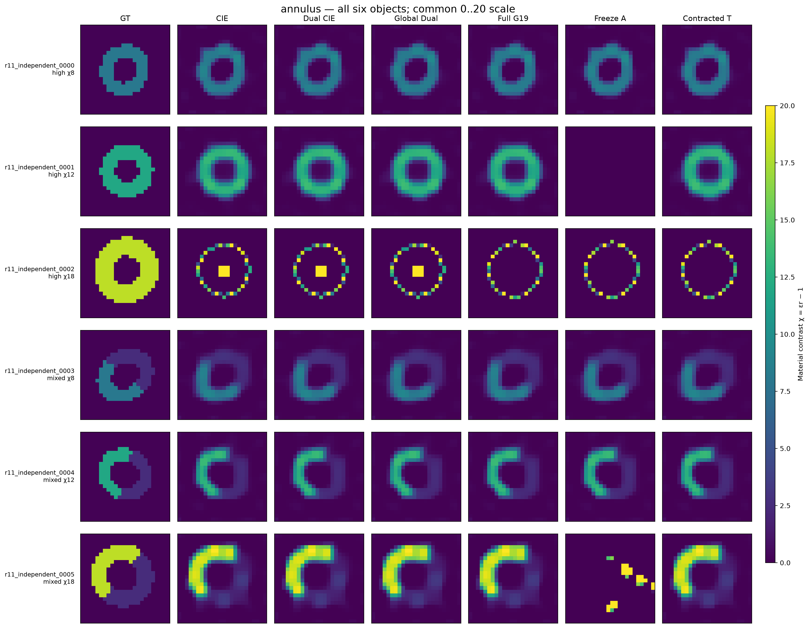

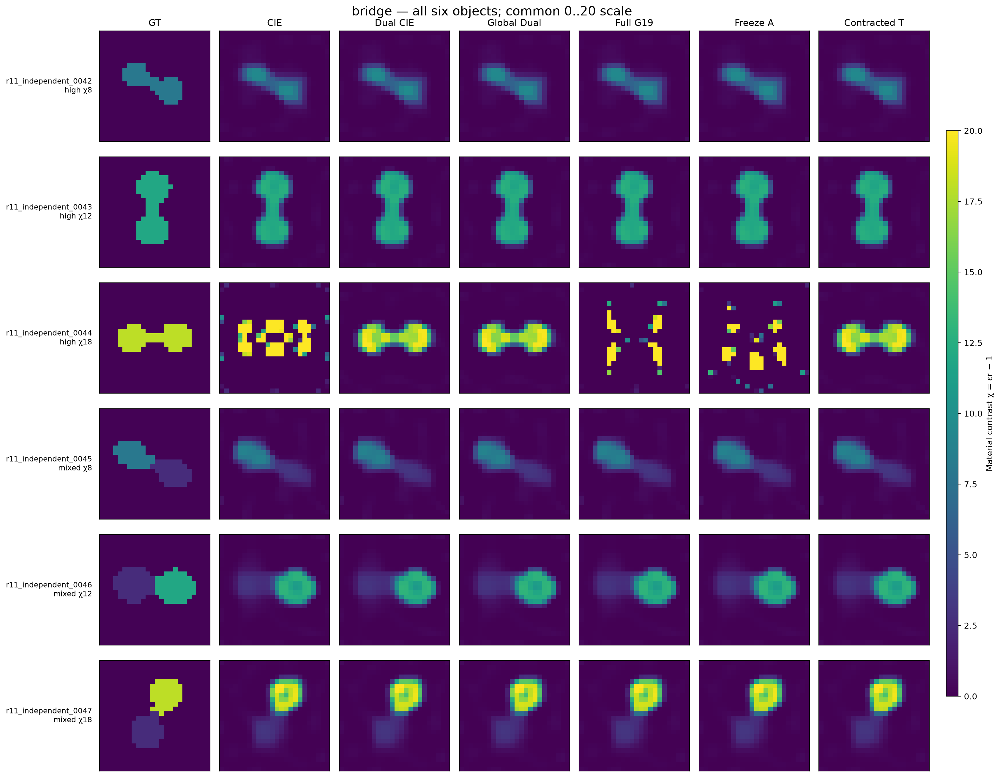

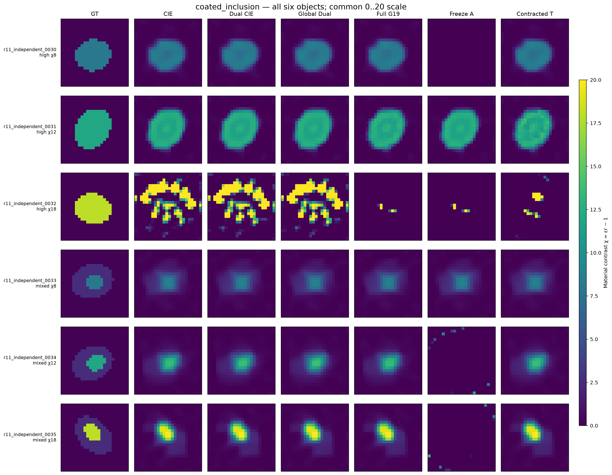

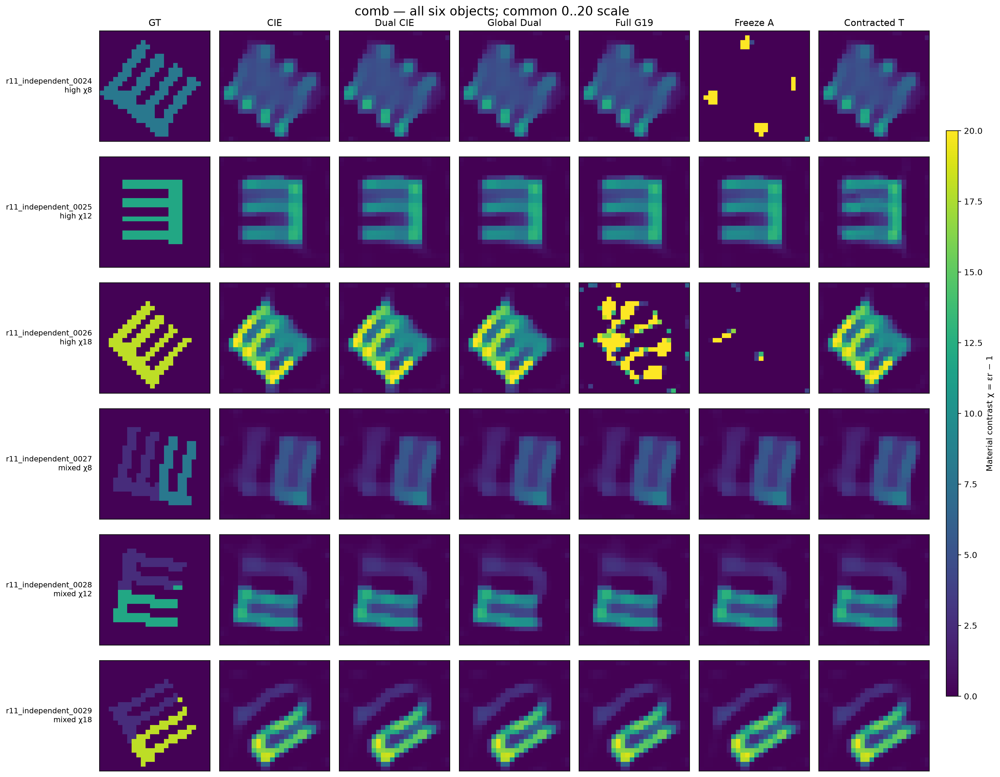

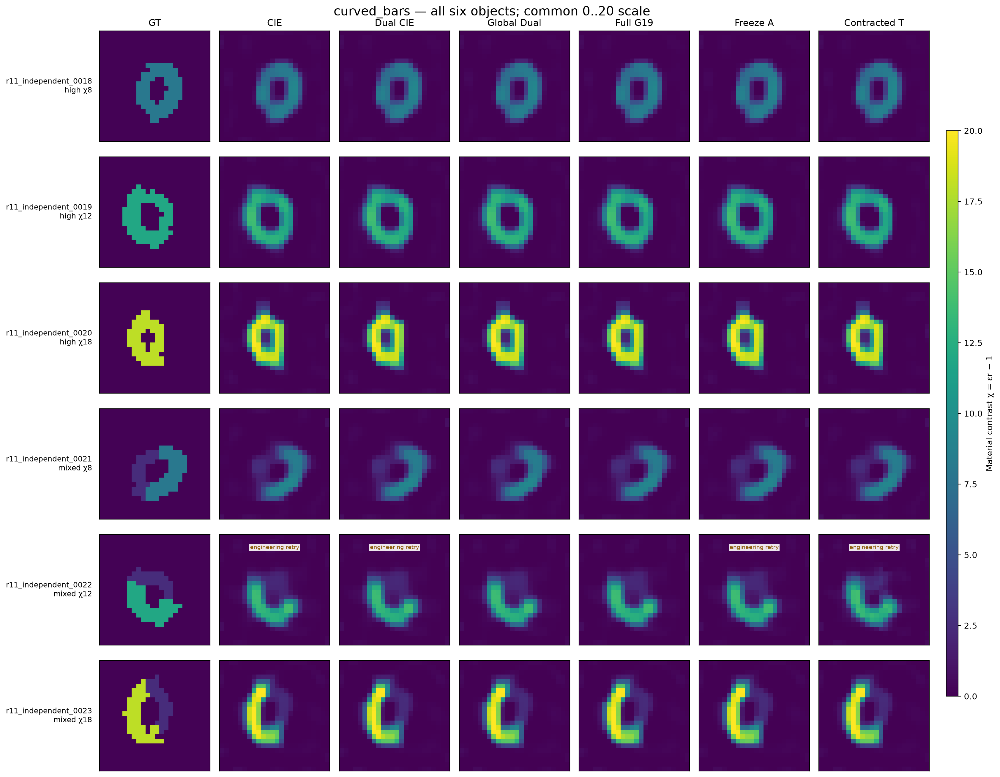

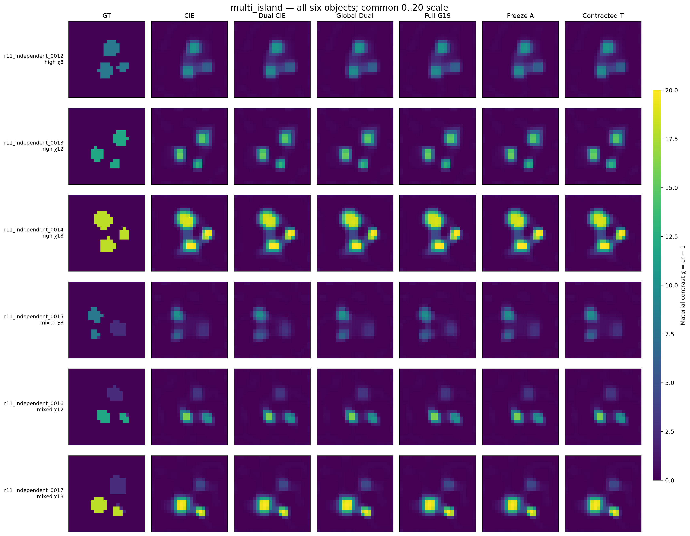

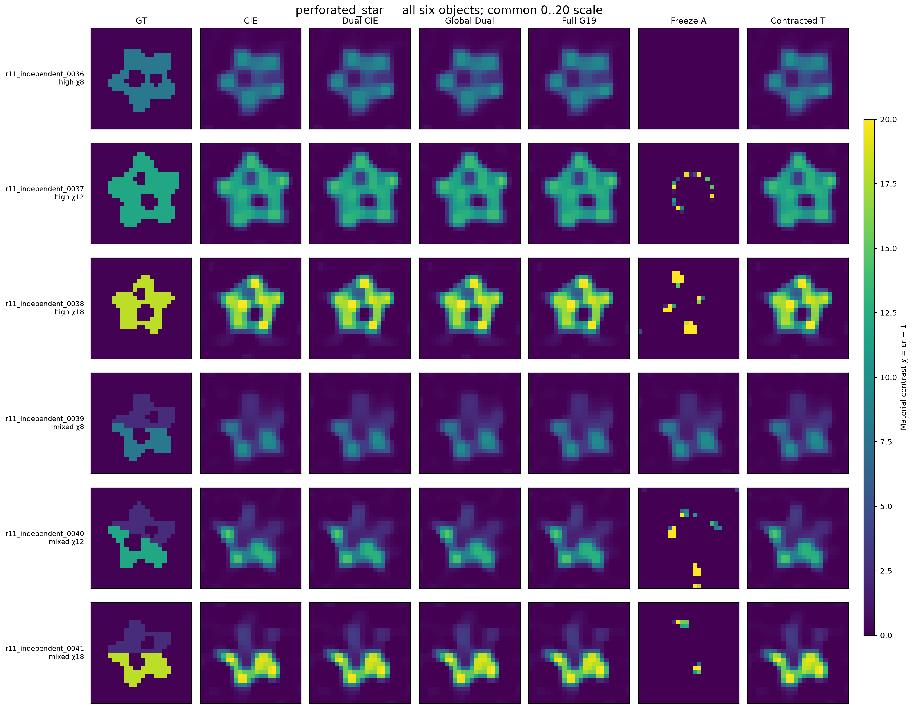

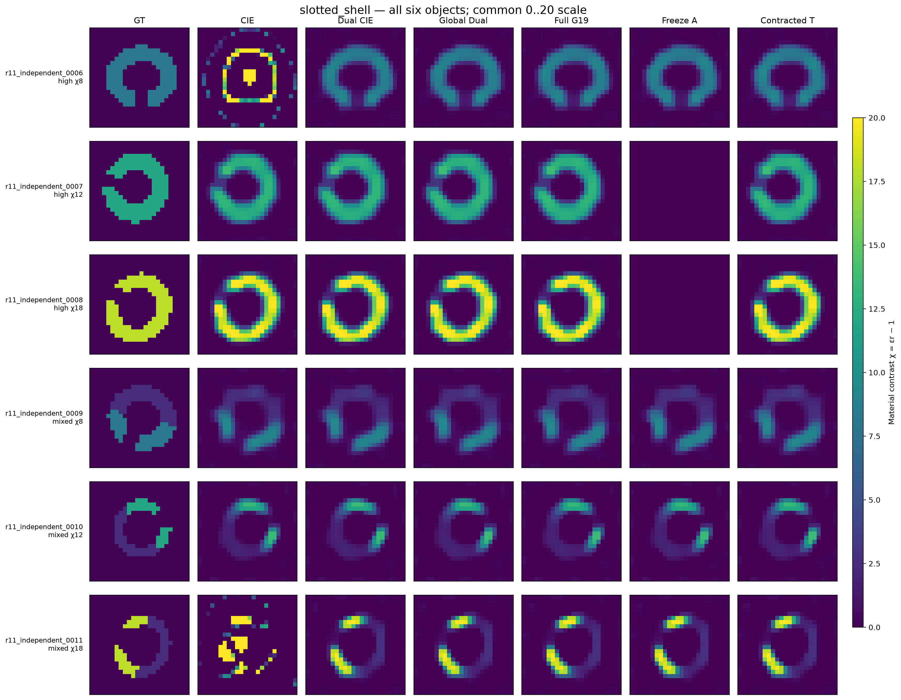

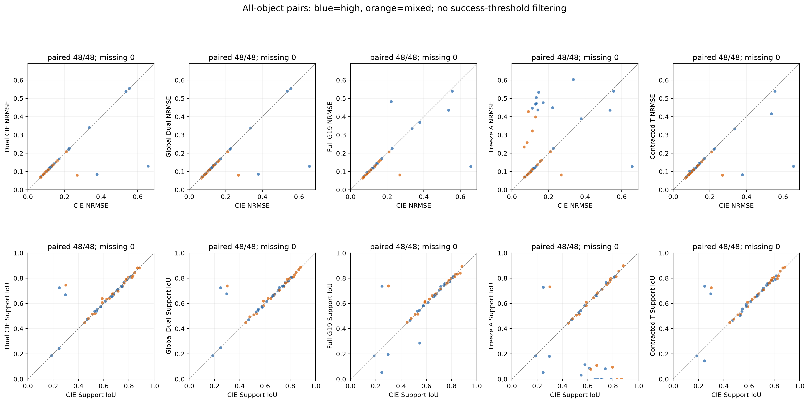

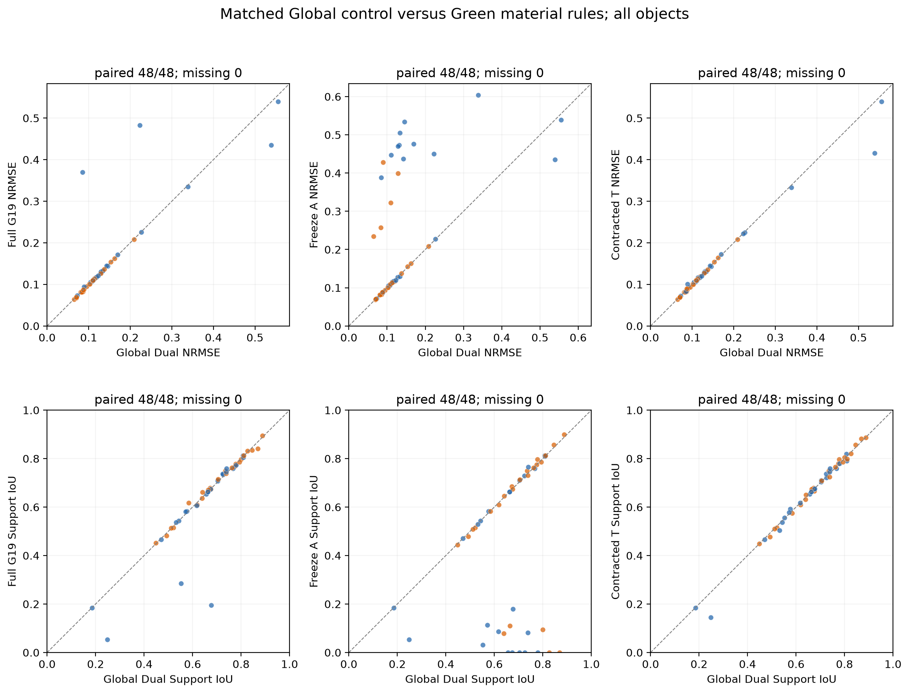

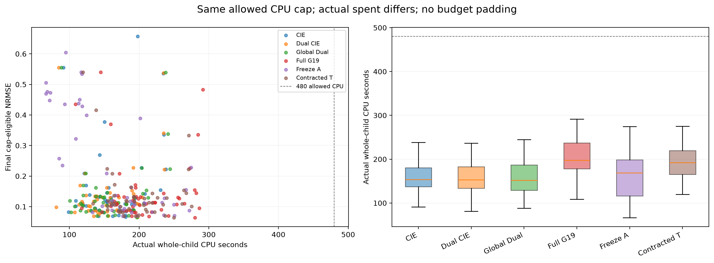

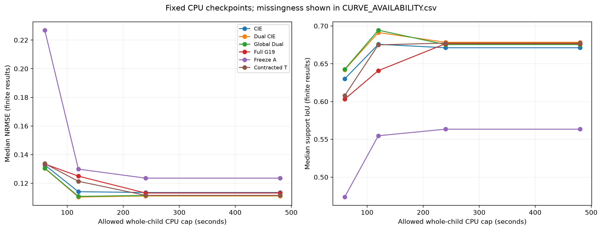

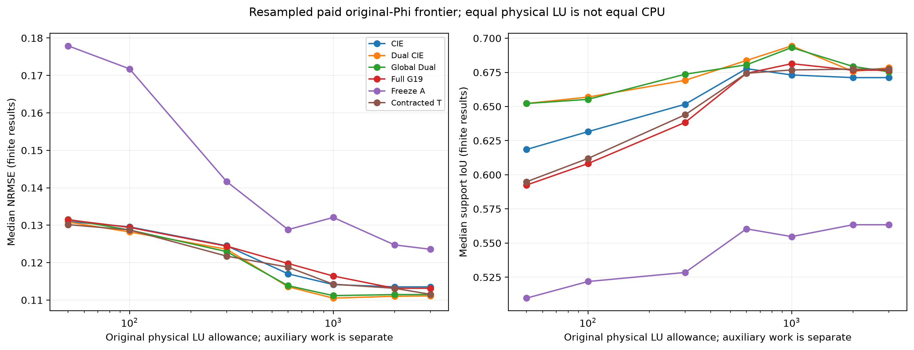
