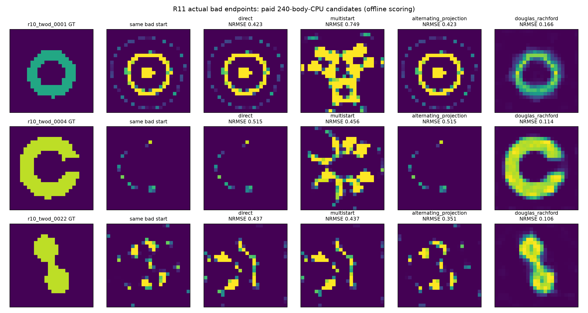

# R11 真实错误终点的反射干预

## 当前判断

**在三个指定旧坏终点上，双场反射按同一公开规则返回了比原物理续跑、AP 和本次同预算平滑扰动控制更准确的材料。** 这是暴露开发对象上的路径能力证据；不是三个新盲测，也不是已经优于所有初始化下的成熟 CIE/G19。

环和壳的旧终点有接近受约束局部极小的数值证据；桥尚有负曲率和错号乘子，因此桥的结果不单独证明离开一个已收敛局部极小。所有方法从相同保存材料重新求完整物理场，没有给反射输入另一个算法的好终点或GT。

## 远端同机已付240 CPU前缀

|对象|原物理续跑|平滑扰动＋direct|AP|DR|
|---|---:|---:|---:|---:|
|环，幅度NRMSE|.42288|.74888|.42288|**.16585**|
|开缝壳，幅度NRMSE|.51514|.45633|.51514|**.11377**|
|桥，幅度NRMSE|.43673|.43673|.35144|**.10617**|

候选只按同一原Maxwell Phi＋同一旧prior选出；全部12预测和预算前缀先封存，再离线评分。阈值沿用R11，只作描述：壳通过；环、桥仍有定量误差。图中三者的主要形态都明显重现，不因单个阈值未过而写成“没有成像”。DR的superlevel IoU约.647/.763/.695，边界/宽度偏差仍可见。

## 从公式到实际轨迹

共同初始完整物理状态属于C，故ω=1时AP和DR第一步相同。两者后续区别来自反射保留的集合不相容状态，而非第一步偷偷换初值。

本地同合同环轨迹先将Phi从.009385提高至第50步的.014582，再在第100/200/400步下降到.002002/.000167/.000065。第400步首次被已付物理审计观察为进噪声球。AP长期保持非零shadow gap，公开incumbent仍是原坏材料。此序列说明所测DR路径允许原物理目标暂时上升并改变活动box区域；不证明所有逃逸路径都必须上升同样高度。

三个远端DR完整终点数据残差约.009607/.009684/.009746；所有物理验收费用、背景H分解与RHS均另计。最终material恢复和noise-ball合格分别记账。

## 成本及不能越过的边界

- 四种方法在同一i9主机、各自P核、单BLAS线程运行。固定144proposal/96corrector窗口不是成功门槛。
- v1在两阶段之间压缩完整投影状态，导致部分完整运行超过240CPU。表格使用实际240以内的已支付候选；完整超时端点另存，不能混称同预算。详见audit/BASIN_BUDGET_ACCOUNTING.md。
- 该前缀时钟不含脚本导入，故称body-CPU前缀。完整生命周期由远端队列回执补充；独立确认已改为whole-child计费。
- multistart只代表本次事前固定的平滑扰动分布和费用，不证明所有restart算法失败。
- 原G19从均匀初值已经能恢复环，原CIE能恢复壳/桥。本实验的新证据是从**已陷入的指定坏终点**出发的改善，不能把旧方法已有好解抹掉。
- 不同BLAS下轨迹允许不同；本地环重放与远端均有逃逸，但不能宣称逐位相同。

原始入口：RESULTS/basin_remote/OFFLINE_SCORES.json、PREFIX_SEAL.json、每臂RECEIPT/history/prediction；完整投影状态仍保留远端，待统一归档发布。此报告不替代独立24对象的整组确认；该组已封存并在离线评分。控制全部保存池的材料oracle另作事后诊断，不能从选出端点断言它们从未访问任何较好材料。

## 保存候选池的事后反证检查（OFFLINE_ORACLE，不是在线算法）

12条运行的candidate/history逐项对应，均只保留bodyCPU≤240且已记录的物理候选。使用GT计算best@K仅为判断“控制搜索不到”与“Phi未选中”的差别，绝不替换在线结果。三个对象的控制池最小NRMSE分别是环.37454（多初值）、壳.45202（多初值）、桥.33477（AP），仍差于DR公开规则返回的.16585/.11377/.10617。DR返回值恰与其已保存候选池oracle相同。

控制也确实有选择损伤：环多初值从online.74888到pooloracle.37454，桥direct/多初值从.43673到.33603。但这些未选中的已记录候选仍未达到DR的材料质量。因此正例不只是“控制拥有相同好材料却没选出来”。这只适用于实际已审计/保存的有限池，不涵盖未保存的每个投影中间态、其他重启分布或无限预算。详见[原始诊断](RESULTS/basin_remote/SAVED_POOL_ORACLE_DIAGNOSTIC.json)。零新forward、零新优化，诊断成本单列。
