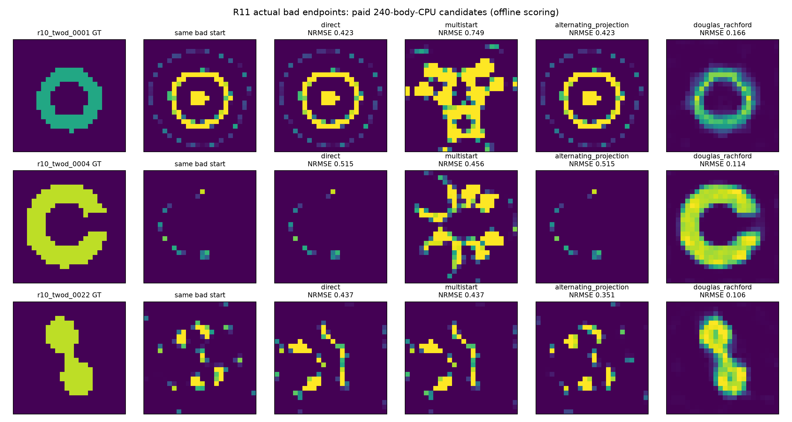
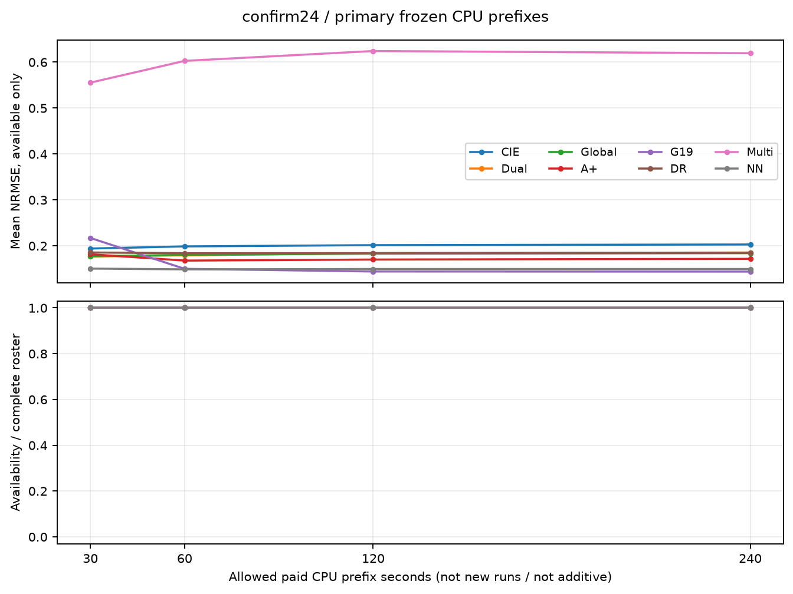

# MAX-STRUCT R12：双场反射、错误路径逃逸与材料选择

## 科学判断

**本轮建立了两类不同的正面证据：DR在指定坏终点的再搜索和完整NN初值接续中有实际价值；G19在独立24对象的常规二维反演中有材料误差与结构恢复增量。** 前者主要是已暴露对象上的机制/接口研究，后者是冻结独立确认，不能混合成同一种统计。DR不能据此被宣布为全面替代CIE/G19，但也不能因为均匀初值整组排名没有胜出就抹去其条件优势。完整正反证据见[综合评价：DR、NN与G19](COMPREHENSIVE_EVALUATION_ZH.md)。

**这里的7/24只是旧定量合取条件，不代表只有7个对象有成像。** 按2026-11-12用户要求，对全24×8主图作统一的事后目视描述：DR有10个主要整体结构恢复、8个主成分恢复但弱结构不足，6个主要结构错误；Dual有19/24、G19与NN各20/24有S或P类可辨恢复。这是单人事后描述，不冒充预注册确认成功率。0009应称“主要高对比分支恢复，弱分支与幅值仍偏”；0007的G19、0013的多种改进法也有旧IoU门掩盖的结构增量。详见[结构恢复补充判读](STRUCTURAL_REVIEW_ZH.md)，原分数和原阈值统计保留。

本轮更值得保留的结构认识是：**搜索能找到更好的材料，不等于原物理D+R目标会选择并保留它。** 两个高对比三维开发对象中，DR原始候选材料更准且处于声明噪声球内；共同corrector降低Phi，却增加数据误差、降低平滑prior并把候选推出噪声球。这不是“再多跑corrector一定更好”，也不是只看residual就能解释的现象。

目前最诚实的论文定位是“反射可行性作为条件性的错误路径干预，以及搜索—物理可行性—材料选择的实证分离”。还不足以写成“普遍优于CIE的高对比Maxwell新算法”或“实现全局凸化”。不要求所有对象全胜，但独立样本上可重复的优势范围必须由证据界定，不能事后用GT挑出擅长对象。

## 1. 本轮确实执行了什么

用户原任务全文见[sources/user/R12_ORIGINAL_TASK.txt](sources/user/R12_ORIGINAL_TASK.txt)，原Pro包保留在[sources/pro/MAX_STRUCT_RESEARCH/](sources/pro/MAX_STRUCT_RESEARCH/)。旧R1–R11没有改写。两个Chat取得的是有界读取，不是无损完整导出；访问边界见[audit/SOURCE_ACCESS.md](audit/SOURCE_ACCESS.md)。

|研究组|实际工作|用途与边界|
|---|---|---|
|Pro源码重放|4对象direct/AP/DR与原后续controls|继承公开GT逐步诊断；不是新盲测，不把微小BLAS轨迹差异藏掉|
|成熟toy对照|4对象×5个CIE系方法×2种mode合同，共40运行|补足原Pro“只赢direct”的缺口；不同mode合同分别保留|
|R11错误终点|3对象×4臂，共12远端运行，另3本地开发运行|真实旧坏材料、同完整物理初态；预算前缀和超限完整端点分开|
|独立二维|6开发×8=48；24确认×8=192|全部确认预测封存后评分；24材料才是统计簇，不把方法/前缀当新材料|
|NN接口|4公开R8对象×4臂，共16运行|复用24,737参数冻结网络；不重新训练，不冒充独立确认|
|moderate矢量3D|2独立几何＋一个配对跨网格观测；18原运行＋18统一续跑|真三分量dyadic-DDA；较长共同corrector后差异消失|
|high矢量3D|2独立几何＋一个跨网格配对；4法×3观测=12运行|高χ8/混合2与8；原始/校正后分解，粗网格资格限制|
|实测与Austria|12原运行＋3完整Dual续跑＋3matched32诊断|真实Fresnel与Austria150→32；没有伪造实测pixelGT|

上述跨网格观测、续跑和多方法不是额外独立材料。所有执行与失败成本见[COST_LEDGER.md](COST_LEDGER.md)，具体合同见[BENCHMARKS.md](BENCHMARKS.md)。

## 2. 公式究竟利用了什么

核心不是重新命名CIE残差，而是选择不同的搜索状态：完整总场Q与对比电流J。传播/接收集合A约束Q=Einc+GJ及观测球；材料集合C要求每cell的同一个实材料同时解释所有源、所有三维分量。固定尺度X=J/6，C投影化成共享斜率TLS小问题；A投影消元后复用H=I+36G*G和小端口系统。

AP和DR共享这两个投影。在同一个完整物理初态、ω=1时第一步严格相同；后续DR保留反射状态，允许经过不满足完整物理的中间对。这提供与原物理梯度下降不同的路线，却没有抹去原Phi的局部极小。若错误材料已经是合法且数据可行的物理解，纯反射同样会把它固定住。

[THEORY_DERIVATIONS.md](THEORY_DERIVATIONS.md)给出共享投影、条件shadow-gap→物理误差界及其假设。该界含材料resolvent，因此小shadow gap不自动说明端口精度，更不证明GT材料。iteration0的gap=0只是记录初态的占位值，不可用作集合一致证据。数值rank/边界容差明确公开。

这些投影和DR数学工具已有先例。相近WRI、DCTMC、CSI、EM-ADMM和PADMM-CIE限制了新颖性主张；详见[PRIOR_ART_AND_NOVELTY.md](PRIOR_ART_AND_NOVELTY.md)。本轮贡献不是“首次使用非物理状态”或一般非凸全局收敛定理。

## 3. 最清楚的正例：从已陷入的坏材料重新出发

R11环CIE、开缝壳G19、桥G19的保存材料原样作为共同起点。重新forward获得完整J/Q后，比较原物理续跑、固定分布平滑扰动多初值、AP和DR。

|幅度NRMSE，付费240 body-CPU内|续跑|平滑多初值|AP|DR|
|---|---:|---:|---:|---:|
|高对比环|.42288|.74888|.42288|.16585|
|开缝壳|.51514|.45633|.51514|.11377|
|桥|.43673|.43673|.35144|.10617|

三者主要形态确实重现；DR的IoU约.647/.763/.695，仍有边界和宽度误差。按沿用旧描述门只有壳通过，不能因此把环和桥写成“完全没有恢复”。环与壳的旧点有近受约束局部极小证据，桥尚有负曲率/非收敛迹象，所以桥只支持路径干预，不单独证明严格局部极小逃逸。

本地环审计显示Phi先从.009385升至第50步.014582，随后第100/200/400步降至.002002/.000167/.000065。AP保留旧坏incumbent。这个对照支持反射记忆对该路线有用，不能证明所有成功都需同样上升，也不能从三例推出普适盆地扩大。

旧G19从均匀初值已经能恢复环，CIE能恢复壳/桥，本研究没有抹掉这些事实。完整结果及v1序列化造成预算超额的前缀更正见[BASIN_ESCAPE_REPORT_ZH.md](BASIN_ESCAPE_REPORT_ZH.md)。

## 4. 独立24确认：收益没有成为通用优势

24个独立对象覆盖levelsets、枝状、岛状、连续随机四族，高8/高18/高低混合各组合。固定24²、576个独立实材料未知量、12源48接收、1%复圆高斯噪声、公开box和原prior。八法有相同240 whole-child CPU上限、144proposal/96corrector窗口；记录实际支出和30/60/120/240前缀，不能把上限相同说成消耗必然相同。

封存评分如下；[独立确认完整报告](delegated/confirmation/CONFIRMATION_RESULTS_ZH.md)提供逐对象、条件可用性、配对与全部失败：

|方法|平均幅度NRMSE|旧描述成功/24|
|---|---:|---:|
|成熟CIE|.202932|9|
|Dual-CIE|.185456|9|
|Global-Dual|.184007|9|
|A+|.171692|9|
|G19|.143891|9|
|DR|.184631|7|
|物理平滑多初值|.619361|4|
|冻结NN→direct|.149514|9|

不能只说DR“没过gate”便停止分析，也不能说这组已证明所有结构无价值。它否定的是当前冻结DR作为普遍默认替代器的主张。反射从均匀场出发与从指定坏端点干预是不同实验；一些坏材料已经满足噪声球时，继续反射没有GT选择依据。

新增次规则在24生成后、任何确认逆解/评分前登记：从已付费、合法、原始CN99球内候选中最小化同一R，Phi破平局。它没有增加forward，也没有改轨迹。八方法合计144/192个可用、48/192个不可用的次候选；单法最多24个，DR为18/24可用；不能删掉不可用对象后把均值降低包装成整体改善，也不能拿它悄悄替换主结果。最终需在相同对象交集比较主/次差异，并同时报告覆盖率。

### 同成本前缀与配对不确定性

|whole-child CPU前缀|CIE|Dual|A+|G19|DR|NN→direct|
|---|---:|---:|---:|---:|---:|---:|
|30秒|.19411|.17677|.18169|.21718|.18551|.15044|
|60秒|.19876|.17942|.16787|.14988|.18396|.14881|
|120秒|.20149|.18404|.17014|.14411|.18408|.14951|
|240秒|.20293|.18546|.17169|.14389|.18463|.14951|

均为全部24对象的平均幅度NRMSE，公开规则按Phi而非GT选择，所以材料误差可以随预算变差。G19早期setup较重，但60/120/240前缀已优于DR，不能把其最终优势全部解释为多用CPU。NN30秒已较强，然而它带有既有训练prior，不是同信息的纯优化创新。

DR−Dual平均差−.000825，按对象10000次bootstrap的95%区间[−.040982,+.053017]；不能据此宣称统计等价或优势。DR−G19为+.040740，区间[+.001934,+.095095]，本组数据支持G19平均材料误差较低；这是小样本、未校正多重比较的探索性区间，不是跨全部问题的定理。

DR17个旧描述未过中，11个在球内、6个在球外。11个球内对象均NRMSE≤.15，未过的是IoU≥.7这一项，relativeL2为.324–.600；应报告结构/边界不准，不能一概说完全没成像。原始DR proposal minPhi平均NRMSE.185814、最终.184631，12对象改善12退化；本组没有high3D那种原始进球→corrector出球的转移。因此不能把三维开发反例强套为独立二维的统一失败原因。

### 候选池是否隐藏了相同的好解

另对三个R11端点的已记录付费候选池做OFFLINE_ORACLE诊断，未新求解：控制池best@K的NRMSE为.37454/.45202/.33477，仍高于DR在线返回的.16585/.11377/.10617。多初值确有被Phi丢弃的较好材料，但未追上DR。这加强了这些指定例子的搜索差异证据；只覆盖已物理审计的保存池，不声称所有未保存状态都差。

## 5. 材料选择的问题：共同corrector为何会毁掉更好的结果

两个high3D matched对象中，DR原始相对材料L2约.06163/.07831，corrector后变为.12978/.22724；CIE/Dual/AP最终也趋近相同材料。分解表明：

- 高χ对象D由1.0210e-4升至1.3577e-4，R由7.1732e-4降至5.9158e-4。
- 混合对象D由1.0034e-4升至1.3033e-4，R由3.5856e-4降至2.4505e-4。
- 原始DR均通过raw CN99，校正后两者均出球。

因此Phi下降由prior改善支付，数据和材料同时变差。不能把同Phi校正器自动当作更可靠的最终裁判。这也是预注册次规则的依据。不过另外的AP例子中D与R都改善而材料仍变差，说明所有失败并不能统一归结为prior权重。

三维高χ的6³网格内部cell相位大，8³→6³干净响应差约26.16%。这是真正矢量有限模型研究，尚非连续高对比Maxwell精度验证。moderate组在更长共同corrector后各法材料几乎一致，说明短预算优势可能是预算/收敛差异。详见[EXTERNAL_AND_VECTOR_REPORT_ZH.md](EXTERNAL_AND_VECTOR_REPORT_ZH.md)。

## 6. NN、实测及经典对象没有被跳过

冻结小NN的四对象接口中，uniform→direct、NN→direct、NN→DR、NN→CIE的平均幅度NRMSE约.4470/.1419/.0862/.3089。NN→DR的某些对象好于NN→direct，但两个对象轻微变差，完整CPU也增加；另一个对象CIE已解释相同收益。没有NN→AP单因素臂，不能把全部差异唯一归因于反射。独立24只确认NN→direct；不能宣称全部NN组合已经独立泛化验证。[NN报告](NEURAL_AND_SELECTION_REPORT_ZH.md)。

Fresnel用真实2001 single/twin原数据、空目标入射校准、源相关实际mask、711留出通道。多种算法与补足原生3000步的Dual最终接近相同corrector支配结果，留出残差约.0915/.0986。没有可信逐像素GT，因此不报告伪造NRMSE，也没有证明DR实测成像更好。

Austria原观测实际是150²→32²，旧64²元数据已保留并更正。粗GT残差.22526高于选用.12球，存在模型差异。随后用同粗GT、同预算/规则生成matched32，新GT残差.09951进球，DR仍差（最终NRMSE2.25391，残差.13490）；完整Dual也在corrector中从原始.60638退化至1.08143。因此物理模型误差确实存在，却不是全部失败原因。没有靠改阈值或反复换球挽救DR。

## 7. 效率、失败和公开证据

固定背景H只分解一次不等于免费：所有投影RHS、Green/接收乘法、物理验收、corrector、状态写出都计费。grouped v2在原toy固定投影workload的CPU为v1的约1/2.40，属于相同数学问题的工程优化，不是恢复优势或GPU速度结论。

确认192子进程实际CPU为28147.796875秒，开发48有效子进程为7189.6875秒。初期13个路径求值启动失败合计.90625CPU秒，全在科学setup之前，源文件与失败回执保留。生成、运输、打包及后处理另记，内部/外部计时不重复累加。准备/阅读/部分旧timer缺失保持null。不能把并行CPU总和称作wall时间。

远端固定独立P核、单BLAS线程；负载下遥测样本报告活跃核约1.5GHz，未中途改电源。五baseline显式BelowNormal，search继承controller；有一次有效优先级快照，但没有全程历史。故不宣称严格同调度下的wall吞吐优势。此次科学运行使用CPU，未宣称4060 CUDA已运行。

完整源、模型、配置、原始状态、成功与失败由现有GitHub仓库及release分包交付；发布尚在准备时不会把未发布URL写成已可访问。复现入口见[REPRODUCE.md](REPRODUCE.md)。

## 8. 能写什么论文，还缺什么

可保留的论文主线：同一有限Maxwell模型下，反射在某些真实坏端点上产生AP/direct不具备的有效搜索路线；独立多样材料中这种能力没有成为通用优势；即使找到更准确的候选，同一物理D+R选择/校正也可能毁掉它。三种失败必须分别处理，不能用更低residual、更多迭代或更大的NN混淆。

当前尚不支持：全局凸化、所有高对比对象优于CIE、连续高χ三维保证、实测材料优势、首次非物理状态/DR理论。论文资格仍缺最接近WRI/EM-ADMM/PADMM-CIE的合格数值比较、较高精度三维及机制适用区域的独立预测。未做完的这些对照应是明确限制，不以列举文献冒充已比较。

下一轮最值得研究的公式是条件shadow-gap界中的resolvent放大，以及球内材料选择与soft D+R校正的差别。可先研究“何时保留观测可行候选、何时启动反射干预”的可观测判据；它必须在新对象上预注册，不能用本轮GT赢家事后拼成一个所谓全能混合算法。是否推进这个方向，应由逐对象确认诊断来决定，而不是本报告强行宣布新算法成功。

英文初稿见[PAPER_DRAFT.md](PAPER_DRAFT.md)，科学审查见[audit/SCIENTIFIC_REVIEW.md](audit/SCIENTIFIC_REVIEW.md)。结果解释与发布状态分别记账；公开文件入口以CHAT_HANDOFF与ARTIFACTS为准。
