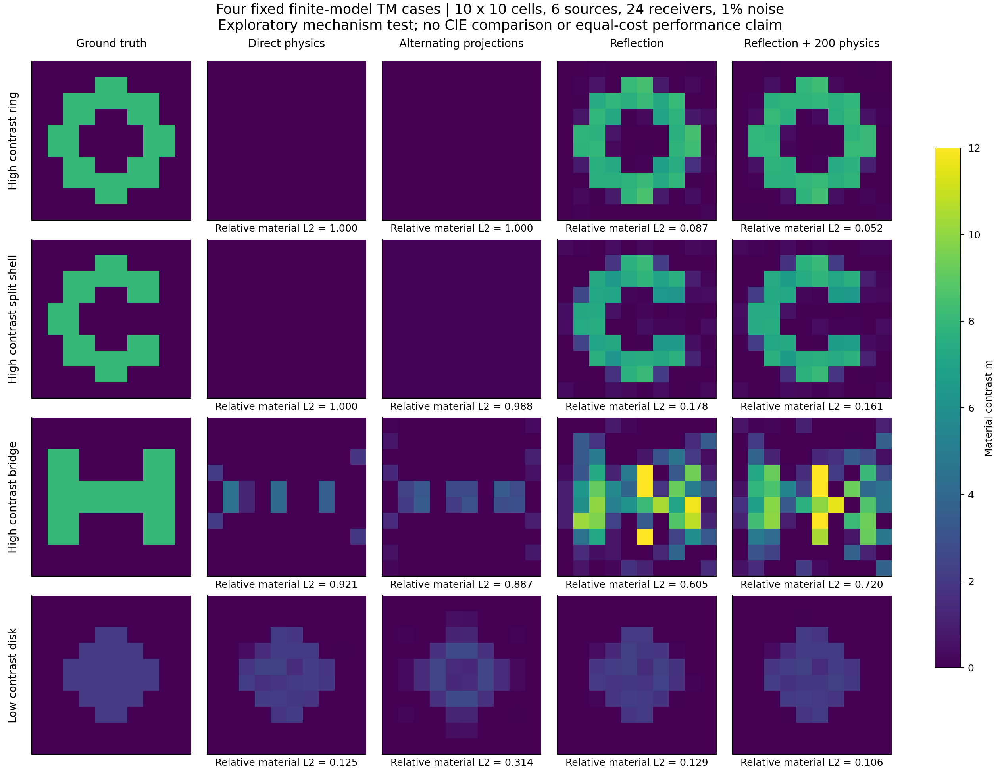
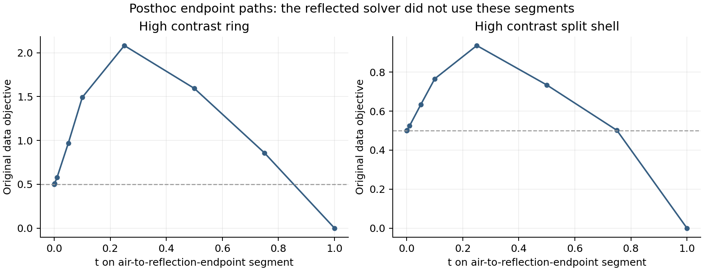
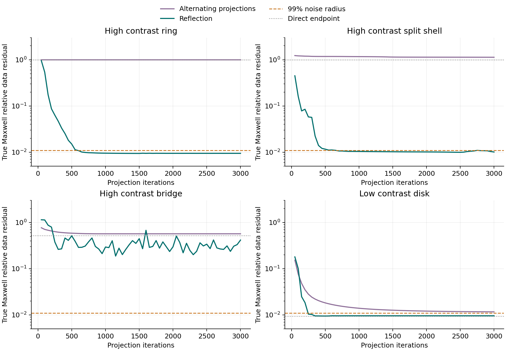

# MAX-STRUCT Maxwell 逆散射结构研究报告

研究日期：2026-11-08（Asia/Singapore）

**核心判断：下一步最值得研究的是“传播与观测约束”和“跨照明共享材料约束”的交集几何，以及能够在这两个集合之间保持非物理路径记忆的反射搜索。** 它可以直接改变搜索轨道，且不需要每步重建材料依赖 Green 分母。它解决的是到达可行材料的路径问题；噪声可行集内的材料选择，必须单独使用明确先验或新观测。高阶局部优化、更多 Green rank 和更低现有目标，都不能替代这一区分。

本报告已经完成仓库证据审查、主要近邻文献调查、新候选的具体推导和四个固定小模型的计算验证。它不是算法普遍优越性的宣布，也不是仅供以后执行的研究计划。

## 阅读范围与证据等级

仓库读取固定在提交 [24ab7e85d750a477ab337e03cdb1a77d5c9ff2c3](https://github.com/migodam/b1-probabilistic-maxwell-imaging/tree/24ab7e85d750a477ab337e03cdb1a77d5c9ff2c3)。精读了 MAX-STRUCT R4–R11 的 HANDOFF、主要报告、相关理论、失败审计及 R11 的 16/48/配对跨网格/三维确认报告；结合 formula atlas、FBG、A17、P3L、Z-ALG 和 FP-T 接缝材料。历史完整 Release 数值归档没有逐个下载重算，成熟恒等式没有重新做机器精度检验。

通过个人上下文检索取得了相关历史讨论片段，用于恢复此前方向和限制；**没有取得整个旧 session 的逐字完整导出**。以下历史数字以固定仓库快照为可复核依据，不把检索摘要当作新实验证据。

全文使用四种证据身份：

- **已有证据**：仓库已有实验或原论文已经证明的内容。
- **本次推导**：针对明确有限维模型推得的公式或命题；不自动等于数学首创。
- **本次探索计算**：附代码、全部四个对象和失败结果的小规模验证。
- **待检验主张**：需要独立对象、共同预算或真实测量进一步判断的算法价值。

材料记号统一为对背景的实标量对比度 m，而非绝对相对介电常数。二维每 cell 一个标量；三维各向同性情形，一个 m_i 共享三个矢量分量和全部照明。最终报告中的新实验误差为相对材料 L2，不与历史 amplitude NRMSE 混用。

# 一 先判断真正瓶颈

## 1.1 不存在一个适用于所有失败的单一解释

R4–R11 的证据不支持“材料读出还不够精确”作为统一解释，也不支持“都是观测不可辨识”。至少存在以下三种不同状态：

|状态|已有直接证据|算法还能合理争取什么|
|---|---|---|
|存在明显更好的材料，当前终点仍在噪声球外|历史薄环/开缝壳；R11 部分近 box 局部极小和正初始导数路径|改变有限搜索路径、离开错误局部吸引域|
|错误材料和 GT 都满足当前噪声合同|R11 16 对象审计中大量材料失败候选仍进 CN99；一些候选目标与 prior 都低于 GT|明确先验、解族、独立新测量；不能靠更低同一目标保证 GT|
|模型失配显著，现有有限预算求解未在声明噪声内解释数据|R11 三维跨网格全部出球；部分离散误差显著大于 3% 噪声；尚未证明粗模型不存在更好拟合材料|改善正演、几何/照明/标定和误差建模，同时继续区分模型偏差与未完成求解|

**最根本的研究瓶颈是当前目标、可行集合与材料评价之间的关系没有被算法分工明确表达。** 对球外错误终点，搜索能力是真问题；对球内错误材料，选择规则是真问题；对三维跨网格，模型资格可能先于求解器优劣。应按对象及终点分层分析，不能先决定一个统一故事再解释全部数据。（见文末 R6 至 R11）

在研究资源排序上，我建议：

1. 主线：共享材料双场投影与反射，针对球外错误终点的可达性。
2. 并行必要对照：显式先验的物理可行材料选择，检验 R8 的 NN 信息能否合法保留。
3. 条件性扩展：针对候选分歧的真正新增照明或频率，而非同数据数字重组。
4. 保留 A+/G19 的条件性价值及所有反例，停止把它们当作必须维护的中心假说。

## 1.2 已有结论应该如何继承

|轮次|应当继承的成果|已经暴露的边界|
|---|---|---|
|R4|局部非对角 Green 本构反馈可以改变材料路径；旧弯条 onehop 约 0.0417，而 global 约 0.3892|新六对象都是 4/6，onehop 对 global 连续误差 1 胜 5 负；更细网格优势会消失|
|R5|作用位置主要在材料读出；普通 global current 加 onehop material 仍约 0.0415|current-only 失败；特定早晚交接未保持收益；无 Y 的能量指标不能普遍预测物理下降|
|R6|A-material 真 FFT current 接入；历史困难组有额外成功|新六对象仍同为 4/6；A 总 CPU 约为 Dual 的 1.61 倍|
|R7|A+ 的 Möbius 条件结构保留 A 的成功集合，CPU 比 A 减少 31.4%|仍比 Dual 多 11.2%；原 30 对象 A/A+ 为 21/30，未建立普遍胜出；有限 rank 搜索无独有恢复|
|R8|24,737 参数轻量 NN 显著改善 direct Maxwell；恢复能力并非完全缺失|优势不能稳定传给 CIE/A+；DPCS/截断和后续交替会丢信息；最小 Phi 分支选择有反例|
|R9|修复噪声相关 DPCS rank 后，多个方法共同由 2/6 到 4/6|共享修复不是 A+ 贡献；WRI 类放松的旧壳成功未推广到新对象；小辅助残差可对应大物理残差|
|R10–R11|G19 在部分环、壳上确有跨网格收益，full derivative 的地位明确|48 对象 G19/Global-Dual 同为 23/48 且成功集完全相同；等 CPU 和三维没有稳定优势|

（见文末 R4 至 R11） 这些结论不是互相抵消：局部反馈“能改变一些吸引域”已被正例支持，“能普遍改善材料恢复”没有被支持。

R7 的追加 20 对象，A+/Dual 为 12/9，值得保留；但家族是在原 30 对象结果之后选定，不能把两批拼成一个事前设计的 50 对象总体试验。R11 的 16 对象 G19 7/16、Global-Dual 6/16，也不能压过后续 48 对象相同成功集合的确认结果。反过来，48 对象打平不能抹掉配对 8 对象上的真实 6/8 对 4/8。[R7] [R11-16] [R11-48] [R11-X]

## 1.3 R11 最需要准确表述的四点

第一，G19 不是“完整 Green”。它是材料分母中的 rank-19 反馈，三维确认使用的是另一个 rank-120 实现；Global-Dual 也是仓库具体实现控制，不是原文中一个同名新理论。

第二，配对 8 对象的 full-endpoint 增益在 24 网格和 48→24 生成/反演条件下都保留。等 CPU 的跨网格额外成功对象发生变化：环保留，另一个变成混合多岛，而非仍把壳写成同预算收益。G19 的有效 CPU 相对 Dual 约 1.334；48 对象共同 CPU 前缀下，Dual 22、G19 21、contracted 20。[R11-X] [R11-48]

第三，局部极小证据必须逐对象使用。环/CIE 的 projected gradient 约 9.68e−9，自由面最小特征值约 6.69e−9；壳/G19 约 8.91e−9 和 3.59e−7，并有活动约束乘子检查。桥则 projected gradient 约 3.18e−5，存在 24 个自由面负特征值和 8 个错误乘子；它不能被归为同一类收敛的 box 局部极小。有限精度下这是有力数值证据，不是连续 Maxwell 的严格局部最优证书。[R11-T]

第四，原物理有限路径有显著壁垒，但只证明被检查的路径。例如环的两个算法终点间，Phi 从 0.009385 经采样最大 0.152826 到 0.00005255，初始方向导数为正；壳也有明显上升。这不是“所有连接路径都必须经过该高度”的全局地形定理，更不能把远端算法解偷偷替换成 GT。[R11-T]

## 1.4 NN 真实测量与三维证据的分量

R8 的冻结轻量网络对 direct physics 的平均 amplitude NRMSE 改善很明显：ID 24 对象从 0.24966 到 0.09647，OOD 12 从 0.40474 到 0.16245，cross-grid 6 从 0.19593 到 0.08431。这支持“有用的材料初值信息确实存在”，但不说明同样信息一定能穿过 CIE 的 current 投影。R9 Austria ε_r=3.5 上 CIE 约 0.1851、A+ 约 0.1845、direct 约 0.6068，也说明 direct 不是所有对象的最终强基线。[R8] [R9]

Fresnel 中把不允许空气的旧下界 0.02 改成 0 是共同模型修复。R8 的同起点 Dual/A+ held-out 8 GHz 相对预测残差约 0.137237/0.137128，几乎相同且有材料尖峰；这不能支撑 A+ 的真实材料优势。[R8]

R11 三维确认确实有 1728 个实材料未知量、每源 5184 个复 current 状态及 60 个 dipole 照明。八个 matched 对象的平均材料相对 L2：CIE 0.22844、Dual 0.22608、Global 0.23127、fullGreen 0.22780、contracted 0.22774。40 个 matched 终点全部在声明 CN99 内，10 个 cross-grid 终点全部在外；两种干净网格差异约 17.68% 和 3.53%，对照名义 3% 噪声。50 个终点都达到 320 accepted-step 预算，而非全部收敛。[R11-V]

所以目前三维证据支持“已在真实耦合矢量有限模型实现，且 rank-120 Green 分母反馈没有稳定优势”，尚不支持“已经解决连续三维高对比反演”，也不支持把所有 cross-grid 失败归因于错误 basin。

# 二 从 Maxwell 结构看已有方法为何改变行为

## 2.1 物理层与离散假设

在固定背景、非磁、各向同性介质中，采用 e^{-iωt} 约定，把对比度电流归一化为 J=mQ，Maxwell 体积分方程可以写成

$$
Q=E^{inc}+GJ,\qquad J=D_mQ,\qquad F(m)=SJ_p(m),
$$

$$
L_m=I-D_mG,\qquad J_p(m)=L_m^{-1}D_mE^{inc}.
$$

G 已包含背景波数、Green 核、离散积分和自作用约定；S 包含从体内电流到实际接收端口的传播与读出。三维 G 必须是合格的 dyadic 算子，不可用三个互不耦合的标量问题代替。以下有限维推导假设相关材料处 L_m 可逆。接近奇异处，存在性、误差放大和数值容差必须另行报告。

把照明、current 和材料保留为真实共享关系，比“用哪个 Green 奇异子空间”更基本。强 G 模式未必被当前照明激发，也未必被接收端口看到；材料的一个实参数还必须同时解释所有源和三维分量。

## 2.2 辅助误差是物理误差的偏移量，不是替代指标

记

$$
d=SJ-Y,\qquad e=J-D_m(E^{inc}+GJ).
$$

则已有恒等式给出

$$
F(m)-Y=d-SL_m^{-1}e.
$$

所以需要关心的是 e 经材料依赖的物理 resolvent 和接收映射后的方向及大小。仅把两个辅助范数都压低，并不控制它们在真实数据空间里的叠加结果。R9 的辅助 RMS 约 0.017–0.027、物理残差约 0.37 和放大约 7–13，正是此问题的实证，而不是再次验证恒等式的理由。[R9]

令物理 current 误差 z=J−J_p=L_m^{-1}e。若构造

$$
\frac12\|W[r(m)+Sz]\|^2+\frac{\rho}{2}\|WSz\|^2,
$$

并允许可见 current 分量自由优化，那么在可达端口空间消去 z，只得到原物理数据项的正比例缩放；不可达端口分量保留固定加权。若直接使用精确 residual d−SL_m^{-1}e，则该项与自由 J 完全无关。

**因此，“把缺陷精确传播到端口”可以成为可靠验收和误差分析，但本身不是新的 basin 消除机制。** 这一退化情形在 R4 也已有审计。任何声称新能力的方案，必须指出额外的限制、分裂记忆、路径变化、先验或新信息来自哪里。[R4] [L3] [L4]

## 2.3 A+/G19 改变的不只是一个预条件器

固定 J 时，把材料残差写成 R(m)=P(m)e(m)，有

$$
dR[h]=-P(m)D_hQ+(dP[h])e.
$$

根处 e=0 时第二项消失；非根处它会改变有效材料切向。对 G19，

$$
A=I+\beta D_m-D_mK,\quad w=A^{-1}e,
$$

$$
dw[h]=-A^{-1}D_h\{Q+(\beta I-K)w\}.
$$

这同时改变 residual metric 和 effective illumination。freezeA/contractedT 去掉的不是无关精度，而是原更新的一部分；它们既可能修复一个坏方向，也可能失去一个好方向。已有 rank-r 反馈对应的空间 residual metric 差一般不定，可有至多 2r 的低秩结构；这既不保证正向加权，也不等于整个材料 Hessian 只有同样 rank 的改变。[R10] [R11-T]

已有加权读出公式说明，当材料相容空间不被度量保持时，非对角反馈可以把“当前各源无法由一个实材料解释”的 residual 分量带入材料读出。这解释为何材料-only 干预能改变路径。但改变路径的方向不必与真实数据梯度一致，也不必朝 GT。[R4] [R5] [R10]

完整交替算法还含 PR 历史、线搜索、阶段切换、box 活动集和 current 截断。不同块使用不同 β 时，通常没有一个共同辅助函数被每步单调下降。真实实现不能简化成一个处处光滑的 m→m 映射，然后用单步 Hessian 谱声称 basin、周期或混沌。R1/R5 的审计已提示这个问题。[R1] [R5]

更合适的机制量是：

- 某实际材料步 h 对真实目标的方向导数，而非只看辅助 loss；
- current 变化能否由共享实材料切向产生；
- 该方向在接收端口的可见性；
- 有限更新后活动集、物理残差和材料误差如何共同变化；
- 从同一实际错误终点出发，是否到达一个不同、经物理验证的材料区域。

这些量只用于解释和可证伪预测；不能再次把一个新能量评分包装成万能成功分类器。R11 的十个检查状态中，普通 β 导数项约为新增 K 项的 2.288–5.390 倍，Qeff 列能量也没有解释 shell 失败；不能把梯度抵消或所谓“去激发”全部归给新增 Green 反馈。[R11-T]

## 2.4 真正的材料 current 切向

定义 B_Qh=D_hQ_p，则

$$
T_mh=L_m^{-1}B_Qh,\qquad \mathcal J_mh=WSL_m^{-1}D_hQ_p.
$$

复数组使用实 Hilbert 内积。逐 cell，材料相容性要求

$$
\Pi_{Q_i}^{\perp}r_i
=r_i-Q_i\frac{\operatorname{Re}(Q_i^*r_i)}{\|Q_i\|^2}.
$$

在 Q_i≠0 时，

$$
\delta J\in\operatorname{range}(T_m)
\iff
\Pi_Q^\perp L_m\delta J=0.
$$

这里的 span 是**实一维**，不是复一维；三维时 Q_i 把 3 个分量和全部源一起堆叠。它揭示了一种简单而重要的结构：材料自由度很少，辅助 current 空间很大，两者之间的限制是跨源共享实斜率。

Atlas 已有 T_m、双边 Jacobian、Gram 和 noncommuting projector。上述微分不是新发现。值得发展的新方向是：把它做成**有限步精确联合投影**，并用与传播—观测集合的夹角来分析实际搜索器，而非再给同一个 Jacobian 换一次 SVD。[ATLAS]

# 三 文献查新与创新边界

## 3.1 最接近本研究的已有工作

|工作|已有机制|对本研究的约束|
|---|---|---|
|NIE，Zhong–Lambert–Lesselier–Chen，TAP 2016|改写 IE，FFT-TSOM，高对比 Austria 与 Fresnel|原文已有空心结构假材料、噪声/不可见 current 讨论；不是新发现|
|CIE，Zhong–Xu，J Imaging 2019|contractive rewriting、two-β current/material relaxed scheme|Dual β 不是仓库新理论；普通 scalar 分母仍须忠实实现|
|CC-CSI，Sun 等，TAP 2017|把 state error 在接收端传播并加入 cross-correlated residual|不能宣称首次连接辅助误差与观测；完整 resolvent 版本又退回物理 residual|
|van Leeuwen–Yang，Inverse Problems 2025|receiver-adjoint representer、constraint relaxation、消元后的 Gram residual metric|Schur/pullback/变度量本身已高度成熟，凸化有特定条件|
|DCTMC，Levinson–Markel，PRE 2016 I/II|在数据兼容 T 与局部材料 V 之间迭代，允许中间 V 非局部|“非物理中间态改变非线性搜索”已有散射领域近邻|
|Elser，J Global Optim 2017；Learning without loss 2021|双线性约束投影、divide-and-concur、DR/RRR 与固定点 shadow|联合最小修改、反射框架、固定点可行性不是新数学工具|
|EM-ADMM 2020；PADMM-CIE 2024|电磁逆散射的增广/分裂方法；后者结合 FBE 与 L1/2|此次只有摘要/元数据，尚不能逐式排除重合，是投稿前必须补齐的查新|
|投影 EPT，Eda 等，TMI 2022|利用内部测得磁场构造 Maxwell 投影|有内部场信息，集合性质与外部散射的未知 J,Q 不同|
|Borcea–Liu–Zimmerling，JCP 2024|时域数据驱动 Maxwell ROM，估计内部波并改变反演目标|更强观测结构和时域数据，不能无代价移植到当前单频有限端口|
|LaMP，2026 作者实现/early access|contrast-source 物理更新与学习 latent manifold 周期投影|一般“物理迭代＋学习投影”已缺乏新颖性；本次未完整取得论文|

（见文献 L1 至 L13） 以上阅读程度见参考文献表。2025 constraint-relaxation、DCTMC、Elser 与 CC-CSI 是决定论文定位的四组近邻。

CC-CSI 的 residual 在本报告记号下接近 d−Se，而不是 d−SL_m^{-1}e；二者不能混同。DCTMC 使用完整 T/V 空间，其二维矩阵存储与求逆规模和有限照明下 J=T E 的表示不同。拟议方案的可辩护区别是：直接在实际照明的 J,Q 上工作，所有源共享一个带 box 的实材料，逐 cell 精确联合投影，反射保留非物理路径记忆，并以物理端口误差验收。[L3] [L5]

**这仍是一个需要完整查新的组合贡献，而非首创保证。** 没有检得完全相同的实现，不等于它从未出现。尤其 PADMM-CIE 2024 全文未取得，不能声称已完成逐式排除。

## 3.2 哪些内容不能作为主创新

以下都是工具、已有仓库成果或成熟数学：

1. resolvent、Woodbury 和有限材料有理响应；
2. Möbius 条件更新；
3. Schur complement、variable projection、adjoint pullback；
4. 材料 Jacobian 的双边因子分解及奇异空间；
5. 两集合 DR/RRR、固定点 shadow 可行；
6. 一维实斜率 total least squares 的二次根；
7. 先验约束反演、普通 Gauss–Newton 和一般主动实验设计。

更可能形成原创贡献的是：**一个 Maxwell 物理划分下的可计算算法，及其共享材料几何、端口误差控制、失败分类和明确的条件性效果。** 数学原创性须来自具体算子性质与算法联系，不靠给成熟恒等式起新名字。

## 3.3 理论上不同的路线也值得保留

数据驱动 ROM 通过额外的时域/阵列结构改变内部场估计，属于与局部 Green 分母不同的方向；若未来能够获得宽带、双极化、合格阵列数据，它可能比继续优化单频辅助目标更有潜力。但它需要新的数据条件和工程实现，本次不把它塞进已有单频合同里冒充免费的算法增强。[L10]

轻量学习更合理的对象可能是材料先验、可迁移的初值或少量有限 proposal。学习一个静态 Green 强空间，或把全部性能归因于“网络理解了物理”，并不能回答 R8 的信息流失。学习 proposal 前必须有稳定的公开候选选择规则，否则网络只会产生一组离线 oracle 好看的候选。

# 四 主候选 共享材料双场投影与反射搜索

为便于讨论，称其为 **共享材料双场反射**。英文暂用 *shared-material field–current reflection*；不急于给它一个暗示已成熟的新算法商标。

## 4.1 两个集合和状态变量

令固定尺度 m_s>0，X=J/m_s，α=m/m_s。算法在 (X,Q) 的固定 Euclidean metric 中运行；等价地，在原变量用

$$
\|(J,Q)\|_s^2=m_s^{-2}\|J\|_F^2+\|Q\|_F^2.
$$

m_s 是算法尺度，不是测试 GT 对比度。应在开发集固定，连同噪声合同和物理验收频率一起锁定。

定义传播—观测集合

$$
\mathcal A_\delta
=\{(J,Q):Q=E^{inc}+GJ,\ \|W(SJ-Y)\|_F\le\delta\},
$$

和共享材料集合

$$
\mathcal C_{\rm box}
=\{(J,Q):J_i=m_iQ_i,\ m_i\in[\ell_i,u_i]\ \text{for every cell}\}.
$$

A 是闭凸集合；C 是闭但一般非凸的集合。每个 cell 内的 m_i 共享全部源，三维时还共享全部矢量分量。有限 box 下 C 闭；投影可能多值。两集合交点满足原 Maxwell 与数据合同，前提是对应 L_m 可逆；暗 cell 的材料标签可能不唯一。

这个划分不需要将未知材料塞进传播投影。所有材料非线性都在逐 cell 的共享关系中；背景传播和接收关系固定。

## 4.2 材料集合的精确联合投影

给定一个 cell 的输入 (j_0,q_0)，考虑固定正权重 a,b：

$$
\min_{m\in[\ell,u],q}\ a\|j_0-mq\|^2+b\|q_0-q\|^2.
$$

这里允许 current 与 total field 同时移动，区别于固定 Q=E+GJ 后只拟合 m 的 CIE readout。

先消去 q：

$$
q(m)=\frac{amj_0+bq_0}{am^2+b}.
$$

记

$$
A_0=\|j_0\|^2,\quad B_0=\operatorname{Re}(j_0^*q_0),\quad C_0=\|q_0\|^2,
$$

则最小代价为

$$
\varphi(m)=\frac{ab(A_0-2B_0m+C_0m^2)}{am^2+b}.
$$

内部驻点满足

$$
aB_0m^2+(bC_0-aA_0)m-bB_0=0.
$$

所以每 cell 只需枚举合法实根与 box 两端，直接比较真实代价，即得全局最近点。B_0=0、线性退化、零字段和并列最优应显式处理。实现时可用稳定二次根公式，避免一个根发生消减误差。

尺度变量中更简单。此处重新定义 A_0=||x_0||²、B_0=Re(x_0^*q_0)、C_0=||q_0||²，不再沿用未缩放 j_0 的 Gram：

$$
q(\alpha)=\frac{\alpha x_0+q_0}{1+\alpha^2},\qquad
\varphi(\alpha)=\frac{A_0-2B_0\alpha+C_0\alpha^2}{1+\alpha^2},
$$

$$
B_0\alpha^2+(C_0-A_0)\alpha-B_0=0.
$$

这是受 box 约束的共享实斜率 total least squares，亦可解释为 2×2 实 Gram 的 Rayleigh 商。代数不新；**它给出了将 Maxwell 共享材料关系作为有限联合动作的便宜实现**。

全部 cells 的代价 O(Ns)，三维为 O(3Ns)，没有材料依赖 LU。若推广到未知各向异性张量、复材料或额外非局部 prior，不能继续声称同一二次根解决了所有投影；需单独推导。本轮最简实现保持共享实标量。

## 4.3 传播—观测集合的固定背景投影

在原变量度量 a||J−J_0||²+b||Q−Q_0||² 中令

$$
H=aI+bG^*G,\quad C_o=WS,\quad y_w=WY,
$$

$$
\bar J=H^{-1}\{aJ_0+bG^*(Q_0-E^{inc})\},
\quad r_0=C_o\bar J-y_w.
$$

H 正定且不依赖材料。若 ||r_0||_F≤δ，输出 (\bar J,E+G\bar J)。

若球活跃，设

$$
B_o=C_oH^{-1}C_o^*,
$$

$$
J_\lambda=\bar J-H^{-1}C_o^*\lambda(I+\lambda B_o)^{-1}r_0.
$$

残差为

$$
C_oJ_\lambda-y_w=(I+\lambda B_o)^{-1}r_0.
$$

选择 λ 使其 Frobenius norm 等于 δ。这是单调一维求根；B_o 的分解和 H^{-1}C_o^* 可以缓存。各源 receiver mask 不同，则使用按源的端口块，全球数据球共用一个 λ，不必造出一个没有必要的大型源—接收 Kronecker 系统。

必须保留的边界情形是：若 B_o 有零特征值，最小可达残差为 ||P_ker(B_o)r_0||。δ 小于它时 A 为空；恰等于它通常需要 λ→∞ 的伪逆极限，不能声称总有唯一有限正根。

这是标准凸二次投影及 Schur 消元。上述逐源写法假定白化按源分块；相关跨源噪声需要整体向量化白化或额外可利用结构。计算意义在于它不随 m 重分解。实际优势取决于维数、G/G* 实现和缓存是否复用，而非公式本身。

## 4.4 反射轨道保留什么记忆

以 C 为第一个投影，固定 0<ω<2：

$$
c_k\in P_C(z_k),\qquad
a_k=P_A(2c_k-z_k),
$$

$$
z_{k+1}=z_k+\omega(a_k-c_k).
$$

ω=1 是常用 Douglas–Rachford 形式。z_k 是 lifted state，不要求是任一真实材料的物理场；c_k 和 a_k 是两个 shadow。反射保留前一次集合不相容的方向记忆，而非每次都把状态抹回单一物理 m 的唯一正演。

**固定点命题（成熟 DR 性质的本问题实例）。** 精确投影和 ω≠0 下，若 z_{k+1}=z_k，则 a_k=c_k∈A∩C。反之，任一交点本身是固定点。若迭代有界、shadow gap 趋零并存在收敛子列，则相应极限 shadow 在交集中；不由此推出迭代必然有界或 gap 必然趋零。

普通交替投影可能停在两个不同的最近点 c=P_C(a)、a=P_A(c)，a≠c。这样的非可行最近点对不能成为精确 DR 固定点。这是值得检验的路径区别；它不是“所有非物理驻点都被消灭”的全局收敛保证。DR 可以循环、漂移，或收敛到错误但数据可行的材料。[L6] [L7]

若球外的原物理局部极小被映成真实双场，则该状态在 C 中但不在 A 中，DR 第一步必非零。AP 也可能第一步非零，所以 **AP 是不可省略的机制控制**。是否真正找到另一支更好的物理解，要看有限迭代和物理验收。

不要每步要求材料 shadow 的原 Phi 单调下降；这会切断该候选希望利用的非物理路径。可以定期保留公开规则选出的物理候选，再进行共同 corrector，而不是把中间非物理状态直接报成重建材料。

## 4.5 端口可见 shadow gap

设 c=(J_c,Q_c)∈C，其材料为 m；a=(J_a,Q_a)∈A。定义

$$
\Delta J=J_c-J_a,\qquad \Delta Q=Q_c-Q_a.
$$

由两集合关系直接得到

$$
J_p(m)=J_a+L_m^{-1}(\Delta J-D_m\Delta Q),
$$

$$
W(F(m)-Y)
=W(SJ_a-Y)+WSL_m^{-1}(\Delta J-D_m\Delta Q).
$$

这把用户强调的辅助缺陷传播恒等式变成新算法可直接检查的接口。raw shadow gap 小，不保证物理误差小；近共振或接收可见放大仍可能很大。验收需要真 Maxwell forward，或已验证的传播误差上界。不能因为 A-shadow 在球内，就直接给 C-shadow 的材料贴“物理可行”标签。

一个不含新增优化假设的证书是

$$
\|W(F(m)-Y)\|
\le \|W(SJ_a-Y)\|
+\|WSL_m^{-1}(\Delta J-D_m\Delta Q)\|.
$$

通常直接算真 residual 更便宜清楚。第二项主要用于解释：这一步是投影残差还大，还是 residual 被物理传播放大。

## 4.6 与 DCTMC、CSI、ADMM 的精确区别

与 CIE/CSI 的材料块相比，C 投影同时调整 J,Q，固定传播关系暂时可以被违反；原物理 current 不必受预先选定 Fourier 或 G 强空间截断。与普通 full-current relaxation 相比，物理到达被写为两个硬集合的共识问题，反射携带路径记忆。与 DCTMC 相比，变量只覆盖实际照明下 J=T E，未存所有可能入射对应的完整 T 矩阵。[L5]

变量本身只需 O(Ns) 个复数，三维 O(3Ns)；但**整个 dense 实现仍需 O(N²) 的 G/H 存储**。只有采用合格的 matrix-free G/G* 和固定预条件求解时，才可以争取更低总体内存。不能把变量规模的优势写成全部算法已线性存储。

DR 与某些 ADMM 在适当变换下有已知等价关系。论文不能仅以“我们没叫它 ADMM”证明新颖；必须逐式比较 PADMM-CIE 的变量、约束、prox、惩罚和实际更新。此处最可信的创新候选是物理集合划分和可计算结构，不是一般分裂框架。[L6] [L8]

## 4.7 最简实现与合理成本

首版只需要五个核心部件：

1. 合格的 G/G*、S/S* 以及当前物理 forward 接口。
2. 逐 cell 共享实材料的精确 C 投影。
3. 固定 H 与端口 Schur 的 A 投影。
4. 固定 m_s、ω 和物理审计间隔的反射循环。
5. 不看 GT 的候选保留规则，以及同一原物理 corrector。

Dense 二维设状态维数 n=N、源数 s、接收数 p。setup 包括形成/分解 H（一般 O(n³)）、p 个固定 RHS、O(p³) 端口分解；每步约 O(n²s+nps+p²s) 加 O(ns) cell 投影。三维 n=3N。定期真物理审计每次另计材料依赖 LU 与 s 个 forward RHS；共同 corrector 的 adjoint 和线搜索也全部计入。

大三维使用 FFT G/G* 加固定预条件 Krylov 时，每步成本约为若干背景 matvec 和端口运算；投影变为近似，需记录内层 residual，并研究误差对轨道的影响。开放边界 G 的 H 不能未经推导就当作周期卷积而逐频点直接除法。

因此本候选的低成本潜力来自“复用固定背景”，并非已证明总 CPU 比 G19/Global-Dual 更低。小模型已显示普通 direct 很快停错，反射花更多时间；等成本优势仍待验证。

# 五 Maxwell 专用的相容性夹角

## 5.1 为什么这比静态 Green 强空间更贴近问题

在一个 Q_i≠0、材料处于 box 内部的光滑点，尺度变量的材料切空间为

$$
T_C=\{(\delta X,\delta Q):
\delta X_i-\alpha_i\delta Q_i\in\operatorname{span}_{\mathbb R}Q_i\}.
$$

由 [I,−α_iI] [I,−α_iI]^*=(1+α_i²)I，可得精确距离

$$
\operatorname{dist}^2((\delta X,\delta Q),T_C)
=\sum_i\frac{\|\Pi_{Q_i}^{\perp}
(\delta X_i-\alpha_i\delta Q_i)\|^2}{1+\alpha_i^2}.
$$

对 exact-data affine tangent，有 δQ=GδJ、C_oδJ=0。定义

$$
\mathcal B_m\delta J=
D_{(1+\alpha^2)^{-1/2}}\Pi_Q^\perp L_m\delta J/m_s,
$$

$$
H_s=m_s^{-2}I+G^*G.
$$

于是

$$
\mu(\delta J)=
\frac{\|\mathcal B_m\delta J\|^2}
{\langle\delta J,H_s\delta J\rangle_{\mathbb R}},
\qquad C_o\delta J=0,
$$

等于该传播—观测切向与材料切空间夹角的 sin²。若存在共同切向零模态，应先剔除，再用最小正值描述最小非零主角度；材料 Jacobian 为单射时，共同切向也可能只有零向量，不能预设必有非零交集。

这个量同时使用当前总场的跨源共享关系、材料依赖 L_m 和接收 nullspace。它区别于 ||G||、保留 Green 能量百分比、单个 Jacobian 列能量，也区别于只分析材料 Hessian 对角。

## 5.2 与材料不可见方向的联系

共同切向满足

$$
\Pi_Q^\perp L_m\delta J=0,\qquad C_o\delta J=0.
$$

在 Q_i≠0 且 L_m 可逆的前提下，它对应某个实材料方向 h：

$$
\delta J=T_mh,\qquad \mathcal J_mh=0.
$$

因此，两个约束集合的切向交集正是物理不可见材料的一阶表现。它把“算法集合相遇困难”和“数据缺乏材料约束”放在同一几何中，但二者仍然不同：

- 小非零角度可能使局部共识迭代慢；
- 零角度的共同材料方向反映一阶不可见性；
- 有限非线性材料多解、全局 basin 和真实噪声可分离性还需额外分析。

局部 Jacobian nullspace 不自动积分成有限 exact solution fiber；需要常秩、内点、正则性等条件。box 边界可以消掉某些可行方向，也可以产生更复杂的分层结构。

## 5.3 如何便宜计算，而不再造一个巨大矩阵

因为 Π 是实正交投影，

$$
\mathcal B_m^*\mathcal B_m
=m_s^{-2}L_m^*
D_{(1+\alpha^2)^{-1}}\Pi_Q^\perp L_m.
$$

每个 action 只需 G/G* 和逐 cell 跨源实投影，不需构造完整 current tangent QR 或材料依赖 LU。接收 nullspace 在 H_s 度量下的投影为

$$
P_{\ker C_o}^{H_s}
=I-H_s^{-1}C_o^*(C_oH_s^{-1}C_o^*)^\dagger C_o,
$$

可复用 A 投影缓存。开发对象上做少量随机探针或 Lanczos 足够检验局部机制；不建议每步求完整谱，再把额外大量算量藏进“几何诊断”。

## 5.4 可以证明什么，不能证明什么

两个线性子空间主角度为 θ 时，松弛 DR 在对应平面的收缩因子是

$$
\sqrt{1-\omega(2-\omega)\sin^2\theta};
$$

ω=1 时为 cosθ。这是成熟主角度理论。AP 在相应迭代计数下可有 cos²θ 型因子，因此不能以此证明 DR 总比 AP 更快。DR 的主要机会是有限非凸路径，而非所有局部渐近速度。

对非凸 C，只在光滑投影、合适交点/零法向等条件下可以直接借用切空间线性化；一般 fixed point 的非零法向和集合曲率会进入投影导数。噪声球内部 A 的 tangent 仅受传播 graph 限制；球边界还有单侧约束，而不是 C_oδJ=0。box 下界 h_i≥0，上界 h_i≤0，应使用切锥；只有明确固定活动面，才可令相应 h_i=0 进行子空间分析。[L6] [L7]

因此论文可以给一个**有明确条件的相容性夹角命题**，再检验其在接近可行解时的解释力；不能把一个局部 cosθ 公式当作 R11 全局 basin 定理。

# 六 能力边界与另外两个候选

## 6.1 一个必须写进主文的反例

若错误材料 m_bad 已满足

$$
\|W(F(m_{\rm bad})-Y)\|\le\delta,
$$

把它的真实双场作为初值，则它已经属于 A∩C，纯 DR 一步不动。

这是算法的精确能力边界。R11 那些球内错误材料不能靠本候选自动修复；降低 δ 到声明噪声以下以强迫移动，会改变问题并可能过拟合。加入 prior 或第三个 prox 后，需要重新推导 fixed point，不能沿用纯两集合结论。

一个解析例子是单 cell 代数模型 G=i、E=S=1：

$$
F(m)=\frac{m}{1-im},\quad
|F(m)-F(t)|
=\frac{|m-t|}{\sqrt{1+m^2}\sqrt{1+t^2}}.
$$

取 t=20、m=10、y=F(20)、δ=0.05。两响应差约 0.04969，但材料误差为 50%。两者真实双场都是可行固定点。这说明高对比响应饱和能造成噪声球内很大的材料差异；它只是一个有限被动代数示例，不是完整 Maxwell 几何的普遍非唯一性证明。

另一个例子：G=0、E=1、m∈[0,2] 实、y=i、δ<1。A 允许非物理 J=i，故不空；但原物理 F(m)=m 永远为实，A∩C 为空。投影再精确也不能创造一个不存在的物理解。

## 6.2 确定性可行多解不等于统计不可区分

R11 16 对象中，65/80 候选与 GT 进入同一 CN99 合同，其中 38 个材料失败；65 个候选的数据项和 prior 都低于 GT。它否定了“继续压低当前目标就会回到 GT”这种充分解释。首次进入噪声球就停也已试过：65 个候选全部材料误差变差，成功数没有改善，19 个回退。[R11]

但 candidate−GT 的白化响应距离约 4.30–6.09σ，不能称两个固定高斯模型统计上没有区别。对于已知独立圆复高斯、每分量 E|n|²=σ² 的约定，两固定均值分布的 KL 与白化响应差平方相关；“都在一个总体高维球里”是很弱的二元检验结论。候选又是由同一数据自适应选出的，不能直接套未经选择修正的两假设检验。

只给确定性噪声界时，若两个材料都能解释同一 y，则任何单点估计对这两种可能真值至少一个的误差不小于它们距离的一半。这是最坏情形不确定性，不是关于实际 GT 必然不可恢复的概率结论。

材料商空间宜明确写成相同 F 的等价类；“响应距离≤ε”一般不具传递性，不是真正等价关系。对有噪声情形，使用可行集、局部切向 nullspace 或响应距离图，比把所有近邻材料笼统称一个商类更严谨。

## 6.3 候选 B 物理可行集上的先验保留

目标为

$$
\min_{m\in{\rm box}} R(m;m_{\rm prior})
\quad\text{subject to}\quad
\|W(F(m)-Y)\|\le\delta.
$$

R 可以是透明 TV、合法形状约束或小网络得到的 anchor prior。它明确把“数据允许什么”与“在允许范围内偏好什么材料”分开。对于 R8，关键问题是保留材料空间中数据弱约束的初值信息，而不是尽量保持某个辅助 current 坐标。

一个最简局部实现是，在 R 可微时取 d_prior=−ηM_h^{-1}∇R；非光滑时使用明确声明的 proximal 方向。对该 prior 方向解

$$
\min_h \frac{1}{2\eta}\|h-d_{\rm prior}\|_{M_h}^2
$$

满足

$$
\|r+\mathcal J_m h\|\le\delta,\quad
m+h\in{\rm box},\quad \|h\|\le\Delta,
$$

再验收真实 R 改善及真物理 forward 的可行性。任意网络 proposal 只过数据验收，不等于在求解所写的 min R。M_h 为正定材料度量，不能与固定背景 H_s 混记。可用低秩可观测子空间加 matrix-free Jacobian actions；弱方向保留 prior，强可见方向由数据纠正。

如果有已验证的 Jacobian Lipschitz 余项界，可以用

$$
\|r+\mathcal J_mh\|+c\|h\|^2\le\delta
$$

给出保守可行保证。没有该界时，诚实地称为 trust region 与真 forward 验收。不能随意写 δ−margin，因为已可行的 h=0 也可能被排除；边界纯切向步可能因二阶弯曲在所有小步上出球，需要允许向内 restoration。

**本质区别：** 它改变材料解选择规则，不以另一个 Green 分母争取逃逸。它是已有约束正则化/IRGN 思路的针对性实现，不宜单独声称新理论。需比较 NN→direct、NN anchor constrained physics、NN→CIE/A+，并对所有方法公平开放相同 prior 信息。

每个 outer step 至少需要一个物理状态；每次 Jacobian action 约 s 个增量 forward RHS，adjoint action 相应计费；rank-r 表示存储 O(Nr) 及数据侧 O(psr)，不能叫零成本。若使用 full GN，成本可能高于反射；只需小规模作为选择机制控制。

最有力反例是错误或 OOD prior：弱数据无法纠错时，它会稳定保留幻觉。它也不保证从一个可行分支走到另一个不连通分支。必须报告错误 anchor、位置偏移、孔洞先验和域外形状，而非只测试训练同分布。

## 6.4 候选 C 由材料歧义驱动的新增照明

当多个合法候选差异很大时，真正应优化的可能是下一次测量。设可物理实现的入射 E=B a，功率约束 a^*Pa≤1，P>0。材料传递算子为

$$
\mathsf T_m=(I-D_mG)^{-1}D_m.
$$

对两个候选，定义

$$
D_{12}=WS(\mathsf T_{m_1}-\mathsf T_{m_2})B.
$$

最大分离照明满足

$$
a_*=\arg\max_{a\ne0}
\frac{a^*D_{12}^*D_{12}a}{a^*Pa},
$$

由一个广义特征方向得到。多个候选应事先声明 pair 平均、加权风险或 max-min 准则。候选来自当前数据，设计本身不需要 GT；最终验证必须使用真正独立的新测量。

如果已有全部 source span 的精确响应，那么对它们做数字线性组合没有新增无噪声信息。实际重测同 span 可能改变独立噪声和能量分配，但要按新增测量收费。若 D_12=0，则当前允许源空间内的任何照明都无法区分这对材料；应改变频率、孔径、极化或 receiver。

成本是少数候选的物理因子化与允许源基的 RHS，外加实际采集/标定。若只有旧数据而没有硬件，此候选只能做离线设计价值分析，不可伪造“新信息”。它属于成熟最优实验设计的物理实例；独立论文需要证明其对真实歧义有效且可实施，不能仅展示特征值公式。

## 6.5 三个候选的分工

|候选|实际改变|最有力理论内容|关键反例|首版优先级|
|---|---|---|---|---|
|A 双场反射|J,Q 的有限非物理轨道和共识记忆|精确投影、fixed-point 物理可行性、传播 gap、相容性夹角|球内错误材料固定；cycle；模型不一致无交点|最高，已完成小模型可行性|
|B 先验保留|噪声可行集内的材料选择规则|局部可行步条件、线性可观测/不可见分量分工|错误 prior 在弱数据方向被保留|必要并行控制|
|C 主动照明|观测信息本身|固定候选的可分离方向、同 span 无新无噪声信息|允许源空间对候选无差异；标定误差抵消收益|有采集条件时单独推进|

这三个目标不能揉成一个不透明“更强优化器”。A 的成功不能证明 B 已解决；B 的 prior 收益不能算作 A 的 basin 创新；C 的新增数据收益不能算进同数据算法排行榜。

# 七 有理响应 极点 留数与学习方向的重新判断

## 7.1 仍有价值，但不再是默认主线

给定材料变化支持 B，精确有限响应具有

$$
\Delta F=C_B(I-D_hH_B)^{-1}D_hQ_B
$$

形式；C_B 是接收可见的左因子，Q_B 是当前照明的右因子。对一维幅度 h=t v，它是一条有理曲线。极点提示某些变化幅度会激发内部放大，但是否在观测端显著，取决于左右耦合及留数；近极点也可能带来病态、噪声放大、强模型误差和 box 不可达。

这条路线的独立价值主要是：

- 对已经有物理意义的有限 proposal，快速、精确评价响应；
- 诊断 dark/receiver-invisible 支持和有限材料灵敏度；
- 对小参数化支路构建受控代理，减少 forward 代价；
- 给出“不可能靠该支持改变观测”的证书。

若 Q_B=0 或 C_B=0，并且变化后的逆算子存在，该支持上的有限材料变化可以精确不改变端口响应。这比“局部 Jacobian 小”更强，但只是特定充分条件，不意味着所有高对比内部区域都不可见。

它并不自动提供一个好支持 B 或跨 basin 的 proposal。精确 evaluator 和有用 generator 是两个问题。

## 7.2 R7 已经否定了哪种简单期待

R7 不只是试过两条随意射线。它做了 48 个 cell 对、最多 24 个远距 2×2 block 对、每轴 9 点网格和局部搜索；还做 rank-32 的有限动作，支持来自 Hessian 弱方向、平移梯度、负数据梯度和随机控制，增减各 16 cells。三个旧锚点共 15 个端点没有独有恢复。壳没有实质逃逸；部分改善能被相同 corrector 续跑复制。[R7]

因此，不应把同一 low-rank 搜索换成“pole-aware”名字再做一轮。要继续，必须先提出可验证的新支持生成机制，例如由候选之间的真实拓扑差异、物理可实现的新照明或独立学习先验提供有限变化方向。仅增加局部展开阶数没有解决这个缺口。

一个低维 latent proposal 也不意味着材料更新低 rank。A17 已见 7 维 latent 变化在 575 个对角材料位置非零，rank-7 近似丢失大量算子信息。三维每个各向同性体素一般对应三个状态 rank，不能把“两个幅度参数”写成“rank-2 Maxwell 更新”。[A17]

## 7.3 什么学习对象更值得试

优先顺序应为：

1. 已有 R8 小网络的材料初值，配合原物理优化作为强基线；
2. 数据弱方向中应保留的 prior 信息，明确 OOD 风险；
3. 有限、可物理验收的候选动作，训练目标应包含同预算下的后续恢复效果；
4. 最后才是 learned subspace 或 pole/residue 代理，且先证明它比便宜物理 action 提供额外价值。

不建议现在训练“错误 basin 分类器”：历史正负对象少、家族选择有适应性、不同方法终点混合，标签很容易把对象类别、预算和模型误差当成 basin 性质。也不建议先训练一个大型算子网络再寻找它的用途。2024 learned-current 和 2026 LaMP 说明一般 hybrid 方向已有大量近邻；本项目更有辨识度的问题是信息究竟在哪个接口被丢掉。[R8] [L11] [L16]

# 八 本次已经完成的小规模可行性分析

## 8.1 模型与公开选择合同

本次完成一个独立、很小的二维 scalar TM 有限 VIE，目的只检验“双场联合投影＋反射是否真的能产生不同有限搜索行为”。

固定设置：

- 10×10 材料 cells，1λ×1λ 区域；
- 6 个平面波照明，24 个接收点，接收半径 3λ；
- disk-pulse 近似的自由空间 Hankel Green，含解析自作用；
- 1% 圆复高斯噪声，按已知噪声方差构造 99% 球；
- box [0,12]、固定 m_s=6、共同材料初值 0.1；
- 高对比环、开缝壳、桥的材料对比度 8；低对比圆盘为 2；
- direct L-BFGS-B 至多 600 步；AP 与 DR 各 3000 个投影步；
- 每 50 步做真物理审计，共 61 个候选，以最小真数据项公开选择；
- 不加 prior，之后单列共同的至多 200 步 direct corrector。

四个形状、主参数和预算在主运行前固定；GT 误差仅用于记录和最终诊断，不用于迭代、候选选择或停止。研究者知道对象和 GT，因此这是探索性计算，**不是盲测**。后续从错误空气终点启动及随机初值控制明确标为事后机制试验。

实现与结果见附件中的 feasibility/consensus_reflection_toy.py、toy_results.json、followup_controls.py 和 toy_controls.json。

## 8.2 全部四个对象的结果

下表统一为 ||m−m_GT||₂/||m_GT||₂；不与 R11 的其他 NRMSE 定义混用。

|对象|direct|普通交替投影 AP|反射 DR|DR 后共同 200 步 direct|
|---|---:|---:|---:|---:|
|高对比环|1.0000|1.0000|0.0870|0.0516|
|高对比开缝壳|1.0000|0.9877|0.1777|0.1612|
|高对比桥|0.9206|0.8874|0.6049|0.7200|
|低对比圆盘|0.1251|0.3142|0.1286|0.1064|

DR 选择终点的相对真数据残差分别为 0.00939、0.00994、0.18760、0.00945；对应噪声球半径约 0.01097–0.01098。环、壳和低对比圆盘进入球，桥没有。开缝壳 AP 的公开最优候选仍是初始材料，不应隐藏这个失败。

这个结果支持一个有限结论：使用相同精确集合投影时，反射轨道在两个强非线性对象上产生了 AP 和该 direct 实现没有得到的好材料。它未证明优于 CIE、Dual、Global-Dual、A+ 或 G19，因为这些成熟方法没有在本次小模型中运行。

## 8.3 从已经停住的错误终点出发

为区分“换了共同初值的早期路径”和“离开实际错误终点”，又把环和壳的 direct 空气终点 m=0 的真实双场输入 DR。

|对象|空气点最小梯度坐标|从空气开始 DR 的材料误差|相对真数据残差|
|---|---:|---:|---:|
|环|+0.02261|0.07787|0.00930|
|开缝壳|+0.002220|0.17204|0.00990|

在光滑有限维问题中，所有坐标位于下界且每个梯度坐标严格为正，足以推出严格 box 局部极小；本次数值有明显正余量，支持该解释。它不是区间算术证书，也不是连续 Maxwell 定理。

从空气到计算出的 DR 终点的合法直线段，原归一化数据目标从 0.5 出发：

- 环采样最大约 2.0824，最后约 4.33e−5，初始方向导数 +7.4591；
- 壳采样最大约 0.9363，最后约 4.90e−5，初始方向导数 +2.3476。

这些路径只在算法结束后检查，没有用于生成 proposal，远端是 DR 计算解，不是 GT。它们显示该段存在上升阻碍；不证明所有路径的最低壁垒高度。

这比“最终图看起来好”更直接支持了独立的逃逸可行性，但仍是两个小型离散对象的证据。

## 8.4 必须保留的失败与成本

桥最重要：DR 的材料误差约 0.605，追加 direct 后物理残差从 0.1876 降到 0.0347，材料误差却上升到 0.720。它是“更好数据拟合不等于更好材料”的又一个明确反例。低对比圆盘上，DR 与 direct 大致接近，并未显示独立优势。

主运行中 DR 用时约 1.56–2.43 秒，direct 约 0.004–0.42 秒。这里记录的是该机器单次 wall time，不是稳健的多机器性能估计。每个投影臂还有 1 个固定 H Cholesky、24 个 setup RHS、18,000 个迭代固定 H RHS，以及全部 G/G* 和小端口运算；物理审计另用 61 个材料 LU 和 366 个 forward RHS。只报“61 个物理 LU”会严重低估反射的真实计算量。

另用两个固定平滑随机初值各跑 direct，环/壳未达到 DR 的恢复；这是事后弱控制，不是充分多启动基线。初值分布偏向高材料值，在低对比圆盘很差，因此不能声称已经击败合理的同预算 multistart。

## 8.5 做过哪些必要检查

为排除实现错误，而不是重复成熟恒等式，独立审查检查了：

- 真物理梯度的 8 个方向有限差分，最大相对差约 2.41e−9；
- A 投影的噪声球与 KKT 条件；
- C 投影与独立 2×2 Gram 特征参考的最小代价；
- 候选选择确实只使用物理数据目标；
- 所有失败对象、corrector 回退与额外算量都保留。

检查结果没有发现造成上述成功的符号或选择错误。这不等于连续物理资格：本次没有独立网格收敛、cross-grid、真实测量或三维验证。**当前证据足够把主候选从“漂亮公式”提升为值得实施的机制假说，不足以形成论文性能结论。**

# 九 下一轮论文级实验合同

完整可执行合同另见 CODEX_EXPERIMENT_PROTOCOL.md。这里给出研究逻辑、关键比较和如何解释失败；不把研究写成若未达某阈值就全部结束的机械流程。

## 9.1 统一比较口径

首先固定估计器层次：

- **路径比较**：给相同 m_0 和真实双场，所有方法可访问相同数据、box、prior 信息及训练信息；DR 输出候选后用共同原物理 corrector，分别报告前后。
- **选择比较**：单独比较相同数据可行集内的 prior 选择；不要把新增 prior 的收益算成纯反射收益。
- **采集比较**：新增照明单独记测量预算；旧数据数字组合不算新观测。
- **模型比较**：matched 有限模型、cross-grid、真实测量分别报告，不混成同一“噪声”。

最终候选规则必须在开发集锁定，不使用 GT 的最优迭代、最优 prior 强度、最优 branch 或最优姿态。可报告 oracle 作为诊断上界，但必须与实际输出完全分开。

不能用“首次达到噪声球”作为唯一输出规则；R11 已有明确反例。建议同时保存预算末状态和公开选择状态。主路径比较沿用原完整 Phi 选择和共同 corrector，以隔离算法路径；这不是声称 Phi 能选出 GT。单独的材料选择实验再使用事先冻结的 noise-feasible + prior/validation 规则，并公平应用到所有候选方法。旧指标继续按旧定义复现，另补统一相对材料 L2、IoU/拓扑和真实数据残差，避免改指标制造收益。

## 9.2 决定性实验一 同错误终点的路径干预

直接使用 R11 已存环/CIE、壳/G19 的错误材料端点，以及桥的非完全收敛端点；从它们各自的真实双场重启，不重新制造一个有利初值。

最小方法矩阵：

1. 原方法/原物理 corrector 继续；
2. 相同双场投影的 AP；
3. DR；
4. 与 DR 同实际预算的公开物理多启动或同范数状态扰动；
5. 已存在的最强条件性 A+/G19/Global 路径，仅作必要参照。

每个端点记录：噪声球位置、projected gradient、活动约束、原 Phi、物理 residual、材料误差、raw gap 和端口传播 gap。环和壳可检验局部极小逃逸；桥主要检验辅助路径和未收敛机制，不可混成第三个已认证局部极小。

对比 AP/DR 必须复用相同 m_s、投影精度、候选物理审计和预算。若只有增加预算就能复制恢复，则反射不是独立解释。若 DR 只有在松开 current 截断后成功，AP 也同样成功，则主要贡献可能是 current 表示修复，而非反射。

无需重复成熟 resolvent 精度测试。新增有限步干预应回答：反射是否改变 box 活动集与共享材料相容方向，并形成不同的物理可接受终点？

## 9.3 决定性实验二 球内错误解与材料选择

从 R11 选择 2–3 个材料明显错误但原物理数据在球内的端点。先按解析预测，从其真实双场运行纯 DR，确认固定状态；这是能力边界测试，不是算法失败后临时找借口。

然后只增加一种信息：

- 使用预先训练/声明的 NN anchor 或透明 prior，执行候选 B；
- 或用候选间分歧设计一项独立新增测量，执行候选 C。

同时保留错误 prior 控制和等测量预算的常规新增照明控制。若 prior 带来收益但独立测量不能验证，不能据此声称识别了 GT。新测量显著区分候选只证明其有额外区分价值，不能单独排除旧数据已含可用区别、但优化或选择失败的可能；旧观测的似然差异、可达性与选择规则仍须分别审查。

## 9.4 决定性实验三 R8 的信息丢失在哪里

复用 R8 冻结小网络，不先扩大网络。对同一 NN 材料 m_NN，比较：

- NN→direct physics；
- NN→原 CIE/A+ 接口；
- NN 的完整物理 (J_p,Q_p)→双场反射；
- NN anchor→物理可行 prior 选择。

把接口和后续动力学分开：先比较同一 m_NN 映射前后材料可观测切向中的信息，再固定接口比较完整迭代。不要把“初始 constitutive defect 更小”当充分解释；R8 已否定这一简单关系。

开发对象上只做少量 angle/compatibility 诊断。如果真物理初始双场仍不保留 NN 的材料优势，而 prior 选择能保留，则核心是目标/选择而非仅 DPCS 投影。若只有 NN→direct 强，主候选应承认不适合该数据分布，而不是再添一个复杂 feedback 模块。

## 9.5 决定性实验四 独立二维材料

建议 6 个独立开发对象 + 24 个锁定测试对象；24 可分两批 12 执行，但中途不看 GT 调参。四个事先固定家族各 6 个：

- 随机 level-set 的多连通结构，包括孔、窄颈和非规则拓扑；
- 随机多相复合材料，独立位置/形状/对比度；
- 平滑连续非二值材料，避免方法只适合边界稀疏；
- 随机分支网络与窄连接结构，包含不来自旧环壳模板的形态。

生成器、种子、范围、采样拒绝规则都预先保存；不根据任何方法成败筛对象。测试物体与 NN 训练家族隔离。主结果不只给平均值：给每对象配对误差、成功集合差异、bootstrap 区间、运行分位数及失败图。24 个仍是有限样本，置信区间宽就保留宽度。

主矩阵可冻结为 CIE、Dual-CIE、Global-Dual、A+、G19、NN→direct、同预算 direct multistart、DR。AP 和高成本 GN/CC-CSI 机制控制集中在少量代表对象；不把所有消融铺满 24 个。若能取得 PADMM-CIE 代码/全文，选少量最接近的物理例加入公平复现，不能以自行想象的实现代替原算法。

预先选 4 个测试对象做 matched 与 cross-grid 配对；另选少量对象一次只改变一个因素：源数、有限孔径、1%/3%/10% 噪声、位置/增益/背景参数误差。每项一至两个配对对象用于机制 stress，避免 full factorial 大扫参。变化条件和对象在结果出现前固定。

## 9.6 原始对象与真实数据的外部锚点

**NIE Austria。** 继承原文两个半径 0.2 m 的圆、中心 (±0.3,0.6) m；环中心 (0,−0.2) m、内外半径 0.3/0.6 m。采用原文 2 m ROI、20 照明、40 接收、接收半径 3.75 m、forward 150²/inverse 64² 的几何合同。至少包含 ε_r=3.5 与 4 的 400 MHz，以及 ε_r=2 的 750 MHz；同时保留成功和失败对象。原文 β/阶段设定有正文与图示细节差异，复现记录明确选择，不能静默混用。[L1]

**原始 CIE 三维。** 原文 300 MHz、3λ 区域、三个互相正交圆上的 60 个电偶极、三分量接收和 60³/30³ forward/inverse 配置；对象包括复介电涂层立方体、不同介电常数四立方体、空心立方体加两杆。真实复材料对象超出当前共享实标量首版时，必须标成材料类别扩展，不能改成实材料后仍宣称原样复现。[L2]

**Fresnel。** 复用已有 FoamTwinDiel 等合格可取得数据，严格按官方 source/receiver mask、频率、极化和标定处理。用校准对象估计照明/增益；held-out source/frequency 用于预测验证，不能同时调参和测试。材料图像只作几何/标称参数比较，没有可信 voxel GT 时不报“真实材料 NRMSE”。官方三维库的访问和发布条款需要按实际可用版本确认；此次没有下载或批准发布新的受限原始数据。[L15]

**独立三维资格。** 先用 Mie 球与独立体积分/有限元解检查源场、dyadic 自项、能量/互易性和网格收敛，再用两个新非球形对象比较反演，结合原 CIE 对象作有限外部锚点。资格不足时仍可继续做有限模型机制实验，同时修正模型；只是不能把该结果写成已验证连续 Maxwell 或真实实验优势。R11 1728 未知量的 matched 与 cross-grid 必须分开；R9 已做过更大 27,000 材料尺度，不能把 1728 写成项目历史最大值。[R9] [R11-V]

## 9.7 算量与机制指标

每个方法保存同一硬件线程设置下 wall time、CPU time、峰值内存、setup、材料 LU、物理 forward RHS、adjoint RHS、固定背景 RHS、G/G* matvec、receiver 运算、训练和调参成本。给出单次冷启动和同几何复用缓存的两种成本；不能只报后者。

主比较至少同时给：

- 同实际 CPU/wall 预算的误差和成功率；
- 同物理算子预算的趋势，但明确固定 H 的额外成本；
- 完整终点和公共时间前缀；
- data-feasible 成功与 material-success 分开；
- 球外局部终点、球内错误解、模型不一致和预算未收敛分别统计。

Basin 机制证据最好包括同终点有限干预、公开物理验收和新终点材料图；它不需要一个声称万能的单标量“basin score”。angle 诊断只检验事先声明的局部假设，不用结果倒推一个适配标签的阈值。

## 9.8 一个失败应该否定什么

|观察|被否定或削弱的机制|合理下一步|
|---|---|---|
|AP 与 DR 相同预算同样恢复|反射记忆不是主要独立收益|把贡献转为联合材料投影/current 表示，保留更便宜实现|
|只有更高预算才有效|效率/等成本优势未成立|优化固定背景求解；按路径能力而非加速叙事|
|球内错误材料不动|符合纯可行性边界|转 prior 或新增观测，不再调 ω 期待 GT|
|raw gap 小、物理误差大|普通共识范数不足以验收|用端口传播 gap，审查 resolvent 放大和投影精度|
|NN 物理双场仍失去材料优势|接口修复不充分|转明确 prior 保留或使用 NN→direct|
|matched 有效、cross-grid 全失效|连续模型或离散鲁棒性不足|报告有限模型结论，修正正演和误差合同|
|DR 发生持续周期/漂移|全局到达能力有限|分析冲突源、投影多值和角度；考虑有理论依据的局部修改，保留失败|
|某次新测量仍不区分候选|该设计的分离能力不足|检查全部允许源空间的最大分离度，再决定是否换频率/孔径/极化或报告解族|

# 十 论文定位 与当前真正的差距

## 10.1 最值得优先形成的论文

暂定英文题目：

**Illumination-Restricted Maxwell Feasibility with Shared-Material Projections and Reflected Search**

中文工作题目：

**有限照明 Maxwell 逆散射的共享材料约束几何与反射搜索**

这里 illumination-restricted 指只表示实际照明下的场，并非人为减少已有照明。若审稿读者易误解，可改成 *Field–Current Feasibility for Maxwell Inverse Scattering: Shared-Material Geometry and Reflected Search*。

主线应集中在一个问题：**怎样用固定传播—观测投影与廉价共享材料联合投影，构造区别于原物理单调优化和 CIE readout 的有限搜索轨道；其能力边界是什么？**

建议核心贡献为：

1. 特定 Maxwell 双场划分及可计算的精确共享实 box 材料投影，明确变量与总体内存成本。
2. 端口传播 shadow-gap 与真实 Maxwell residual 的联系，以及带条件的相容性夹角算子。
3. 从实际错误终点出发的同预算机制证据，包含 AP、最强 CIE 变体和 direct/NN 控制。
4. 明确球内错误材料固定点与模型不一致反例，给出诚实的适用范围。

第一项代数、第二项恒等式部分都不宜单独写“new theorem”。论文的价值在于物理专用结构、算法连接和可重复证据；需对 DCTMC、DR/RRR、CC-CSI 与 PADMM-CIE 做逐式近邻比较。

## 10.2 可组织成三个命题，而非包装成全局定理

**命题 A：有限照明双场可行性与投影。** 给出 A/C 的闭性、A 投影、C 全局 cell 投影，以及 L_m 可逆时交点的原物理含义。零场多值和不可达数据球作为显式条件。

**命题 B：共享材料切向与观测相容角度。** 给出 B_m Rayleigh 商、共同切向与材料 Jacobian nullspace 的对应；明确 exact-data、内点、实 span 条件。该命题最有机会成为 Maxwell 专用的理论贡献。

**命题 C：端口误差和能力边界。** 给出 shadow-gap 传播、球内物理解固定点、模型不一致无交点反例。它约束算法主张，也指导实验分层。

若要更强数学论文，下一步有价值的理论问题是：在具体 Maxwell 离散与可验证材料范围下，能否给出局部投影正则性/误差界，以及近似 A 投影如何影响物理 shadow 的收敛；不是任意再添一个 Hessian 阶数。未证明的部分应保持为研究问题。

## 10.3 推荐章节

1. Introduction：现有分母反馈的正反证据与不同失败类型。
2. Maxwell model and prior methods：限定观测、材料类别、近邻工作。
3. Shared-material field–current geometry：集合、投影、复杂度。
4. Reflected search and physical certification：固定点、端口误差、局部角度。
5. Mechanism experiments：同错误终点、AP 控制、球内 no-go、NN 接口。
6. Independent benchmarks：锁定二维、Austria、Fresnel、合格三维。
7. Limitations and material selection：多解、prior、模型不一致。
8. Conclusion：只总结已获得证据，不宣称普适消除局部最小。

## 10.4 各投稿方向的现实差距

|期刊|最匹配的贡献|当前缺口|
|---|---|---|
|IEEE TAP|Maxwell 物理结构、可靠正演、同成本重建、经典与真实测量|主候选尚未在成熟 CIE 系统、独立对象和合格矢量 3D 上验证；真实数据照明/标定需严格|
|Inverse Problems|可辨识性、稳定性、正则化或局部几何的明确数学新结论|目前工具多为成熟有限维投影理论；需更强误差界/条件分析或重要新逆问题结构|
|SIAM Journal on Imaging Sciences|可扩展成像算法、几何分析与充分机制/数值证据|需在近似投影、规模、复杂度和跨问题可复现性上更完整，且摆脱仅两个成功形状|

目前尚不能据四个 toy 宣称达到任一目标期刊的算法证据标准。若主候选在锁定对象上出现有条件、可解释且同预算成立的互补成功，TAP 的路径最直接；若没有这些实验优势，但得到严谨且有内容的相容性/误差理论，才有理由转向数学期刊叙事。

## 10.5 不要硬塞入一篇的另外两条线

**G19 机制论文。** 可单独考虑 *Material-Dependent Green Feedback in Contrast-Source Inversion: Conditional Benefits and Failure Mechanisms*。现有证据基础丰富，但若只有排名混合与经验消融，创新性仍弱；需要把非根 metric/effective-illumination 变化、活动集和端口误差做成可证伪的机制故事，而不是再报一个平均改善百分比。

**材料选择/歧义论文。** 可以围绕“有限观测下的高对比材料可行集与 prior/new-measurement selection”。当前 R11 证明了有多个噪声可行候选和目标与材料错位，尚未证明系统性的有限解族、统计不可区分或可信后验。概率解族必须配覆盖/校准或独立观测检验，不能把算法多次重启的候选集合直接叫后验。

轻量 NN 初始化作为独立论文，则须胜过强 NN→direct 和已有 LaMP/learned-current 方法；只证明小网络有用可能不足以支撑本目标级别的新颖性。

# 十一 明确的研究取舍

**立即优先推进：** 把本次双场反射最简核接进已有合格 Maxwell 接口，首先做 R11 同错误终点的 AP/DR/继续优化/同预算扰动控制，同时保留球内固定点反例。实现应尽量小，不先添加网络、rank 自适应、β schedule 或三重 prior prox。

**并行推进：** 以冻结 R8 小网络做物理可行 prior 保留控制，明确它解决的是材料选择；把原始 CIE/Austria 和真实测量正演资格整理成可复用合同。

**暂不再投入的主线：**

- 没有新机制的 rank/β 扫描及 freezeA、contractedT、BothBlocks、吸收分母再组合；
- 对同一 Jacobian/Gram 重新命名的“新双边弱空间”；
- 没有新 proposal 来源的有限 rank/极点搜索；
- 把 current 能量、Qeff 列能量或 scalar cross 指标当通用 basin 预测器；
- 更高阶局部展开来替代有限路径和材料信息；
- 用更低当前 Phi 或首次进噪声球证明更接近 GT；
- 把更多未知量等同于连续三维物理资格；
- 先扩大网络，再用事后 oracle 选择证明它有用。

本次最有价值的结构不是又一个更复杂的反馈矩阵，而是：**同一个实材料必须跨全部照明与分量解释 J 和 Q；传播与观测约束又把这些场放到另一个固定集合中。两集合的有限共识轨道、共同切向与端口误差，分别对应搜索、可辨识性和物理验收。**

这套结构已经给出了具体可实现核、两个从实际坏终点逃逸的小模型正例，以及一个不可回避的球内固定点反例。下一轮工作应围绕这些明确预测进行，成功就形成算法，失败也能定位是反射、投影、信息还是模型的问题。

# 十二 来源与复现文件

## 12.1 固定仓库证据

以下路径均指同一个审计快照，不随 main 后续变化。方括号编号是本报告的来源索引。

|索引|主要文件|本报告使用范围|
|---|---|---|
|R1|research/research_max_struct_r1/BASELINE_AUDIT.md|实际 PR 映射、root cancellation 和基线身份|
|R4|research/research_max_struct_r4/RESEARCH_REPORT_ZH.md；ABC_VALIDATION_ZH.md；THEORY_DERIVATIONS.md|onehop 正反例、加权读出、profile 退化|
|R5|research/research_max_struct_r5/RESEARCH_REPORT_ZH.md；THEORY_DERIVATIONS.md|材料/current 作用位置、非根导数与有限切换|
|R6|research/research_max_struct_r6/RESEARCH_REPORT_ZH.md；NIE_BASELINE_AUDIT.md|21 对象、成本、原文适配|
|R7|research/research_max_struct_r7/RESEARCH_REPORT_ZH.md；THEORY_DERIVATIONS.md；FAILURES.md|A+、30+20 的证据身份、有限 rank 搜索|
|R8|research/research_max_struct_r8/RESEARCH_REPORT_ZH.md；NEURAL_WARM_STARTS.md；FRESNEL_REPORT.md|NN、信息流失、真实测量与空气下界|
|R9|research/research_max_struct_r9/RESEARCH_REPORT_ZH.md；CLASSIC_BENCHMARKS.md；FAILURES.md|DPCS、WRI、原尺度/三维和误差传播|
|R10|research/research_max_struct_r10/RESEARCH_REPORT_ZH.md；THEORY_DERIVATIONS.md|G19 定义、导数、初始正反例|
|R11|research/research_max_struct_r11/RESEARCH_REPORT_ZH.md；CHAT_HANDOFF.md；FAILURES.md|总审计、噪声球、停止和材料选择|
|R11-16|research/research_max_struct_r11/CONFIRMATION16_REPORT_ZH.md|16 新对象确认|
|R11-48|research/research_max_struct_r11/CONFIRMATION48_REPORT_ZH.md|48 对象、相同成功集及等 CPU|
|R11-X|research/research_max_struct_r11/CROSSGRID8_REPORT_ZH.md|配对 8 对象跨网格|
|R11-V|research/research_max_struct_r11/VECTOR_CONFIRMATION_REPORT_ZH.md|1728 材料变量矢量确认|
|R11-T|research/research_max_struct_r11/TRAJECTORY_ANALYSIS.md；METHODS_AND_ABLATIONS.md；THEORY_DERIVATIONS.md|活动面、有限路径、梯度与反馈消融|
|ATLAS|research/maxwell_formula_atlas/FORMULA_ATLAS.md；03_MATERIAL_GEOMETRY_AND_CORRECTION.md；12_BILATERAL_MATERIAL_MODES_AND_FIXED_POINTS.md|双边传递、材料切向、非交换投影|
|A17|research/a17x_f3_competition_audit/RESEARCH_REPORT_ZH.md|低 latent 维数不等于低材料 rank|

相关失败边界还核对了 [P3L-R12 横向 corrector](https://github.com/migodam/b1-probabilistic-maxwell-imaging/blob/24ab7e85d750a477ab337e03cdb1a77d5c9ff2c3/research/p3l_r12_bilateral_fixedpoint/TRANSVERSE_CONTINUATION.md)、[P3L-R7 solution fibers](https://github.com/migodam/b1-probabilistic-maxwell-imaging/blob/24ab7e85d750a477ab337e03cdb1a77d5c9ff2c3/research/p3l_r7_material_solution_fibers/RESEARCH_REPORT_ZH.md)、[Z-ALG-R4 basin](https://github.com/migodam/b1-probabilistic-maxwell-imaging/blob/24ab7e85d750a477ab337e03cdb1a77d5c9ff2c3/research/research_z_alg_r4_basin/RESEARCH_REPORT_ZH.md) 和 [FBG-R3 手稿](https://github.com/migodam/b1-probabilistic-maxwell-imaging/blob/24ab7e85d750a477ab337e03cdb1a77d5c9ff2c3/research/research_fbg_r3_experiments/input/FBG_R3_Reproducibility/memos/agent_branches.md)。

FBG 已有线性 current chord 的 state defect 公式及有限通道上界，不能在新论文改名占为原创；通道存在且两个端点已知，也不等于算法会生成未知另一端。P3L-R12 的 4 个暴露困难上下文×8 臂 coverage 仍为 0/4，已否定其特定弱空间刷新/横向 corrector 的简单期待。FP-T 接缝应按该 P3L 工作的真实变量与目标理解，不能混同 MAX-STRUCT 的 576 个自由材料参数任务。

## 12.2 主要文献及实际阅读程度

**[L1]** Yu Zhong, Marc Lambert, Dominique Lesselier, Xudong Chen. *A New Integral Equation Method to Solve Highly Nonlinear Inverse Scattering Problems*. IEEE TAP 64(5), 1788–1799, 2016. [DOI 10.1109/TAP.2016.2535492](https://doi.org/10.1109/TAP.2016.2535492)；[作者上传正文](https://www.researchgate.net/publication/296475773_A_New_Integral_Equation_Method_to_Solve_Highly_Nonlinear_Inverse_Scattering_Problems)。已读相关公式、Austria、噪声/高频 current 及 Fresnel 段落。

**[L2]** Yu Zhong, Kuiwen Xu. *Contraction Integral Equation for Three-Dimensional Electromagnetic Inverse Scattering Problems*. Journal of Imaging 5(2):27, 2019. [DOI 10.3390/jimaging5020027](https://doi.org/10.3390/jimaging5020027)；[全文](https://pmc.ncbi.nlm.nih.gov/articles/PMC8320915/)。已读模型、two-β 和三组实验。

**[L3]** Shilong Sun, Bert Jan Kooij, Tian Jin, Alexander G. Yarovoy. *Cross-Correlated Contrast Source Inversion*. IEEE TAP 65(5), 2592–2603, 2017. [DOI 10.1109/TAP.2017.2673758](https://doi.org/10.1109/TAP.2017.2673758)；[作者稿](https://arxiv.org/html/1906.10864v1)。已读 cross-correlated residual 和梯度；arXiv 上传年不是发表年。

**[L4]** Tristan van Leeuwen, Yunan Yang. *An analysis of constraint-relaxation in PDE-based inverse problems*. Inverse Problems 41(2):025009, 2025. [DOI 10.1088/1361-6420/adab89](https://doi.org/10.1088/1361-6420/adab89)；[作者全文](https://arxiv.org/html/2403.15292v2)；[发表记录](https://ir.cwi.nl/pub/34830/)。已读 representer、reduced metric 和凸性条件选段。

**[L5]** Howard W. Levinson, Vadim A. Markel. *Solution of the nonlinear inverse scattering problem by T-matrix completion. I. Theory / II. Simulations*. Physical Review E 94:043317/043318, 2016. [理论 DOI](https://doi.org/10.1103/PhysRevE.94.043317)、[实验 DOI](https://doi.org/10.1103/PhysRevE.94.043318)；[理论作者稿](https://link.aps.org/accepted/10.1103/PhysRevE.94.043317)、[实验作者稿](https://link.aps.org/accepted/10.1103/PhysRevE.94.043318)。两篇正文可见，精读原理、变量和数值范围；3D scalar、无新增噪声不等于矢量 Maxwell 验证。

**[L6]** Veit Elser. *Matrix product constraints by projection methods*. Journal of Global Optimization 68,329–355,2017. [DOI 10.1007/s10898-016-0466-9](https://doi.org/10.1007/s10898-016-0466-9)，此文主要核对摘要/元数据。另 *Learning without loss*, Fixed Point Theory and Algorithms for Sciences and Engineering 2021:12，[全文及 DOI](https://link.springer.com/article/10.1186/s13663-021-00697-1)。后者精读局部联合修改、RRR/DR、fixed point 与 limit cycle 部分。

**[L7]** Robert Hesse, D. Russell Luke. *Nonconvex Notions of Regularity and Convergence of Fundamental Algorithms for Feasibility Problems*. SIAM J Optimization 23(4),2397–2419,2013. [DOI 10.1137/120902653](https://doi.org/10.1137/120902653)。本次核对摘要与定理范围，没有逐式复核全文。补充：Heinz H. Bauschke, Manish Krishan Lal, Xianfu Wang, *Projections onto hyperbolas or bilinear constraint sets in Hilbert spaces*, J Global Optim 86,25–36,2023，[DOI 10.1007/s10898-022-01247-8](https://doi.org/10.1007/s10898-022-01247-8)、[作者稿入口](https://arxiv.org/abs/2112.02181)，摘要/元数据。

**[L8]** Jian Liu, Huilin Zhou, Liangbing Chen, Tao Ouyang. *Alternating direction method of multiplier for solving electromagnetic inverse scattering problems*. Int J Microwave Wireless Technologies 12(8),790–796,2020. [DOI 10.1017/S175907872000015X](https://doi.org/10.1017/S175907872000015X)。Yufeng Liu, Zhibin Zhu, Shuo Wang, Ruwen Zhao, Benxin Zhang. *Proximal Alternating Direction Method of Multipliers for Solving 3-D Electromagnetic Inverse Scattering Problems*. IEEE TMTT 72(2),981–995,2024，early access 2023，[DOI 10.1109/TMTT.2023.3298203](https://doi.org/10.1109/TMTT.2023.3298203)、[摘要](https://www.researchgate.net/publication/372927324_Proximal_Alternating_Direction_Method_of_Multipliers_for_Solving_3-D_Electromagnetic_Inverse_Scattering_Problems)。**这两篇未取得完整正文，不能认为已排除具体更新重合。**

**[L9]** Naohiro Eda, Motofumi Fushimi, Keisuke Hasegawa, Takaaki Nara. *A Method for Electrical Property Tomography Based on a Three-Dimensional Integral Representation of the Electric Field*. IEEE TMI 41(6),1400–1409,2022. [DOI 10.1109/TMI.2021.3139455](https://doi.org/10.1109/TMI.2021.3139455)；[记录](https://pubmed.ncbi.nlm.nih.gov/34968176/)。已核对内部磁场、两物理集合及凸性条件相关选段。

**[L10]** Liliana Borcea, Yiyang Liu, Jörn Zimmerling. *Electromagnetic inverse wave scattering in anisotropic media via reduced order modeling*. JCP 515:113272,2024. [DOI 10.1016/j.jcp.2024.113272](https://doi.org/10.1016/j.jcp.2024.113272)；[作者全文](https://arxiv.org/html/2403.03844v1)。已读数据条件、核心构造及数值范围；理论三维、实验二维的边界保留。

**[L11]** Haoran Sun, Hongyu Zhou, Maokun Li, Shenheng Xu, Fan Yang. *Latent Manifold Projection for Plug-and-Play Generative Priors in Electromagnetic Inverse Scattering*. 2026 IEEE TAP early-access 作者记录；[作者代码](https://github.com/shrrr/LaMP)。已核对作者 README 及 IEEE 作者记录，未完整阅读论文；本报告省略未由 primary source 确认的 DOI。

**[L12]** Tristan van Leeuwen, Felix J. Herrmann. *Mitigating local minima in full-waveform inversion by expanding the search space*. GJI 195(1),661–667,2013. [DOI 10.1093/gji/ggt258](https://doi.org/10.1093/gji/ggt258)；[原文页面](https://academic.oup.com/gji/article/195/1/661/609594)。延续 *A penalty method for PDE-constrained optimization in inverse problems*, Inverse Problems 32:015007,2016，[DOI 10.1088/0266-5611/32/1/015007](https://doi.org/10.1088/0266-5611/32/1/015007)。核对模型/摘要，未逐段复核后者全部理论。

**[L13]** Gabrio Rizzuti, Mathias Louboutin, Rongrong Wang, Felix J. Herrmann. *A dual formulation of wavefield reconstruction inversion for large-scale seismic inversion*. Geophysics 86(6),R879–R893,2021. [DOI 10.1190/geo2020-0743.1](https://doi.org/10.1190/geo2020-0743.1)；[作者全文](https://slim.gatech.edu/Publications/Public/Journals/Geophysics/2021/rizzuti2020dfw/rizzuti2020dfw.html)。已读 receiver-space dual、adjoint 和复杂度；其可扩展 3D 定位不等于文中已做 3D 数值。

**[L14]** William W. Symes. *Wavefield reconstruction inversion: an example*. Inverse Problems 36:105010,2020. [DOI 10.1088/1361-6420/abaf66](https://doi.org/10.1088/1361-6420/abaf66)；[作者全文](https://arxiv.org/html/2003.14181v2)。已读一维 acoustic 反例；它反对“放松必然消除非凸”，不是 Maxwell 的普遍否定定理。

**[L15]** Jean-Michel Geffrin, Pierre Sabouroux, Christelle Eyraud. *Free space experimental scattering database continuation: experimental set-up and measurement precision*. Inverse Problems 21,S117–S130,2005，[DOI 10.1088/0266-5611/21/6/S09](https://doi.org/10.1088/0266-5611/21/6/S09)。Geffrin–Sabouroux, *Continuing with the Fresnel database: experimental setup and improvements in 3D scattering measurements*, Inverse Problems 25:024001,2009，[DOI 10.1088/0266-5611/25/2/024001](https://doi.org/10.1088/0266-5611/25/2/024001)。[官方数据入口](https://www.fresnel.fr/3Ddatabase/)、[参数](https://www.fresnel.fr/3Ddatabase/parameters.php)、[独立正演库](https://www.fresnel.fr/3Ddirect/database.php)。核对官方说明、参数与部分实验资料；未逐文件下载和验证本轮新的原始数据。

**[L16]** *Two-Step Contrast Source Learning Method for Electromagnetic Inverse Scattering Problems*. Sensors 24(18):5997,2024. [DOI 10.3390/s24185997](https://doi.org/10.3390/s24185997)；[全文](https://pmc.ncbi.nlm.nih.gov/articles/PMC11435635/)。作为 learned current/material 两阶段近邻，未完整复现训练。

**[L17]** Owen Melia, Olivia Tsang, Vasileios Charisopoulos, Yuehaw Khoo, Jeremy Hoskins, Rebecca Willett. *Multi-frequency progressive refinement for learned inverse scattering*. JCP 527:113809,2025. [DOI 10.1016/j.jcp.2025.113809](https://doi.org/10.1016/j.jcp.2025.113809)；[作者稿入口](https://arxiv.org/abs/2405.13214)。摘要/highlights 核对；不能把多频信息收益算成同单频算法创新。

**[L18]** Haixia Li, Benxin Zhang, Yufeng Liu, Zhibin Zhu. *Three-dimensional electromagnetic inverse scattering imaging via FBE-CIE model with L2/3 regularization and alternating direction method of multipliers*. Applied Mathematical Modelling 154:116666,2026. [DOI 10.1016/j.apm.2025.116666](https://doi.org/10.1016/j.apm.2025.116666)；[出版商页面](https://www.sciencedirect.com/science/article/pii/S0307904X25007401)。本次只核对摘要/元数据。

## 12.3 附件与复现

- MAX_STRUCT_RESEARCH_REPORT_ZH.md：完整报告。
- CODEX_EXPERIMENT_PROTOCOL.md：下一轮执行合同，包含费用、数据隔离和输出 schema。
- feasibility/consensus_reflection_toy.py：四个固定小模型的主实现。
- feasibility/followup_controls.py：实际错误终点启动与两个固定随机初值控制。
- feasibility/toy_qualification_audit.py：新实现的必要资格检查。
- feasibility/toy_results.json、toy_controls.json、toy_qualification_audit.json：全部数值结果。
- feasibility/*.npz：材料、数据与轨迹，供复现和审查；本次是公开探索数据，不是隔离盲测包。
- figures/：全部材料、轨迹和端点路径图。
- README.md：运行顺序、软件版本和证据边界。

没有修改远程仓库，没有发起新大规模 R11 式反演，没有向他人发送研究结果。

[R1]: https://github.com/migodam/b1-probabilistic-maxwell-imaging/blob/24ab7e85d750a477ab337e03cdb1a77d5c9ff2c3/research/research_max_struct_r1/BASELINE_AUDIT.md
[R4]: https://github.com/migodam/b1-probabilistic-maxwell-imaging/blob/24ab7e85d750a477ab337e03cdb1a77d5c9ff2c3/research/research_max_struct_r4/RESEARCH_REPORT_ZH.md
[R5]: https://github.com/migodam/b1-probabilistic-maxwell-imaging/blob/24ab7e85d750a477ab337e03cdb1a77d5c9ff2c3/research/research_max_struct_r5/RESEARCH_REPORT_ZH.md
[R6]: https://github.com/migodam/b1-probabilistic-maxwell-imaging/blob/24ab7e85d750a477ab337e03cdb1a77d5c9ff2c3/research/research_max_struct_r6/RESEARCH_REPORT_ZH.md
[R7]: https://github.com/migodam/b1-probabilistic-maxwell-imaging/blob/24ab7e85d750a477ab337e03cdb1a77d5c9ff2c3/research/research_max_struct_r7/RESEARCH_REPORT_ZH.md
[R8]: https://github.com/migodam/b1-probabilistic-maxwell-imaging/blob/24ab7e85d750a477ab337e03cdb1a77d5c9ff2c3/research/research_max_struct_r8/RESEARCH_REPORT_ZH.md
[R9]: https://github.com/migodam/b1-probabilistic-maxwell-imaging/blob/24ab7e85d750a477ab337e03cdb1a77d5c9ff2c3/research/research_max_struct_r9/RESEARCH_REPORT_ZH.md
[R10]: https://github.com/migodam/b1-probabilistic-maxwell-imaging/blob/24ab7e85d750a477ab337e03cdb1a77d5c9ff2c3/research/research_max_struct_r10/RESEARCH_REPORT_ZH.md
[R11]: https://github.com/migodam/b1-probabilistic-maxwell-imaging/blob/24ab7e85d750a477ab337e03cdb1a77d5c9ff2c3/research/research_max_struct_r11/RESEARCH_REPORT_ZH.md
[R11-16]: https://github.com/migodam/b1-probabilistic-maxwell-imaging/blob/24ab7e85d750a477ab337e03cdb1a77d5c9ff2c3/research/research_max_struct_r11/CONFIRMATION16_REPORT_ZH.md
[R11-48]: https://github.com/migodam/b1-probabilistic-maxwell-imaging/blob/24ab7e85d750a477ab337e03cdb1a77d5c9ff2c3/research/research_max_struct_r11/CONFIRMATION48_REPORT_ZH.md
[R11-X]: https://github.com/migodam/b1-probabilistic-maxwell-imaging/blob/24ab7e85d750a477ab337e03cdb1a77d5c9ff2c3/research/research_max_struct_r11/CROSSGRID8_REPORT_ZH.md
[R11-V]: https://github.com/migodam/b1-probabilistic-maxwell-imaging/blob/24ab7e85d750a477ab337e03cdb1a77d5c9ff2c3/research/research_max_struct_r11/VECTOR_CONFIRMATION_REPORT_ZH.md
[R11-T]: https://github.com/migodam/b1-probabilistic-maxwell-imaging/blob/24ab7e85d750a477ab337e03cdb1a77d5c9ff2c3/research/research_max_struct_r11/TRAJECTORY_ANALYSIS.md
[ATLAS]: https://github.com/migodam/b1-probabilistic-maxwell-imaging/blob/24ab7e85d750a477ab337e03cdb1a77d5c9ff2c3/research/maxwell_formula_atlas/FORMULA_ATLAS.md
[A17]: https://github.com/migodam/b1-probabilistic-maxwell-imaging/blob/24ab7e85d750a477ab337e03cdb1a77d5c9ff2c3/research/a17x_f3_competition_audit/RESEARCH_REPORT_ZH.md
[L1]: https://doi.org/10.1109/TAP.2016.2535492
[L2]: https://doi.org/10.3390/jimaging5020027
[L3]: https://doi.org/10.1109/TAP.2017.2673758
[L4]: https://doi.org/10.1088/1361-6420/adab89
[L5]: https://doi.org/10.1103/PhysRevE.94.043317
[L6]: https://doi.org/10.1186/s13663-021-00697-1
[L7]: https://doi.org/10.1137/120902653
[L8]: https://doi.org/10.1109/TMTT.2023.3298203
[L9]: https://doi.org/10.1109/TMI.2021.3139455
[L10]: https://doi.org/10.1016/j.jcp.2024.113272
[L11]: https://github.com/shrrr/LaMP
[L12]: https://doi.org/10.1093/gji/ggt258
[L13]: https://doi.org/10.1190/geo2020-0743.1
[L14]: https://doi.org/10.1088/1361-6420/abaf66
[L15]: https://www.fresnel.fr/3Ddatabase/
[L16]: https://doi.org/10.3390/s24185997
[L17]: https://doi.org/10.1016/j.jcp.2025.113809
[L18]: https://doi.org/10.1016/j.apm.2025.116666

