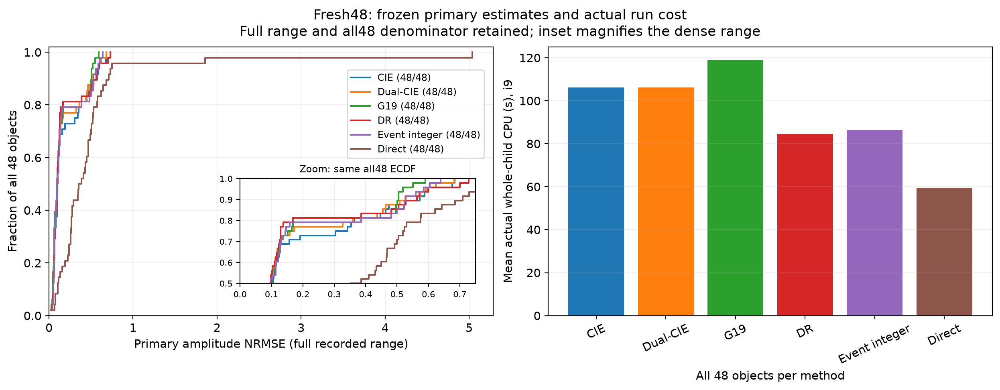
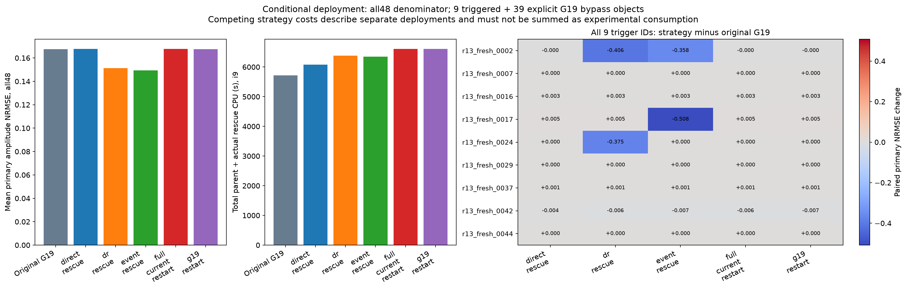

> **Completed follow-up, 2026-11-14:** [Paired A+48, neural-interface and dynamics addendum](supplement_aplus48/PAPER_ADDENDUM.md). A+ now covers all48 exposed objects; the frozen arc/guard readout retains recovery with lower cost. The original frozen manuscript below is preserved and must be read with this addendum, not used as the final complete A+ comparison.

# Constitutive Branch Accessibility in Maxwell Inversion: Finite Events, Reflected State Memory, and Paid Candidate Selection

**Research draft, 12 November 2026.** This manuscript reports completed finite-dimensional experiments and conditional results. It is not a claim of journal acceptance, a continuous-Maxwell uniqueness theorem, or a new globally convergent optimizer. All numerical tables below use sealed predictions; raw arrays and execution versions accompany the repository release.

## Abstract

High-contrast inverse scattering can fail despite flexible current representations, accurate physical derivatives, or low auxiliary objectives. We study branch accessibility in a shared-material field–current formulation of discretized Maxwell inversion. The constitutive projection admits an exact finite-event law along its normal ray. We distinguish exact closest-pair fast-forwarding, which follows the original Douglas–Rachford trajectory, from finite perturbations of approximate pairs, which may change accessible branches. A same-shadow counterexample and a Maxwell experiment show why a material shadow alone does not encode reflected state memory. We develop event proposals and compare them with ordinary reflection, alternating projections, matched random displacements, normal extrapolation, memory resets, mature CIE variants, Green-feedback material readout, and direct physical optimization. On 48 newly generated independent two-dimensional materials, ordinary reflection attains mean normalized material error 0.1767 at 84.5 mean process-CPU seconds, compared with 0.1798 at 106.3 seconds for Dual-CIE and 0.1676 at 119.1 seconds for G19. Integer events achieve 0.1815 and do not provide a general improvement over ordinary reflection. A registered noise-residual-triggered G19 rescue reduces the full-cohort error to 0.1514 with reflection and 0.1495 with events, but the gains are concentrated in different pairs of objects. Simpler post-hoc portfolios explain part of this complementarity. True vector-DDA inversion, measured Fresnel holdouts, and a classical Austria adaptation expose important model and discretization limits. The results support reflected-state memory and solver complementarity as useful mechanisms; they do not establish threshold events as a universally superior reconstruction method.

## 1. Introduction

The distinction between representing a physical state and reaching a useful material branch is consequential in nonlinear electromagnetic inversion. An expanded current space may reduce a constitutive profile penalty while changing continuation, conditioning, and the trajectory taken under a fixed computational allowance. Similarly, a more accurate update of a material block does not remove nonconvexity from the complete Maxwell map. An auxiliary optimizer can improve its own residual without producing a better material, and a physical corrector can reduce a data-plus-prior objective while moving away from the material that generated a measurement.

We investigate these distinctions through the propagation equation Q=Einc+GJ and a material relation J=Dm Q. A propagation–observation set and a shared-material constitutive set provide an alternative lifted geometry. Douglas–Rachford (DR) reflection maintains a state that need not itself be physical; its constitutive shadow can remain unchanged while normal memory accumulates. The practical question is whether this memory gives useful access to material branches missed by established current–material optimization, and whether an analytically predicted first material event offers more than an arbitrary finite perturbation.

Our contribution is a qualified mechanism study rather than a declaration of global convexification. We derive the bounded-real normal-ray event formula and its approximate-pair limitations, construct a same-shadow witness, audit the Maxwell dual-pressure connection, and perform fixed-cost recovery and representation controls. We also preserve raw and corrected materials to separate search, selection, and noise feasibility. The numerical contribution includes 48 fresh two-dimensional objects, a common 16-object mechanism subset, conditional rescue from actual G19 endpoints, completed native-schedule references on another host, genuine three-component vector inversion, and measured held-out data. Exposed development examples are reported separately.

## 2. Related work and scope of novelty

Contrast source inversion and CIE use auxiliary currents to balance data and constitutive constraints. The original NIE and CIE papers provide the inherited algorithmic context: [Zhong et al., NIE](https://doi.org/10.1109/TAP.2016.2535492), [Zhong and Xu, CIE-I](https://doi.org/10.3390/jimaging5020027). NFFT-SOM already motivates representations beyond truncated Fourier current spaces; releasing DPCS or Fourier constraints is therefore a control, not an invention here. Our NFFT-equations implementation is an adaptation of the joint equations and is explicitly not a completed reproduction of the original authors' optimizer.

Reflection algorithms, normal drift, and local bilinear projections have substantial prior art. In particular, [Elser, Learning without loss](https://doi.org/10.1186/s13663-021-00697-1) discusses RRR, bilinear local projections, and drift between inconsistent constraints. We do not claim those general mechanisms. DCTMC, WRI, CSI, ADMM and PADMM-CIE provide additional related splitting or lifted formulations. The detailed claim-by-claim ledger, verified citations and inaccessible full-text limitations are recorded in [PRIOR_ART_AND_NOVELTY](PRIOR_ART_AND_NOVELTY.md); inaccessible papers are not claimed as fully reproduced comparators.

The potentially useful distinction studied here is the exact bounded-material event geometry, its Maxwell pressure correction and its limited predictive relevance to reconstruction. A proof of a local projection event is not a proof of material recovery. We retain the negative comparisons that delimit this distinction. The same-shadow witness illustrates an existing memory principle in the present material setting; it is not a new continuous electromagnetic nonuniqueness result. Earlier project work already contains a genuine non-permutation material atlas in a different finite model.

## 3. Formulation, projection geometry and finite events

## Physical model and lifted geometry

We use the time convention \(\exp(-i\omega t)\) and reconstruct a real isotropic susceptibility \(m=\chi=\varepsilon_r-1\) within a prescribed box \([\ell,u]\), with \(0\leq\ell<u<\infty\). All sources, and all three field components in a vector cell, share one material value. The discrete equations are

\[
J=D_mQ,\qquad Q=E+sGX\;(J=sX),\qquad F(m)=SJ.
\]

Here \(J\) is a normalized contrast source, not an SI current measured in amperes. The scalar-TM disk-pulse VIE and vector CM+RR dyadic DDA retain their respective Green functions and self terms. Shared algebra does not identify their continuum errors. Source-dependent measured reception uses its actual block operator and adjoint; absent channels are not zero-filled.

For the scalar synthetic acquisition, the background wavelength is one, \(k=2\pi\), and the inverse region is a \(0.96\)-wavelength square discretized into \(24^2\) independent real materials. Six or twelve cylindrical line sources lie at radius \(1.4\), with incident field proportional to \((i/4)H_0^{(1)}\); these are not plane waves. Reception uses the declared full or partial aperture at radius \(1.1\). Classical plane-wave, vector-dipole and measured acquisitions remain separate physical contracts. The scalar synthetic host is \(m=0.1\), rather than vacuum support.

Fix \(s>0\) and equip \(z=(X,Q)\) with

\[
\|z\|^2=\|X\|_F^2+\|Q\|_F^2.
\]

The two constraint sets are

\[
\mathcal C=\{(X,Q):sX=D_mQ,\ m_i\in[\ell,u]\},
\quad
\mathcal A=\{(X,Q):Q=E+sGX,\ \|W(sSX-Y)\|_F\leq\delta\},
\]

where \(W\) is fixed and declared; the raw synthetic ball uses \(W=I\). The nonempty set \(\mathcal A\) is closed and convex, whereas \(\mathcal C\) is generally nonconvex. The common projection metric uses \(s=6\) in the stated experiments. Changing this scale changes the event geometry.

At cell \(i\), concatenate sources and vector components and realify complex entries, obtaining \(Z_i\in\mathbb R^{2\times d}\). With

\[
\theta=\arctan(m/s),\quad
u(\theta)=(\sin\theta,\cos\theta)^T,
\]

the material set is \(Z_i=u(\theta_i)v_i^T\). At fixed angle, the optimal amplitude is \(v_i^T=u(\theta_i)^TZ_i\). Thus material projection maximizes \(u(\theta)^TK_iu(\theta)\), where \(K_i=Z_iZ_i^T\), over the legal angle interval. Endpoints and stationary angles suffice; no angular grid search is required. This representation applies to bounded shared real materials, not arbitrary loss or anisotropic tensors.

## Finite events on a constitutive normal ray

Let \(c=P_{\mathcal C}(a)\), \(d=a-c\), and suppress a cell index. Amplitude stationarity gives \(u^Td=0\), so

\[
c=uv^T,\qquad d=u_\perp w^T,\qquad
a_0=\|v\|^2,\ b_0=\|w\|^2,\ \gamma=\langle v,w\rangle.
\]

For the ray \(c+td\), compare the current angle with a relative angle \(\phi\). Substitution of \(u(\theta+\phi)=u\cos\phi+u_\perp\sin\phi\) gives the exact projection-energy difference

\[
\Delta(\phi,t)=(t^2b_0-a_0)\sin^2\phi
                  +2t\gamma\sin\phi\cos\phi.
\tag{1}
\]

For an interior material, angle stationarity implies \(\gamma=0\). Since \(c\) is optimal at \(t=1\), \(a_0\geq b_0\). If \(b_0>0\), the first competition threshold is

\[
t^*=\sqrt{a_0/b_0}.
\tag{2}
\]

Before the threshold, every nonzero legal angle change has smaller energy. After it, the maximum is attained at a legal endpoint farthest from the current angle. Equal-distance endpoints and equality at the threshold may be tied; uniqueness is not asserted there.

At the lower endpoint, one-sided optimality gives \(\gamma\leq0\). For \(0<\phi\leq\phi_{\rm far}\),

\[
\frac{\Delta(\phi,t)}{\sin^2\phi}
=b_0t^2-a_0+2t\gamma\cot\phi.
\]

Because the legal interval has width less than \(\pi/2\), this expression is largest at the opposite endpoint. The upper-endpoint argument is analogous. The first boundary competition therefore solves

\[
b_0t^2+2\kappa t-a_0=0,
\qquad \kappa=\gamma\cot\phi_{\rm far}.
\tag{3}
\]

Its positive root is \((\sqrt{\kappa^2+a_0b_0}-\kappa)/b_0\); when cancellation is possible it is evaluated as \(a_0/(\sqrt{\kappa^2+a_0b_0}+\kappa)\). A zero \(b_0\) gives an infinite threshold, without an artificial denominator floor. Dark states, persistent ties and threshold equalities are recorded as degeneracies, not identifiable material events.

The first global event is \(\min_i t_i^*\). Its arithmetic requires field-energy contractions and a minimum, rather than a material Jacobian or Hessian. Obtaining the underlying projected state still costs propagation/data projections. This finite-dimensional law belongs to bounded bilinear projection geometry; it is not Maxwell-exclusive and does not identify a correct material branch.

Excluding dark cells, persistent symmetric ties and threshold equalities, the material readout is constant between consecutive distinct events on this ray, while the projected amplitudes are affine in t within a fixed material branch. This does not identify an interval of equivalent future reflection trajectories.

## Exact drift, approximate proposals and retained memory

Use the Douglas–Rachford map

\[
T=I+P_{\mathcal A}(2P_{\mathcal C}-I)-P_{\mathcal C}.
\]

Suppose \(a=P_{\mathcal A}(c)\), \(c=P_{\mathcal C}(a)\), and \(d=a-c\). While \(P_{\mathcal C}(c+td)=c\), convex normal-cone geometry gives \(P_{\mathcal A}(c-td)=a\), hence

\[
T(c+td)=c+(t+1)d.
\tag{4}
\]

Skipping repeated unchanged-shadow projections on this exact ray deletes redundant operations; it does not create additional recovery capability. Normal drift and discrepancy accumulation have established projection-method precedents, including [Elser's matrix-product formulation](https://arxiv.org/html/1601.01003v1).

For an approximate pair, let \(a\in\mathcal A\), \(c=P_{\mathcal C}(a)\), and \(e=P_{\mathcal A}(c)-a\). Put \(a'=a+e\). The normal-cone property yields

\[
P_{\mathcal A}\bigl(a'+(t+1)(c-a')\bigr)=a',\qquad t\geq0.
\]

Its argument equals \(c-td-te\). Nonexpansiveness of \(P_{\mathcal A}\) and the triangle inequality consequently bound the one-step deviation from (4) by \((t+1)\|e\|\), provided the same constitutive shadow is retained. This is not an unconditional multi-step trajectory or event-time bound. Fixed-branch nonexpansive arguments require the relevant iterates to remain in that branch; interior projection sensitivity can deteriorate as the Gram eigenvalue gap closes.

Finite AP preparation and a DR-state construction are therefore treated as distinct proposal mechanisms. The former applies a declared finite number of AP steps; the latter forms one \(\mathcal A\)-shadow from the current DR constitutive shadow. Neither asserts exact future fast-forwarding. Integer targets use the first integer strictly beyond the tie; fractional targets use a predeclared overshoot. Matched-norm random displacements, a same-direction \(t=2\) action, no-event shadow reset, physical-memory reset and Anderson controls isolate different effects. They do not inherit a convergence guarantee merely from their names. Established nonconvex projection convergence results require explicit regularity assumptions; see [Hesse and Luke](https://doi.org/10.1137/120902653).

If the initial physical state satisfies the legal constitutive constraint, \(z_0\in\mathcal C\), then AP and DR have the same first step:

\[
P_{\mathcal A}P_{\mathcal C}z_0=P_{\mathcal A}z_0=Tz_0.
\]

This equality does not extend automatically to subsequent iterates.

### An exact same-shadow counterexample

Identical material readouts do not generally define a closed reduced dynamical system. Consider the abstract real geometry

\[
s=1,\quad \mathcal C=\{(mv,v):0\leq m\leq1,\ v\in\mathbb R\},\quad
\mathcal A=\{(X,Q):Q=1-X,\ |X|\leq3\}.
\]

The coefficient \(G=-1\) here is abstract; it is not a Maxwell Hankel or dyadic self term. Take \(z_1=(-1,1)\), \(z_2=(-11/5,1)\). For \(z=(-a,1)\), projection energy is \((1-am)^2/(1+m^2)\). The endpoint energies are \((1,0)\) for \(a=1\), and \((1,18/25)\) for \(a=11/5\); an interior stationary point cannot improve them. Thus both have the strict identical full shadow \(P_{\mathcal C}z_j=(0,1)\).

The reflected states are \((a,1)\). Their projections onto the affine line are \((a/2,1-a/2)\), inside the segment. Consequently

\[
Tz_1=(-1/2,1/2),\qquad Tz_2=(-11/10,-1/10).
\]

The next material projections select respectively \(m=0\) and \(m=1\). Even an identical complete constitutive shadow cannot determine the next material readout. This counterexample concerns discarded state memory, not which branch is closer to truth, nor whether resetting memory is always harmful.

## A conditional state-ball branch bound

For a realified cell state \(Z\) and perturbation \(E\), assume \(\|E\|_F\leq r\). Expanding the Gram product gives

\[
\|(Z+E)(Z+E)^T-ZZ^T\|_2
\leq2\|Z\|_Fr+r^2=\rho.
\]

For any closed legal angle interval \(I\), define \(h_I(K)=\max_{\theta\in I}u(\theta)^TKu(\theta)\). Unit-length \(u\) implies \(|h_I(K+\Delta K)-h_I(K)|\leq\|\Delta K\|_2\). Split the legal angle interval into low/high halves and let \(M=h_H-h_L\). Then

\[
|M(Z+E)-M(Z)|\leq2\rho.
\tag{5}
\]

If \(M>2\rho\), every optimal projection in that state ball lies outside the low half; the opposite sign excludes the high half. Strictness also excludes a midpoint-only tie. If \(r\) is an observed deviation between actual DR and a reference ray, this is an a posterior branch certificate. Without a valid future radius bound it is not a future-event certificate. An inconclusive margin remains inconclusive.

## Maxwell-specific dual pressure and its approximate-pair correction

Let \(A_m=I-D_mG\) be invertible. Assume exact amplitude stationarity for \(P_{\mathcal C}\), compatible propagation, a positive-radius ball satisfying Slater's condition on the propagation graph, and a valid finite multiplier \(\lambda\) for the half-squared ball constraint. For \(a'=P_{\mathcal A}(c)=a+e\), define

\[
r'=W(sSa'_X-Y),\qquad
p'=A_m^{-*}S^*W^*r'.
\]

Propagation gives \(e_Q=sGe_X\), while constitutive amplitude normality gives \(d_Q=-D_{m/s}d_X\). Projection KKT acts on \(d+e\):

\[
d_X+e_X+sG^*(d_Q+e_Q)+\lambda sS^*W^*r'=0.
\]

Therefore

\[
\boxed{d_X+\lambda sp'
=-A_m^{-*}(e_X+sG^*e_Q)
=-A_m^{-*}(I+s^2G^*G)e_X.}
\tag{6}
\]

For an exact pair, \(e=0\), this reduces to \(d_X=-\lambda sp\), \(d_Q=\lambda D_mp\). At a nondegenerate interior event,

\[
t_i^*=\frac{\|Q_{c,i}\|}{\lambda s\|p_i\|}.
\]

These are auxiliary residual-adjoint fields, not truth fields. Invertibility and \(\lambda=0\) imply zero exact gap. Zero-radius, unreachable or non-Slater limits and singular Maxwell matrices require separate treatment.

For approximate pairs, scalar \(\|e\|/\|d\|\) omits the directional resolvent action in (6). A retained material LU can apply \(A_m^{-*}\) to the receiver and correction RHS in one batch. The resulting directional gain is neither an operator-norm certificate nor a recovery guarantee. Receiver-Gram and adjoint representations also arise in established extended-field elimination; see [van Leeuwen and Yang](https://arxiv.org/html/2403.15292v2).

The Q-component correction is \(d_Q-\lambda D_mp'=-D_{m/s}(d_X+\lambda sp')\). Diagnostics use the actual finite multiplier returned by the data-ball projection, not a coefficient fitted to the gap. A bound on \(\|A_m^{-*}[I,sG^*]\|\), if independently justified, would control this correction by \(\|e\|\); measuring its action on one RHS does not supply that bound.

## Fixed-current profiles and baseline distinctions

Fix one explicitly specified single-\(\beta\) current block \(\tfrac12\|C_mJ-b_m\|^2\), with full-column-rank \(C_m\). If \(J^*\) is its unrestricted minimizer, the normal equations eliminate the cross term, giving, for an affine current family \(\mathcal V\),

\[
\varphi_{\mathcal V}(m)=\varphi_{\rm full}(m)
+\tfrac12\operatorname{dist}_{C_m^*C_m}^2(J^*(m),\mathcal V).
\tag{7}
\]

A common material prior adds equally to both sides. The representation penalty depends on m and differs from an initial Euclidean current-projection loss. Equation (7) concerns that fixed block, not a common Lyapunov function for an entire dual-\(\beta\) G19 trajectory.

The matched G19 controls retain its PR current loop, material denominator/readout, prior and beta schedule, changing only \(JD+PF_{\rm mf}\alpha\), full APCS \(JD+PF_{\rm full}\alpha\), or full current \(JD+F_{\rm full}\alpha\). On \(24^2\), the original final mf12 already spans full APCS. Early truncation, final capacity and fixed DPCS must be separated. Independent real current capacity is \(2n_s\operatorname{rank}(PF_{\rm mf})\), not the redundant coefficient count; material capacity remains N.

CIE/Dual-CIE retain the declared real-material/common-prior adaptations of [the contraction-integral formulation](https://doi.org/10.3390/jimaging5020027). A global PR coefficient in Dual-CIE is distinct from **physical GlobalDual**, which optimizes the material-only total-field source-Gram objective at \(\beta=0\); \(\beta=.2\) denotes a different feedback variant. Full-J TRF uses the inherited physical residual/Jacobian with \(x_{\rm scale}=\mathrm{jac}\), whereas physical L-BFGS-B uses the inherited analytic gradient. For scalar prior edges \(d\), \(q=\sqrt{d^2+\epsilon^2}\), the prior residual \([\sqrt{2\alpha/M}d;\sqrt{2\eta/M}d/\sqrt{q+\epsilon}]\) has half-squared norm equal to \(\alpha\operatorname{mean}(d^2)+\eta\operatorname{mean}(q-\epsilon)\). This verifies the residual objective, not an exact nonlinear Hessian.

For the scalar native schedule, masks mf3/6/10/12 permit 500/500/500/1500 updates. Single-beta CIE uses current/material beta1/.2/.2/.2; Dual-CIE retains current beta1 while changing material beta. CIE/Dual/A+ initialize zero APCS coefficients above JD. The G19 controls project the same initial physical current into their respective admissible families. Material variables are not reduced by the current basis. Setup and warm-projection costs are charged.

More explicitly, physical GlobalDual uses

\[
F_{\rm GD}(m)=\frac{c_0}{2}\operatorname{tr}\!\left[
\mathcal E(Q^*Q)^{-1}\mathcal E^*\right]+R(m),\qquad
\mathcal E=F(m)-Y,
\]

where \(c_0=\|Q_{\rm ref}\|_F^2/(n_s\|Y\|_F^2)\) and the reference is fixed. Under the declared uniform0.1 initialization, it matches the historical uniform reference. Its analytic derivative includes the changing Gram; it is not ordinary LS with a frozen weight. TRF and physical L-BFGS-B instead optimize the original physical objective through different numerical models. Finite CPU caps can truncate any native schedule, so configured iterations are not completed iterations.

The complete-current NFFT-equations control uses ordinary LSIE, \(JD+F\alpha\), data weights \(1/\|Y_s\|^2\), state weights \(1/\|JD_s\|^2\), the declared prior/box and joint L-BFGS-B. It is explicitly an adaptation of [Wei–Chen's equations](https://usncursi.org/archive/aps-ursi/2018/papers/1927.pdf), **not an original NFFT-SOM author-algorithm reproduction**.

Its joint objective is \(\sum_s[\|SJ_s-Y_s\|^2/\|Y_s\|^2+\|J_s-m(E_s+GJ_s)\|^2/\|JD_s\|^2]+R(m)\), without half factors. Zero initial correction means J=JD, not zero current. Complete unitary Fourier and spatial-correction coordinates share the global Euclidean metric; no current/material rescaling is introduced. This normalization and optimizer must not be silently equated with the CIE current block or the underspecified original conference algorithm.

These GlobalDual, NFFT-equations and TRF control specifications concern the common-port real scalar implementation; vector and measured models retain their separately qualified interfaces.

## Paid audits, correction and provenance

Online methods use only public inputs and frozen configurations. Raw materials undergo the original physical audit. The primary estimator minimizes paid, legal, in-budget \(\Phi=D+R\); the secondary minimizes R among discrepancy-feasible candidates, with absence reported and primary fallback distinguished. Raw, corrected and primary are retained separately. The common corrector optimizes the same physical objective; lower Phi does not imply lower material error.

Synthetic circular-complex noise uses \(\delta=\sigma\sqrt{\chi^2_{2d_{\rm obs}}(.99)/2}\), where \(d_{\rm obs}\) is the number of effective complex observation channels. Cross-grid error is outside this noise model. Measured/classical diagnostic balls are not relabeled CN probability certificates. Scalar and vector physical objectives retain their different inherited normalizations.

Proposal audits follow declared absolute process-CPU buckets after completed updates, preserving and charging native audits. Physical optimizer trials already paid for forward evaluation remain eligible. Atomic operations can overshoot; spent work is counted and late candidates excluded. Prefix selection cannot use future candidates or truth. CPU, wall time, LU/RHS, projection factors, FFT/Gram work, setup and failures remain separate; hosts are not pooled into a fictitious speedup. Source shipping/config references are distinguished, missing costs remain unknown, and truth scoring follows completed-queue prediction sealing.

Archives contain the material candidate pool, audit metadata and selected physical field snapshots. They do not contain every CIE/G19 auxiliary state or PR restart vector. Separate profile/short-state diagnostics do not fill that gap or establish exact optimizer continuation. These coverage limits accompany any subsequent interpretation.

## 4. Experimental protocol

### 4.1 Provenance, data access, and selection

All new algorithms, principal parameters, acquisition rules and budgets were frozen before fresh material scoring. The independent two-dimensional cohort contains 48 material objects with 576 independent real material unknowns per inverse problem. The common 16-object subset is not another set of independent materials. Different methods, initializations and noise views of one object are not statistical replicates. Truth was kept separate from public observations. Joint authorization followed complete prediction seals and public retention-policy indices. The scorer and post-hoc diagnostic analysis never change the primary candidate references.

The deployed primary is the minimum original physical Phi=D+R among legal, completed, paid, in-budget candidates. Auxiliary objectives, shadow gap and material error are not used in online selection. Secondary minimum-prior feasible selection and minimum-change retention have separate meanings. No new binary success threshold is introduced after inspecting scores. NRMSE, IoU, data feasibility, topology and amplitude are all reported rather than collapsed into a single recovery count.

### 4.2 Compute and baselines

The principal i9 comparison has a 120-second whole-process CPU allowance, with at most 72 seconds for proposal and 48 seconds for the shared original-Maxwell corrector. Direct optimization uses the full allowance. Native audits are retained, and a public CPU-bucket schedule adds paid physical audits. An indivisible operation may finish after the deadline; its cost is charged and its late candidate excluded from earlier prefixes. Actual mean costs differ because methods may terminate early. Fixed background factorizations, triangular solves, Green actions, port actions, and FFT work are included in process CPU, with separate operator counters.

We preserve mature sourcewise CIE and Dual-CIE, global-PR Dual-CIE, A+, and G19. The last is the project's Green-feedback material algorithm derived from CIE. The label global_dual denotes global-PR Dual-CIE; physical_globaldual instead denotes a total-field source-Gram physical objective with its material derivative. These are not interchangeable. CIE/Dual and A+ use inherited cold coefficient starts; G19 uses its inherited legal current least-squares start. A common material does not imply a common auxiliary state.

In the principal 48 cases, CIE completes its native 3000 steps on 46 objects and Dual on all 48, whereas G19 completes on only one. Full-APCS/current G19 each complete on two. DR and the frozen integer-event schedules complete on all 48. To separate this budget issue, a pre-scoring-frozen M4 reference runs the same 16-object subset with a 360-second allowance; every CIE/Dual/G19 native schedule completes. Hardware and NumPy/SciPy versions differ, so cross-host differences are not treated as a pure budget effect. Full-J TRF uses the inherited analytic physical Jacobian and common prior residual, not a weakened first-order proxy.

## 5. Results

### 5.1 Fresh two-dimensional materials

|Method|Mean NRMSE|Median NRMSE|Mean IoU|Noise-feasible /48|Mean actual CPU, s|
|---|---:|---:|---:|---:|---:|
|CIE|0.19454|0.10279|0.69456|35|106.15|
|Dual-CIE|0.17985|0.09731|0.71592|37|106.26|
|G19|0.16758|0.10108|0.68577|39|119.08|
|G19, full APCS|0.29235|0.13189|0.52682|27|117.24|
|G19, full current|0.30985|0.27012|0.48188|24|115.86|
|DR|0.17672|0.09818|0.68726|39|84.50|
|Integer event|0.18149|0.09596|0.66314|38|86.33|
|Matched random integer displacement|0.19840|0.10040|0.65012|36|84.50|
|Direct L-BFGS-B|0.49491|0.36858|0.28438|9|59.46|

G19 has the lowest primary mean error in this principal comparison, while DR uses less process CPU and has comparable mean error to Dual-CIE. These are conditional advantages, not a uniform ordering. On object 0002, DR and events recover a connected bent body while CIE/Dual/G19 produce wrong fragments. On 0031 the converse occurs: CIE/Dual/G19 have NRMSE around 0.026–0.027, while DR and events remain near 0.386. Direct optimization uniquely recovers the C-shaped 0007 well, despite its poorer overall mean. All 48 materials, including common failures, are shown in the linked galleries.

Thirty-six objects use a matched grid and twelve a different generating discretization. Mean CIE/Dual/G19/DR NRMSE is 0.21391/0.19437/0.17334/0.19979 in the former and 0.13643/0.13628/0.15029/0.10751 in the latter. Acquisition and material conditions also vary between these groups; the split is not a controlled causal estimate of discretization alone. The coarse truth is inside the declared CN99 ball on all 36 matched objects and outside on all 12 cross-grid objects. We retain the original noise bound and report this model discrepancy rather than tuning the ball after observing scores.

Higher current capacity is not sufficient. On a 24-square grid the final mf12 space already spans full APCS, so full capacity from the beginning additionally changes continuation and per-step cost. The full-current results cannot be interpreted as an intrinsic theorem against larger spaces. The independent native-schedule M4 reference gives mean errors CIE 0.14521, Dual 0.12464, G19 0.13737 and DR 0.11509, while direct, physical GlobalDual and Full-J TRF give 0.41081, 0.36171 and 0.37670. This supports the importance of trajectory, while leaving convergence and hardware confounds explicit.

### 5.2 Events versus simple alternatives

In the common 16 objects, DR, integer events and matched integer-random displacements have mean errors 0.12313, 0.12189 and 0.15973. AP and depth-one Anderson give 0.36214 and 0.36155. However, the more directly controlled online fractional-event experiment yields 0.12352, compared with 0.12392 for matched random perturbation, 0.12290 for normal doubling, 0.11979 for a no-event A-shadow reset, and 0.12146 for physical-memory reset. Descriptive paired bootstrap intervals do not isolate a reliable threshold-specific gain. Random comparisons use one fixed seed, not an exhaustive random-search baseline.

An exposed old object gives a stronger but narrower mechanism observation. DR128 followed by an A-shadow and a first-event perturbation changes the outcome from approximately 0.366 to 0.099 NRMSE. A nearby interval midpoint fails, although the material shadows of the two starts agree to about 1e-13. Their full auxiliary states differ by only about 0.0552%. This is evidence of state-memory-sensitive branch accessibility, not a robust reconstruction guarantee. The pair defect relative to gap is about 0.606, so the example is not exact AP fast-forwarding.

### 5.3 Registered rescue from actual G19 endpoints

The public G19 residual triggers nine rescues and bypasses 39 materials. Every strategy retains all 48 objects in the denominator and pays the full parent computation. Restarted methods use the same initial material; full optimizer histories are not claimed to be restored.

|All-48 deployment|Mean NRMSE|Parent plus rescue CPU, s|
|---|---:|---:|
|G19 parent|0.16758|5716.00|
|G19 restart|0.16762|6605.63|
|Full-current G19 restart|0.16763|6607.55|
|Direct continuation|0.16769|6082.75|
|DR rescue|0.15135|6385.66|
|Event rescue|0.14947|6349.20|

DR substantially rescues 0002 and 0024; events rescue 0002 and 0017. Thus the strategies do not merely reproduce the same two successes. The mean improvements are concentrated, with descriptive bootstrap intervals extending very slightly across zero. This does not erase the observable conditional rescues, but it limits population-wide claims and event attribution. The rescue design lacks an AP-to-DR or matched-random rescue arm, so its event gain cannot be uniquely assigned to the threshold.

We additionally disclose an unfrozen, post-scoring counterfactual using already paid uniform-start DR runs. Applying an identical public outside-ball trigger to each of CIE, Dual and G19 and selecting by original Phi gives mean errors 0.13377, 0.13317 and 0.14803, with process-CPU sums 6197.83, 6035.80 and 6492.72 seconds. All three alternatives are reported. They were not executed as new conditional queues, their end-to-end deployment wall time is unmeasured, and none is promoted to a confirmed new winner. They demonstrate that ordinary solver complementarity can explain or exceed some proposed hybrid gains without finite-event prediction.

### 5.4 A+, neural initialization and physical correction

On the prespecified 16 objects A+ gives mean NRMSE 0.10966 at 120.39 mean actual CPU seconds, a positive result that should not be hidden by the reflection narrative. It has not been run across all 48 in this study. The frozen 24,737-parameter R8 initializer reduces mean error by 0.00377 for DR, 0.02352 for G19 and 0.13743 for direct. Paired 95% bootstrap intervals are [-0.01154,0.00197], [-0.07238,0.00355] and [-0.24451,-0.04010]. It clearly helps direct in this cohort; the extra effect for DR/G19 is smaller and uncertain. Training provides additional prior information. Historical training expense is unknown, so a fully amortized neural speedup is not claimed.

The shared corrector changes all-48 raw-to-corrected mean error as follows: CIE 0.19148 to 0.19454; Dual 0.18295 to 0.17985; G19 0.20908 to 0.16758; DR 0.20067 to 0.17672; integer events 0.21822 to 0.18149. It helps several methods on average and harms individual materials. Per-object error decreases/increases are 33/15 for CIE, 35/13 for Dual, 39/9 for G19, 40/8 for DR and 41/7 for events, all with denominator 48. Direct raw denotes initialization, so its corresponding change is not a shared-corrector harm count. Minimum-change-to-raw retention among paid feasible candidates worsens G19/DR/event means to 0.19184/0.20747/0.22374. Therefore preservation is a preference, not an automatic remedy for correction damage.

A fixed post-seal stationarity diagnostic evaluates 400 endpoint references, corresponding to 393 distinct materials and 393 physical LU factorizations. Several poor materials have small box-gradient mappings. This supports the inadequacy of simple continuation in some cases, but no Hessian or strict-local-minimum certificate was computed. Paid-pool truth oracles are explicitly offline diagnostics; they do not define a deployable selection rule.

### 5.5 Vector Maxwell, classical and measured data

The vector study uses a coupled dyadic TensorDDA with three current components and one shared scalar material per cell: 216 real unknowns, 648 complex current rows per source, 60 exterior dipole sources and 180 receiver channels. Three new geometries include an open frame, unequal coupled blocks and a mixed-contrast bracket; a fourth condition uses 8-cubed generation and 6-cubed inversion. This is not a scalar slice stack.

For the matched frame, mean material NRMSE is 0.28080 for CIE, 0.25368 for Dual, 0.28776 for DR and 0.22223 for integer events. The event result still fills the intended cavity and slit; lower error is not topological success. Coupled-block and bracket results retain main layouts at errors around 0.09 and 0.07, but underestimate high-contrast amplitudes. All primary noise-only residual ratios exceed one. An analytic Mie sphere check at relative permittivity nine gives far-field discrepancies of 9.02% and 7.06% on the two finer validation grids; volume-average field discrepancies remain 19.76% and 16.93%. Cross-grid frame mismatch is 8.01%, above the 1% simulated noise. These are finite-DDA mechanism results, not high-accuracy continuous 3D recovery certificates.

The Austria adaptation uses 400 MHz, a two-metre square ROI, 20 plane waves, 40 receivers, and contrast three, with matched32 and 150-to32 generation. It differs from the original inverse grid and regularization contract. Matched CIE/Dual/G19 errors are 0.4913/0.4915/0.3983, whereas DR/events are substantially worse. CIE/Dual preserve recognizable object layout despite amplitude error. The cross-grid coarse truth has a 22.53% residual against a 12% diagnostic discrepancy ball. The experiment neither reproduces the original authors' complete result nor supports a universal reflection advantage.

For two actual Fresnel specimens at 2 GHz, source-specific operators and empty-target order-two multipole calibration are retained. There are 1053 training and 711 held-out measurements. Corrected primary holdout relative errors are approximately 9.15% and 9.86%, with closely agreeing methods. Raw DR holdouts are approximately 10.12% and 11.17%; correction improves prediction here. Receiving-horn response and full noise covariance remain imperfectly characterized, and the 15% discrepancy allowance is not a CN99 certificate. No pixel truth NRMSE or IoU is fabricated. There is no demonstrated final event/DR superiority on these measurements.

## 6. Discussion

The useful structural lesson is that the accessible material branch depends on more than the material itself. A legal physical material, a restricted auxiliary representation and a reflected state can have different subsequent dynamics even when their material shadows coincide. The normal-ray law makes a local branch competition explicit, but its threshold does not encode which branch best explains the material. Approximate propagation defects are filtered by a Maxwell resolvent, so a small scalar gap ratio alone is inadequate for a robust event certificate.

Current representation, optimizer geometry and candidate selection remain distinct interventions. Full current reduces a profile restriction but can remove favorable continuation and consume more of a fixed CPU allowance. A+ changes auxiliary material readout and cannot be reduced to a harmless coordinate relabeling. DR retains nonphysical state memory and can escape some G19 endpoints, but it does not repair an already feasible wrong material automatically. Uniform-start DR portfolios further show that a change of solver and trajectory may explain recovery gains without a threshold mechanism.

A method need not win on every object to be useful. The observed DR rescues, G19 mean improvement, A+ subset advantage and direct-only positive cases are all scientifically meaningful. The constraint is attribution: conditional benefits cannot be elevated to universal convergence, physical residual cannot stand in for material accuracy, and post-hoc portfolios cannot be rebranded as fresh confirmation.

## 7. Limitations, costs and reproducibility

There are 962 canonical method runs, not 962 materials. Reused subsets, host references and recovery aliases are identified. Known online process CPU totals are 80,241.94 seconds on i9 and 3,995.17 seconds on Apple M4, with additional setup, validation, scoring, transfer and publication expenses recorded separately. This is not parallel elapsed time. No R13 GPU compute or training was used. Four interrupted partial attempts and several early setup costs are not fully measurable and remain unknown. Old neural training cost and model-call monetary cost are unavailable.

Native PR history and every auxiliary current were not saved; material pools and selected physical states cannot reconstruct a seamless optimizer continuation. Forty-two initial physics jobs failed before model creation due to a missing inherited namespace; a separate unchanged-source dependency runtime completed all 42, with both attempts retained. Grid discrepancy limits the 3D and classical claims. The measured-data protocol uses a model discrepancy allowance rather than a proven stochastic operator error bound. The joint NFFT-equations adaptation is not a mature-author implementation. Detailed commands, sources, raw arrays, seals and these failures are supplied in [REPRODUCE](REPRODUCE.md), [ARTIFACTS](ARTIFACTS.md), [COST_LEDGER](COST_LEDGER.md) and [FAILURES](FAILURES.md).

## 8. Conclusion

Finite normal-ray events are analytically meaningful and can explain constitutive branch changes, but they do not yet provide a uniquely effective reconstruction algorithm. Reflected full-state memory offers useful branch access in selected high-contrast Maxwell problems, and registered G19 rescue demonstrates a real conditional recovery benefit. Larger current spaces, lower physical objectives and feasible noise residuals each fail as universal proxies for material quality. The most economical next hypothesis is a freshly frozen, residual-triggered portfolio of mature current optimization and ordinary reflection, while theory should target resolvent-controlled event uncertainty rather than event occurrence alone. No such next-round claim is presented as already confirmed here.
