# combined · 实际图集

[R13首页](../../index.html) · [HTML图集](GALLERY.html)

仅列出实际生成附件；不以运行状态或图名推断科学结论。

[紧凑全对象复核表](../review_tables/README.md)

[REPORT.md](REPORT.md)

## 本组图

### cost_material_conditional_deployment48_i9_remote_scalar_tm_2d_fresh48_independent

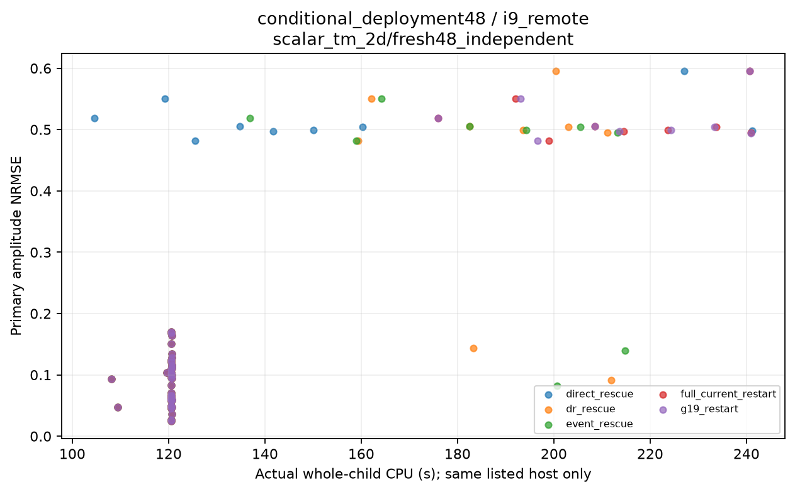

[PDF](FIGURES/cost_material_conditional_deployment48_i9_remote_scalar_tm_2d_fresh48_independent.pdf)

### cost_material_confirmation_core48_i9_remote_scalar_tm_2d_fresh48_independent

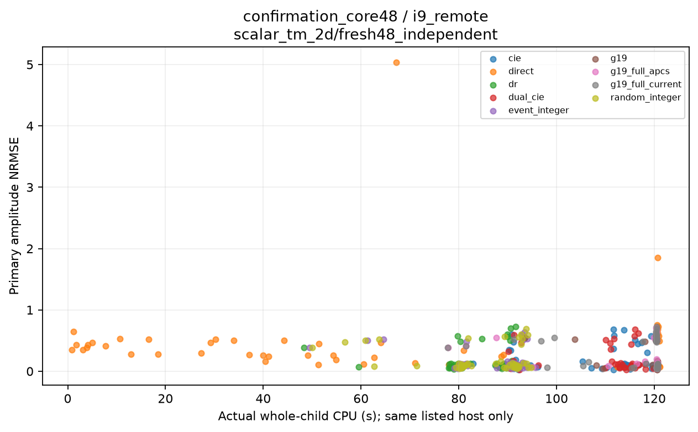

[PDF](FIGURES/cost_material_confirmation_core48_i9_remote_scalar_tm_2d_fresh48_independent.pdf)

### cost_material_confirmation_local_reference16_Apple_local_scalar_tm_2d_local_full_schedule16

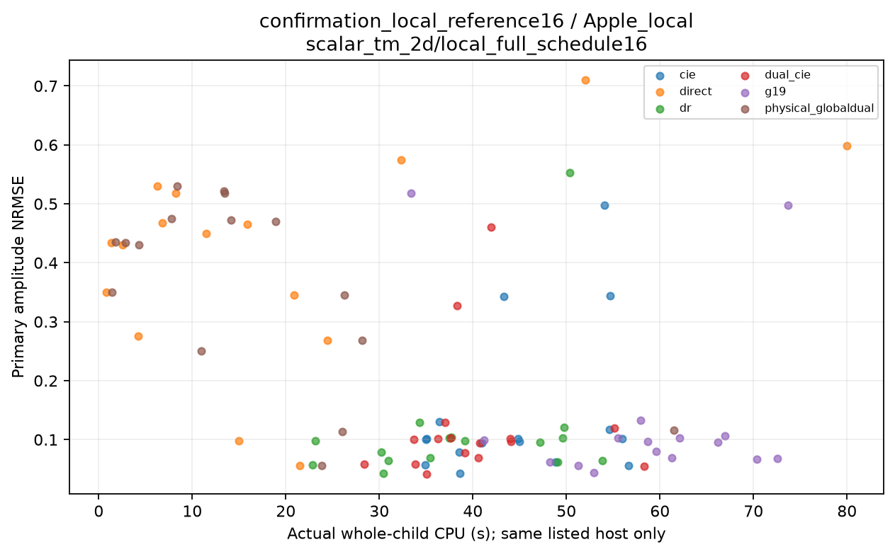

[PDF](FIGURES/cost_material_confirmation_local_reference16_Apple_local_scalar_tm_2d_local_full_schedule16.pdf)

### cost_material_confirmation_local_trf16_Apple_local_scalar_tm_2d_exposed_TRF_diagnostic

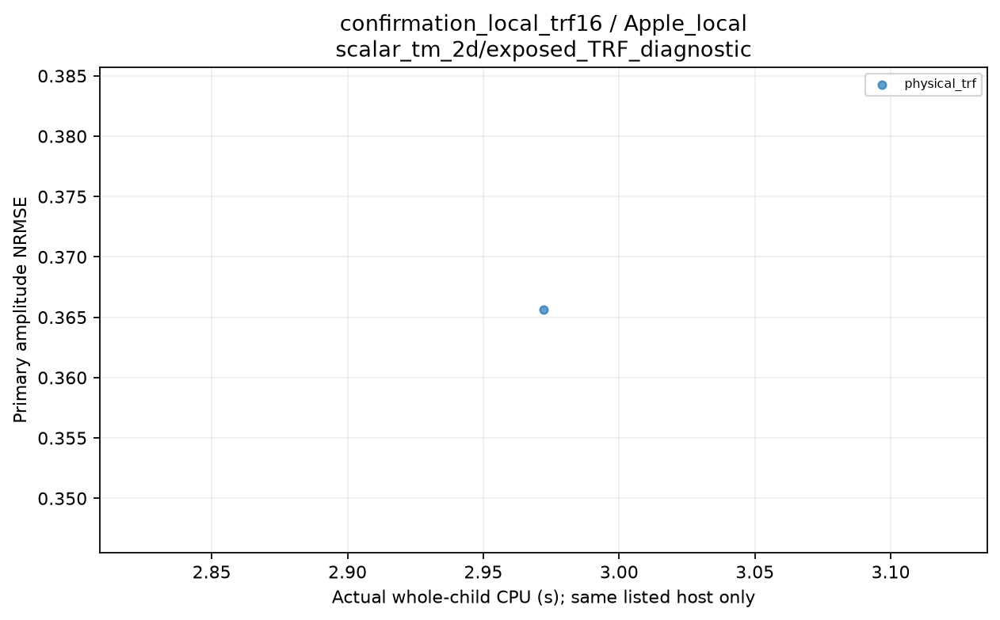

[PDF](FIGURES/cost_material_confirmation_local_trf16_Apple_local_scalar_tm_2d_exposed_TRF_diagnostic.pdf)

### cost_material_confirmation_local_trf16_Apple_local_scalar_tm_2d_local_full_schedule16

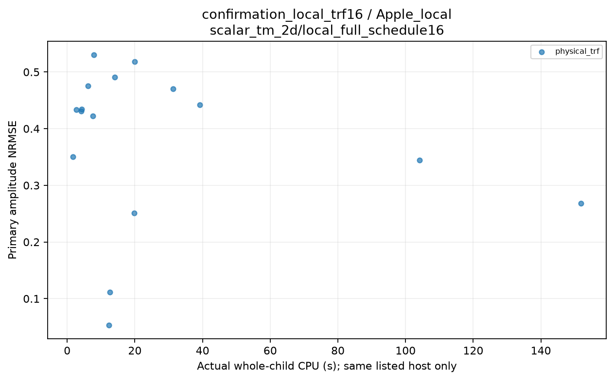

[PDF](FIGURES/cost_material_confirmation_local_trf16_Apple_local_scalar_tm_2d_local_full_schedule16.pdf)

### cost_material_confirmation_mechanism16_i9_remote_scalar_tm_2d_predeclared_every_third_ID16

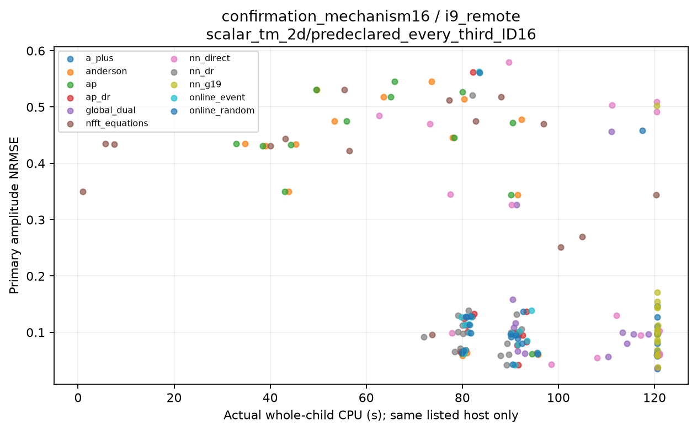

[PDF](FIGURES/cost_material_confirmation_mechanism16_i9_remote_scalar_tm_2d_predeclared_every_third_ID16.pdf)

### cost_material_confirmation_online_controls16_i9_remote_scalar_tm_2d_predeclared_same_ID16_additive_controls

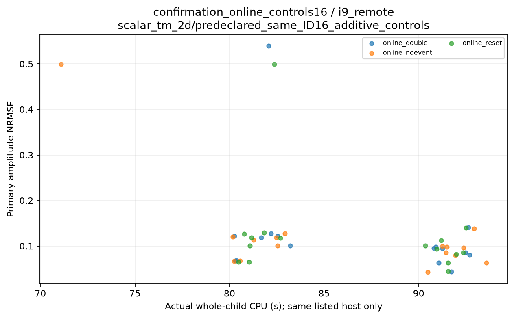

[PDF](FIGURES/cost_material_confirmation_online_controls16_i9_remote_scalar_tm_2d_predeclared_same_ID16_additive_controls.pdf)

### cost_material_confirmation_rescue48_i9_remote_scalar_tm_2d_fresh48_conditional_rescue

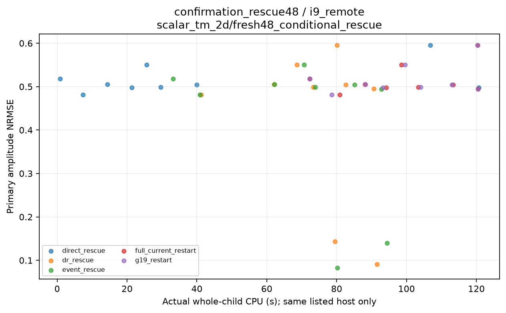

[PDF](FIGURES/cost_material_confirmation_rescue48_i9_remote_scalar_tm_2d_fresh48_conditional_rescue.pdf)

### cost_material_local_reference_common16_Apple_local_scalar_tm_2d_local_reference_common16

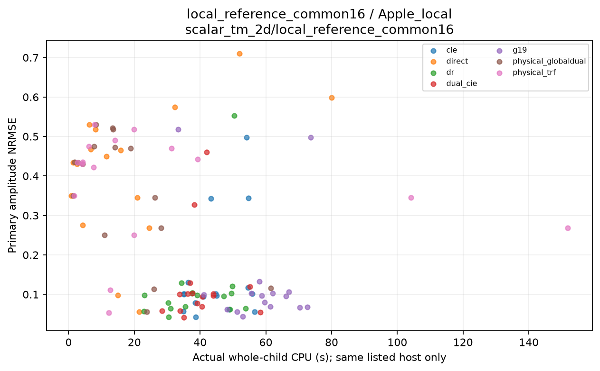

[PDF](FIGURES/cost_material_local_reference_common16_Apple_local_scalar_tm_2d_local_reference_common16.pdf)

### cost_material_physics_v1_i9_remote_classic_classic

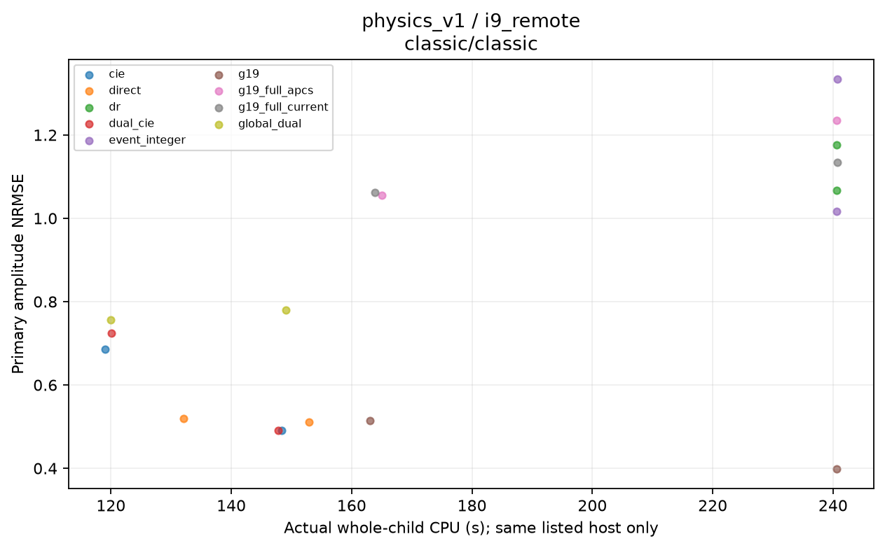

[PDF](FIGURES/cost_material_physics_v1_i9_remote_classic_classic.pdf)

### cost_material_physics_v1_i9_remote_vector3d_vector3d

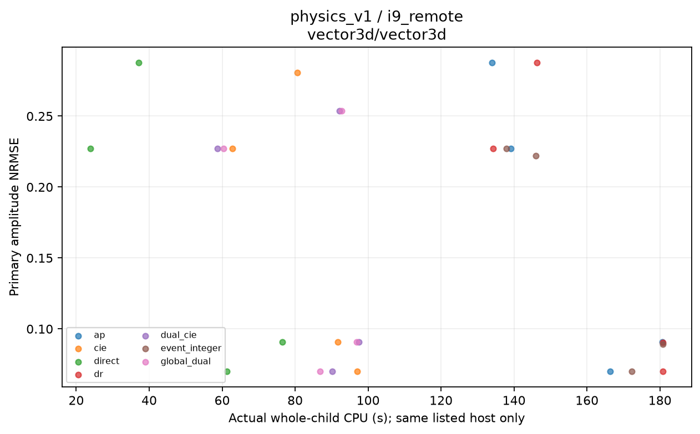

[PDF](FIGURES/cost_material_physics_v1_i9_remote_vector3d_vector3d.pdf)

### paired_changes_NN_common_predeclared16_01

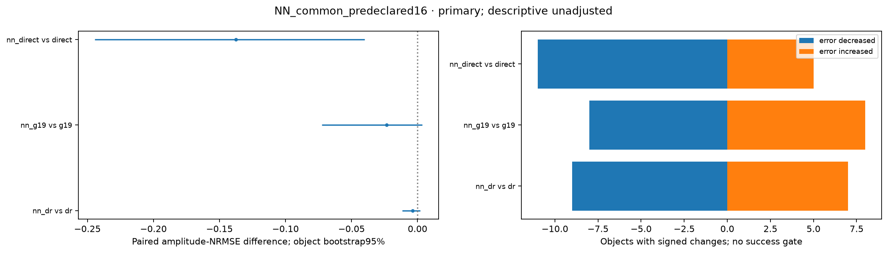

[PDF](FIGURES/paired_changes_NN_common_predeclared16_01.pdf)

### paired_changes_conditional_ALL48_vs_original_g19_01

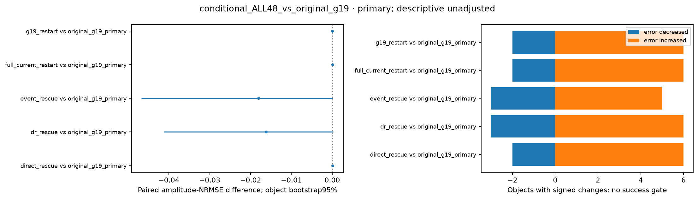

[PDF](FIGURES/paired_changes_conditional_ALL48_vs_original_g19_01.pdf)

### paired_changes_conditional_deployment48_scalar_tm_2d_fresh48_independent_01

[PDF](FIGURES/paired_changes_conditional_deployment48_scalar_tm_2d_fresh48_independent_01.pdf)

### paired_changes_confirmation_core48_scalar_tm_2d_fresh48_independent_01

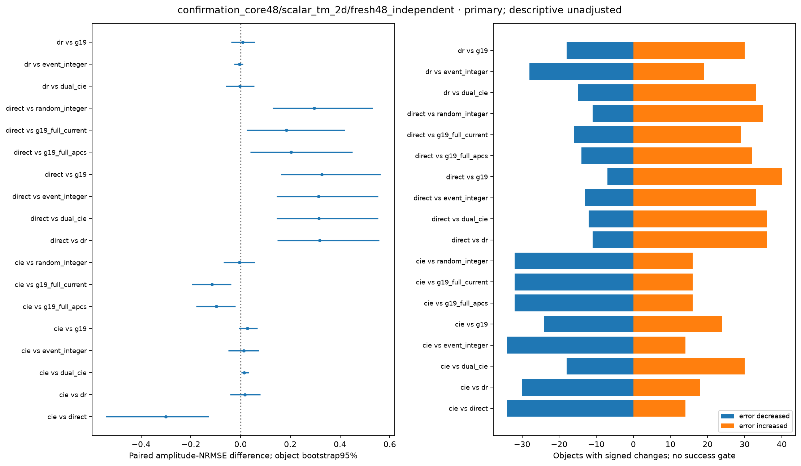

[PDF](FIGURES/paired_changes_confirmation_core48_scalar_tm_2d_fresh48_independent_01.pdf)

### paired_changes_confirmation_core48_scalar_tm_2d_fresh48_independent_02

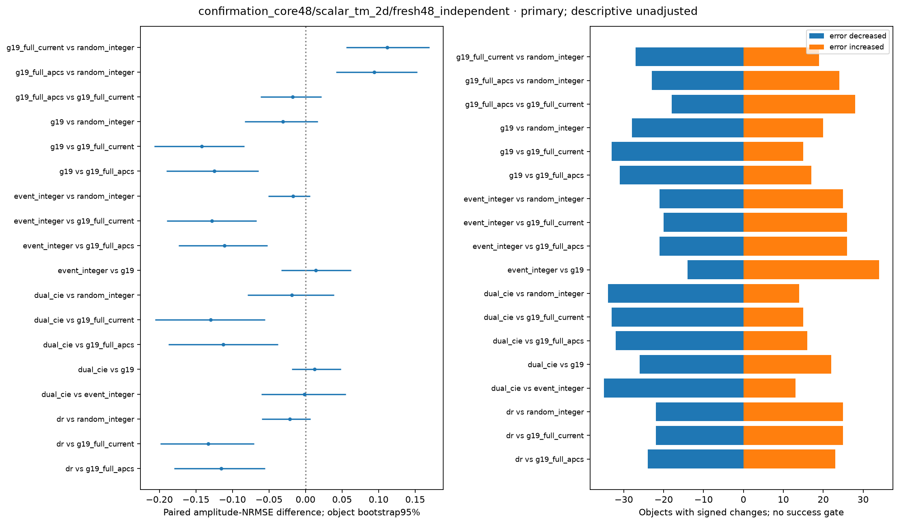

[PDF](FIGURES/paired_changes_confirmation_core48_scalar_tm_2d_fresh48_independent_02.pdf)

### paired_changes_confirmation_local_reference16_scalar_tm_2d_local_full_schedule16_01

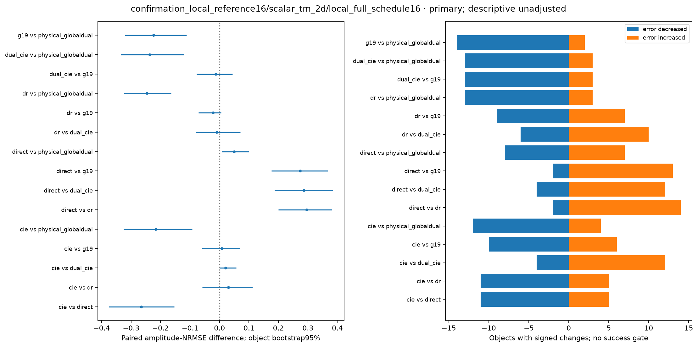

[PDF](FIGURES/paired_changes_confirmation_local_reference16_scalar_tm_2d_local_full_schedule16_01.pdf)

### paired_changes_confirmation_mechanism16_scalar_tm_2d_predeclared_every_third_ID16_01

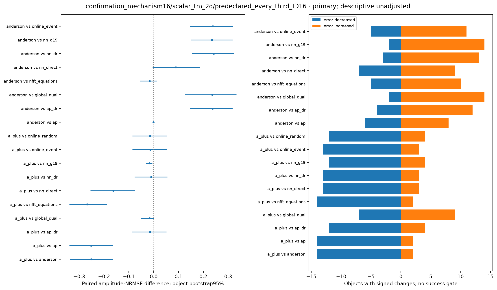

[PDF](FIGURES/paired_changes_confirmation_mechanism16_scalar_tm_2d_predeclared_every_third_ID16_01.pdf)

### paired_changes_confirmation_mechanism16_scalar_tm_2d_predeclared_every_third_ID16_02

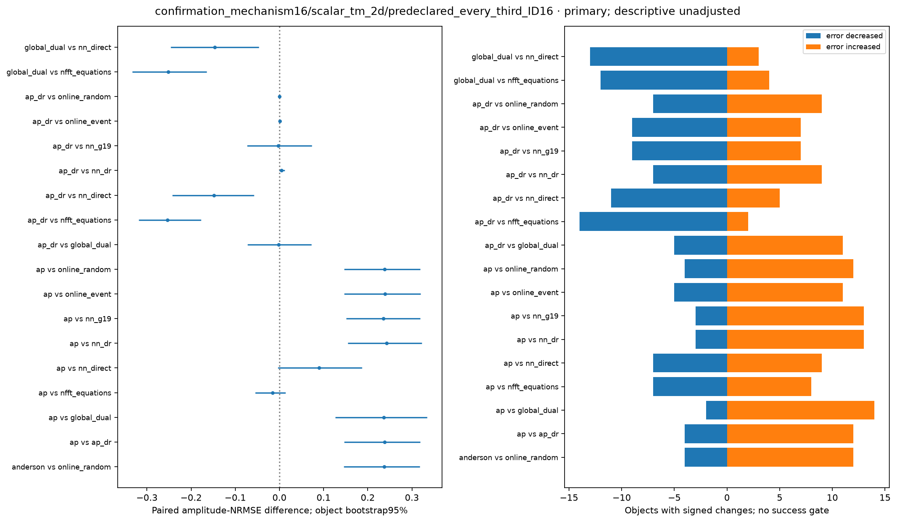

[PDF](FIGURES/paired_changes_confirmation_mechanism16_scalar_tm_2d_predeclared_every_third_ID16_02.pdf)

### paired_changes_confirmation_mechanism16_scalar_tm_2d_predeclared_every_third_ID16_03

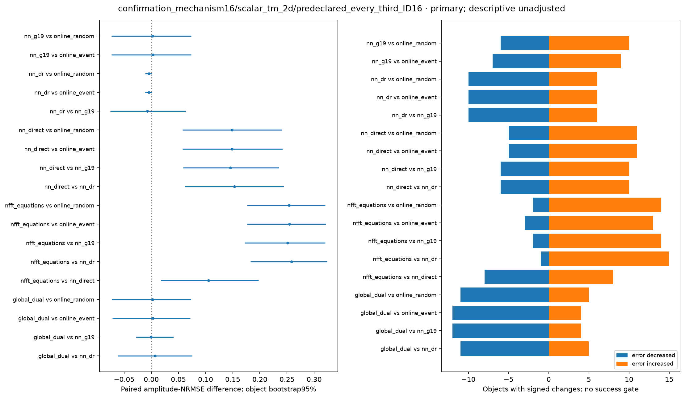

[PDF](FIGURES/paired_changes_confirmation_mechanism16_scalar_tm_2d_predeclared_every_third_ID16_03.pdf)

### paired_changes_confirmation_mechanism16_scalar_tm_2d_predeclared_every_third_ID16_04

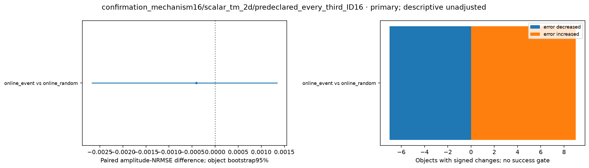

[PDF](FIGURES/paired_changes_confirmation_mechanism16_scalar_tm_2d_predeclared_every_third_ID16_04.pdf)

### paired_changes_confirmation_online_controls16_scalar_tm_2d_predeclared_same_ID16_additive_controls_01

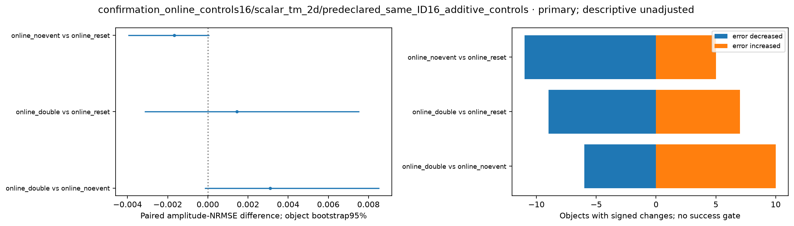

[PDF](FIGURES/paired_changes_confirmation_online_controls16_scalar_tm_2d_predeclared_same_ID16_additive_controls_01.pdf)

### paired_changes_confirmation_rescue48_scalar_tm_2d_fresh48_conditional_rescue_01

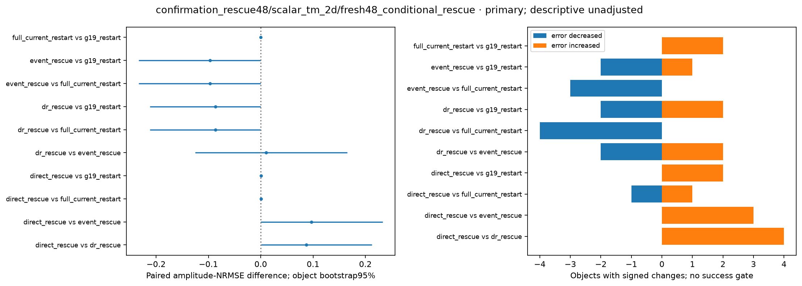

[PDF](FIGURES/paired_changes_confirmation_rescue48_scalar_tm_2d_fresh48_conditional_rescue_01.pdf)

### paired_changes_local_reference_common16_360CPU_01

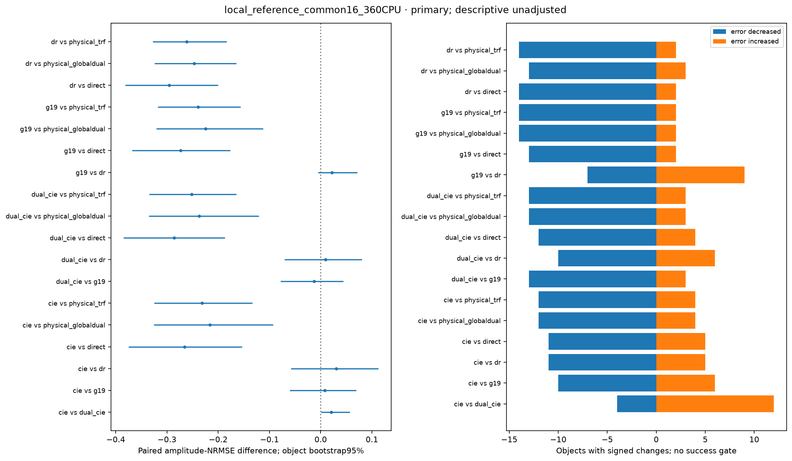

[PDF](FIGURES/paired_changes_local_reference_common16_360CPU_01.pdf)

### paired_changes_local_reference_common16_360CPU_02

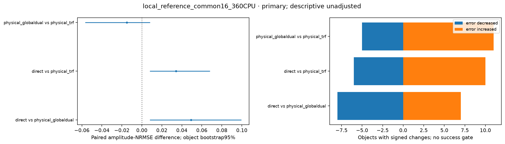

[PDF](FIGURES/paired_changes_local_reference_common16_360CPU_02.pdf)

### paired_changes_online_controls_common16_vs_DR_01

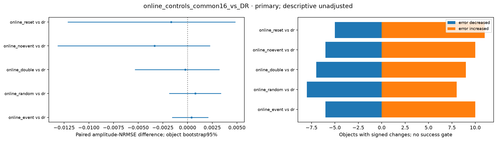

[PDF](FIGURES/paired_changes_online_controls_common16_vs_DR_01.pdf)

### paired_changes_online_controls_common16_vs_event_01

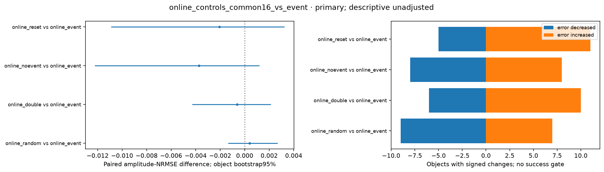

[PDF](FIGURES/paired_changes_online_controls_common16_vs_event_01.pdf)

### paired_changes_physics_v1_classic_classic_01

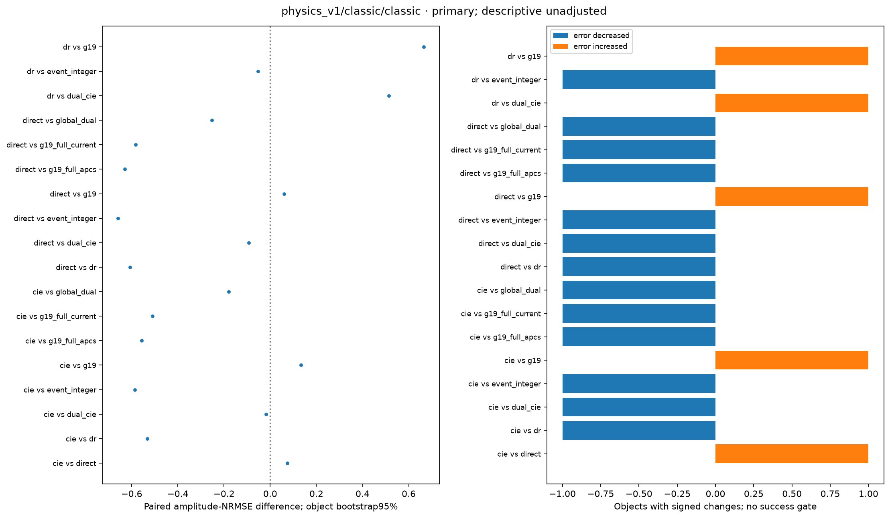

[PDF](FIGURES/paired_changes_physics_v1_classic_classic_01.pdf)

### paired_changes_physics_v1_classic_classic_02

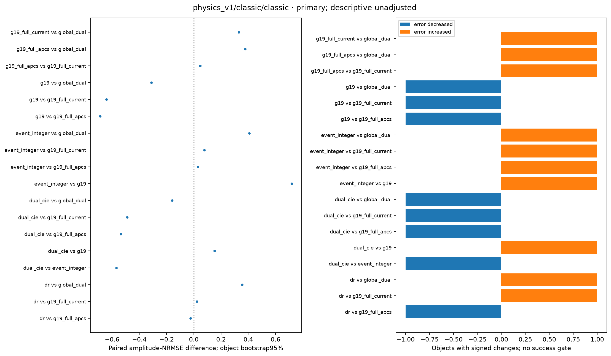

[PDF](FIGURES/paired_changes_physics_v1_classic_classic_02.pdf)

### paired_changes_physics_v1_vector3d_vector3d_01

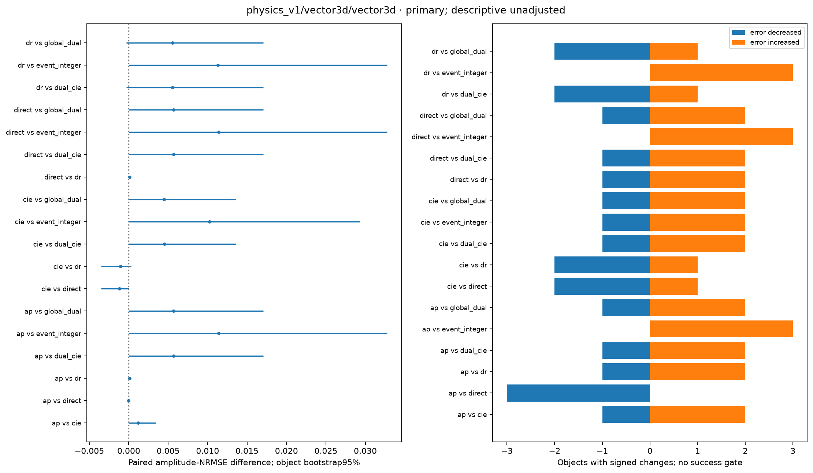

[PDF](FIGURES/paired_changes_physics_v1_vector3d_vector3d_01.pdf)

### paired_changes_physics_v1_vector3d_vector3d_02

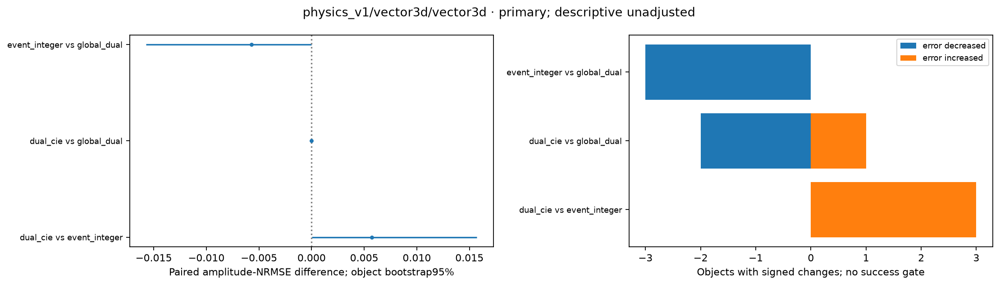

[PDF](FIGURES/paired_changes_physics_v1_vector3d_vector3d_02.pdf)

