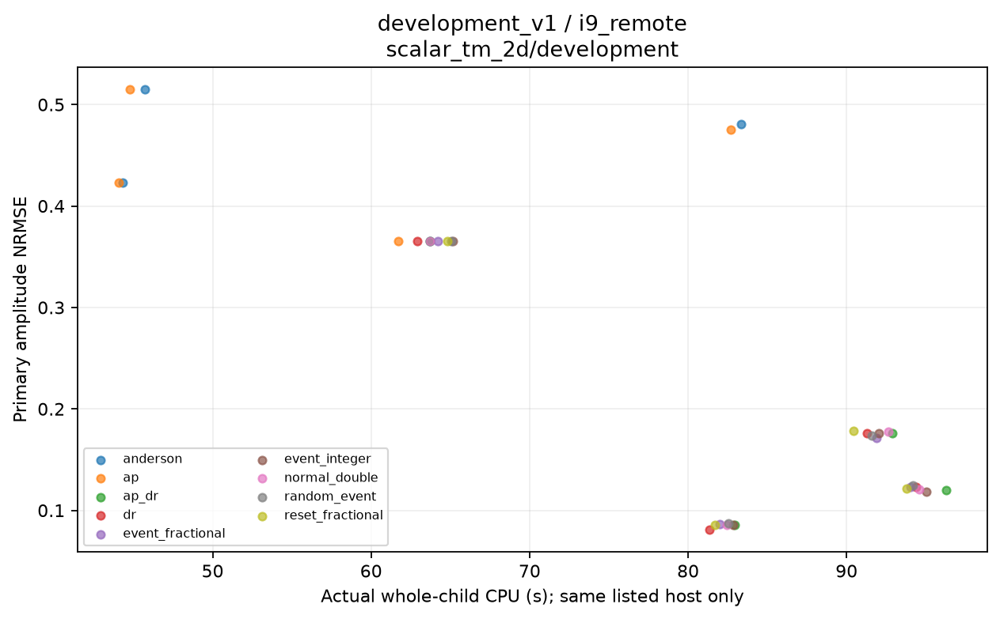
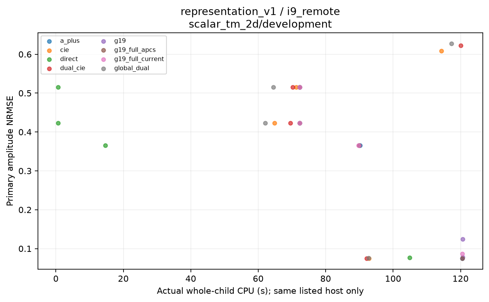
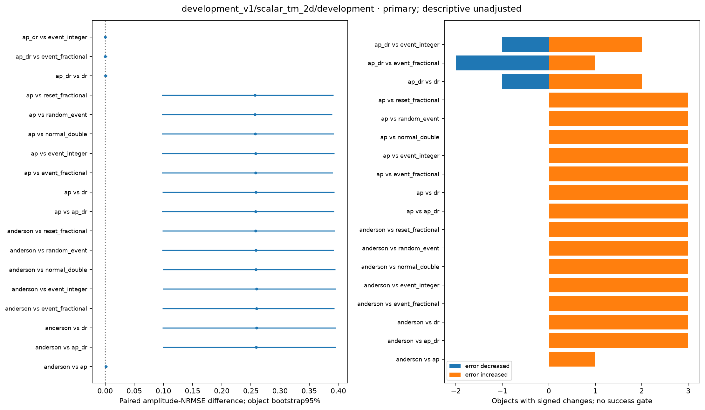
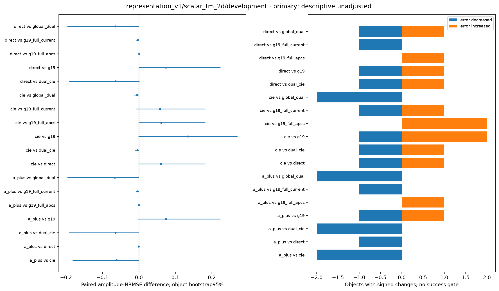
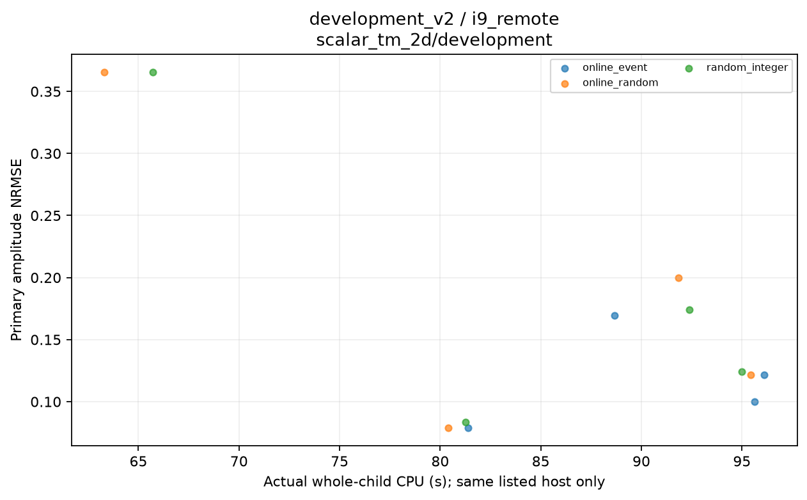
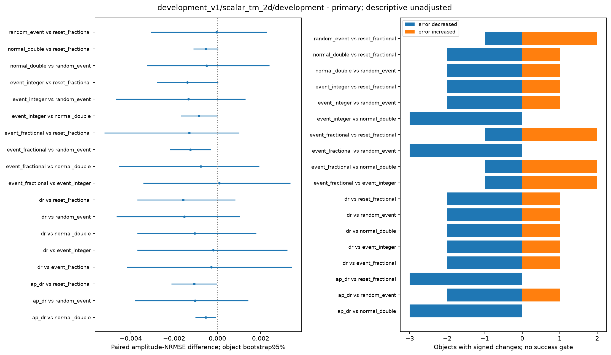
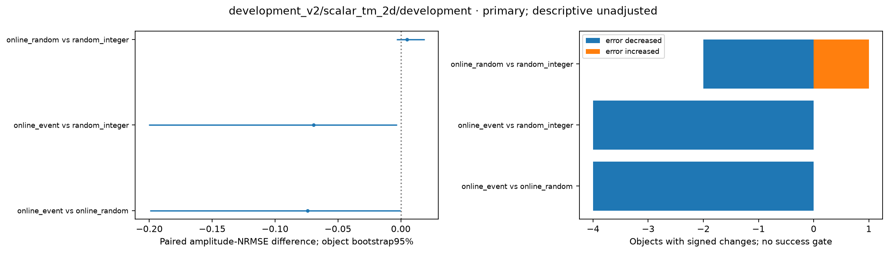
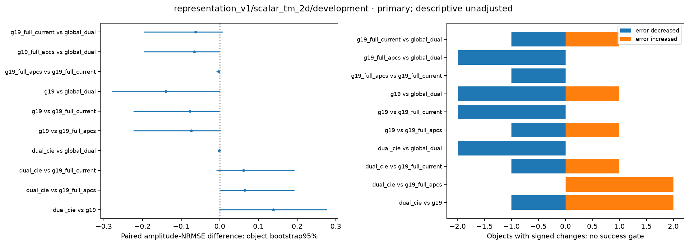

# delegated · 实际图集

[R13首页](../../index.html) · [HTML图集](GALLERY.html)

仅列出实际生成附件；不以运行状态或图名推断科学结论。

[紧凑全对象复核表](../review_tables/README.md)

## development_aggregation_v1

### cost_material_development_v1_i9_remote_scalar_tm_2d_development

[PDF](development_aggregation_v1/FIGURES/cost_material_development_v1_i9_remote_scalar_tm_2d_development.pdf)

### cost_material_development_v2_i9_remote_scalar_tm_2d_development

[PDF](development_aggregation_v1/FIGURES/cost_material_development_v2_i9_remote_scalar_tm_2d_development.pdf)

### cost_material_representation_v1_i9_remote_scalar_tm_2d_development

[PDF](development_aggregation_v1/FIGURES/cost_material_representation_v1_i9_remote_scalar_tm_2d_development.pdf)

### paired_changes_development_v1_scalar_tm_2d_development_01

[PDF](development_aggregation_v1/FIGURES/paired_changes_development_v1_scalar_tm_2d_development_01.pdf)

### paired_changes_development_v1_scalar_tm_2d_development_02

[PDF](development_aggregation_v1/FIGURES/paired_changes_development_v1_scalar_tm_2d_development_02.pdf)

### paired_changes_development_v2_scalar_tm_2d_development_01

[PDF](development_aggregation_v1/FIGURES/paired_changes_development_v2_scalar_tm_2d_development_01.pdf)

### paired_changes_representation_v1_scalar_tm_2d_development_01

[PDF](development_aggregation_v1/FIGURES/paired_changes_representation_v1_scalar_tm_2d_development_01.pdf)

### paired_changes_representation_v1_scalar_tm_2d_development_02

[PDF](development_aggregation_v1/FIGURES/paired_changes_representation_v1_scalar_tm_2d_development_02.pdf)

## development_aggregation_v2

### cost_material_development_v1_i9_remote_scalar_tm_2d_development

[PDF](development_aggregation_v2/FIGURES/cost_material_development_v1_i9_remote_scalar_tm_2d_development.pdf)

### cost_material_development_v2_i9_remote_scalar_tm_2d_development

[PDF](development_aggregation_v2/FIGURES/cost_material_development_v2_i9_remote_scalar_tm_2d_development.pdf)

### cost_material_representation_v1_i9_remote_scalar_tm_2d_development

[PDF](development_aggregation_v2/FIGURES/cost_material_representation_v1_i9_remote_scalar_tm_2d_development.pdf)

### paired_changes_development_v1_scalar_tm_2d_development_01

[PDF](development_aggregation_v2/FIGURES/paired_changes_development_v1_scalar_tm_2d_development_01.pdf)

### paired_changes_development_v1_scalar_tm_2d_development_02

[PDF](development_aggregation_v2/FIGURES/paired_changes_development_v1_scalar_tm_2d_development_02.pdf)

### paired_changes_development_v2_scalar_tm_2d_development_01

[PDF](development_aggregation_v2/FIGURES/paired_changes_development_v2_scalar_tm_2d_development_01.pdf)

### paired_changes_representation_v1_scalar_tm_2d_development_01

[PDF](development_aggregation_v2/FIGURES/paired_changes_representation_v1_scalar_tm_2d_development_01.pdf)

### paired_changes_representation_v1_scalar_tm_2d_development_02

[PDF](development_aggregation_v2/FIGURES/paired_changes_representation_v1_scalar_tm_2d_development_02.pdf)

