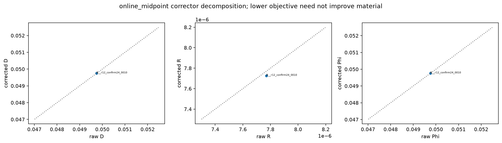
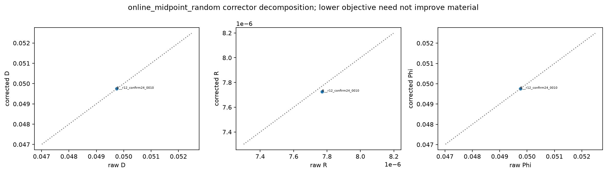
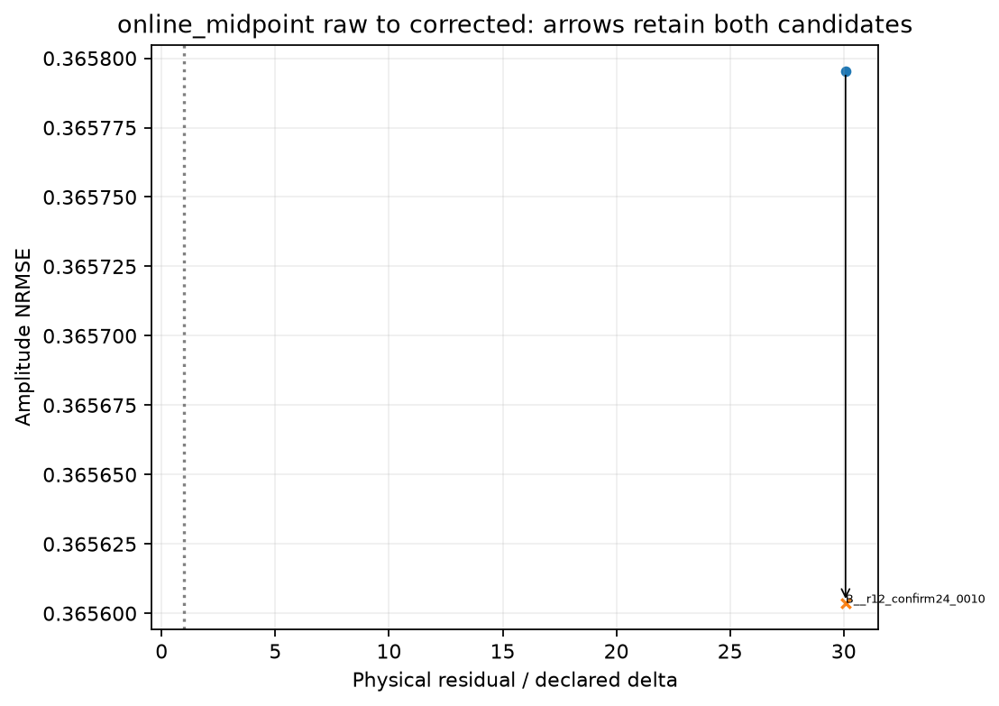
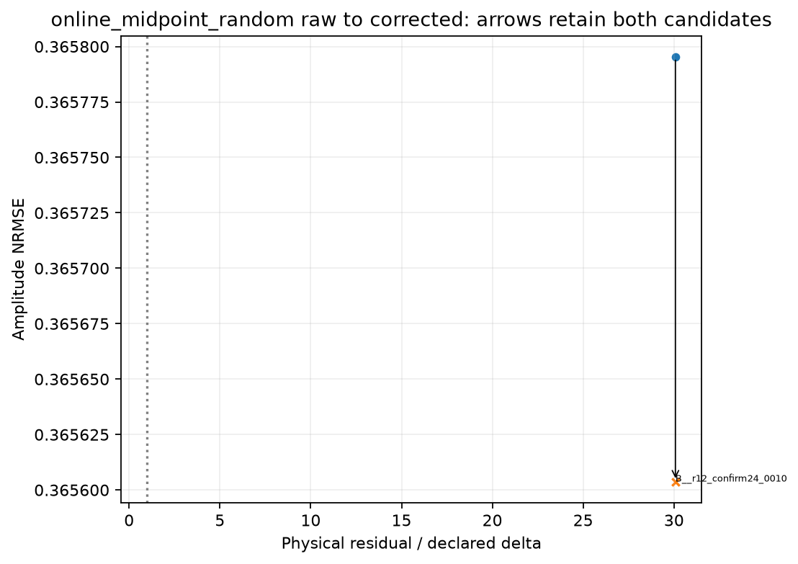
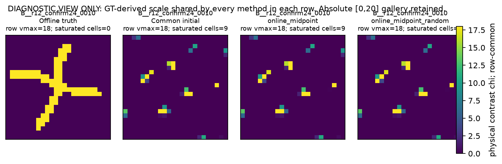
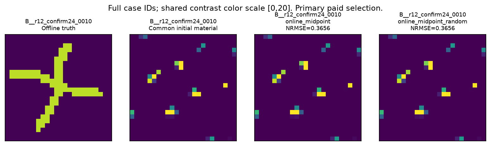
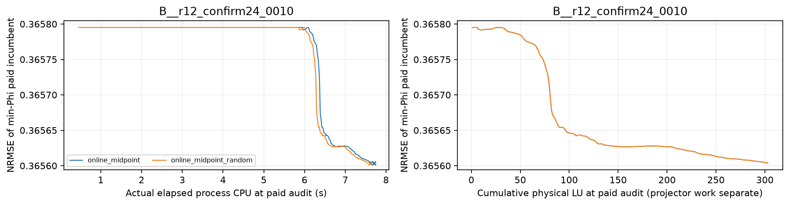
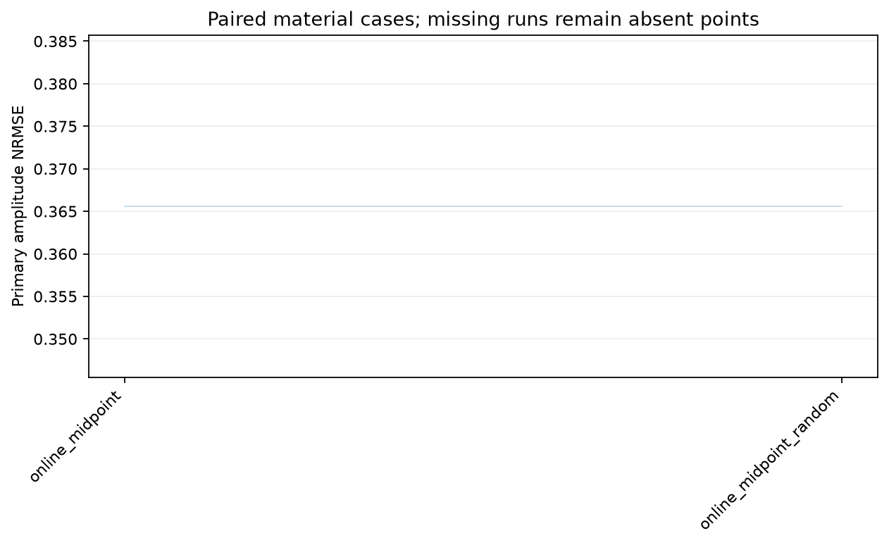

# development_v4_local · 实际图集

[R13首页](../../index.html) · [HTML图集](GALLERY.html)

仅列出实际生成附件；不以运行状态或图名推断科学结论。

[紧凑全对象复核表](../review_tables/README.md)

[REPORT.md](REPORT.md) · [SCORING_RECEIPT.json](SCORING_RECEIPT.json) · [METHOD_VIEW_SUMMARY.csv](METHOD_VIEW_SUMMARY.csv) · [PAIRED_STATS.csv](PAIRED_STATS.csv) · [CORRECTOR_DECOMPOSITION.csv](CORRECTOR_DECOMPOSITION.csv) · [COST_LEDGER.csv](COST_LEDGER.csv) · [COST_TOTALS.json](COST_TOTALS.json) · [FAILURES.json](FAILURES.json) · [TRUTH_SOURCES.json](TRUTH_SOURCES.json) · [QUEUE_ATTEMPT_HISTORY.json](QUEUE_ATTEMPT_HISTORY.json)

## scalar_tm_2d_development

### corrector_components_online_midpoint

[PDF](DOMAIN_scalar_tm_2d_development/FIGURES/corrector_components_online_midpoint.pdf)

### corrector_components_online_midpoint_random

[PDF](DOMAIN_scalar_tm_2d_development/FIGURES/corrector_components_online_midpoint_random.pdf)

### corrector_material_arrows_online_midpoint

[PDF](DOMAIN_scalar_tm_2d_development/FIGURES/corrector_material_arrows_online_midpoint.pdf)

### corrector_material_arrows_online_midpoint_random

[PDF](DOMAIN_scalar_tm_2d_development/FIGURES/corrector_material_arrows_online_midpoint_random.pdf)

### diagnostic_structure_methods1_page01

[PDF](DOMAIN_scalar_tm_2d_development/FIGURES/diagnostic_structure_methods1_page01.pdf)

### materials_methods1_page01

[PDF](DOMAIN_scalar_tm_2d_development/FIGURES/materials_methods1_page01.pdf)

### paid_cost_curves_page01

[PDF](DOMAIN_scalar_tm_2d_development/FIGURES/paid_cost_curves_page01.pdf)

### paired_primary_NRMSE

[PDF](DOMAIN_scalar_tm_2d_development/FIGURES/paired_primary_NRMSE.pdf)

