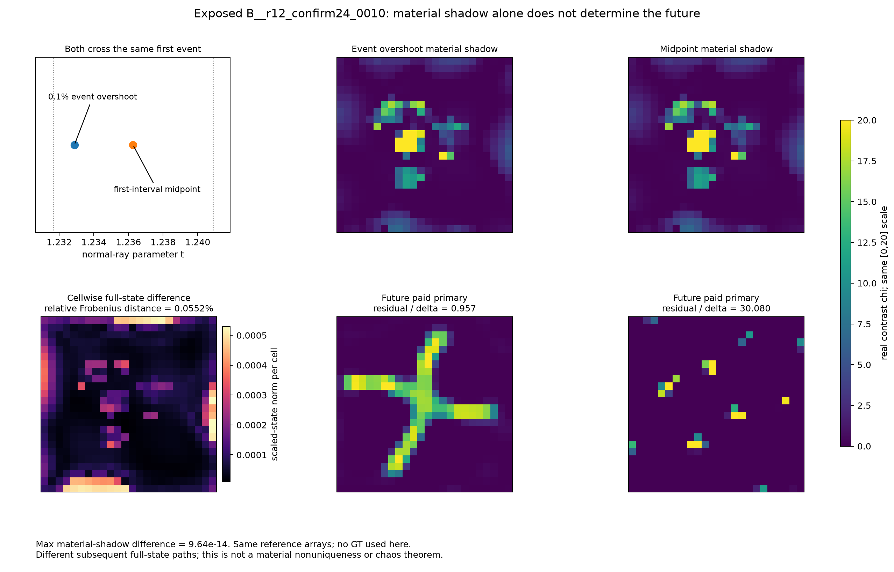

# mechanism_public · 实际图集

[R13首页](../../index.html) · [HTML图集](GALLERY.html)

仅列出实际生成附件；不以运行状态或图名推断科学结论。

[紧凑全对象复核表](../review_tables/README.md)

[REPORT.md](REPORT.md)

## 本组图

### same_shadow_different_future

[PDF](FIGURES/same_shadow_different_future.pdf)

