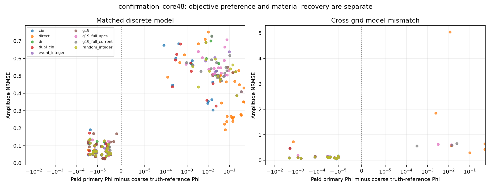
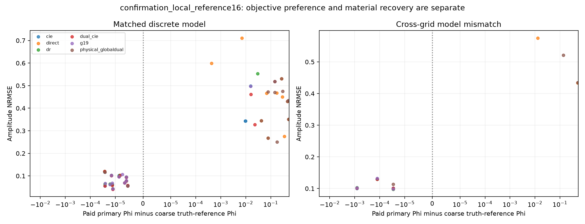
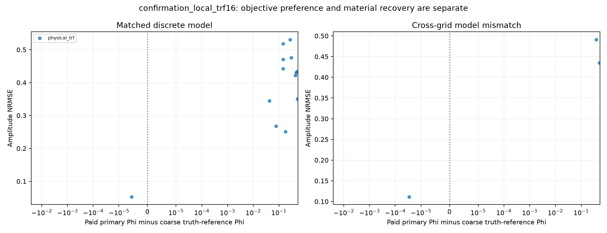
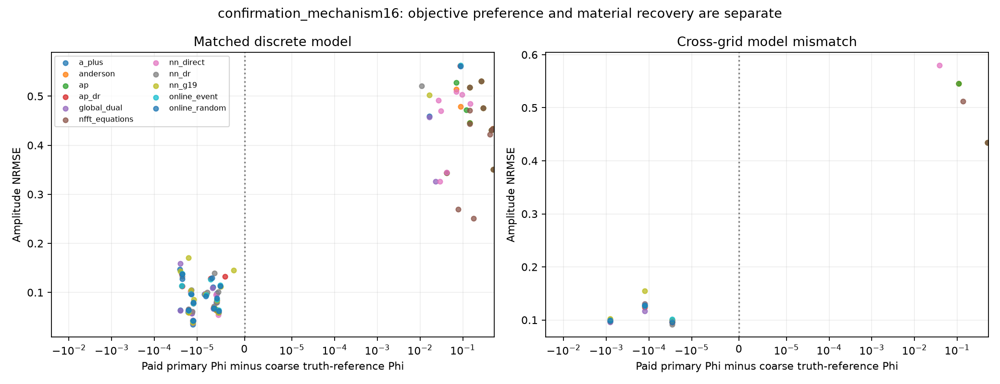
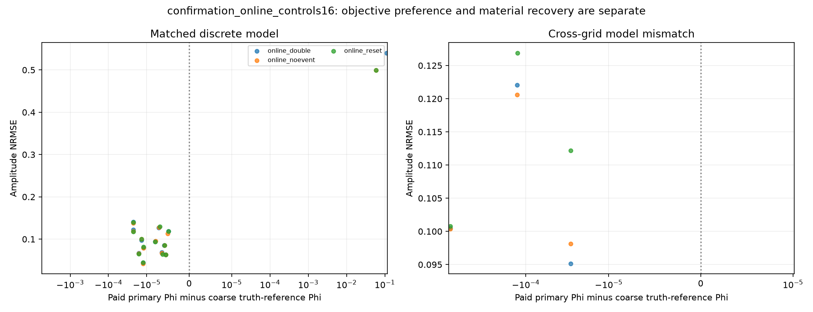
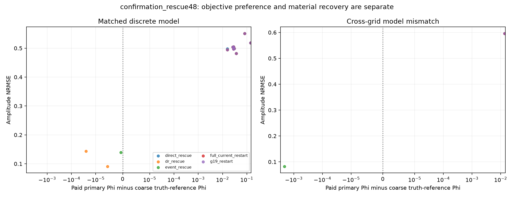

# objective_truth · 实际图集

[R13首页](../../index.html) · [HTML图集](GALLERY.html)

仅列出实际生成附件；不以运行状态或图名推断科学结论。

[紧凑全对象复核表](../review_tables/README.md)

## 本组图

### confirmation_core48_objective_truth

[PDF](FIGURES/confirmation_core48_objective_truth.pdf)

### confirmation_local_reference16_objective_truth

[PDF](FIGURES/confirmation_local_reference16_objective_truth.pdf)

### confirmation_local_trf16_objective_truth

[PDF](FIGURES/confirmation_local_trf16_objective_truth.pdf)

### confirmation_mechanism16_objective_truth

[PDF](FIGURES/confirmation_mechanism16_objective_truth.pdf)

### confirmation_online_controls16_objective_truth

[PDF](FIGURES/confirmation_online_controls16_objective_truth.pdf)

### confirmation_rescue48_objective_truth

[PDF](FIGURES/confirmation_rescue48_objective_truth.pdf)

