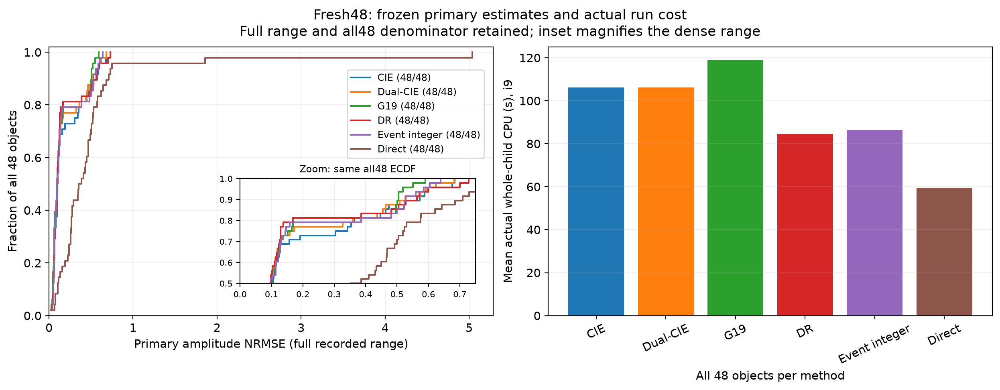
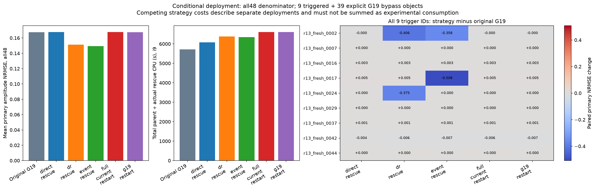
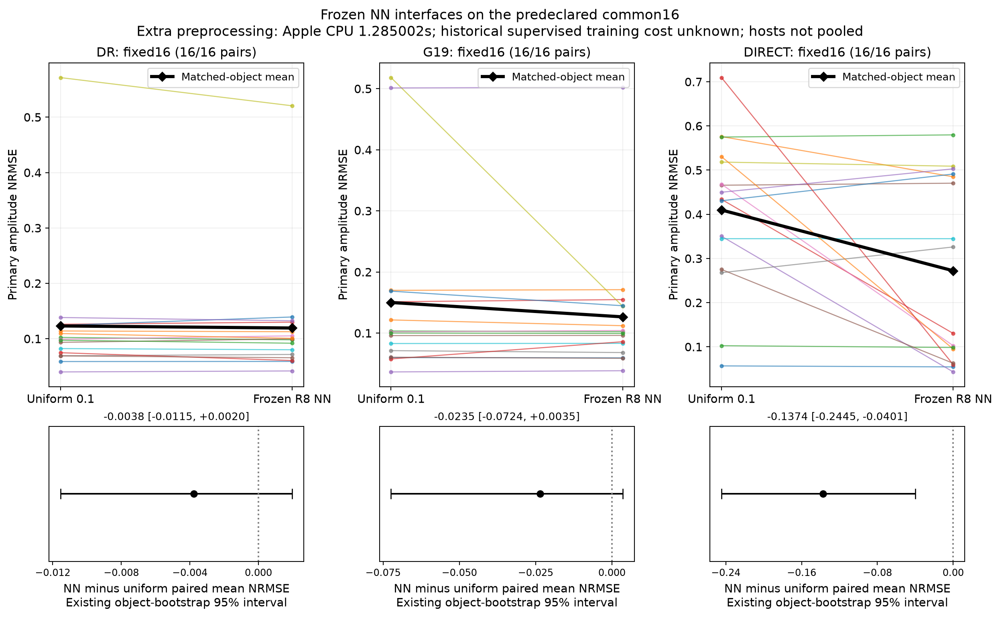
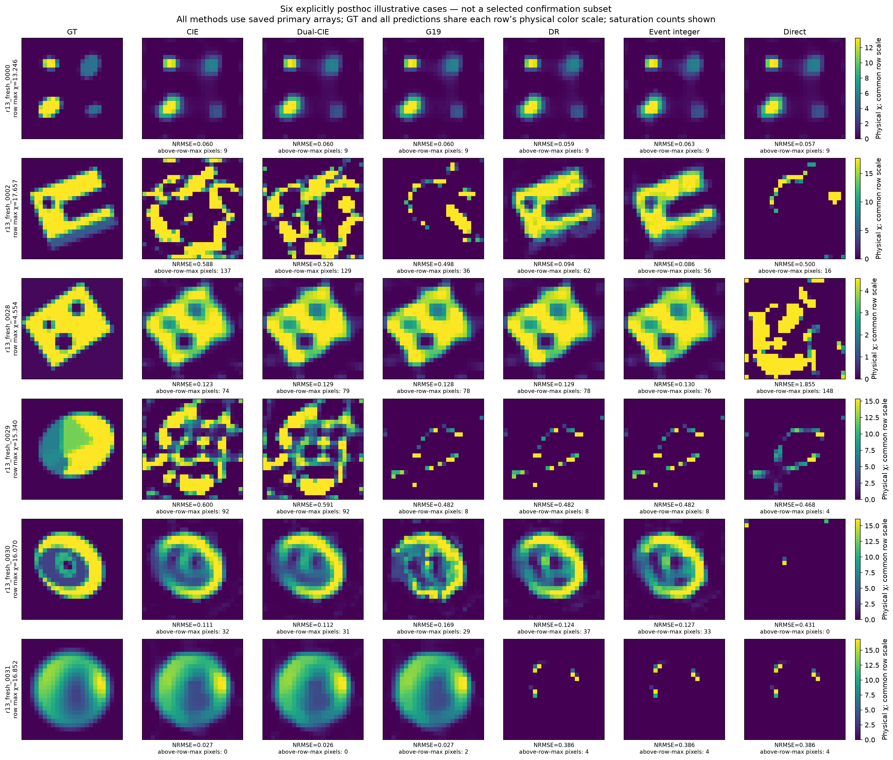

# paper_figures · 实际图集

[R13首页](../../index.html) · [HTML图集](GALLERY.html)

仅列出实际生成附件；不以运行状态或图名推断科学结论。

[紧凑全对象复核表](../review_tables/README.md)

[REPORT.md](REPORT.md)

## 本组图

### 01_fresh48_ecdf_actual_cpu

[PDF](FIGURES/01_fresh48_ecdf_actual_cpu.pdf)

### 02_conditional_all48_cost_trigger_changes

[PDF](FIGURES/02_conditional_all48_cost_trigger_changes.pdf)

### 03_fixed16_nn_interfaces

[PDF](FIGURES/03_fixed16_nn_interfaces.pdf)

### 04_posthoc_six_case_materials

[PDF](FIGURES/04_posthoc_six_case_materials.pdf)

