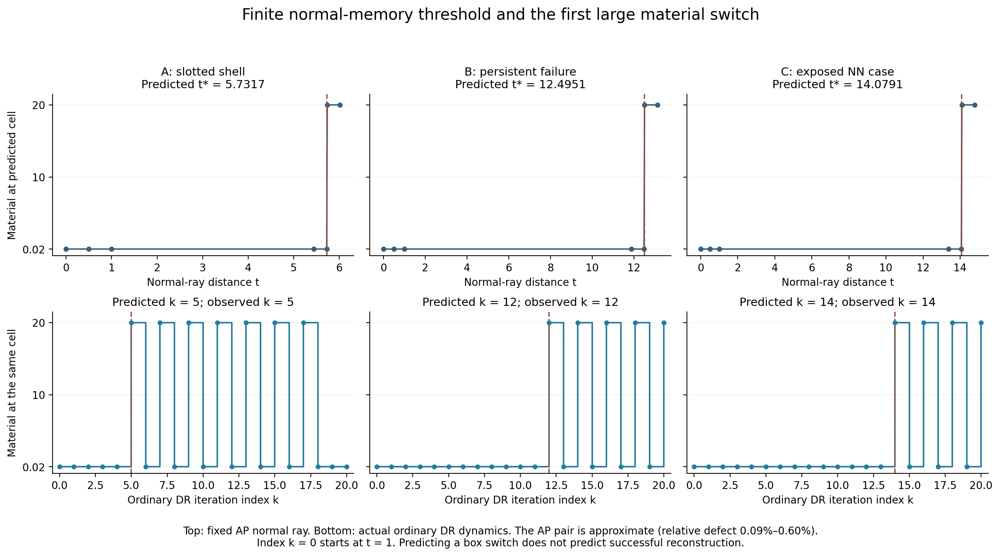
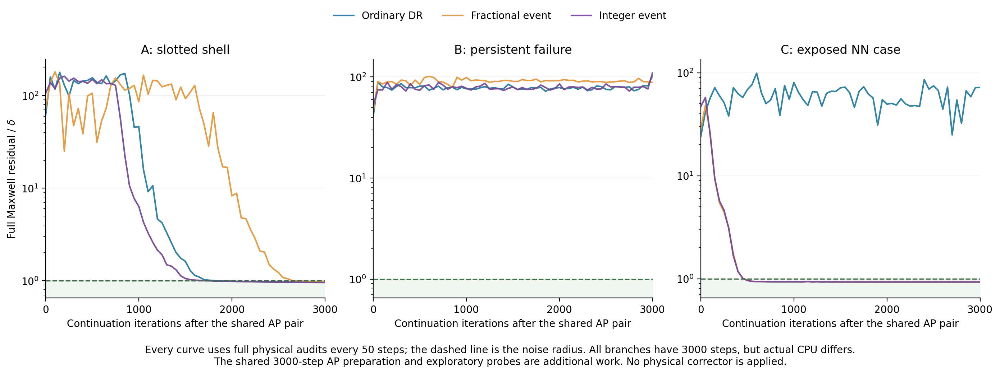
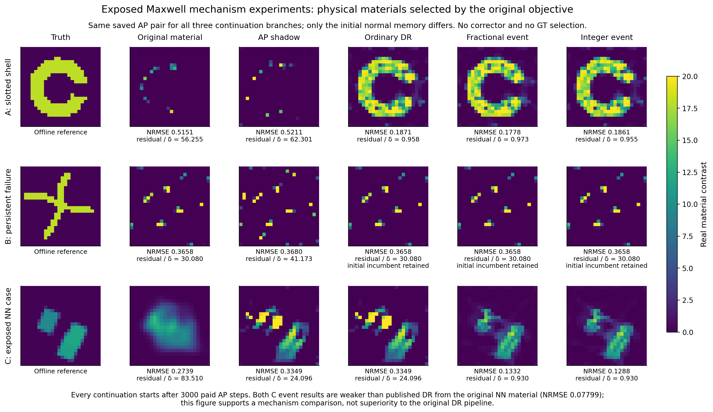

# 研究结论与证据范围

**本轮最值得继续投入的方向，是由源场、接收伴随场和材料边界共同决定的有限分支事件。** 这条方向比继续扩大 Green rank、重复低物理残差排名、或直接把 DR 称为新 Maxwell 理论更具体：它给出一个可以事先计算、由真实轨迹推翻的预测，并产生一个几乎不增加线性代数成本的事件 proposal。

但现在还不能声称获得了稳定优于 G19/DR 的新算法。新阈值定理的主体适用于更一般的共享标量双线性约束，不是 Maxwell 独有；精确跳步只省略影子不变的迭代，不改变解；近似停滞对上的跳跃才会改变 basin，而这部分尚无恢复保证。实际三例中，一个受 AP 损伤的 NN 状态得到显著救援，一个壳对象与普通 DR 接近，一个对象持续失败。原始 NN 初值直接运行已有 DR 仍优于本轮事件试验。

本报告形成三项相互区分的结果：

1. **证据审查。** 大辅助电流损失、完整场表示、反射记忆与候选审计机会，都是不同机制。最新配对结果不足以唯一归因；但在五个已保存 AP/DR 候选池中，差异确实出现在候选生成阶段。
2. **严格推导。** 给出材料切向与源—接收双边传播的关系；辅助表示的有限 profile 惩罚；有界共享材料投影的首次事件；近似 AP 对的误差界；并用 Maxwell KKT 将法向记忆写成接收伴随场。
3. **实际验证与下一步算法。** 在真实 576 材料 Maxwell 实例上预测首次大幅材料跳变，并完成普通 DR、分数事件与整数事件的 3000 步继续实验。随后给出可以直接执行的独立确认、经典方法、三维和实测协议。

## 访问与可复核性

仓库固定为 [migodam/b1-probabilistic-maxwell-imaging](https://github.com/migodam/b1-probabilistic-maxwell-imaging/tree/ec3a37da6f3ee90beb61e753067d4f639f4118f5)，提交为 ec3a37da6f3ee90beb61e753067d4f639f4118f5。直接检查了 R4–R12 的代表性理论、负结果、算法源码、公式 atlas、R8 初始化、R11 G19、R12 及 supplement_paired，以及 FBG、Z-ALG、P3L/FP-T 相关材料；没有仅以 CHAT_HANDOFF 为依据。

本轮读取了 11 个实际配对起点、44 条完成运行的材料端点与元数据，并从公开归档提取、CRC 核对了 10 个 AP/DR 候选池。完整访问与计算清单见附带的 evidence_audit、theory_audit、literature_review、源文件及数据回执。

**会话访问边界：** 历史会话检索只返回了相关片段和摘要，未获得整段 ChatGPT session 的逐条原始记录。不能宣称已完整阅读全部历史对话。当前判断以用户给定事实、可访问的原始仓库材料和本轮计算为基础。

文献清单含 35 条逐项记录阅读深度的主来源。NIE 2016 已通过作者上传全文审读相关推导和实验；FFT-TSOM 2011 本轮仍未取得完整原文。若干 2024–2026 工作只读到作者机构摘要，报告没有把它们当成已审核的完整定理。检索不是穷尽性优先权证明。

# 一、R4–R12 的真正瓶颈

## 1.1 继承事实，但重新解释

R4–R6 已表明：只修改材料块的离本构流形反馈，就能使两个历史困难弯条恢复；但相同机制没有在独立新对象上增加成功数。R5 已否定仅靠反馈交叉项符号判断物理下降的普适解释。R6 的 FFT 实现有工程价值，但没有创造新的信息或可辨识性。

R7 的精确有理响应、rank-2/8/32 协同动作没有可靠逃离开缝壳；部分改进被等量 corrector 续跑复制。Z-ALG 的非局部入口在新对象上降低残差却恶化材料。P3L 的双边结构、高阶补偿和 weak-material 方向同样没有自动获得高质量材料分支。因此，已有负结果指向的不是“代数还不够精确”，而是**动作如何接入正确的材料分支，以及该分支如何被数据和先验选择**。

R8 已发现物理 NN 初值到辅助电流的表示损失，并运行过 physical-complement anchor。不能将重新加入物理电流余量包装成本轮首次发现。R11 的 G19 是用户从 CIE 内部发展出的算法：保留完整矩阵分母导数，确实在部分环和开缝壳改变可访问分支；48 对象上却未比 GlobalDual 增加稳定成功集合。

R12 的配对补充加强了 DR 的条件救援证据：既有 24 对象中，G19 的四个球外终点有三个被救回，平均 NRMSE 从 0.143891 降到 0.106261，额外完整 CPU 约 7.85%。它仍是已暴露对象上的条件策略，不是独立盲测，也不是 DR 普遍优于 G19 的证明。[仓库 R12 配对原件](https://github.com/migodam/b1-probabilistic-maxwell-imaging/tree/ec3a37da6f3ee90beb61e753067d4f639f4118f5/research/research_max_struct_r12/supplement_paired)

## 1.2 同一材料，不是同一算法状态

物理优化的状态是材料和优化器记忆。G19 还包含辅助电流、当前 Fourier 阶段、固定 DPCS、双 beta 与 PR 历史。DR 包含完整场、电流和不能由当前材料恢复的反射记忆。NN 提供一个学习分布偏好的材料入口。相同材料可以对应完全不同的辅助状态和下一步方向。

因此，公平的“同起点”至少有四个层次：相同观测和物理模型；相同材料；相同物理场—电流提升；相同可容许辅助空间和记忆约定。不同算法不能强制具有相同内部变量，但必须明确哪一层相同。

还有第五个因素：什么时候允许一个材料进入最终候选池。本轮核对所有 HISTORY 后发现，A/C 的 G19 proposal 物理审计通常只有 5 行，B 为 4 行；AP/DR 为 61 行。G19 在阶段末审计，AP/DR 每 50 步审计。B 虽进入 mf12，预算却在阶段结束前用完，其 mf12 材料没有成为合格物理候选。相同 Phi 选择器不意味着相同候选观察机会。

这个发现不撤销原实际成本结果；它限制了因果解释。下一轮应将付费物理审计频率作为独立因素或统一日程。

# 二、材料可观测性的正确对象

## 2.1 精确物理切向与有限差分

以下先针对实各向同性离散材料。三维时 D_m 与 D_h 表示每个单元的标量在三个场分量上的重复块，而不是独立的分量材料。令

$$L_m=I-D_mG,\qquad R_m=L_m^{-1},\qquad J_m=R_mD_mE^{inc},\qquad Q_m=E^{inc}+GJ_m.$$

假设相关材料处的 resolvent 存在。对实材料增量 h，

$$D J_m[h]=R_mD_hQ_m,\qquad K_mh=W S R_mD_hQ_m.$$

这不是新导数；atlas、Z-ALG、P3L 和敏感度文献已有。重要的是解释其三个必要因素：材料必须被当前总场激发；扰动电流经完整 resolvent 多次传播；最后还须被接收器看到。[R17, R22]

对两个有限材料，严格有

$$F(m_b)-F(m_a)=S R_{m_b}D_{m_b-m_a}Q_{m_a}.$$

这说明有限步响应既包含起点源场，又包含终点接收传播。当前 Jacobian 的 kernel 只是一阶对象，不能直接作为有限材料自由度。该恒等式属于标准 resolvent/双边场结构，不宜作为主创新。[R22]

## 2.2 源与接收的乘积几何

若白化按接收维度左乘 W，且所有照明使用相同 G、S，记 A=WSR_m。材料 Jacobian 第 i 列为所有照明下的 A 的第 i 列与 Q 的第 i 行的张量积。因此实材料 Gauss–Newton/Fisher 几何为

$$H_m^{\mathrm{mat}}=\operatorname{Re}\left[(A^*A)\odot\overline{Q_mQ_m^*}\right].$$

上述逐列和 Hadamard 简式直接适用于 scalar-TM。三维实各向同性单元的一个材料增量同时作用于三个场分量，其 Jacobian 列是三项分量贡献之和；应通过共享映射 Pi（将一个 cell 的增量重复到三个分量）把分量级 Gram 拉回为 H_mat,3D=Pi^T H_component Pi，不能把三个分量当成独立材料未知量。

源侧和接收侧的空间相干性通过 Hadamard 乘积结合。只有对角激励强度远远不够；不同材料位置的列相关性决定能否区分它们。一般不可分离噪声协方差下，应直接使用白化后的 K，而不能强套这个简式。

**强 Green 模式不是强材料信息模式。** 一个电流方向可以在内部被强放大而落在接收暗空间；一个接收可见电流又可能无法写成跨所有照明共享的材料扰动。S 有非平凡核也不直接证明材料非唯一，因为共享材料在多照明下只能产生受约束的电流族。应以材料质量矩阵归一化 K，区分参数缩放、网格变化和真实弱可观测性。

无需构造 H：利用已有 LU，K 作用需要一组切向 RHS，K 的伴随需要一组伴随 RHS。低秩谱诊断可以复用这些作用，但其计算必须收费。固定子空间跨材料可复用，需要 resolvent 变化和相关谱隙的控制；高对比共振附近不能假设这些条件自动成立。

## 2.3 可行集合角度与可辨识性不是一回事

在精确等式数据交点，切向条件为

$$\delta Q=G\delta J,\quad WS\delta J=0,\quad
\delta J=D_m\delta Q+D_hQ.$$

消元后，材料方向满足 K_mh=0。全场非暗且 resolvent 可逆时，材料切向核与两集合的物理切向交具有明确对应；主角数值仍取决于提升和状态度量。

但在数据噪声球的严格内部，数据不等式局部不活动，所有足够小的物理材料变化都仍在球内。此时用两集合切向角度估计统计可辨识性会失效，即使 K 满列秩也一样。非零法向偏移处的 DR 投影导数还含曲率项，不能全部替换为切平面投影。

子空间 DR 的 Friedrichs 角速率是成熟局部理论，既不是全局 basin 定理，也不是 DR 总比 AP 快的证明。[R13–R15]

# 三、G19 为什么可能帮助，也可能损害

设 G19 的材料块为

$$M_m=I+\beta D_m-D_mK,\qquad w=M_m^{-1}e,\qquad e=J-D_mQ.$$

固定辅助 J 时，完整导数是

$$D w[h]=-M_m^{-1}D_h\left[Q+(\beta I-K)w\right].$$

它的材料读出使用有效场 Q+(beta I-K)w，以及变换残差的伴随拉回。第二项在 e=0 时消失，在离本构流形的状态却可能主导更新。因此 G19 改变的不只是迭代条件数：它改变了非物理状态中哪些材料方向被奖励或抑制。

这解释了正反效果为何可以同时存在，但不能仅凭公式判断具体对象受益。K 不显式编码当前接收可见性、照明及错误残差的方向；其作用还被受限电流、交替更新和先验共同改变。R11 中冻结分母、增大 rank 或同时改变两块未获普适收益，并不意外。

此外，legacy G19 的 current/material 块具有不同 beta 和更新规则，不能未经证明把它视为同一个标量目标的精确交替最小化。后文的 profile 引理是明确指定二次辅助目标的诊断，不是对整条 legacy G19 轨迹的能量函数证明。

# 四、辅助表示如何变成材料偏好

## 4.1 有限材料处的严格 profile 分解

对固定材料，考虑明确指定的二次电流目标

$$\phi(m,J)=\tfrac12\|W(SJ-Y)\|^2+
\tfrac12\|C_m(L_mJ-D_mE^{inc})\|^2.$$

将其写成半个最小二乘范数，设完整电流极小点为 J_star，H_m^cur 为该二次型的正定 current Hessian；它与前面的材料 Gram 不同。把电流限制在 affine 家族 \(\mathcal V=J_D+\operatorname{range}V\)，配方严格得到

$$\phi_V(m)=\phi_{full}(m)+\tfrac12\operatorname{dist}_{H_m^{\mathrm{cur}}}^{2}(J_\star(m),\mathcal V).$$

证明只有一步：完整极小点的正规方程使交叉项为零。这个额外非负项随材料变化，因而可能颠倒两个材料的目标排序。它不只是初值处 current 误差。

但标准加权最小二乘、变量投影与扩展状态消元已有充分先例。van Leeuwen–Yang 2025 更直接给出了接收伴随场 representer 和材料相关 receiver-Gram 残差度量。这里有价值的是 Maxwell 中的归因及可验证预测，不是将配方命名为新基本定理。[R29–R31]

在零数据残差、零本构残差且正确 current 可表示的根，令 \(\mathscr C=[WS;\,C_mL_m]\) 为竖直堆叠的电流残差算子，令 \(\mathscr B h=[0;\,C_mD_hQ_m]\)。P_U 表示到算子 U 列空间的正交投影；线性化材料 profile Hessian 的额外项为

$$H_V^{\mathrm{mat}}-H_{full}^{\mathrm{mat}}=\operatorname{Re}\{\mathscr B^*(P_{\mathscr C}-P_{\mathscr CV})\mathscr B\}\succeq0.$$

离开该兼容根，非负表示惩罚的精确材料 Hessian不必正定或半正定；移动度量和残差曲率不可省略。沿指定材料方向加入完整最优切向电流的缺失分量，可消除该方向的线性化表示惩罚。但计算这种方向可能需要昂贵的传播求解，且多照明公共空间的新增维数不一定只有一维。

## 4.2 原始保存状态给出的修正

实际调用链先经过 mf3/6/10，再进入 mf12。初始 Fourier 空间仅 36 列；全部 11 条运行后来都进入 mf12，因此“大初始化损失”不能被解释成最终始终没有完整 Fourier 补空间。硬 DPCS affine 限制仍存在。

对这 11 个起点的无新增正演分解：

- Fourier 截断占丢失 current 平方范数的 62.76%–99.97%，中位数 97.43%。
- DPCS 修正占接收变化能量至少 99.9178%。
- 在 A+B 七个坏终点上，初始 current loss 与最终 G19–DR 材料差的 Spearman 相关为 -0.107；没有得到可用成功预测器。

这不是说 DPCS 接收变化大就有害：它本来就在纠正输入材料的观测不匹配。current 能量、接收影响和材料恢复相关性必须分开。

10 个球内 DR 物理端点的固定 DPCS 差异为 current 范数的 0.2894%–1.1131%，对应 retained receiver 坐标约 0.350–0.603 个 delta。它们的精确物理三元组不在硬锁定的 lifted 交集中；但 G19 允许非零本构残差并输出材料，不能据此证明这些材料对 G19 绝对不可达。

## 4.3 必须加入的 NFFT 对照

Wei–Chen 2018 NFFT-SOM 明确使用完整 Fourier 校正 J=J_D+F alpha，允许修正 deterministic current；2016 EIT 前身也有该结构。CIE 2019 的式(10)则保留对 dominant subspace 的正交补投影。[R26–R28, R05]

因此，解除 DPCS 不是新方向的原创性。最有价值的控制是：将完整 NFFT 参数化移植到当前 G19 的同一个材料更新、beta、prior、初始化和预算上，另运行原始 NFFT-SOM 作成熟方法比较。两种比较回答不同问题。

若采用 J=J_D+V_D b+B_F a 且 V_D^* B_F=0，在接收 SVD 的相应度量下可以精确拆分 retained 和 complementary 噪声预算。这是清晰的实现方式，但不是首次“释放确定电流”的贡献。

# 五、新候选结构：有限法向记忆事件

## 5.1 共享材料的局部几何

在固定度量下缩放 X=J/s，s>0。每个 cell 收集所有照明，复数实化；三维各向同性矢量情形再收集三分量。定义

$$u(\theta)=(\sin\theta,\cos\theta)^T,\qquad \theta=\arctan(m/s).$$

本构集合每个 cell 是有界角度的 rank-one 子空间族：

$$\mathcal C_i=\{u(\theta)v^T:\theta\in[\theta_-,\theta_+],\ v\in\mathbb R^d\}.$$

本节假定材料为实数，0<=lower<upper<infinity，从而角宽小于 pi/2。未知复损耗和各向异性张量没有被这一定理覆盖。s 必须固定；改变度量不是同一条法线射线。

传播—观测集合

$$\mathcal A_\delta=\{(X,Q):Q=E^{inc}+sGX,\ \|W(sSX-Y)\|\le\delta\}$$

是闭凸集合，以下假定它非空。对精确 AP 最近点对

$$c=P_{\mathcal C}a,\qquad a=P_{\mathcal A_\delta}c,\qquad d=a-c\ne0,$$

只要 P_C(c+td)=c，就有

$$T_{DR}(c+td)=c+(t+1)d.$$

证明来自凸投影的法锥条件：-d 属于 A 在 a 的法锥，所以 P_A(c-td)=a。AP 重复 a 与 c；DR 保留 gap 并累积其幅值。一般 normal drift 已由 Elser 等明确讨论，不能算本轮发明。[R32–R33]

## 5.2 首次事件的闭式公式

在一个 cell，写

$$c_i=u_i v_i^T,\qquad d_i=u_{i,\perp}w_i^T.$$

振幅投影的一阶条件保证该法向分解。定义

$$a_i=\|v_i\|^2,\qquad b_i=\|w_i\|^2,\qquad \gamma_i=\langle v_i,w_i\rangle.$$

竞争材料角相差 phi 时，投影能量相对旧分支的差为

$$\Delta\mathcal E_i=(t^2b_i-a_i)\sin^2\varphi
                  +2t\gamma_i\sin\varphi\cos\varphi.$$

**内部材料。** gamma_i=0 且 b_i>0，则首次事件为

$$\boxed{t_{*,i}=\sqrt{a_i/b_i}.}$$

阈值之前影子不变；阈值处二维 Gram 各向同性；阈值之后最优角度转向较远的材料端点。其代数基础是奇异值交叉，不能宣称新 SVD 理论。

**活动边界。** 令 phi_f 为从当前端点指向另一端点的角差。则

$$\boxed{t_{*,i}=\frac{-\gamma_i\cot\varphi_f+
\sqrt{\gamma_i^2\cot^2\varphi_f+a_i b_i}}{b_i}.}$$

下界的 gamma_i<=0，上界的 gamma_i>=0。将能量差除以 sin²phi，利用 cot 的单调性可证明首次竞争者就是另一端点。这里通常是两个全局分支的能量交叉，原端点的局部导数并未失稳；不能统一称为 Hessian 失稳。

全局首次事件是 t_star=min_i t_star,i。b_i=0 时阈值取无穷；a_i=b_i=0 是无信息暗 cell，没有有意义的材料跳变。对非退化材料区间与非零 gap，至少一个 cell 的事件有限。定理保证不可能永远保留同一个非可行影子，不保证跳到 GT、噪声球或较低物理目标。

## 5.3 与真正 Maxwell 源—接收结构的连接

前面的事件定理本身较一般。真正的 Maxwell 内容进入产生 AP gap 的机制。

假设噪声球 Slater 条件成立、delta>0、L_m 可逆，并取 PA 投影问题中的乘子 lambda>=0。记辅助数据残差及接收伴随场

$$r=W(sS a_X-Y),\qquad p=L_m^{-*}S^*W^*r.$$

投影 KKT 与本构振幅法向条件联合给出

$$\boxed{d_X=-\lambda s p,\qquad d_Q=\lambda D_m p.}$$

证明要点：PA 的一阶条件为 d_X+sG^*d_Q+lambda sS^*W^*r=0；PC 的固定材料条件为 d_Q=-(D_m/s)d_X；代入得到 L_m^*d_X=-lambda sS^*W^*r。

于是非零最近点对必须具有活动数据球和非零数据压力。若球不活动，lambda=0，L_m 可逆迫使 d=0。非物理停滞并非凭空产生的任意 Green 模态，而是观测压力经完整 Maxwell 伴随传播拉回的结构。

对内部材料，

$$v_i=\sqrt{1+(m_i/s)^2}\,Q_{c,i},\qquad
w_i=-\lambda s\sqrt{1+(m_i/s)^2}\,p_i,$$

故阈值变为

$$\boxed{t_{*,i}=\frac{\|Q_{c,i}\|}{\lambda s\|p_i\|},\qquad
\operatorname{Re}\langle Q_{c,i},p_i\rangle=0.}$$

这给出清楚的解释：AP 的材料一阶读出可以因源场与接收伴随场正交而停滞，即使两者范数都很大；DR 积累这个不相容方向，直到有限能量竞争使原材料分支不再最优。G 的大奇异值单独不能预测该事件，因为 Q_c、接收器、噪声残差与完整 resolvent 都在式中。

进一步令 T_m=diag(s²+m²)，则

$$r=(I+\lambda H_m^{\mathrm{rec}})^{-1}r_{phys},\qquad
H_m^{\mathrm{rec}}=WSR_mT_mR_m^*S^*W^*.$$

这里 H_m^rec 是接收空间 Gram，与第二节的材料 Gram、第四节的 current Hessian 尺寸和作用均不同。

这与 constrained extended-state profile

$$\min_{\|W(SJ-Y)\|\le\delta}
\tfrac12\|T_m^{-1/2}(L_mJ-D_mE^{inc})\|^2$$

相对应。该 receiver-Gram 消元与 WRI/变量投影有直接先例；新的候选贡献应是将它与有界材料首次事件结合，形成可验证的动力学预测，不是重命名该消元公式。[R29]

## 5.4 近似 AP 对的误差边界

实际 a 属于 A，c=PCa，但 e=PAc-a 通常非零。设 epsilon=||e||。在预设法线射线上影子尚未变化时，严格有

$$\|T(c+td)-[c+(t+1)d]\|\le(t+1)\varepsilon.$$

这是单步缺陷界，不是实际多步轨迹自动贴近射线的结论。若真轨迹保持同一固定边界分支，DR 局部非扩张，误差可以累积为 O(K² epsilon)。内部 rank-one 投影在事件附近的微分范数为

$$\|DP_{\mathcal C_i}\|=\frac{1}{1-t\sqrt{b_i/a_i}},$$

它在阈值附近发散。因此很小的 AP 停滞量不必给出可靠的长距离迭代时刻预言。必须同时记录 pair defect、gap、首事件、边界状态和实际射线偏离。

# 六、最简可实现算法，以及它究竟承诺什么

## 6.1 事件 proposal

输入已有传播—数据可行状态 a 属于 A_delta、同一投影器及当前物理 incumbent。

1. 计算 c=PCa、d=a-c、e=PAc-a，不用 GT。
2. 从已有场数组逐 cell 计算 a_i、b_i、gamma_i、t_star,i。
3. 取全局 t_star。最简确定版本先到整数 t0=ceil(t_star)；零 gap 不强行造事件。若阈值恰为整数，这是并列投影状态，必须执行原 projector 的 tie 规则，不能未经该步就强制越过。
4. 形成 z0=c+t0 d，然后按原 DR 更新。不能分别放大每个 cell 的 d_i，否则破坏全局法锥关系。
5. 按共同付费日程评价完整 F(m)，保留物理候选及原 incumbent。搜索过程不要求每一步原物理目标下降。

在精确最近点对且从 z=c+d 开始时，可跳至普通 DR 会到达的上述整数状态，省略 ceil(t_star)-1 次更新；阈值为整数时，到达 tie 不等于保证已经换分支。对非整数的起始法线参数 t_start，正确目标参数是 t_start+ceil(t_star-t_start)。该操作只节省影子不变的迭代，不会提高恢复质量。

在近似对上，它是一个新的有限状态扰动，不是精确加速。其合理性来自阈值给出了这条既定法向射线上打破原材料分支的最小尺度，而非任意大随机扰动；是否优于同范数随机扰动、倍增外推、Anderson 或普通 DR，仍需独立验证。[R34–R35]

本轮也使用了 t0=1.001 t_star 的分数版本，并保留该先行试验；不能在看结果后只展示较好版本。建议后续冻结参数更少的整数版本作为主要候选。

## 6.2 复杂度与数值稳定性

阈值内积开销为 O(NL)，各向同性矢量场为 O(3NL)，存储增加 O(N)；无需新增物理 LU、完整 Jacobian、Green rank 或网络训练。若为了获得近似 AP 对先做数千 AP 步，准备成本必须计入，可能远大于只省略的几次投影。

传播—数据球投影的原有成本没有消失。小型 dense 后端可复用 H 分解和低维接收结构；大三维需要成熟 FFT Green/伴随和可控内层求解。不能把事件公式的 O(NL) 写成整个反演的复杂度。

当前三个阈值在精确模型中只对应省略 5、12、14 个普通投影对，远不足以解释数量级效率改善。大材料差别来自近似对上的轨迹扰动，而非精确跳步节省。此区分应写进论文摘要的主张边界。

# 七、本轮实际完成的机制验证

## 7.1 解析模型

一个 cell、两个共享实通道、固定材料盒和 affine 观测集构成精确 AP 非可行最近点对。内部与下界情形的理论阈值分别为 3.2 和 3.480249，普通 DR 首次在整数 t=4 改变影子，之后进入交集。AP 保持非零 gap；跳过之前三次重复影子迭代得到相同后续轨迹。

它证明相同投影器不意味着相同 AP/DR 行为；不是 Maxwell 成像或 GT 恢复证据。源码和 JSON 均在复现包。

## 7.2 真实 Maxwell：首次事件预测

使用原发布的 dense field/current projector、24×24 scalar-TM Green、48 接收；A/B 各 12 照明，C 为 6 照明。材料盒 [0.02,20]，s=6。三个对象均已暴露：旧开缝壳、R12 持续失败例、R8 NN 对象。各从保存的同一物理初值运行 AP3000，再从相同 AP 状态构造继续实验。

| 实例 | AP defect/gap | 预测 t_star | 预测首次大跳变索引 | 实际索引 |
|:--|--:|--:|--:|--:|
| A：开缝壳 | 0.000948 | 5.731722 | 5 | 5 |
| B：持续失败例 | 0.000907 | 12.495138 | 12 | 12 |
| C：NN 对象 | 0.005986 | 14.079063 | 14 | 14 |

索引从 0 开始，初始法线参数 t=1。三个预测 cell 均包含在实际首次完整下界到上界跳变的 cell 集合中；该次同时跳变的 cell 数分别为 A=3、B=2、C=3，所以这里不是唯一首 cell 的精确定位。实际轨迹在此前已发生小的内部材料运动，不能说完整 DR 状态严格停到阈值才变化。

{width=95%}

## 7.3 真实 Maxwell：同样 3000 步继续

每个对象先对普通 DR 与分数事件各做 500 步试探；随后三个对象都从各自保存的同一 AP 对重新运行 3000 步继续实验，并加入整数事件分支，不是只给成功对象追加计算。普通、分数事件、整数事件均每 50 步及最后一步做完整物理审计；以原 Phi=data+prior 选候选，保留原输入，无 corrector。GT 仅在输出完成后离线评分。

| 实例 | AP 材料 NRMSE | 普通 DR | 分数事件 | 整数事件 |
|:--|--:|--:|--:|--:|
| A：开缝壳 | 0.521084 | 0.187079 | 0.177757 | 0.186115 |
| B：持续失败例 | 0.368014 | 0.365795 | 0.365795 | 0.365795 |
| C：NN 对象 | 0.334856 | 0.334856 | 0.133181 | 0.128761 |

NRMSE 使用该组既有幅度归一化，A/B 为 17.9、C 为 12，不是直接跨组可比较的绝对误差。B 三臂均保留原始 incumbent，best iteration=-1，不能当成新的反射恢复。

| 实例 | 普通 DR 残差/delta | 分数事件 | 整数事件 |
|:--|--:|--:|--:|
| A | 0.957701 | 0.973092 | 0.955139 |
| B | 30.079656 | 30.079656 | 30.079656 |
| C | 24.095912 | 0.929641 | 0.929749 |

{width=98%}

**正确解读：** 有限法向状态可以改变后续可访问材料分支，阈值对首次大跳变具有可验证解释力。但准确预测跳变并不保证恢复，B 是直接反例。A 的整数事件与普通 DR 很接近，不能宣称稳定材料收益。

发布的原初值 DR 结果须区分 proposal 阶段的 raw 与包含 corrector 候选的 primary。按冻结仓库 `offline_v2/SCORES.csv`：

| 实例 | 已发布 DR raw NRMSE | 已发布 DR primary NRMSE |
|:--|--:|--:|
| A：开缝壳 | 0.173264 | 0.112699 |
| B：持续失败例 | 0.365795 | 0.365604 |
| C：NN 对象 | 0.107522 | 0.077988 |

这里 raw 是原物理 Phi 选出的初始/proposal incumbent，不必是最后一个 DR shadow；primary 可以来自后续 corrector。本轮事件实验没有 corrector，也多付了 AP 准备成本，因此这些发布结果仅作有阶段标记的参照。尤其 C 从原始 NN 初值出发的 DR 在 corrector 前已达到 0.107522，优于本轮整数事件的 0.128761；0.077988 则是加入 corrector 候选后的 primary。这里恢复的是 AP 损伤后的状态，不是击败已有 DR。三个已暴露例子不能估计泛化成功率。

{width=98%}

## 7.4 成本账目

本轮三次 probe 加九个继续分支的已记录 CPU 小计为 241.448473 秒。该数不是端到端总时间：六个后续进程的导入、投影 setup、初始物理审计和输出未完整进入 branch timer。没有为缺失计时补零，也没有据此宣称加速。

源码和回执可重建 624 次完整物理 LU、6240 个 complex RHS、9 次投影 H Cholesky。内存峰值没有实测。没有新训练 NN。零正演的保存状态审查、文献研究、下载和作图成本与这组数值求解分开。

# 八、已有候选池和 corrector 的决定性证据

## 8.1 AP 并非仅仅丢掉了好候选

对五个对象的 AP/DR 各 62 个保存的 pre-corrector 材料记录，使用离线 GT oracle 评分；其中包含初始项、proposal 阶段的重复初始审计及 60 次常规审计，并非 62 个互异材料。它不影响原在线选择。

| 对象 | AP 候选池最小 NRMSE | DR 候选池最小 NRMSE |
|:--|--:|--:|
| A 壳 0004 | 0.514830 | 0.173264 |
| B 0001 | 0.423836 | 0.117463 |
| B 0003 | 0.424947 | 0.167737 |
| B 0022 | 0.295946 | 0.063050 |
| C 0001 | 0.273914 | 0.107503 |

发布的 DR raw 与 DR proposal oracle 差不到 0.00004。即使给 AP 离线完美选择器，它也未在这些已保存候选中产生相当材料。因而至少在此保存尺度，AP/DR 差异来自生成过程，不只是 Phi 选错。未保存的中间迭代、更长运行和其他对象不受该结论覆盖。

## 8.2 正确约束也可能选错材料

两条 DR corrector 反例：

| 对象 | raw → primary NRMSE | 材料位移 NRMSE | 预测数据变化/delta |
|:--|:--|--:|--:|
| C0004 | 0.074037 → 0.078824 | 0.090955 | 0.078946 |
| C0022 | 0.055806 → 0.067208 | 0.055116 | 0.449022 |

两者前后均在噪声球内。C0022 的数据项和 prior 同时下降，材料仍变差；球内 minimum-prior 规则也选择同一变差材料。故将 corrector 改为 min prior subject to discrepancy，不能保证保住 GT。

一个诚实的保护性 repair 是

$$\min_{m\in\mathcal M}\tfrac12\|m-m_c\|_M^2
\quad\text{s.t.}\quad\|W(F(m)-Y)\|\le\delta.$$

若 m_c 已可行且 M 正定，它原样保留。这个保证仅是“不移动已可行候选”，不保证 GT，也不是新正则化理论。对不可行点，局部求解不保证全局最近修复。搜索、物理修复与先验选解应分别保存；不要让一个无条件 prior corrector 擦掉唯一好候选。

# 九、五类失败与可观测信息优先

| 失败类型 | 可以支持它的证据 | 不能推出的结论 |
|:--|:--|:--|
| 搜索未到好区域 | 已存在合法低目标/球内材料见证，而当前解球外 | 不等于观测不充分 |
| 找到不同可行材料 | 两个材料均通过独立物理验收，材料相差显著 | 不等于噪声为零的严格多解 |
| 数据辨识力不足 | 白化响应分离、任务风险界、独立观测检验 | 小 Jacobian 奇异值不是全局非唯一证明 |
| prior/选择偏差 | 同一候选池、Phi/prior 排序与离线材料质量冲突 | 更多搜索未必修好选择器 |
| 模型/标定失配 | 独立求解器、网格收敛、标定残差有一致结构 | 低拟合残差不认证连续物理 |

P3L 已指出 decoder gauge、真实材料弱方向和数据 kernel 必须分开。精确 F 相等可以定义等价类；有限噪声“差得不多”通常不具传递性，不能直接叫商空间。截断 weak eigenspace 不必可积为有限材料纤维。[仓库 P3L](https://github.com/migodam/b1-probabilistic-maxwell-imaging/tree/ec3a37da6f3ee90beb61e753067d4f639f4118f5/research/p3l_r7_material_solution_fibers)

可执行的“先恢复可观测信息”是先估计数据真正支持的任务或材料组合，再在其不确定范围内使用明确先验；同时保存多个数据可行候选。局部 K 的强弱分解是计算工具，不是全局分支标签。可用有限候选的完整白化响应差衡量可区分性，但若候选用同一噪声数据自适应产生，不能未经校正把两点界当后验置信区间。

若拥有新测量自由度，可以选择能区分候选的新增照明/频率/接收位置。对已有数据做可逆线性组合不会凭空增加 Fisher 信息。标定未知量还会消耗材料信息：在局部线性模型中，将其 profile 掉对应材料 Jacobian 对 nuisance 列空间的正交补投影，而非免费改善可辨识性。

对已经位于 A 与 C 交集的错误物理材料，d=0，纯 AP/DR 都有固定点。事件定理对此没有逃逸结论。需要新的观测、明确先验或报告不确定性；不能靠增加反射次数解决一个已无物理不一致的选择问题。

# 十、原创性审查与应减少的投入

## 10.1 文献对核心主张的约束

| 邻近工作 | 已覆盖内容 | 本研究必须额外提供 |
|:--|:--|:--|
| CSI/MR-CSI、NIE/CIE | 共享材料与电流，非物理状态，方程变换 | 新的可计算材料机制，不只是新变量命名 |
| NFFT-SOM | 完整 Fourier 电流修正确定分量 | 表示偏置的材料后果、必要且廉价的控制 |
| WRI/IR-WRI/CC-CSI | 扩展场、残差耦合、乘子记忆 | 同表示与同成本下的实质增益 |
| Elser、DR/RRR、CRM | 非凸投影、gap 累积与几何外推 | 有界共享材料首事件及可靠预测 |
| van Leeuwen–Yang 2025 | 消元后的 receiver-Gram 度量 | 结合有限材料事件的可证后果 |
| LSL/Maxwell ROM | 数据驱动内部场、双边场、较弱非线性求解 | 适合当前单频有限孔径的真实条件与误差控制 |

原 NIE 2016 已讨论强 Austria 环内部的假目标、噪声/Fourier 子空间折中与 plateau。低残差不等于真实材料，不应被写成本轮首次发现。近期 CIE 两阶段 current/support 到 total field 再线性 material 的路线亦有直接先例，仅换读出顺序不够新。[R04, R07]

2026 年 11 月的新仿射 DR 有限外推预印本也提示，不能使用“首次 DR 有限跳步”这样的宽泛主张。本轮只取得该最新工作的主来源摘要，未读完整定理；它讨论 affine 子空间极限恢复，与非凸材料端点事件不同，但仍需投稿前逐定理比对。

## 10.2 资源优先级

**主要投入：** 源—接收伴随结构下的有限材料事件、近似停滞对的可预测范围、事件是否带来有用且低成本的候选生成。把 full-current/NFFT、候选审计与 corrector 作为必要因子控制。

**保留为工程路线：** 已有 NN→DR、G19 条件救援及完整候选池。根据真实预算部署，而不将本轮三例替换成新的默认算法。

**减少投入：** 无预先预测的 Green rank 扫描；仅提升 Taylor/有理阶数；只以物理残差下降判断算法进步；没有新方向生成机制的极点枚举；不分表示空间的 DR 优势叙事；把噪声球约束包装成 GT 保证。

固定 support 或低维材料族上的有理响应与极点复用仍有价值，但任意逐像素材料一般不共享固定极点。R7 已证明精确评估选定动作不等于拥有正确动作。若转向 ROM/LSL，应承认需要不同的多频/瞬态采集条件，作为独立备选路线，而非把当前单频数据假设改掉。[R21–R24]

# 十一、可以直接执行的论文实验方案

完整命令任务、schema 与资源表见 paper_experiment_protocol 和 CODEX_TASK。本节给出研究优先次序，按照要回答的问题组织，不设置失败就停止的任意 gate。

## 11.1 机制与归因

先使用已暴露的环、壳、桥、连续材料与 NN 反例。冻结首次事件预测后再读真实 DR 轨迹。报告时间误差、首 cell/邻域命中、无事件对象、边界/内部分类、pair defect 与误差界是否有信息量。

对 exact/approximate pair 分别比较普通 DR、整数事件、原分数事件、重置记忆、AP、同范数随机方向、简单倍增外推，以及可合法实现的 Anderson/CRM 基线。预测“何时变分支”与预测“是否恢复”应使用不同终点指标，避免混作一个成功标签。

在相同物理输入、原目标、材料初值和付费审计日程下，做表示与动力学因子实验：受限 Fourier/硬 DPCS、完整 Fourier/硬 DPCS、释放 DPCS 的完整 current；AP/DR、当前 G19、同表示 WRI/ADMM 控制。限制表示时传播投影要联合满足相应 affine current 约束，不能只在投影后随意截断。

保存每次审计的 material、physical J/Q/F、辅助 J/Q、DR z、投影影子、活动边界、lambda、各类残差、原 Phi 与真实 CPU/wall。G19 在 mf12 中途被预算打断时仍按共同日程审计材料，不能把进入某阶段等同于观察了该阶段候选。

## 11.2 独立二维确认

建议主确认 96 个新的实各向同性材料，分为八种预先定义的生成族，每族 12 个：不对称多连通支撑、多尺度分离夹杂、细缝与近接触结构、弯曲细杆/桥、连续梯度、非同心多层介质、多孔随机介质和平滑随机场。另加 24 个分布外对象。损耗放入预声明的压力子集；未推导复材料投影的事件方法不参与该条件，不能直接套用实角公式。不要只继续改环壳桥。

主几何先冻结，再为固定子集设置孔径、照明数、contrast、噪声、初始化的平衡扰动，不做失控全笛卡尔积。matched 与 cross-grid 均报告；生成算子与反演算子的自项、质量矩阵、单位和噪声定义必须明确。几何、种子、训练外关系、失败条件与全部预算事先记录，GT 只在预测封存后评分。

核心成熟对照包括 CIE、Dual-CIE、GlobalDual、A+、G19、完整场 DR、direct/NN，以及资格明确的 NFFT、MR/CC-CSI、WRI/IR-WRI。不是每个复杂方法都需要跑全部实验，但主要因果问题必须有同表示控制，最终性能结论必须面对成熟强基线。

报告连续 NRMSE、相对 L2、预先声明的结构指标、物理残差/delta、候选覆盖与选择损失，以及配对效应分布和不确定区间。成功率只是补充；既有 exposed 对象单独列出，不能混入独立确认分母。

## 11.3 原始论文、三维和实测

NIE 2016 的原始 Austria 采用 20 平面波、40 接收，150² 正演和 64² 反演，分 contrast 与电尺寸测试；CIE 2019 的真正三维实验采用矢量电偶极采集和不同正反演网格。这些应作为具来源的复现任务，不得用现有 24² scalar-TM 结果替代。[R04–R05]

三维计划 24 个不同几何的完整矢量对象，至少包含多极化、非旋转对称结构与各向同性实材料，以检验当前定理的适用范围。有损材料单列，因为本轮实角定理未覆盖复材料。先把独立 Mie/其他求解器的连续物理误差解释清楚，再扩大高对比，而不是重复 R7 体积 alias 的假收敛。R9 已完成原尺寸 CM+RR 九臂及物理续算，不能重记为新实验；其 60³ 到 30³ 的冻结真值响应差约 0.535，高于 0.1 噪声尺度，matched-grid 成功仍不能替代该物理误差问题的处理。

对 N 个三维 cell，dense Green 有 3N 阶，单个 complex128 矩阵约 16(3N)² 字节：12³ cell 已约 0.43 GB，24³ cell 约 27.5 GB，尚未计 LU 与其他数组。中大三维必须使用已验证的 FFT/Krylov/伴随后端，不能照搬 dense 投影器再宣传可扩展性。

Fresnel 2D FoamTwinDiel 与 3D 数据分开按官方源场、极化、缺测接收、频率、相位和幅值标定处理。官方 3D 数据具有特定平面波近似和接收排除角，不能把某个二维线源近似移植过去。留独立频率/通道评估模型失配；调标定参数与调材料参数的成本和信息损失分开。[R25]

## 11.4 资源安排

96 个核心二维对象 × 2 个网格合同 × 2 个初值 × 9 个主方法，共 3456 条运行。以 32² 每条总上限 600 CPU 秒作初步容量估计，满预算约为 576 CPU 小时；经典方法、压力条件、48²和额外分布外对象另预留约 300–700 CPU 小时。这里是可复算容量，不是已测耗时或保证每条都耗满。机制小集可在 16–32 核、64–128 GB 主存的工作站完成；二维广确认使用固定 worker 数的 CPU 队列。真正三维建议准备 128–256 GB 主存及已验证的 24–48 GB GPU/FFT 后端，约 100–150 条主/控制运行先预留 100–500 GPU 小时，按同硬件完整物理试点更新估计。完整资源表见实验协议。

禁止把总任务 CPU、串行 wall 和并行队列历时混为一谈。包含 setup、失败、初始化、审计、corrector、训练、模型加载与峰值内存。扩大规模的依据是尚待回答的科学问题和实际资源，而不是任意成功率阈值；若预测失败，检查近似对误差、材料活动状态、模型失配或反例机制，继续修正理论。

# 十二、论文定位与现实风险

## 12.1 最有希望的第一篇

工作题目可为：**Finite Constitutive Events in Full-Field Maxwell Inversion: Material Branch Access, Representation Bias, and Reflective Memory**。

核心问题不是“谁平均 NRMSE 最低”，而是：共享材料约束与观测拉回的法向记忆，怎样产生普通下降/AP 不会到达的有限材料分支；这些分支何时可被预测，何时仍是错误解。

主命题可包括：有界共享材料首次事件；Maxwell 伴随 gap 表示；近似对误差及曲率放大；精确跳步与近似 proposal 的严格区分。表示 profile 和观测切向作为支持引理及因果控制，不再另立多个算法名称。

决定性图应有：同材料不同辅助状态的方向；current/接收/材料误差分离；预测首事件对真实首事件；相同投影器 AP/DR 的有限轨迹；噪声球内材料差异与 corrector 损伤；新对象的配对成本—质量分布；三维与实测残差结构。

建议章节顺序：问题与反例；物理/辅助几何；有限事件定理；算法；机制实验证据；独立成像；局限与可辨识性。不要将全部 R4–R12 历史作为正文算法堆叠，历史负结果可进入动机和补充材料。

## 12.2 三个期刊不同的要求

**IEEE TAP：** 最有说服力的是新算法在可靠完整电磁模型、合理实际成本、真正矢量三维与实测上的收益。事件规律可以提供解释，但两条简单投影定理加少量 2D 图片不足。已有 CIE/NFFT/CC-CSI 必须公平比较，电尺寸、损耗和标定比额外统计排行榜更重要。

**SIAM Journal on Imaging Sciences：** 最适合有限非凸搜索几何、可计算预测、误差条件与可扩展算法的结合。需要独立数据上的首事件预测、与一般反射外推的实质区别，以及为什么几次代价极低的事件动作有用。仅将 rank-one 投影公式与 Elser drift 拼接，审稿人完全可能认为增量不足。

**Inverse Problems：** 当前内容还不足以作为强基本可辨识性论文。更强方向需要连续 Maxwell、测量/材料类下的稳定性或有限不可辨识性界、离散一致性，以及可观测任务和选择的严格理论。有限维首事件可以是算法理论论文的一部分，但不能包装成 Maxwell 唯一恢复理论。

目前建议先准备一篇以有限分支访问为中心、理论与算法均有边界的论文；待独立实验证实其用途再确定 TAP 或 SIAM JIS。不要预先拆成两篇各自不够厚的稿件。只有出现超出投影几何的稳定性/可辨识性定理后，再考虑独立 Inverse Problems 理论稿。

## 12.3 最有威胁的审稿反例

- 首事件只预测一次 box flip，与 GT 无关；本轮 B 已体现。
- 精确跳步只省几步，主要收益可能来自一般大扰动。
- 获得 AP 近似停滞对的成本超过收益；本轮已付 AP3000。
- 完整 current/NFFT 而非反射贡献大部分效果。
- 不同候选物理审计频率造成看似算法差距。
- 事件对尺度 s、材料盒、近似误差敏感，复损耗理论缺失。
- 已经可行的错误材料仍为固定点；选择器无法凭空创造信息。
- 全部开发对象已暴露，独立确认可能复现 R6/R11 的“有个别好例但没有新增普适成功”。

这些反例决定论文需要什么证据，而不是决定现在停止研究。

# 十三、明确行动建议

下一阶段把最多理论和算法精力投入**源—接收伴随结构下的有限材料事件**，并把“预测跳变”“产生好候选”“选择正确材料”“降低端到端成本”分成四个独立命题。

实施上先完成整数事件、同范数非几何控制、同表示 NFFT/G19、统一付费审计和无损坏 repair；使用现有成熟 Green/FFT/伴随实现，不另建昂贵 Hessian 或网络。然后在冻结规则下运行新的独立对象，并按事件失败类型修正模型。

本轮已经获得了比“Green 非局部反馈可能有帮助”更具体的结构，也完成了对应的真实 Maxwell 验证。它尚未回答“如何普遍选中 GT”。从现有正反证据看，最有希望的突破是把可访问性的有限动力学与可辨识性的源—接收限制严格接起来，而不是继续让一个更复杂的更新公式同时承担搜索、物理修复与材料选择三种任务。

# 参考材料与复现入口

完整 35 条主来源书目及阅读深度见 bibliography.tsv；详细原创性比对见 literature_review.md。报告中的 R01–R35 对应该表。以下列出最直接的主来源：

- R04 Zhong et al., NIE, IEEE TAP 2016, DOI: [10.1109/TAP.2016.2535492](https://doi.org/10.1109/TAP.2016.2535492)。
- R05 Zhong & Xu, 3D CIE, 2019, DOI: [10.3390/jimaging5020027](https://doi.org/10.3390/jimaging5020027)。
- R10 Aghamiry et al., IR-WRI/ADMM, 2019, DOI: [10.1190/geo2018-0093.1](https://doi.org/10.1190/geo2018-0093.1)。
- R12 Sun et al., CC-CSI, 2017, DOI: [10.1109/TAP.2017.2673758](https://doi.org/10.1109/TAP.2017.2673758)。
- R14 Bauschke et al., DR Friedrichs angle, 2014, DOI: [10.1016/j.jat.2014.06.002](https://doi.org/10.1016/j.jat.2014.06.002)。
- R22 Druskin et al., Lippmann–Schwinger–Lanczos, 2021, DOI: [10.1088/1361-6420/abfca4](https://doi.org/10.1088/1361-6420/abfca4)。
- R23 Borcea et al., anisotropic Maxwell ROM, 2024, DOI: [10.1016/j.jcp.2024.113272](https://doi.org/10.1016/j.jcp.2024.113272)。
- R27 Wei & Chen, NFFT-SOM, APS/URSI 2018, [作者原文](https://usncursi.org/archive/aps-ursi/2018/papers/1927.pdf)。
- R29 van Leeuwen & Yang, constraint relaxation, Inverse Problems 2025, DOI: [10.1088/1361-6420/adab89](https://doi.org/10.1088/1361-6420/adab89)。
- R32 Elser et al., Searching with iterated maps, PNAS 2007, DOI: [10.1073/pnas.0606359104](https://doi.org/10.1073/pnas.0606359104)。
- R33 Elser, Matrix product constraints, 2017, DOI: [10.1007/s10898-016-0466-9](https://doi.org/10.1007/s10898-016-0466-9)。
- R34 Dizon et al., circumcentering reflection, 2022, DOI: [10.1007/s11228-021-00626-9](https://doi.org/10.1007/s11228-021-00626-9)。
- R35 Themelis et al., accelerated nonconvex DR/ADMM, 2022, DOI: [10.1007/s10589-022-00366-y](https://doi.org/10.1007/s10589-022-00366-y)。

复现包包括完整推导、证据审查、上述书目、实验协议、Codex 任务、全部新增机制脚本、冻结材料、原始结果 JSON、汇总 CSV、出版尺寸 PNG/PDF 图，以及必要的来源回执。它不包含第三方论文全文或整个历史仓库。没有向原仓库推送修改。
