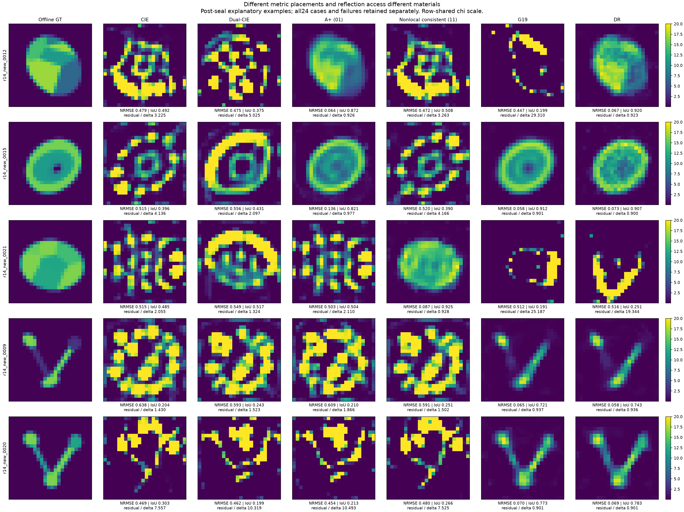

# MAX-STRUCT R14：双度量、有限程序与材料可达性

## 最终判断

**A+对CIE的二维恢复增量是真实的，但不能解释成“一个更好的metric放到两个块都会更好”，也不能解释成“不一致本身总是更好”。本轮实际发现了两种不同的恢复能力：01保住并推广了A+的部分优势；一致非局部11又独立恢复了A+、CIE、Dual、G19、DR和direct全部失手的新高对比对象。**

最有用的新认识是：真正决定结果的不是理想根处一个谱半径，而是**非局部metric放在哪个块、早期有限current轨迹、材料相关metric的非根导数力，以及最终原物理选择**的共同作用。根附近闭环理论在其假设下成立，但不是实际有限PR程序的稳定性或恢复定理。

本轮完成576次全程反演、完整状态干预、根与非根诊断及独立24材料验证。由机制提出的单次01→11切换已实际实现和验证，保留了原A+成功集合，**没有增加恢复数**。没有通过换β、重训NN、追加GT选根或扩大扫参制造成功。

## 1. 先对齐实验，避免再出现无意义的排名翻转

| 组别 | 材料/条件 | 方法运行数 | 证据身份 |
|---|---:|---:|---|
| 主四metric | 已曝光48对象 | 192 | 后续机制实验，非新盲测 |
| self/β控制 | 其中固定16对象 | 48 | 归因控制 |
| stage次序 | 同16对象 | 32 | 早期/晚期作用控制 |
| 共享material solver | 固定4对象 | 16 | 排除Arc与ordinary内循环差异 |
| 新独立组 | 新seed24对象、11方法 | 264 | 参数/选择冻结后预测，再封存评分 |
| 真三维 | 3个旧几何、4条件 | 24 | vector Maxwell几何对应实验 |

次数不能充当独立材料数。R13旧48的A+-MM/Arc36/48、CIE30、Dual32、G19 30、DR29保持冻结；本轮新01为35，少的是r13_fresh_0021。数学更新接线一致，但新增state记录、实际停止与费用不同；不能把旧表覆写，也不能把新00称作原成熟CIE。

所有新二维方法都使用576独立实χ、同数据、box[.02,20]、初值χ=.1和原prior。没有NN初值混入某一臂。新24为8种已有家族×low/high/mixed三种contrast，含4个cross-grid条件；属于新对象/条件确认，不是未见家族泛化。本文J=χQ为归一化对比极化量，物理电流另含−iωεb因子。

## 2. 四组合真正比较的是什么

\[
P_0(m)=\operatorname{diag}\frac{b_0}{1+b_0m},\quad
P_1(m)=(I+D_aG_o)D_p,
\]
\[
d_i=1+(b_1-G_{ii})m_i,\quad a_i=m_i/d_i,\quad p_i=b_1/d_i.
\]

M=P*P。G_o严格保留原互不重叠2×2四cell块的非对角Green；不是full-G或two-hop。二维b0=1，b1按原material阶段1/.2/.2/.2变化。两块一致意味着用同一个材料相关函数，不能把不同β的两个scalar函数混称一致。

| Pair | Current | Material | 本轮48联合描述数 |
|---|---|---|---:|
| 00 | P0 | P0 | 29/48 |
| 01 | P0 | P1 | 35/48 |
| 10 | P1 | P0 | 30/48 |
| 11 | P1 | P1 | 31/48 |

01相对11多恢复0017、0024、0026、0045，没有丢失11的成功对象。新四臂原48秒corrector口径的已支付池保守/宽松截取仍为29/35/31/31，因而这个主趋势不是靠给01额外corrector时间产生。完整费用没有因此减少或退款。componentwise共同LU/RHS池中01为34、11为30，辅助FFT/块动作另计，不能把它们算免费。

原计划写最多48秒corrector，但主2D实现实际可用proposal提前结束的余额直到绝对120秒。这个偏差在评分与独立预测前发现并公开：四新臂按同一实际策略解释，旧R13只作不同停止合同的历史参考；新24所有旧/新方法统一同样策略。原C2文件、单行预算差异和strict48鲁棒性视图均保留。

## 3. 非局部传播、β与有限readout：哪些解释被排除了

固定16对象中，完整01恢复8个，去掉Goff的self-only01和原global-Dual各6个，完整11与self11各5个。**0017与0045的优势依赖非对角Green传播**；仅self分母或原双β没有复制它们。0024则不同：global-Dual也恢复且误差更低，不能把所有增量都归给空间传播。

材料子问题统一为χ坐标、同起点、同L-BFGS60、容差、box、prior后，0017仍只有01恢复：NRMSE .06951、IoU .8789，其他三臂NRMSE约.45–.48。0032四臂均好，0002/0037四臂仍差。**至少0017不是Möbius/Arc专属内循环效果**。这个控制只有四曝光对象，不作全48结论或Mac对Windows速度比较。

原前三stage用01、满Fourier/APCS入口切11，保留同8个对象；反向次序只保留11的同5个。切换点来自已有表示容量事件，无新残差阈值或新分母。这支持早期路径重要的解释，但独立数据又给出只有从早期使用11的已测配置才恢复的反例，不能把它推广成单一普适调度；未试调度并未被排除。

## 4. 新24独立材料：A+优势得到推广，同时出现反向关键正例

所有264预测闭合、公开选择计划固定后才读GT，0运行缺失、0评分issue。

| 方法 | 联合描述数/24 | 平均amplitude NRMSE | 平均IoU | 实际平均child CPU秒 |
|---|---:|---:|---:|---:|
| CIE | 9 | .24374 | .64774 | 118.37 |
| Dual-CIE | 9 | .23776 | .64944 | 119.18 |
| global-Dual | 10 | .22139 | .66942 | 118.66 |
| A+ /01 | 12 | .18871 | .69723 | 120.57 |
| 11一致非局部 | 11 | .20595 | .68014 | 120.65 |
| 01→11 | 12 | .18816 | .69764 | 120.26 |
| G19 | 11 | .19708 | .64597 | 120.31 |
| DR | 14 | .15109 | .71506 | 116.57 |
| direct L-BFGS | 2 | .86248 | .23369 | 70.31 |

这里120是整进程允许上限，不是假装每种方法都恰好花120。终止后导出等操作全部计费，超限候选不能回填预算内。不同矩阵分解与DR固定投影也没有免费。

**A+对CIE新增0006/0012/0015，对Dual新增0012/0015/0022，没有丢失各自成功对象。**0012的A+ NRMSE .0636，而CIE/Dual约.475；0015为.1358，对照约.515/.556。这些是实际材料差异，不只是residual或门槛标签。低contrast平均表现接近；高contrast为A+3/8、CIE2/8、Dual1/8，混合为5/8、3/8、4/8。

A+对CIE配对平均NRMSE差−.0550，描述性对象bootstrap区间[−.1086,−.0040]；对Dual为−.0490，[−.1005,−.0023]。区间未作多重比较调整，不能据此宣布总体统计或新颖性证书。A+与DR差的区间跨0，点估计DR更好。

**成对成本截取也保留了这一增量。**分别把A+与每个对照限制到两臂共同已支付process CPU端点，A+对CIE/Dual仍为12比9，平均NRMSE差−.05570/−.04937；再按两臂共同physical LU与aggregate RHS上限截取，仍为12比9，差−.05392/−.04808。各case候选均先按公开Φ选定再附真值。全部原运行费用保留，截取不是实际提前停止重跑或退款；DR固定背景与辅助动作另计。全11臂共同端点会被早停direct拉低，单独表与成对表回答不同预算问题。原表均保存，见[成对成本附注](analysis/pairwise_cost_independent24_v1/report.html)。

**不能遗漏的新算法正例是r14_new_0021。**这是matched-grid高contrast random-level patchwork。11达到NRMSE .08696、IoU .9252、残差/δ .9283；A+、00、10、CIE、Dual、global-Dual、G19、DR、direct及晚切11均未恢复。A+为.5034，DR为.5163。这个在预测前冻结的方法确实打开了现有栈未找到的材料区域，不能因其平均数低于01而抹掉。

这项恢复属于**11 proposal＋共同物理corrector**。0021的01/11 raw Φ都约.02666，raw NRMSE为.3956/.3648，两者均未达完整恢复；共同corrector后却分别为.5034/.0870。两条proposal都跑到72秒上限，11实际PR步2149还少于01的2205；strict48口径仍保留该差异，成对共同LU/RHS池中11仍为NRMSE .0897。因此不能用“11仅多拿corrector时间”解释，也不应把raw11本身称为已恢复。0015同样需要把proposal与corrector效果连接起来。

但11又失去01的0012/0015，01→11同样救不回0021。因此本轮没有得到“选对一个固定metric就全面解决收敛”的结果。late switch的成功集合与A+完全相同，平均NRMSE只变化−.000548，不能宣称新恢复突破。

这组图是封存后的机制说明；完整24对象及全部失败仍在独立图集，不用于调整算法或统计分母。

## 5. A+、G19与DR分别擅长什么

DR在混合contrast组为7/8，A+5/8；高contrast两者均3/8。0009/0020上G19和DR明显恢复，A+仍在错误材料区域。0012上A+/DR好而G19差；0021则只有11好。曝光48中反向10还恢复了01缺少的0042。**这些是互补访问能力，不能只用一个平均排名替代。**

同时要纠正对二元标签的过度解释：新0002的A+ NRMSE .0522、IoU .6667，DR为.0533/.7097；两者连续材料都好，不能称DR完成了一个A+完全失败的basin救援。0019的A+与DR为NRMSE .05418/.05968、IoU .79747/.63542，支持差比0002更明显，但连续材料仍都低误差，须结合细结构图像解释。联合标准保持不改，主要结构恢复/部分恢复的后验解释另列，不制造新预注册成功率。

预冻结01→G19→DR公开回放为14/24，花3846.796875 CPU秒，平均160.28秒；DR单方法为2797.609375秒，平均116.57秒。它不是120秒总算法，不是warm restart，也不是GT并集。看到0021后再把11加入顺序可以成为后续开发想法，但本轮没有把这种事后规则伪装成独立确认结果。

## 6. 理想闭环为什么还解释不了实际恢复差异

Pro的T_m基于精确根、固定活动面、无prior、独立current坐标与精确两块最佳响应。一致metric的谱[0,1]是该条件下的正确结构。新8²实例得到01理想ρ=1.002712449，但实际有限程序不是这个映射。

一是current只做有限PR，native Fourier/DPCS坐标和历史方向都影响响应。实际与理想差可分为current正规方程误差传到材料的项和material内解误差；本轮根处主要差异落在前者。三个声明尺度下的current方向加法缺陷也没有消失，不能用一次中心差分就宣布取得完整程序Jacobian。

二是material-only扰动不等于完整闭环模态。32步材料收缩不能反驳完整state的弱扩张；补充兼容current/material扰动后，01在声明尺度的128次读出全部nit=0，原guard梯度低于1e−8。这是有限尺度deadband，不是渐近稳定证明，也没有通过改gtol/epsilon搜到想要的结果。

三是非根状态存在理想一阶根模型不含的项：

\[
g_m=-\rho\Re C^*P^*(r\Omega_s)
 +g_{metric}+\nabla R,
\qquad
\langle g_{metric},h\rangle=\rho\Re\langle r\Omega_s,(DP[h])e\rangle.
\]

g_metric在根处是O(||e||²)，但原7checkpoint×8枝的56个first-step中，其与构成力的范数比为.1003–2.0673，各组中位数约1。构成力单独对实际Δm上坡38/56，完整梯度上坡0/56。P0也有这项；不能只给P1补导数。这不是新的链式法则定理，而是**真实搜索途中被理想根叙事遗漏的量级证据**。

完整192轨迹有519199条native记录、170917个已付费候选。逐阶段current步下降并不等于material后同一势下降；signed work与物理Φ分开。原生PR“非下降方向重启”记录全0，也不意味着PR+没有截断或stage没有重置。所有相关按48材料对象汇总，仅为曝光后的描述，未训练或冻结恢复预测器。

## 7. 五个共同严重失败：还没有解决什么

0007、0016、0029、0037、0044的真实材料在同一离散模型中可入原噪声球，且其Φ低于本轮四pair的全部20个primary。这排除了“只是现有prior必然更喜欢当前终点”的简单解释。

但19/20端点沿预定微小物理探针仍有下降，多数corrector是预算停机；0016的一条还有相对目标停止而投影梯度未消失。存在微小下降不代表继续几步就能恢复GT，也不能把它们叫已证严格局部极小。现有证据更准确地描述为**具有已知更好合法参考、仍受路径/病态/预算影响的难搜索区域**。没有证明这些材料全局唯一，或宣称一个optimizer能凭空消除有限噪声歧义。

## 8. Corrector、候选保留与三维

主48四臂raw联合数19/20/22/22，经corrector成为29/35/30/31，整体有帮助。可是在共享solver控制上14/16的连续NRMSE增加，幅度和结构意义必须逐例看；原物理minΦ的165467次incumbent更新中60580次NRMSE增加，不能将这些依赖步骤当独立统计样本。

三维使用真实648分量dyadic current、216共享实材料、60外部dipole与24component局部块，四pair共用完整导数L-BFGS12，另有sourcewise CIE/Dual。三个matched几何的四pair平均NRMSE约.1399，CIE约.1489、Dual约.1399；没有普遍的新恢复优势。bracket的00/11材料数组确实不同，并非纯precision翻转；但普通CIE也有相近表现。

frame的CIE corrector给出了明确反例：Φ从.003808降到.0004125，NRMSE从.2625升到.2840，IoU从.5588降到.2636。frame cross-grid clean模型差约8%，大于1%噪声，不能据噪声球失败归咎优化。既有Mie/离散误差限制保留，不将matched低残差冒充连续三维认证。

本轮没有新Fresnel/Austria反演、NN训练或NN×四metric实验；没有用空模板充数。它们的旧证据和接口边界均保留，见BENCHMARKS与TECH_STACK_MAP。

## 9. 成本、可复现与论文资格

576个成功solver的完整OS CPU为64294.503713秒，约17.86 CPU小时；另16次导入失败为.514267秒。Windows使用既有i9，主48为8P lanes，新24为8P+4E lanes，单BLAS线程；本轮没有CUDA移植。所有大文件保存在外置盘或本任务远端。

576阶scalar、648阶vector物理分解分别计量，DR另计24个背景Cholesky、960 setup RHS及673092 iteration RHS。setup/online/validation/scoring/transport与失败费用分开；没有把多个线程wall之和叫并行历时。归档中一次冗余文本扫描的已测CPU下界473.875秒和未知尾部也保留。模型/API实际账单未取得，不填虚假的货币0。

本轮足以支撑**有实际算法增量的机制研究稿**：A+在独立二维保留CIE成功并新增困难恢复，一致非局部变体又有独立独有正例，且归因控制和负结果完整。论文不需要所有case全胜。但目前不能声称已经达到强TAP/强SIAM/Inverse Problems的全部要求：根谱到有限恢复尚无可靠预测定理，stage控制没有新增集合，三维增量有限，外部实测/经典作者合同与连续物理证据仍不足。

最值得下一轮研究的公式是**有限current误差传递项与非根g_metric的联合状态依赖**，以及为什么同一早期metric在0012/0015和0021上选择相反的材料区域。下一步应利用已发布完整state与反例提出可证伪预测，优先于继续加Green阶数、换β或堆NN。具体数组、开放问题和可重放入口见PRO_HANDOFF；本轮不会把尚未验证的选择器写成成熟算法。

## 证据入口

- [完整四组合评分](analysis/exposed48_v2/report.html)，[可读48全图](FIGURES/exposed48/all48_readable.pdf)。
- [独立24全方法](analysis/independent24_v1/report.html)，[逐对象gain/loss](analysis/independent24_v1/POSTHOC_GAIN_LOSS.csv)。
- [同材料求解器](analysis/shared_readout4_v1/REPORT_ZH.md)，[恢复动力学](analysis/recovery_dynamics_v1/report.html)。
- [非根材料力](audit/material_force_decomposition_v1/report.html)，[三维结果](analysis/vector4_v1/REPORT_ZH.md)。
- [理论推导](THEORY_DERIVATIONS.md)，[实现审计](BASELINE_AUDIT.md)，[费用](COST_LEDGER.md)，[失败](FAILURES.md)，[复现](REPRODUCE.md)。
- 原始全字段/全部候选/checkpoint/公开输入与离线真值分包：见最终DOWNLOADS索引。材料-only review包不替代全字段原档。
