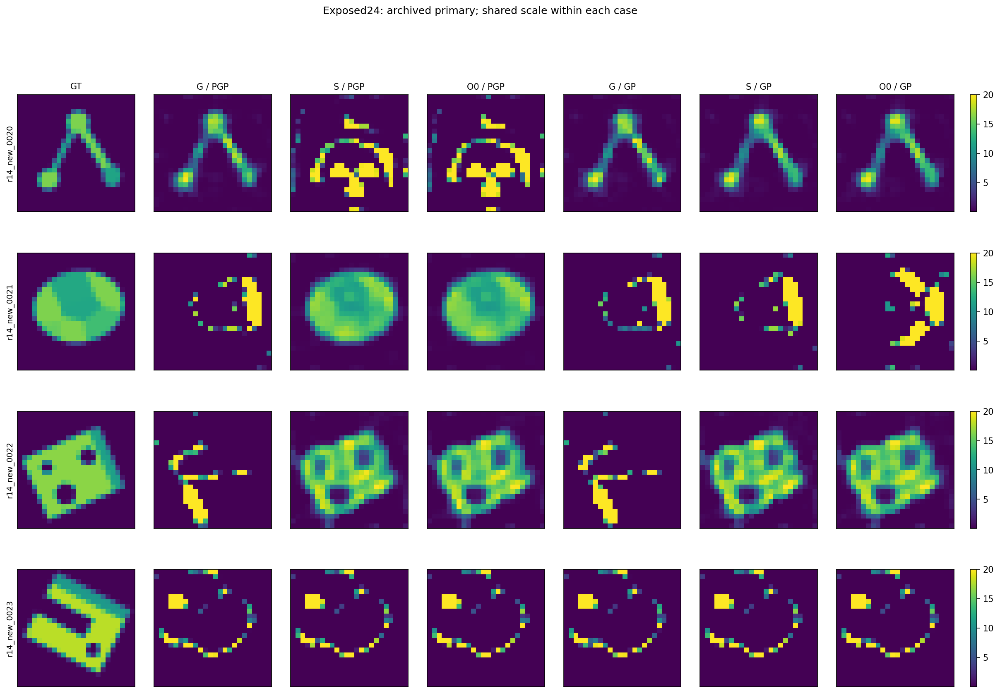

# G19的19维应由内部传播还是观测选择？

**最终判断：观测选基是有价值的修正。** 在本轮同一批24材料、同一120秒整进程CPU预算的144次反演中，S选基使平均材料NRMSE从0.19843降至0.15892，旧联合标准的恢复数从10/24增至12/24。它新增恢复了若干内部Green基无法恢复的材料，也损失了两个原正例。更严格对齐已付费CPU和物理LU/RHS候选前缀后是11对10，连续误差优势仍在；不能把全部净增2例都当成排除预算时序后的确定增量。

0021提供了清楚的机制分辨：S-PGP已在raw阶段恢复其主体，经共同corrector进一步改善；S-GP仍陷入坏终点。**选基来源与Green输出侧的投影共同改变了材料路径，不是仅保留更多内部传播就更好。** O0补充初值resolvent后没有再增加最终恢复数。本轮不追加rank、anchor、算法或新材料扫描。

这24对象已在R14公开评分，本轮是曝光后的配对跟进，不能叫新盲确认；没有三维、实测、NN训练或新照明证据。144任务均完成，原候选封存并父审批准后才离线评分；selector审查issues=0。

## 1. 对你提出的谱与加法性问题的修正

原邻域条件限制的是A=DaGoff或固定材料传播图，不是材料闭环T。即使rho(A)<1，I+A的特征值1+lambda(A)也可以模长大于1；可逆性与收缩性不同。R14所报1.0027则属于更不同的current→material闭环。两块在同一度量中作精确最佳响应时，有自身材料Gram下的非扩张结构；不一致度量给出斜投影式组合，可以推过弱收缩方向的1边界。这不违反原传播谱条件，也不需要加入更高阶Green作用。详见[完整公式与反例](THEORY_CLARIFICATION_ZH.md)。

你说Möbius算法不必加法，是正确的。此前“加法性检查”只能限定能否用**同一线性Jacobian**解释有限程序响应，不是对算法合法性的要求。光滑Möbius的导数线性；实际PR/线搜索、guard和有限内解的方向响应未必能拼成一个统一导数矩阵。不能因不加法否定算法，也不能把方向差分矩阵的谱无条件当作实际程序谱。

若“另一个noise domain”指另一个盆地，应将它与噪声球分开。改变metric可以改变到达哪个材料区域，但Y、δ和原Maxwell可行集合均未变。局部扩张可能帮助探索，也可能排斥正确根；不保证进入噪声球或正确材料。

## 2. 本次到底改了什么

原G19实际保留内部G的19个强**右奇异方向**，通过K=PGP进入辅助材料分母；Full指完整移动分母的材料导数，不是全秩G。576个实材料未知量、真实forward的G、测量、prior、box、current Fourier/DPCS容量和原corrector完全保留。

六臂只比较公开G、接收S、共同公开初值m0=.1处O0=S(I−Dm0G)^−1的19维右基，并分别用PGP或GP。S/O0为矩形，不能直接替代内部方阵G；仍用内部G构造K。当前共同标量白化不改变右子空间。O0复用初始化LU，额外接收伴随RHS计费；没有GT、拟合终点或额外物理观测。完整合同见[EXPERIMENT_CONTRACT](EXPERIMENT_CONTRACT.md)。

CIE原论文已经用接收算子S的SVD确定DPCS；本轮研究的是**同样的观测几何应否进入G19分母**，不是首次发现观测子空间。[CIE-I原文](https://www.mdpi.com/2313-433X/5/2/27)。

## 3. 全24对象结果与费用口径

|19维选基 / 分母|raw恢复|primary恢复/24|平均NRMSE|平均IoU|共同CPU前缀恢复|共同LU/RHS候选恢复|
|---|---:|---:|---:|---:|---:|---:|
|G / PGP|5|10|0.19843|0.63796|10|10|
|S / PGP|9|12|0.15892|0.69516|11|11|
|O0 / PGP|10|12|0.15995|0.69694|11|11|
|G / GP|4|10|0.19767|0.63935|10|10|
|S / GP|7|12|0.16107|0.69157|11|11|
|O0 / GP|6|12|0.16221|0.69032|11|11|

联合恢复只沿用旧NRMSE≤.15且IoU≥.70作离线描述，不用于在线选根。primary始终最小合法、预算内原Phi=D+R。各臂全部24在分母中，完整材料图分六页展示，没有只保留成功对象。四个cross-grid对象的原CN99噪声球不包含模型误差，字面残差/δ与证书资格分开列在ALL_VIEWS；不能把跨网格残差一律称严格噪声证书。

共同CPU前缀在每个对象各臂最后已付费可审计时间的共同截断上重放选根；共同物理前缀按LU和complex RHS逐分量共同预算选候选，全部已经发生的额外开销仍收费。这是已保存候选池分析，不是额外运行了停止版算法，也不是每个小19阶LU等价576阶物理LU。

G-PGP的原同轮实测CPU总2838.05秒，S-PGP2882.56秒，O0-PGP2889.61秒。主队列144次OS整子进程CPU总17199.390625秒（4.778小时），并行历时1614.145秒（26.90分钟）。原物理合计98387 LU、1913532复RHS，分母小系统、FFT、SVD另记；它们不是免费。120是候选资格上限，外部OS退出时钟仍含不可中断尾部及序列化，最大120.84375秒，照实计费。见[COST_LEDGER](COST_LEDGER.md)。

S-PGP相对G-PGP新增恢复完整ID r14_new_0003、0012、0021、0022，丢失0009和0020；不是对原成功集的无损扩张。S-GP保住0020但丢失0021，所以它虽然也是12/24，成功集合不同。O0两投影的恢复集合分别与S相同，没有新增对象。几何主结构已显现但未过联合门槛的情况仍保留连续指标和图，不重新定义门槛以增加成功数。

NRMSE均值改善约19.9%，但固定24对象的描述性配对bootstrap区间跨零，不能据此宣称总体统计优势或独立论文确认。旧R14 G19的11/24保留为历史参考；本次同实现重新实测原G基为10/24；唯一集合差是0019，旧/新NRMSE为.05120/.05977、IoU为.78750/.68966，主体结构仍可见，并非从正确恢复退化成严重失败。同名预算下实际完成的候选数和LU/RHS不同，不能把该跨轮变化归因于某个算法修正。严格六臂比较使用本轮控制，不偷换旧表。

## 4. 0021：新结果支持观测修正，但旧结果归属要准确

原r14_new_0021的历史赢家是双块一致非局部11+corrector，不是原G19；另一个r13_fresh_0021也不是同一材料。本次才真正使G19的观测分母在新0021上恢复：

|分母|raw NRMSE / IoU|primary NRMSE / IoU|primary Phi|
|---|---:|---:|---:|
|G / PGP|0.46675 / 0.33984|0.49929 / 0.20165|0.0353848|
|S / PGP|0.10234 / 0.85145|0.05106 / 0.93254|5.33327e-05|
|O0 / PGP|0.10359 / 0.84532|0.05078 / 0.93254|5.33116e-05|
|G / GP|0.46271 / 0.33468|0.48802 / 0.22083|0.0350799|
|S / GP|0.42124 / 0.68148|0.47222 / 0.21339|0.0360541|
|O0 / GP|0.42921 / 0.46565|0.48703 / 0.27935|0.0184445|

S-PGP的raw在约68.06进程CPU秒已达到NRMSE=.10234、IoU=.85145；corrector才将其提高到.05106/.93254。因此不是corrector从同一个坏起点凭空制造全部收益。内部G-PGP的corrector虽把Phi从.13446降至.03538，材料NRMSE反而从.46675升至.49929。两者正说明原物理目标下降与材料恢复必须分开判断。

## 5. 为什么观测信息有用，却不能用覆盖率直接选算法

真正材料导数是deltaY_s=WS(I−DmG)^−1 D_Qs h。S是current直接可见性，O是本构缺陷的端口运输；**两者均不是完整材料Jacobian**。误差最终落在材料输出，不代表只需对材料误差投影S，也不证明内部传播不重要。R14的主要有限程序误差是current响应误差经读出运输至材料，不能改称“纯材料内解误差”。

预声明的七对象×三checkpoint已全部保存，21个共同状态分别计算六臂原条件读出和真实Phi，共126条离线诊断。原G-PGP重复读出的m_after差异最大为0，确认同输入确实复现；没有重建PR历史或声称这是完整程序干预。诊断不含GT，不进入主候选池。

对0021第一次readout，G/S/O0保留原本构残差current能量分别97.105%、99.819%、99.878%；经当时完整resolvent运输后的相对端口遗漏分别.01789、.002514、7.53e−7。S与O0确实更贴近早期端口方向，材料步对负原物理梯度的夹角也由50.61度降至44.83/44.41度。这支持早期读出几何被改变这一局部解释。

但在**G-PGP坏轨迹**的第128次readout，S遗漏比约1.004，已不优于G的.333；同状态S条件步甚至使Phi增加.04551。第512次，S遗漏比约1.036仍高于G的.462，却能给出更大的单步Phi下降。这是覆盖率、单步物理下降及长程材料恢复不等价的直接反例。比例可以大于1，因为不同分量的相位抵消；不是0–100%的材料信息百分比。

另一个反例是GP：在第一次0021条件读出中，S-GP的单步Phi下降还略好于S-PGP，但完整GP轨迹没有恢复0021。**更完整的G输出、较小的一次Phi和更高的早期端口覆盖，均不是恢复的充分条件。** 现在有证据说“观测几何与输出裁剪改变路径”，还没有证据用单个局部标量预测其最终盆地。

## 6. 建议与本次结论边界

就当前实现，S-PGP是值得保留的简单候选：无需O0的额外伴随/RHS，平均误差更低，直接救回0021及另外三个对象。O0没有最终新增恢复，暂无理由继续加anchor复杂度。内部G基的0009/0020正例也必须保留，不能把全部分母统一替换后称普遍改进。

下一步数学分析最值得解释的是：**同一个接收右子空间中，为什么输出侧P能保住0021，却会损伤0020；以及早期材料–current切向角度怎样累计为不同可达区域。** 已保存完整分母基、current/field和关键读出，可供后续理论研究。本次只交证据与建议，不自动启动新算法或扫参。

全部10张主分析图及3组同状态解释图、逐对象表、raw/corrected/secondary、同状态诊断及失败回执均可从[图集](galleries.html)和[数据下载](evidence.html)访问。完整公式见[理论澄清](THEORY_CLARIFICATION_ZH.md)，代码、原始full-field和成本分卷一并发布。网页访问成功不改变本节科学范围。
