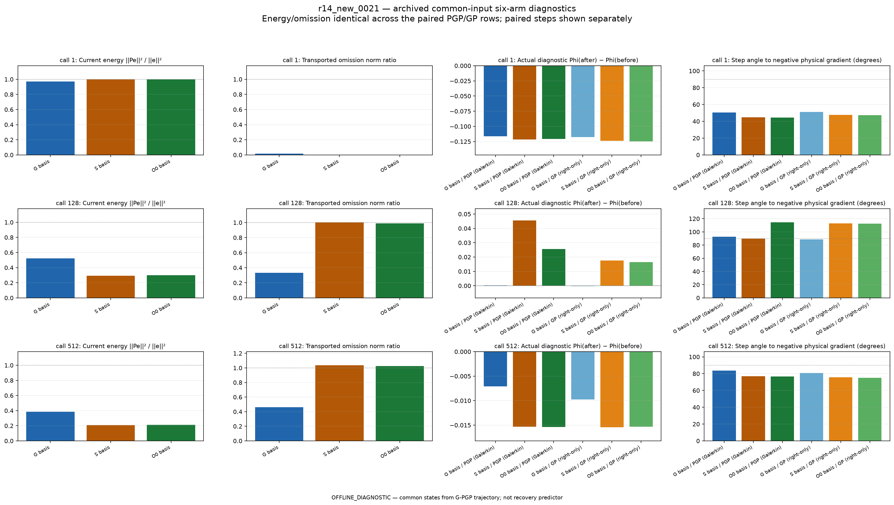
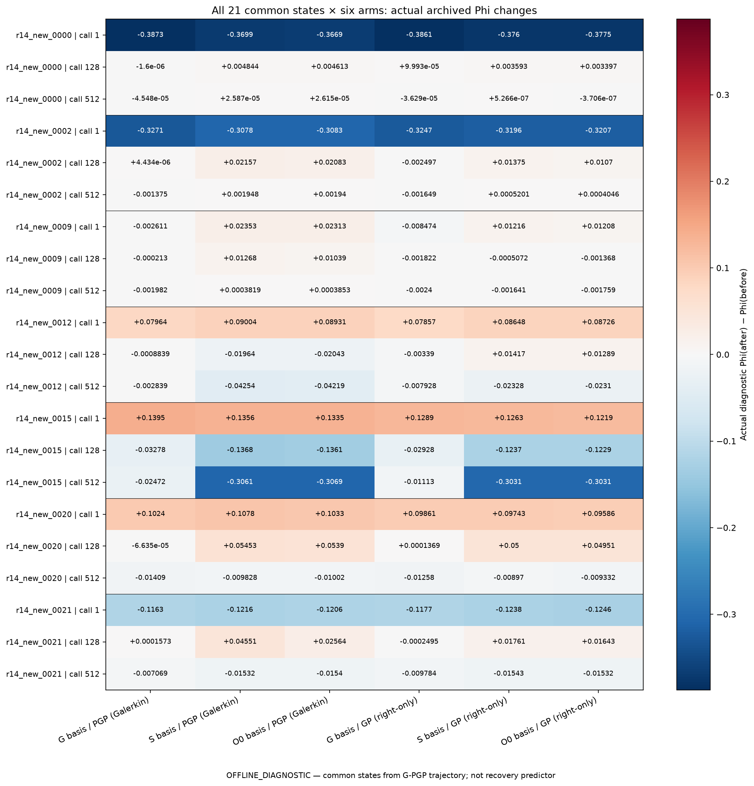
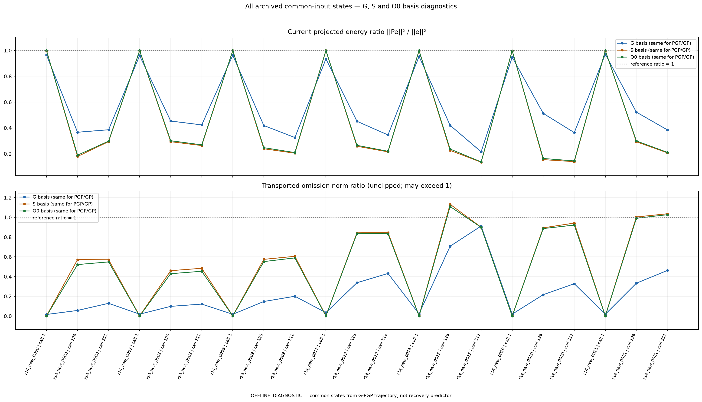

# Archived common-state diagnostic summary

OFFLINE_DIAGNOSTIC — common states from G-PGP trajectory; not recovery predictor

Mechanical summary only: 21 common states = 7 cases × calls 1/128/512; six arms at each state (126 rows). No truth arrays, new physics, scoring, SVD or rank selection.

Reported repeated G-PGP m_after max differences: Linf=0; L2=0 across all 21 states. These values were checked in the archived JSON; original NPZ states were not reloaded.

Common Phi_before maximum difference against COMMON_STATES.json: 0.

Transported omission ratios greater than 1: 10 arm rows (paired projections counted separately). All plotted at their actual values; this norm ratio is not labeled a material-information percentage.

Archived errors: 0; archived warnings: 0.

| Arm | Phi change min | Phi change median | Phi change max | Transported omission max |
|---|---:|---:|---:|---:|
| G basis / PGP (Galerkin) | -0.38730061 | -0.0013754568 | 0.13953832 | 0.91181971 |
| S basis / PGP (Galerkin) | -0.36991574 | 0.000381921 | 0.13564739 | 1.1321066 |
| O0 basis / PGP (Galerkin) | -0.36687684 | 0.00038533368 | 0.1334559 | 1.1097375 |
| G basis / GP (right-only) | -0.38606245 | -0.0024966441 | 0.1289299 | 0.91181971 |
| S basis / GP (right-only) | -0.37598412 | 5.266259e-07 | 0.12627941 | 1.1321066 |
| O0 basis / GP (right-only) | -0.37745598 | -3.7064732e-07 | 0.12186387 | 1.1097375 |

All seven case IDs: r14_new_0000, r14_new_0002, r14_new_0009, r14_new_0012, r14_new_0015, r14_new_0020, r14_new_0021.

The object-specific figure contains all three requested calls for r14_new_0021. The other two figures include every common state. Original arm keys and all rows are in DIAGNOSTIC_COMPACT.csv. Scientific interpretation remains with the parent review.

