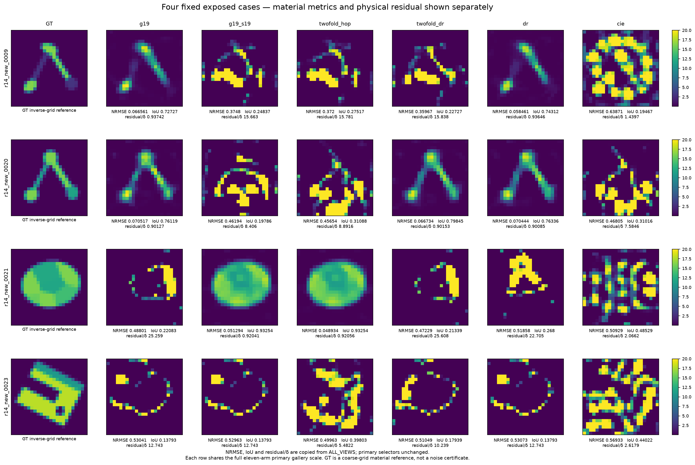

# Observation-Aligned Material Feedback and the Limits of Spectrally Routed Reflection in Maxwell Inversion

Research draft, not submitted. The evidence supports a finite-model mechanism study; it does not establish a new broadly superior imaging algorithm.

## Abstract

We study whether observation and internal-propagation subspaces can organize material feedback and reflection in high-contrast Maxwell inverse scattering. Starting from an existing CIE-derived Green-feedback solver, we replace its internal rank-19 denominator by observation-aligned or conditionally joint subspaces, retain one residual neighborhood action, and route periodic field–current reflection through a weak-observation/strong-propagation sector. The two operators generally lack a common singular frame. We therefore use an explicitly ordered conditional decomposition, and distinguish current-space routing from material-space constraints. On 24 previously exposed two-dimensional materials, 264 budgeted inversions give 11 recoveries for the original feedback solver, 12 for the observation-aligned and routed variants, 9 for CIE and Dual-CIE, and 13 for the independent full-field reflection pipeline under the unchanged joint material criterion. The observation-aligned denominator gains four objects and loses three relative to the original solver; routed reflection gains one and loses another relative to its non-reflecting control. Same-state interventions, finite material readouts and saved field/current states identify limitations of immediate physical descent, auxiliary-state reinjection and active-boundary accessibility. These findings favor a simpler observation-aligned denominator for further study and challenge the treatment of background spectral sectors as independent material domains.

## 1. Introduction

High-contrast inverse scattering couples material, total fields and contrast currents through multiple scattering. A lower auxiliary objective, a lower physical data objective and a more accurate material are distinct outcomes. The user's A-material, A+, G19 and reflection studies have previously demonstrated complementary recovery paths, but those historical comparisons do not explain which operator geometry supplies the improvement.

This work asks a narrow question: can reception and propagation spectra select the finite material feedback retained in a G19 denominator, while an alternative reflection mechanism acts on the excluded strong-propagation directions? Our contribution is an audited implementation and a set of falsifying comparisons, not a claim that subspaces or Douglas–Rachford splitting are new. In particular, the reflection hybrid is compared with its non-reflecting version, AP, PR resets, full-space periodic reflection and the independent existing DR pipeline.

## 2. Related work

Observation-based current decompositions have direct precedents in Chen's subspace-based optimization method [1] and Zhong–Chen's twofold method [2]. Two noncommuting subspaces cannot generally be represented by their four exact intersections; principal angles and generic angle planes are standard [3,4]. Nonphysical intermediate states and retained normal memory occur in established reflection/RRR methods [5]. Block-coordinate splitting results [6] require assumptions not supplied by a moving G19 anchor with a nonconvex material projection and auxiliary-state reinjection.

Our closest-work search obtained official abstract-level evidence for [1,2], partial/indexed evidence for [3,4] and the recorded full-text scope for [5,6]; it was not an exhaustive novelty proof. The underlying CIE/FFT-TSOM, A+, G19 and full-field reflection implementations are inherited project baselines. No mature method is rebranded as a discovery of this work.

## 3. Physical and experimental model

The finite scalar-TM volume-integral model is

\[
J=D_mQ,\qquad Q=E^{inc}+GJ,\qquad F(m)=SJ.
\]

All inversions retain 576 independent real material contrasts with the same box [.02, 20], prior, illumination and receiver data. The primary selector minimizes the original physical objective Phi = D+R over completed, paid, legal candidates. A pre-existing secondary selector minimizes R among legal candidates within the declared CN99 noise ball, retaining primary when none qualifies. Ground truth is used only for post-seal diagnostics and scoring.

The 24 R14 materials are already public. Sixteen have 12 illuminations and eight have 6; the two acquisition geometries use 48 receivers with full or half aperture. Noise levels are 1% or 2%. Four cases use 36×36 forward acquisition with 24×24 inversion; twenty are matched-grid. These are 24 material clusters but only two distinct background operator geometries. This is neither a new blind cohort nor a vector-three-dimensional experiment.

## 4. Conditional twofold material feedback

First split the right singular space of S at relative singular value 0.1 into V_s and V_w. Within each sector diagonalize V*G*GV and classify squared propagation energy at 0.01 ||G||². This produces mutually orthogonal U11, U10, U01, U00 spanning the input space, with the first bit denoting S. It is an ordered conditional decomposition, not a simultaneous singular decomposition or the intersection of globally thresholded subspaces.

Let P = U11U11*, K = PGP and N be the existing disjoint four-cell off-diagonal Green action. Define

\[
A=I+\beta D_m-D_mK,\quad R_N=N-PNP,
\]
\[
T_me=\beta\left[A^{-1}e+A^{-1}D_mR_NA^{-1}e\right],\quad e=J-D_mQ.
\]

Only one residual insertion is taken. The derivative includes the material dependence of A and of D_mR_N. A Neumann remainder estimate needs an additional contraction hypothesis; no uniform all-box contraction or positive-definiteness lower bound is claimed. The original Maxwell forward retains the full G and S.

The full/half-aperture complex dimensions are 11/0/9/556 and 6/0/13/557. Hence U10 is empty and P equals the entire S-strong projector in both geometries. This degeneracy is scientifically important: the joint threshold adds no distinct restriction within S-strong in this experiment. G supplies additional classification only in S-weak.

## 5. Routed reflection and a structural obstruction

Using the inherited scale X = J/6, write g = (X, Q), retain normal memory n and set H = P01 on both state components. Every 16 completed G19 steps and at stage boundaries,

\[
z=g+n,\quad c=P_{\mathcal C}(z),\quad a=P_{\mathcal A}(2c-z),
\]
\[
n^+=n+H(a-c),\qquad c^+=P_{\mathcal C}(g+n^+).
\]

The material shadow is physically audited, then injected into the original DPCS/Fourier current representation; fields are recomputed and PR is reset. The paid minimum-Phi incumbent is protected, but the state injection is unconditional. No GT-based acceptance occurs. AP and full-space controls keep their explicit inherited projection rules.

**Proposition 1.** If a fixed orthogonal projector P commutes with every independently variable material diagonal D_m in an open box, P is a coordinate projector.

**Proof.** For i ≠ j, commutation implies (m_i−m_j)P_ij = 0. Independent variation gives P_ij = 0. An orthogonal diagonal projector has diagonal entries 0 or 1. Consequently a general spectral projector cannot isolate an independent material feasibility set. This algebraic statement applies to the finite model; it is not a continuous uniqueness theorem.

**Proposition 2.** At a fixed feasible anchor, if both projection derivatives are orthogonal tangent projectors in the same Hilbert metric, the linearized routed normal-memory map has norm at most one.

**Proof.** The full tangent DR map is T = (I+R_AR_C)/2, with orthogonal reflections R_A,R_C. Thus ||T|| ≤ 1, and ||HTn|| ≤ ||n|| on range H. This is a standard projection consequence. Moving anchors, non-root curvature, active-set changes, PR history and reinjection are outside the statement. The actual hybrid is not exact DR on independently feasible spectral material sectors.

The complete derivative and assumptions appear in THEORY_DERIVATIONS.md; the implementation does not use a frozen metric derivative in place of the true moving-material derivative.

## 6. Paired experiments and costs

Each inversion has a 120-second whole-process CPU limit. Proposal stops at absolute CPU 72 seconds; the common original-physics corrector receives the remaining allowance. Setup, SVD, fixed projection factors, material readouts and candidate audits are paid. Late completions are recorded but not eligible at an earlier budget. Twelve i9 lanes use one BLAS thread each; all arms for an object run sequentially on the same core. Per-object pairing limits core-assignment confounding; it does not make absolute times portable across hosts.

| Method | Raw recoveries | Primary recoveries | Secondary with fallback | Mean primary NRMSE |
| --- | ---: | ---: | ---: | ---: |
| CIE | 8 | 9 | 10 | .24343 |
| Dual-CIE | 8 | 9 | 9 | .23797 |
| Original internal-G19 | 5 | 11 | 10 | .19881 |
| Observation-right19 | 10 | 12 | 14 | .16017 |
| Conditional U11 | 10 | 12 | 13 | .16024 |
| U11 plus one neighborhood | 9 | 12 | 12 | .15805 |
| Routed DR hybrid | 7 | 12 | 12 | .16091 |
| Routed AP hybrid | 6 | 12 | 11 | .16443 |
| Full-space periodic DR hybrid | 4 | 8 | 7 | .23563 |
| PR-reset control | 9 | 12 | 13 | .15903 |
| Independent original DR pipeline | 6 | 13 | 14 | .15141 |

All counts are out of 24 and retain the existing joint threshold NRMSE ≤ .15 and IoU ≥ .70. Continuous errors and structural interpretations remain separate. Observation-right19 gains 0003, 0012, 0021, 0022 and loses 0009, 0019, 0020 relative to original G19. The routed hybrid gains 0020 and loses 0021 relative to the neighborhood version. Whole-space periodic reflection loses more objects; independent DR remains a positive control, not an instance of that hybrid.

The median paired NRMSE difference of S19 minus G19 is +.000184, despite a mean of −.03864. Descriptive material-cluster bootstrap intervals cross zero. No population-significance claim or fresh-test generalization is made. Under the common componentwise physical-LU/RHS candidate pool, original G19 and standalone DR have 12 recoveries, versus 11 for S19/U11/neighborhood/routed DR. Equal CPU, equal physical work and equal iterations answer different questions.

The 264 runs charge 31,372.375 external child CPU seconds, 203,157 Maxwell LU factorizations and 3,717,630 complex RHS. The 56 interventions add 102.375 CPU seconds, 172 LU and 2,064 RHS. Validation adds 149 LU/7,500 RHS. The 2,985,359 small main denominator LU and 84,966,012 triangular RHS are counted separately. Archive retries, transfers, plotting and publication are also reported; missing monetary bills are null, not zero.

## 7. Dynamics and failure mechanisms

Four saved checkpoint 512 sources are forked into five 64-step arms. Signed 16-step material perturbations in fixed real bands give 36 additional responses, completing 56 forks. Initial full states include material, current, field, PR and stage. These are conditional continuations from intermediate states, not rescue experiments from final wrong optima.

First, S-weak/G-strong routing does not constrain material changes to the corresponding real-material band. Across the first four saved beta = (1, 1) cycles, the routed DR material step has median 81.985% squared energy outside real U01. The corresponding current reinjection relative L2 error is 23.896%, versus 17.346% for AP and 32.796% for the full-space hybrid. These are representation diagnostics, not percentages of irrecoverable information. They support the relevance of the nonlinear material projection and the auxiliary interface, but do not independently identify their full causal contribution.

Second, immediate physical descent is not a sufficient predictor of the full solver outcome. At the same 0021 checkpoint 512, one original-G19 readout decreases Phi by .01811; S19 increases it by .003416 and the neighborhood variant by .000616. Nevertheless full S19 and neighborhood inversions recover the material whereas original G19 fails. For 0020 a finite G19 step even reverses the sign of its gradient-based physical-objective prediction.

Third, 0021 wrong primary materials occupy almost entirely incorrect box faces: G19 has 515 lower-active and 31 upper-active cells, while the routed variant has 518/29; successful S19 has 96/0. Small projected gradients do not establish a strict local minimum without second-order analysis. The finite 16-step material gains, approximately 3.7–50.5, also occur in ordinary neighborhood continuations. They are not a DR-specific spectral radius or an asymptotic Lyapunov exponent. No cycle or singular attractor is established.

Fourth, corrector and material selection can alter the interpretation. On 0013 the G19 raw material has NRMSE .0915 and IoU .962, while the corrected primary is .1856/.832. Its main shape remains recognizable; amplitude/nonuniformity deteriorate. D decreases while R increases, ruling out the blanket explanation of stronger smoothing. On 0019 the two islands remain visible and small support-threshold changes move IoU across .70. Such boundary cases must not be equated to the severe 0021 artifact.

## 8. Background nullspaces and material observability

The correct material derivative is

\[
DF(m)h=[S(I-D_mG)^{-1}D_{Q_s}h]_s,
\]

with the declared whitening/normalization when evaluating data. Background Sh = 0 does not imply DF(m)h = 0. On the 48 old G19/DR endpoints, G19 error energy in the real S numerical nullspace is 55.45% pooled and 98.22% at the per-object median. In 0021, however, 61.52% of G19 material-error energy lies in U11. Transported sector contributions have strong signed cancellations; isolated port energies cannot be normalized into information shares.

Several selected materials fail the material threshold while already lying inside the noise ball with lower Phi than the cached GT reference. These are finite-data/prior-selection limitations distinct from noisy-ball infeasibility and search failure. They are not a proof of noiseless nonuniqueness or of continuous Maxwell ambiguity. One matched coarse GT reference is slightly outside the pointwise 99% noise radius; the original noise and threshold remain unchanged. Cross-grid coarse references are not forward-error certificates.

## 9. Discussion and limitations

The observation-aligned denominator supplies a meaningful but selective recovery increment, including a severe successful 0021 case. This is stronger evidence than auxiliary descent alone. The additional conditional threshold and neighborhood term do not add recovery membership in this cohort, and the routed hybrid exchanges rather than expands the success set. The independent DR pipeline benefits from cheaper proposals and more corrector time; its end-to-end efficiency is legitimate but distinct from a claim about raw reflection search.

There is no H = 0 joint-material-projection-only full 24-object control, so the incremental effect of the route cannot be isolated completely from its joint-projection interface. Only two background operator geometries were tested, the materials were exposed, no NN was retrained and no vector 3D or measured-data experiment was added. Thresholds and budgets were frozen; their universality is not established. We do not claim that a general S-strong/G-weak direction requires a strong prior: a bounded finite diagonal counterexample already disproves that algebraic assertion.

The next mathematical target is field/resolvent-weighted material observability coupled to normal-cone and active-face accessibility. This follows from specific counterexamples rather than from increasing approximation order. Preserving multiple already-paid feasible materials is a separate selection problem. These are future questions, not unexecuted experiments reported as successes.

## 10. Conclusion

Reception-aligned material feedback can change high-contrast recovery paths at fixed CPU cost. Its benefit cannot here be attributed to joint strong-sector filtering, and adding periodic spectrally routed reflection does not yield a net recovery increment. The finite-model evidence identifies three concrete distinctions for future theory: current versus material observability, reflection versus reinjection, and objective minimization versus material selection. A broad new imaging-method claim or a strong-journal readiness claim requires evidence beyond this exposed two-dimensional cohort.

## References

1. X. Chen, “Subspace-based optimization method for solving inverse-scattering problems,” JOSA A 26, 1022 (2009). [Publisher DOI](https://doi.org/10.1364/JOSAA.26.001022).
2. Y. Zhong and X. Chen, “Twofold subspace-based optimization method for solving inverse scattering problems,” Inverse Problems 25, 085003 (2009). [Publisher DOI](https://doi.org/10.1088/0266-5611/25/8/085003).
3. P. R. Halmos, “Two subspaces,” Transactions of the AMS 144 (1969). [Publisher DOI](https://doi.org/10.1090/S0002-9947-1969-0251519-5).
4. A. Bjorck and G. H. Golub, principal-angle computation, Mathematics of Computation 27 (1973). [Publisher DOI](https://doi.org/10.1090/S0025-5718-1973-0348991-3).
5. V. Elser, “Learning without loss,” Fixed Point Theory and Algorithms for Sciences and Engineering (2021). [Publisher DOI](https://doi.org/10.1186/s13663-021-00697-1).
6. P. L. Combettes and J.-C. Pesquet, “Stochastic quasi-Fejer block-coordinate fixed point iterations with random sweeping,” SIAM Journal on Optimization 25 (2015). [Publisher DOI](https://doi.org/10.1137/140971233).

Source receipts and retrieval limits are preserved under delegated/prior_art/. All scientific counts and numerical claims above refer to R15 arrays and cost receipts, not to bibliographic sources.
