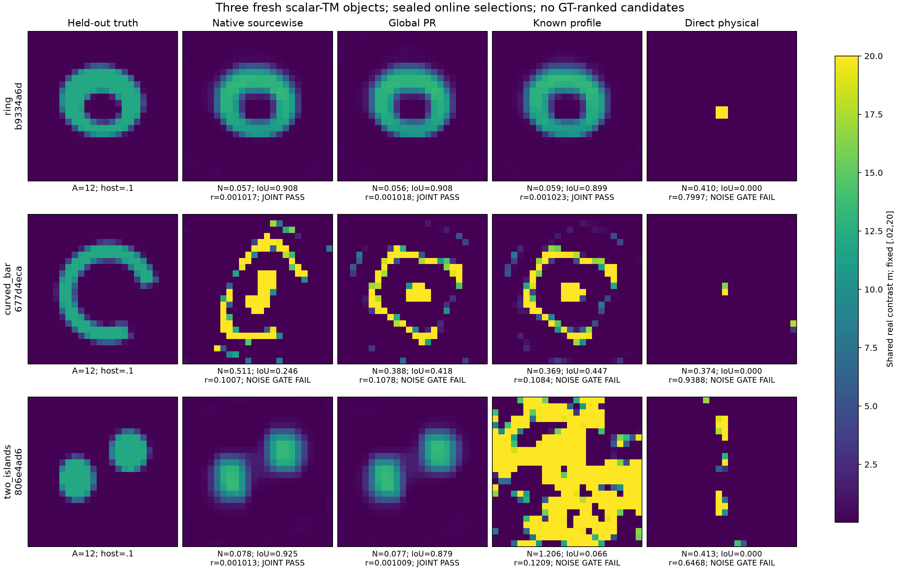
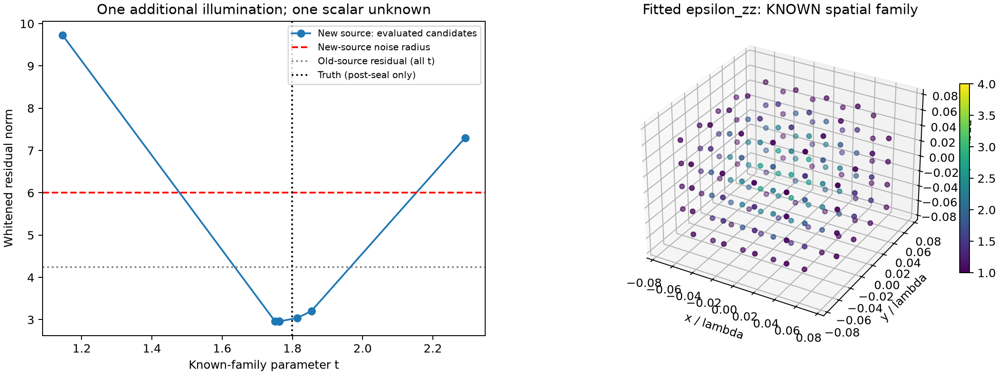

# MAX-STRUCT-R2：更精确地解释 CIE，尚未击败成熟 CIE

2026-11-02。本轮完成新理论审查、真实全波二维三对象盲测、三维新增照明采集演示及独立评分。**没有得到优于成熟双β CIE的新成像方法，也没有发现足以独立支撑新通用定理的数学首创。** 获得的是更清楚的失败分解，以及一个有实际新增观测的有限信息补偿实例。

代码、公开观测、封存预测、评分后真值、证明、图像和失败均保留。R1原结果未改写。入口：[数学推导](THEORY_DERIVATIONS.md)、[基线](BASELINE_AUDIT.md)、[数据合同](DATA_CONTRACT.md)、[原始评分](results/BLIND_SCORES.csv)、[复现](REPRODUCE.md)、[独立理论审查](audit/THEORY_REVIEW.md)。

## 一、先给出路线裁决

|问题|本轮结果|科学判断|
|---|---|---|
|global源协变更新能否补偿逐源PR的短板？|新三对象与成熟CIE同为2/3联合通过；弯条材料误差减小但数据更差|等变性成立，成像新增覆盖未成立；不替换成熟默认算法|
|精确消去全部current是否更好？|同corrector仅1/3，丢失双岛控制|精确优化辅助问题不等于更接近物理材料；该完整控制不优越|
|普通物理局部法是否已足够？|两轮允许各1000步的直接L-BFGS为0/3|本次CIE的非物理current探索仍有实际价值；不是对所有局部法的否证|
|有限多次散射是否导致失败？|现有forward求完整resolvent|不是有限Born阶数截断；表示、约束与优化路径须分别诊断|
|R1同场族能否被新观测补偿？|一次真实新增模拟采集给出相容单参数估计；遗漏族控制被整族拒绝|新增信息有效，强公开材料族先验明确；不算同数据算法收益|
|是否有论文价值？|有可复现机制审计及负面结果；相关核心数学已有直接先例|新算法/新定理论文主张HOLD；不把已有公式换名投稿|

## 二、什么数学结构值得保留

固定材料时，current的二次罚问题可以精确消去。若物理current为j*，state矩阵H可逆，K=SH⁻¹且归一化一致，则约化目标是 ½r*(I+KK*)⁻¹r，r为原始物理残差。**它等价于用材料相关度量重新衡量物理残差，而不是消除非线性。** 接收resolvent很大的方向被压低，没有统一稳定性界就不能由小profile推出小物理残差。profile也不是积分后的边缘似然。

固定同一材料与目标，Fourier仿射current空间与完整current最优值之差，恰为两极小点之间的加权距离平方的一半。增加嵌套current空间使辅助profile不增，却不保证材料更准。源基等变性则要求目标、PR、共享readout与停止共同运输；只改sourcewise_cg开关或重新逐列归一化不够。

这些论证在有限矩阵的可逆、正权重、精确内层条件下成立，状态为 **PROVED_UNDER_ASSUMPTIONS**。但查新找到直接来源：[van Leeuwen–Yang的可变度量约化式](https://arxiv.org/html/2403.15292v1)、[van Leeuwen–Herrmann的罚法消元](https://doi.org/10.1088/0266-5611/32/1/015007)、[Osborne的变量投影分解](https://etna.ricam.oeaw.ac.at/vol.28.2007-2008/pp1-15.dir/pp1-15.pdf)。本轮贡献定位为CIE专门化及实际失效审计。全部九项近邻与证据等级见[文献审查](literature/PRIOR_ART.md)。六次检索操作曾限流，后续六项身份核验成功；不宣称穷尽新颖性。

不同data/state源度量一般产生广义Sylvester系统，不能一概收费“一次分解、全部源”。full-profile控制为复用一份Cholesky明确使用总能量标量归一化；这改变了辅助度量，报告不把它与原生source-normalized CIE的差异只归因于精确性。

## 三、新盲测：高对比环、弯条和双岛

复用真实二维scalar-TM disk-pulse全多次散射算子，24×24独立实材料，12源、48复接收。生成端独立随机几何、opaque ID，材料=.1+12α，α为几何面积占比；在线未知全部576材料，不给support/字体/shape标签。噪声为相对幅度10⁻³的复圆Gaussian，实虚各σ²/2。每例99%白化半径25.1654；材料NRMSE分母固定12、预测自身Otsu的IoU≥.7及NRMSE≤.15形成联合验收。

所有算法相同初始化、box、原物理目标和历史smooth/TV prior。原生与global完整执行mf3→6→10，每阶段500步，beta_current=1，后两段beta_material=.2；没有45秒截断。随后同一original-Maxwell L-BFGS corrector允许1000步。profile为固定β1的250步完整current消元加同corrector；direct允许两轮各1000步。它们是有限工作比较，**不是等FLOP或等时间比赛**。

全部12预测于独立封存检查后才开放GT；封存06:09:07 UTC，首次评分GT读取06:09:12 UTC。[封存记录](audit/PREDICTIONS_SEALED.json)。无GT在线选根，最终top1只按同一个物理目标。以下每格为NRMSE / IoU / 原数据相对残差：

|新对象|成熟双β CIE|global更新|full-current profile|直接物理L-BFGS|
|---|---|---|---|---|
|环|.0566 / .908 / .001017|.0560 / .908 / .001018|.0587 / .899 / .001023|.4097 / .000 / .7997|
|弯条|.5107 / .246 / .10073|.3882 / .418 / .10783|.3693 / .447 / .10840|.3740 / .000 / .93880|
|双岛|.0777 / .925 / .001013|.0772 / .879 / .001009|1.2061 / .066 / .12092|.4128 / .000 / .64681|
|联合通过|2/3|2/3|1/3|0/3|

新环被成熟CIE恢复，说明“环这个形状必失败”错误；它与历史R3的环并非同一对象，不能据此断言旧失败仅是wall预算。global在失败弯条上改善图像指标却增加残差，反过来说明在线residual排名和离线材料排名可能冲突。双岛profile产生大范围错误高材料，不能只展示它的环成功。

三对象只作逐例机制证据，无统计显著性或总体成功率推断。新环/双岛的正面恢复归于成熟CIE也能解释的能力，尚无新算法独有恢复。

## 四、不能把预算、表示和错误盆地混成一个失败原因

新global实现的小模型完整metric接线在酉源混合后，16步材料轨迹差1.43e−14；这只核对新接线，不重复R1全部空实验。profile新包络梯度保留−w²e项，一次方向差分绝对差6.58e−13。两项不提供成像优势。

六个native/global最终端点的原目标投影梯度都高于所设gtol=1e−8；五个corrector达1000步上限，失败global按相对函数变化停止而投影梯度仍2.73e−6。因此本轮仍不能严格把失败定位为收敛的错误局部极小值，更不能声称周期、chaos或数据不可辨识。[端点诊断](results/diagnostics/SUMMARY.json)。

失败弯条的最终物理current对mf10仿射表示的L²投影误差为25.76%/30.20%；mf12若连DPCS系数也自由则能表示全current，而保留真正的数据固定DPCS时仍有4.59%/2.64%误差。这区分了Fourier容量与锁定数据分量。普通L²投影不等于满足本构的合法current，更不等于恢复GT；从投影直接生成漂亮材料没有依据。

只对失败弯条做了一次事后容量对照：最后mf10改为mf12，仍1500步及同corrector；最终APCS独立秩559，加17个固定DPCS空间方向。残差从.100735降到.097693，但NRMSE从.510695恶化到.558744，IoU仅从.24590到.25781；白化残差2344.64远大于25.165，投影梯度3.13e−7仍未达gtol。这说明单纯开放全部Fourier-APCS容量在该预算内没有救回材料；不证明任何预算都无效，也未解除固定DPCS的约束。该诊断付951 LU、22740 RHS、10.73秒，GT已披露，**不改变盲测表**。[独立事后评分](results/POSTHOC_CAPACITY_SCORE.json)。

## 五、三维：从“预测能分开”推进到一份实际新增观测

使用R1已与Mie核对的全矢量DDA，已知μ，合法实SPD族 ε=I+t b(x)zzᵀ，t∈[0,3]，b为已知光滑紧支撑。旧两个沿z传播的横向源对全族严格同场、散射为零。这一信息缺失不是优化失败；再多接收或旧源混合都不能识别t。

选择进程仅依据公开端点的完整transfer差，确定一个合法新方向/极化的相干组合。另一个生成进程实际计算新增观测并加入有界复噪声；拟合进程只读公开观测。旧源整个区间均合格；新源的一次估计t=1.762889，封存后真值1.798734，绝对误差.035844，新数据白化残差2.9604<6。保持相同两个材料参数、h=.06→.03必要细化后，其预测差.5614；这不是独立solver或连续误差证书。

结果是 **EMPIRICAL：一个实例的相容标量估计**，没有连续族唯一性、全局最优或普遍恢复保证。该任务的强几何prior是公开的，新增观测是额外信息；不能拿它与576自由材料CIE混比，不能称击败三维张量CIE。理想源系数功率也不是实际天线标定。

随后只做一个有明确问题的覆盖反例：给合法目标加一个不在族内的xx分量。由于原候选族对旧源全部预测零，整族最小可能白化残差就是观测范数14.8903，大于半径8.4853；因此 **整个族应拒绝**。新源候选内间距再大也不能补救漏掉真实材料类别。此控制不触发重新扩prior拟合。

## 六、继承与未推进的路线

R1完整报告、证明、实验源与原始数组、独立审查已由团队按职责读取；12个NPZ/117数组字段的读证见[audit](audit/R1_READ_AUDIT.md)。Atlas已有变量投影、APCS与端口消元边界；FBG-R3-E历史10/12属于成熟CIE；R4已证明低residual可配更差材料；Z-ALG六实材料四实观测的连续非置换图册仍是既有结果，本轮不重新抢首创。A17/A9提供了3D后端来源与条件current思想，没有把A17自身算法当本轮收益。

M的Hcurl/边界合同、T的可用k与完整delta仍未补齐；本轮NOT_RUN，不将原来的资格缺口改名成否证。没有九数字重跑、NN、ROM、频率扫参、薄层/空腔大批任务。三例未显示新增覆盖、核心公式查新已有先例，所以停止扩大图集。

## 七、论文判断与下一轮最值得解决的问题

本轮没有可以诚实称作“超过成熟CIE”的独立新算法贡献。global完整metric实现可保留为坐标一致性的研究工具；full-profile作为可解释的反例/控制保留，暂不作为默认成像器。理论与负面结果可进入机制分析技术报告；若要形成新算法论文，必须增加已有WRI/CC-CSI/SOM不能解释的机制及独立确认收益，当前 **PAPER_HOLD**。

下一轮最值得解决的是：**含噪DPCS硬锁与共享合法材料之间的冲突，如何在同一物理似然下用少量可计算自由度修正？** Atlas已有显式修正方向，不能把“放开DPCS”本身称原创；需要可证明的误差/稳定性控制、与已知CC-CSI及普通强模态释放的同成本比较。优先在本次失败例的开发副本定位，再冻结方法生成新的两三对象确认。若仍只是增加current自由度或辅助目标降低，就应停止该论文路线。

另一独立方向是对公开低维合法候选族证明完整transfer的覆盖与分离界；这比继续把满局部rank当稳定可恢复更有价值。当前三维结果仅说明需要新信息，尚未提供全族认证。

全轮已计新增物理为 **10,261 LU、245,096复RHS**（122,996 forward、122,100 adjoint）；另有 **772 current Cholesky、9,246 current RHS**，不能混算或省略。数值进程wall之和102.699秒，含已计绘图/评分/诊断汇总为103.807秒；最终网页打包另记EXPORT_RECEIPT，不叠加嵌套timer。这不是整轮研究历时，也不是并行加速比。完整CPU总量因一个绘图timer缺失为null，货币费用未知；已知子项照常保留。

完整费用与失败见[COST_LEDGER](COST_LEDGER.md)、[FAILURES](FAILURES.md)，最终独立核验见[FINAL_INDEPENDENT_REVIEW](audit/FINAL_INDEPENDENT_REVIEW.md)。所有拒绝候选、未恢复对象和事后诊断均收费。
