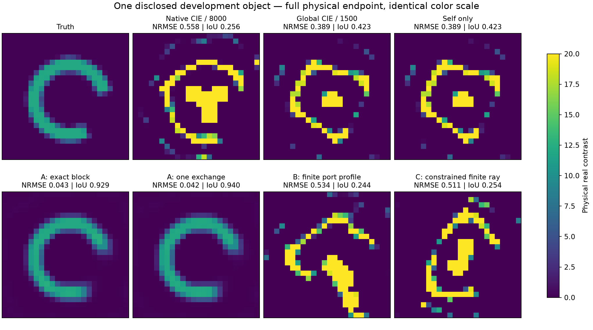
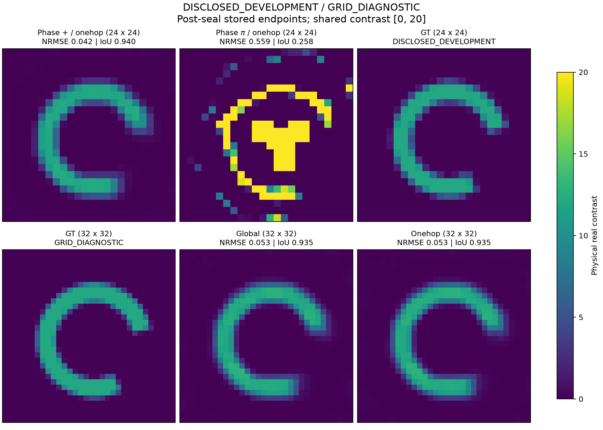
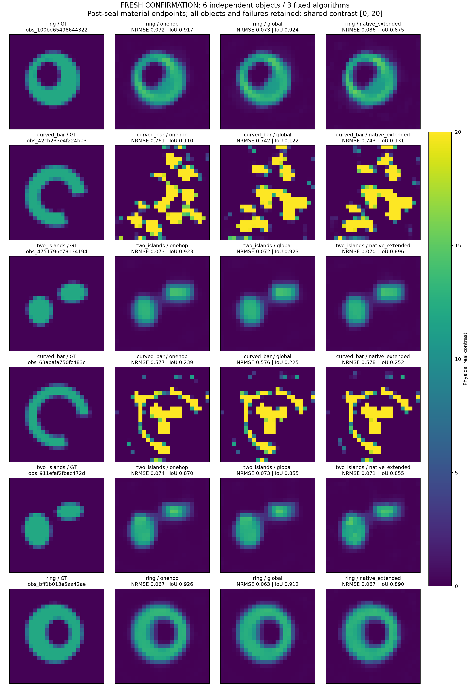
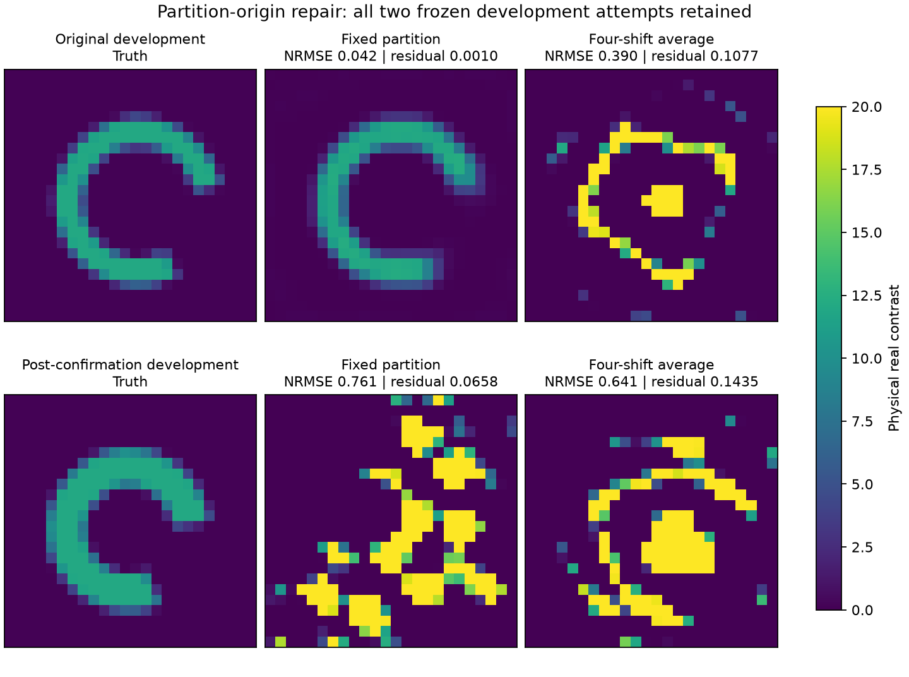

# MAX-STRUCT-R4：从 CIE 公式到空间残差传播

本轮沿 R3 继续研究用户引用的 [CIE机制公式解析](sources/CIE_SESSION_REFERENCE.md)，明确验证原候选 A、B、C。**A 在一个历史困难弯条上带来真实材料恢复，并可缩成一次邻域交换；但六对象新鲜确认没有超过成熟 CIE，网格细化和分块平移平均也暴露了适用边界。B、C 的已测版本没有产生新成像收益。当前不能称已经得到成熟、普遍优于 CIE 的新算法。**

有价值的结果是：识别了非局部残差权重改变材料读出的准确条件，完成了一个简单物理兼容算法、反相控制、新鲜确认、表示敏感性和失败后结构修正。没有用更低 residual、额外 prior、更多观测或 GT 选根代替材料恢复。R1/R2/R3 冻结证据不改写。

直接阅读：[A/B/C逐项答复](ABC_VALIDATION_ZH.md) · [完整推导](THEORY_DERIVATIONS.md) · [理论状态](THEORY_STATUS.md) · [独立审查](audit/INDEPENDENT_REVIEW.md) · [复现](REPRODUCE.md) · [费用](COST_LEDGER.md) · [失败记录](FAILURES.md)。

## 1. 真实模型、数据和评价

复用现有二维 scalar-TM Hankel–Green disk-pulse VIE，未新造正演器。采用 `exp(−iωt)`、`λ0=1`、`k=2π`、背景ε=μ=1；实 contrast `m=εr−1∈[.02,20]`，相对对比源 `j=mE`，物理极化电流另乘 `−iωεb`。原始方程为：

```text
j = X(Einc + G j),  X=diag(m)
F(m) = S(I−XG)⁻¹ X Einc
Phi(m) = 0.5 ||F(m)−Y||² / ||Y||² + R(m)
```

24×24 网格，576个实材料自由度，12个外部线源、48个外部接收器；ROI宽约.96λ0，网格间隔.04λ0、脉冲半径.018λ0。所有方法用同一完整多重散射 resolvent、公开 box 和历史 smooth/TV prior（各1e−4，width19.5，epsilon.01）。Fourier/APCS 实现来自成熟基线；当前小模型使用显式矩阵动作，不能把名称中的 FFT 当作本轮已实际发生的 FFT 加速。

这是真实有限全波二维模型，不是三维矢量 Maxwell 或连续 PDE 证书。3D 新反演、R1 的 H(curl) 表示资格和非空单调性证书均没有被本轮二维结果替代。已有 R1 张量同场族和 Z-ALG-E1 连续材料图册的范围继续保留，不重复声称首次发现多解。

开发对象是 R2 已公开弯条 `obs_b20d5a55677d4eca`，不能算新盲测。新鲜确认在算法冻结后一次生成六个独立材料（环、弯条、双岛各两个），opaque ID 不带家族，GT/clean Y/mask/seed 不进入反演或远端包。全部18个预测封存、按公共 Phi 固定候选选择后才评分。

噪声为独立复高斯 CN，实/虚方差各σ²/2，σ为复幅度标准差。噪声判断用 `||F−Y||/σ≤25.1654222`（576复观测，99%半径）；历史归一化 Phi 与噪声 whitening 的尺度关系见 [数据合同](DATA_CONTRACT.md)。材料指标固定为 RMSE/12、预测自身 Otsu256 阈值的 IoU；沿用 .15/.7 门，仅作逐例描述，未重新调门槛或制造显著性。

## 2. 从公式得到的 A：传播本构缺陷，而非近似正演

令 `r=j−XQ`、`Q=Einc+Gj`，取实际 Green 矩阵中固定2×2空间单元块 Gin：

```text
Kβ = I + X(βI−Gin)
Rexact = β Kβ⁻¹ r
```

Gin=0 回到普通 CIE。只要变换可逆，其状态零集仍是完整原 Maxwell 方程；但离开物理解时，目标和路径会改变。因此有待验证的是有限缺陷的优化几何，而不是把等式重写本身当作成像贡献。材料梯度包括 Kβ 对 m 的导数，不能把它冻结后仍称精确梯度。

分离自项，令 `D=I+X(βI−diag G)`、`L=D⁻¹XGoff`、`u=βD⁻¹r`，则：

```text
Rexact = (I−L)⁻¹u
Rplus  = (I+L)u
||Rexact−Rplus|| ≤ q²/(1−q) ||u||,  q=||L||<1
```

最后一式只在所用的同一个范数中成立。公开24网格整个合法材料盒的解析∞范数上界为 .16810（β=.2）和 .03784（β=1）。一次交换因此保持原状态零集，只需固定邻接矩阵动作和标量复除法，额外复杂度 O(Ns)，不需要小 LU。最终数据排序和 corrector 始终使用完整原物理 forward，未截断多次散射。

算法保留成熟 mf3/6/10、各500步的双β调度（current β=1、后两阶段 material β=.2）、同 source metric 和 global PR。普通 global CIE 是直接机制对照；另给原 sourcewise CIE 追加 mf12、6500步，总8000步。三者最终都接同一原物理 L-BFGS-B corrector，1000步上限，物理目标统一缩放1e6以使数值停止尺度一致。

## 3. 开发正例、反相控制和网格边界



| 开发端点 | RMSE/12 | IoU | 原物理相对残差 |
|---|---:|---:|---:|
| 成熟 sourcewise CIE，8000步 | .557674 | .255814 | .0977066 |
| global CIE，共同 corrector | .389183 | .422680 | .107821 |
| 只吸收 diagonal self | .389418 | .422680 | .107821 |
| 精确四单元吸收 | .042654 | .928571 | .0009670 |
| 缓存版精确吸收 | .041691 | .928571 | .0009695 |
| 一次交换 Rplus | .041672 | .939759 | .0009679 |
| 同幅反相 Rminus | .558703 | .257813 | .0976930 |

同物理数据、最终 prior 和 corrector 下，A 确实改善了这个对象的材料图。仅 diagonal self 和额外普通模态/迭代没有复制收益。它在 corrector 前已较好：一次交换 mf10 的 RMSE/12=.08327、IoU=.77451；corrector 后 .04167/.93976。global/self 的 corrector 则降低 residual 同时恶化材料。所有开发 corrector 都触及1000步上限，不据此认证吸引域或局部最优。



π反相只令辅助 `Goff→−Goff`，真实 forward G 不变。两罚函数都保留 `||u||²`、`||Lu||²`、相同 metric 对角、图拓扑和逐次运算结构，只翻转 `2Re⟨u,Lu⟩`。反相失败支持符号/相位方向在该实例中有作用，不能外推为真实 Green 相位对所有对象最优。

一次32×32诊断使用同192像素几何、同源/接收、同 Fourier 容量和 prior 数值参数。onehop/global **都恢复**：RMSE/12=.053068/.053102，IoU都 .935484，残差都约 .0009705。A 在24网格上的比较优势没有保持。这里同时改变有限脉冲离散、块物理宽度和噪声实例，不能把它称严格连续 PDE 收敛，也不能省略这个反例只展示24网格。

跨平台复验使用原公开开发观测和冻结 onehop，在既有 Windows NumPy2.2.6/SciPy1.15.3 上重放；本地为 NumPy2.5.3/SciPy1.18.1。Windows 原物理残差 .00096835、Phi6.49305e−6，独立材料评分 RMSE/12=.041603、IoU=.951807，保留材料恢复正例；完整评分见增补。该次 solve wall约376.20秒，不能声称 i9 对此工作负载更快。第一次 wrapper 未加入已有 vendor 的 threadpoolctl 路径，在任何物理运算前失败，已保留费用并修正入口，未安装依赖或改算法。

## 4. 六个新鲜对象：没有超越成熟 CIE

全部预测先封存，随后首次读 GT。18个任务全部完成冻结辅助日程；没有失败任务被删掉，也没有短 wall cap 截断基线。

| 对象尾码 / 家族 | onehop RMSE/12 | global | mature native8000 | 三臂联合结果 |
|---|---:|---:|---:|---|
|98644322 / 环|.071621|.073369|.085988|均通过|
|4f224bb3 / 弯条|.761368|.741539|.743118|均失败|
|78134194 / 双岛|.073440|.072053|.069852|均通过|
|50fc483c / 弯条|.576876|.575755|.577784|均失败|
|fbac472d / 双岛|.073560|.072850|.071273|均通过|
|e5aa42ae / 环|.066619|.063476|.067396|均通过|

三方法都是 **4/6**，相同四对象成功。onehop 相对 global 的材料 NRMSE 仅1/6更低，5/6更高；IoU是3高、2低、1相同。样本小，只描述逐例，不能作统计显著性或人群优越性宣称。



预先声明的三臂候选池按同 Phi 选最小，成本为三臂总和，仍只有4/6。两个弯条恰好都选中了三臂中材料误差最差者。42cb 的 A 将 Phi从 global 的 .004105 降到 .002193，但 NRMSE从 .74154 升到 .76137。这个结果明确区分了物理拟合与材料正确；没有离线按 GT 改选。

两个失败对象的合法 GT 自身都满足声明噪声球，白化残差为25.1189、24.0092，Phi约6.54e−6、6.92e−6。因此当前高残差端点不能作为信息不可辨识的证据；它们没有达到已知可行的数据拟合区域。另一方面全部 corrector 都触限，末段目标仍下降，不能未经诊断就宣称已进入认证局部极小。

详表、候选池择劣和每个任务成本见 [确认评分](results/CONFIRMATION_SCORES.md)、[独立确认审计](audit/confirmation/CONFIRMATION_COMPARISON_AUDIT.md)、[停止诊断](audit/confirmation/FAILURE_STOP_DIAGNOSTIC.md)。

## 5. 失败后继续推导与结构修正

材料读出给出一个准确的结构判别。实化线性化写为 `b−C dm`，C满列秩，M为正定残差 metric，Π为 range(C) 的正交投影。在无prior、内点、精确根的局部问题中：

```text
D_M = (CᵀMC)⁻¹ CᵀM
D_M − C† = (CᵀMC)⁻¹ CᵀM(I−Π)
```

所有右端的读出都不变，当且仅当 range(C) 对 M 不变，即 `[M,Π]=0`。逐cell对所有源共享的正标量权重有这种抵消；跨cell权重一般没有。实际某一步改变还需 `CᵀM(I−Π)b≠0`。这解释了非局部 metric 可以把无法由局部实材料解释的 defect 分量送入材料更新，也解释了它可能有害。一个复源就可能产生这种余量；每cell只有一个实方程、C为方阵的玩具模型则会丢掉该机制。

这是已有加权 LS 和 R3/D1 抵消关系的结构精化，不是新发明的投影定理。实际算法存在 prior、活动 box、非零状态 defect、不精确内层和双β，因此不能把这个局部等式直接当完整迭代的收敛定理。

由确认失败进一步提出一次无调参修正：平均四种2×2分块平移的传播，得到水平/垂直邻边权重1/2、对角邻边1/4；边界不周期 wrap。权重来自分块包含概率，保留相同解析可逆界，但去掉任意 parity 起点。它平均的是 residual transport，不是四个平方目标。

该版本只作两个**已暴露开发诊断**：旧正例和按 public 数据不合格、opaque ID最小选出的42cb。两个结果都失败：旧正例残差 .107660、材料NRMSE .38972；42cb残差 .143491，NRMSE从原onehop的 .76137下降到 .64140。这是保留的局部材料指标改善，但仍未成像且数据残差恶化，不能用GT优选它。没有调权重、β或停止规则救回结果。它不能改变原6对象/18端点的确认分母。这否定了“只需去除分块起点即可修复迁移失败”的具体解释，也表明原正例依赖更细的优化路径。



六次新原物理梯度诊断只评估已有失败端点，新增6LU/144RHS，没有优化或GT访问。box投影梯度范围约2.28e−7至8.94e−6，高于原1e−8停止目标；随后为第一个公共失败对象的 A/native 各给同额额外4000步原物理续跑额度。native实际3361步达到原投影梯度目标（7.46e−9），残差仍 .088672，表明这个基线的失败不能只归因原1000步太短；这仍不是局部极小或唯一性证书。A在251步因函数相对下降停止，投影梯度3.87e−6仍未达标，残差 .065584，属于数值停滞而非认证收敛。独立评分中，native材料NRMSE从 .743118恶化到 .750890；A为 .760862，也未恢复。新端点见[续跑评分](results/DEVELOPMENT_CONTINUATION_SCORES_V1.md)，原确认18预测和4/6不改。

## 6. B 和 C 得到什么

**B：纯 port-only 消元会回到原目标。** 对自由全 current 的二次端口罚函数精确消元，只得到原数据残差的正比例缩放和材料无关常数。加入固定 `eta>0` 后才得到材料相关 metric：

```text
C = S(I−XG)⁻¹
M = (eta I + lambda CC*) [eta I + (1+lambda)CC*]⁻¹
```

本轮实现含 resolvent 变化的精确 envelope 梯度；eta仅由公开 host固定。lambda=0 的 WRI/state控制和lambda=1各250辅助步，再接同 corrector。lambda=1残差 .093255，但材料NRMSE .533540，IoU .244094；lambda=0也失败。有限eta确实改了几何，但没有成像收益；不继续扫eta找正例。改变辅助 metric 与未缩放 prior 的相对作用也被明确保留，不能只凭 prior 名称相同排除这种影响。

**C：完整有限响应没有给出可用逃逸方向。** R3端点自由面33维最小曲率为正，而全空间有负曲率；box切锥投影破坏了协同符号抵消，使两方向曲率转正。四条固定完整有限射线无改善；进一步两次固定500步 box二次模型修正仍无有效射线。保留了原完整 Maxwell 有限响应，失败来自方向/可行性及预算范围，而不是人为 Born 截断。没有全 box/global 证书，也没有用GT差方向构造伪成功。

另保留 DCTMC式非局部 T完成、照明加权局域化和 reciprocity/光学定理诊断。T可高度拟合通道却不能局域化成正确材料；其更低 residual 未改善材料。已测 reciprocity 修正落入极弱可见 current 方向，代价巨大，没有据此新增硬约束。它们均在 [研究循环](RESEARCH_LOOP.md) 和失败记录中说明如何分析、修正、转向。

## 7. 计算成本与可复现性

六对象确认复用现有 i9 四个 CPU worker 的有限 FIFO 队列，无新服务、无CUDA安装，实际GPU任务为0。计入共享生成一次，总 **18653次576维物理LU、445932个complex RHS**。前台远端实测 elapsed **1179.03秒**；记录CPU约3804.34秒。worker wall累计3900.01秒不是并行历时。

| 六任务工作 | 物理LU | complex RHS | worker wall累计秒 |
|---|---:|---:|---:|
|onehop|6202|148332|1147.09|
|global|6216|148680|577.95|
|native8000|6229|148848|2174.97|

onehop比普通global消耗更多内层计算，没有等算力优势；native得到更多普通模态/迭代，但仍不能把它视为所有CIE日程的充分收敛。小4×4 LU、稀疏邻接动作、标量除法、源/接收RHS和满维物理LU单独记账，不能混加成一个“forward次数”。32网格1024维、微型接线16维也与576维分列。拒绝候选、数值负结果、缓存回放、入口失败和重复上传都保留。

全轮已记录物理总量为38757次LU、980383个model complex RHS：其中576维36698/931161，1024维2054/49116，16维接线5/106；另有非局部局域化30次LU/17280RHS，不混作物理LU。全轮开发、验证、确认、后续诊断及后处理的最终总账见 [COST_LEDGER](COST_LEDGER.md) 和 `audit/cost_ledger/`。金额、LLM/API收费、部分早期bootstrap CPU没有可核定数据，写null而不是零。未核验SHA；普通git基版本、冻结配置与执行源码快照用于来源记录。

代码入口、公共数据重放、原始数组和环境版本均交付。既有Windows和本地软件栈实际版本见 `audit/ENVIRONMENT.json`。新的子任务明确配置 Sol medium（整理/单篇读取/绘图）或 Sol high（数值/评分/独立审查），父线程保留数学和最终判断，见 `audit/MODEL_ASSIGNMENTS.md`。

## 8. 论文价值和下一步

不能宣称发明了 Green 分解、材料相关 CSI 预条件、T重整化、Neumann展开、加权LS或完整物理Hessian。2000年的 [preconditioned CSI](https://doi.org/10.1109/36.851966)、[NIE/CIE与重写综述](https://doi.org/10.1109/OJAP.2021.3063248)、[CIE-I/SOM](https://doi.org/10.3390/jimaging5020027)、[DCTMC](https://doi.org/10.1103/PhysRevE.94.043318) 都有直接相邻先例；原文可得和未决部分在文献账本中区分。

**已成立的成像收益**限于旧24网格开发对象，经过反相、self、成熟扩模基线以及跨平台复验。**未成立的主张**是新鲜分布上的成像成功率或等成本优势。B/C的已测方向也未突破。最有研究价值的是“同物理零集不等于同材料更新”、本构切空间不变性判别，以及正例如何随分块/网格改变而消失的反例；目前更适合机制与失败边界研究，尚不足以独立支撑普适优越算法论文。

下一步应直接分析 `CᵀM(I−Π)b` 在成功/失败路径中的物理方向性，区分可解释的材料改变量与错误反馈，不继续挑分块、扫β或叠加网络。已保存的状态、完整数据和新投影梯度让这个问题可以从小量有内容的诊断开始。不能用两个失败弯条证明数据不可辨识，也不能把新增照明的可能收益混入本轮同数据比较。
